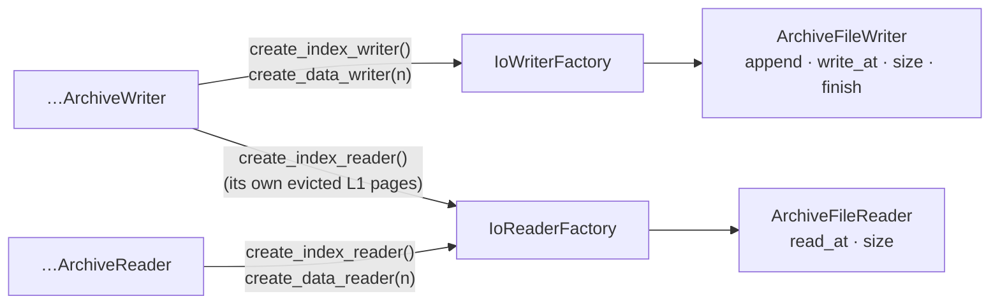
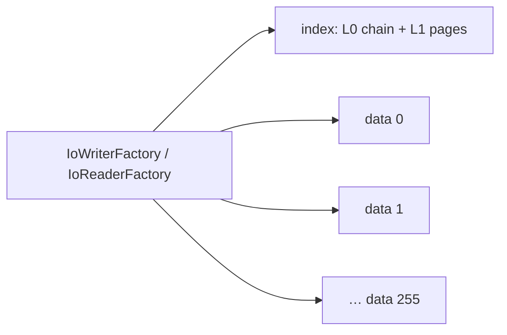
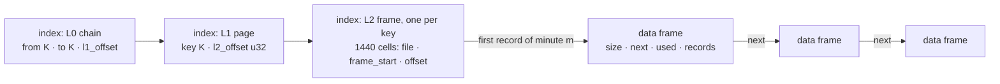

# archived-data

Archives that are **written once and read back by key**, from wherever their files live — local files
or objects in S3.

Nothing in this crate knows what is stored. A storage shape is described by traits the caller
implements; the crate owns the pages, the indexes, the caches and the checks. Nothing in it knows where
the bytes are either: the split structures reach their files through two small IO traits handed out by
ROLE, and the older `…SingleFile` structures through `AsyncRead + AsyncSeek`.

It depends on `tokio` (sync and io traits, `fs` and the blocking pool for local files) and `rust-extensions` and
nothing else, so it can leave this repository as it is.

## Modules

| Module | Shape | For |
|---|---|---|
| [`fixed_key_preallocated_slots`](src/fixed_key_preallocated_slots/README.md) | A fixed-size primary key owns one preallocated page of fixed-size slots. The slot is addressed by position — every period of a fixed calendar. | Aggregated data: one row per key per period, every period of the archive known in advance. Split: `FixedKeyPreallocatedSlotsArchiveWriter` / `…Reader`; SingleFile: `…WriterSingleFile` / `…ReaderSingleFile`. |
| [`variable_key_preallocated_slots`](src/variable_key_preallocated_slots/README.md) | The same, with a primary key of 1 to 32 767 bytes behind a length prefix. L1 pages are sized in bytes and split by bytes; a compact L1 page is capped at 1024 keys and 16 KiB. | The same data, keyed by something that has no fixed width — a name, a path, a composite id. Split: `VariableKeyPreallocatedSlotsArchiveWriter` / `…Reader`; SingleFile: `…WriterSingleFile` / `…ReaderSingleFile`. |
| [`fixed_key_minute_indexed_records`](#fixed_key_minute_indexed_records--a-day-of-records-with-a-minute-index) | ONE day: a fixed-size key owns variable-length records in time order, in a chain of 32 KiB data frames, with a minute index of 1440 cells. Split archive only. | History: every deal of every account of one server-clock day, read back by account and time range. `FixedKeyMinuteIndexedRecordsArchiveWriter` / `…Reader`. |
| [`global_day_index`](#global_day_index--which-days-a-login-has-data-on) | ONE file per server: for every login, a bitmap of the days it has data on, by year. Not split, rebuilt whole. | Opening only the day archives of a period that hold something. `GlobalDayIndex` / `GlobalDayIndexReader`. |

Records carry their strings as Pascal strings: [`write_pascal_string` / `read_pascal_string`](#strings-inside-a-record-pascal-strings).

The two preallocated modules differ only in the key. The data page, the frame chains, the data files, the caches, the
writer's refusals and the reader's `get` / `get_range` / `keys_count` / `compaction_plan` /
`write_compacted_to` behave the same way in both (and, for SingleFile, `get` / `keys_count` /
`compacted_len` / `write_compacted_to`).

## IO: roles, not files

The split structures never open a file. They ask a factory for a ROLE — the index, or data file `n` —
and get back an object that reads or writes that one file. What it is called, where it lives and whether
it is a file at all is the factory's business, so the same archive is written to local files and read out
of S3 by swapping the factory.



| Trait | Contract |
|---|---|
| `ArchiveFileWriter` | `append(&[u8])` writes at the end and returns the offset the bytes start at. `write_at(offset, &[u8])` overwrites bytes already written; a range past the end is `InvalidInput` — a file grows only by append. `size()`. `finish()` confirms the file and returns a `Send + 'static` future: it runs once, a second call is `Ok`, and `Drop` spawns it if it was never called. `finish` and `Drop` alike mean "what was written to THIS file is persisted" — never "the archive is complete". |
| `ArchiveFileReader` | `read_at(offset, len)` returns EXACTLY `len` bytes; a range past the end is `UnexpectedEof`, never a short read. `size()`. No position is held, so concurrent reads of one file need not wait on each other. |
| `IoWriterFactory<W>` | `create_index_writer()`, `create_data_writer(no: u8)`: a new EMPTY file. |
| `IoReaderFactory<R>` | `create_index_reader()`, `create_data_reader(no: u8)`: a file that does not exist is an `Err`, never an empty reader. |

Every trait method returns a `Send` future, so an archive is written, read and compacted inside
`tokio::spawn`. An `io::Error` from any of them becomes `ArchiveError::Io`. A writer that must read its
own pages back gets its readers from a factory implementing both traits, whose readers see every byte its
writers wrote.

### The implementations

| Implementation | Where the files are | Public |
|---|---|---|
| `LocalFileIo` · `LocalFileWriter` · `LocalFileReader` | one local DIRECTORY per archive: the index is the file `index_file_name()` = `index`, data file `n` is `data_file_name(n)` = `data00` … `dataff` (two lowercase hex digits) | yes |
| `InMemoryIo` (`in_memory_io.rs`) | memory, with counters, failures and gates | tests only |

An S3 implementation is the service's: it needs an S3 client, which this crate does not depend on. Name its
objects with `index_file_name()` / `data_file_name(n)` under one prefix per archive, and a directory compacted
with `LocalFileIo` uploads file by file under the same names.

`LocalFileIo` implements BOTH factories, so the working writer — which reads its own pages back — runs over it,
and so do a reader and a compaction's output. What it does beyond the trait contract:

- **`create_*`** creates the directory when it is missing, removes a file already there under the name and
  creates a NEW one. A reader opened on the old file keeps reading the old bytes (on unix the file is unlinked,
  not cut), exactly as over `InMemoryIo`. **It removes only the files it creates**: a compaction into a directory an
  earlier compaction with MORE data files wrote leaves the extra `dataXX` behind, which no index names. So what
  belongs to an archive is the plan's `data_file_sizes().len()` data files and the index — never a listing of
  the directory — or the directory is emptied first.
- **`create_*_reader`** opens a file that exists; a missing file, or a missing directory, is `NotFound` and
  creates nothing.
- **IO is positional** — `pwrite` / `pread` on unix, `seek_write` / `seek_read` on Windows — each call on
  tokio's blocking pool. A reader holds no position and no lock, so concurrent reads of one file run side by
  side; every byte of a writer's call is in the file when the call returns, so a reader of the same file, even
  one opened earlier, sees it; `size()` of a reader is the file's size at the moment of the call.
- **The writer** is the shape `ArchiveFileWriter` prescribes: `Arc<tokio::sync::Mutex<Option<Inner>>>`, the
  guard held across the file IO so appends take their offsets in call order. `append` writes at the size it
  counts and returns it; a failed `append` cuts the file back to where it started. `write_at` past that size is
  `InvalidInput`; a failed one can leave its range partly written. Neither is cancel-safe: dropped halfway, the
  bytes may still land — the archive writers refuse every later call after a dropped one anyway. Any call after
  `finish` panics, naming the file.
- **`finish` is `sync_all`** of the file's content. It does not sync the directory entry of a new file: a crash
  of the MACHINE can lose a file whose `finish` returned. That is enough for a working copy that is rebuilt from
  its source; a file that must survive a crash on its own — the global day index — is written under a temporary
  name, synced and renamed by its owner (see "What the archiver owns").
- **`Drop`** of a writer never finished runs the sync on the blocking pool, or on a thread of its own when the
  writer outlived its runtime; a failure there panics where it runs, naming the file, because nobody is left to
  return it to.
- **`read_at`** checks the file's size first, so a range past the end is `UnexpectedEof` with no read and no
  allocation — `len` 0 included, and an offset past the end of any file.

## Shared by every module

Only what depends on the KEY lives inside a module. Everything else is at the crate root, so every
shape reads and writes it the same way:

| File | What |
|---|---|
| `preallocated_slot_key.rs` | `PreallocatedSlotKey` and its internal range check |
| `preallocated_data_item.rs` | `PreallocatedDataItem` and its internal byte-count check |
| `page_cache.rs` | the reader's page cache: `RwLock` map, `last_access` stamped under the read lock; the split readers resize it at once — also under a write lock already held, so a test can land a resize between a miss and its insert — and insert within its capacity |
| `writer_page.rs` | a writer's cached page: its value, whether it is dirty, when it was last used |
| `cache_defaults.rs` | the default cache sizes of every reader (10 pages) and writer (64 L1, 1024 data pages) |
| `le_bytes.rs` | little-endian field readers |
| `calendar.rs` | the proleptic Gregorian calendar over day counts, for any `i64` of microseconds: civil dates, and a moment written out in a message without `chrono` |
| `pascal_string.rs` | `write_pascal_string` / `read_pascal_string`: strings inside a record |
| `archive_file_writer.rs`, `archive_file_reader.rs` | one file of an archive by ROLE: append / write in place / finish; exact reads at an offset |
| `io_writer_factory.rs`, `io_reader_factory.rs` | the index and data files `0 ..= 255` of one archive, asked for by role |
| **SingleFile** | |
| `data_page.rs` | the data page: `size u32 · next u64 (0) · item_len u16`, then `SLOTS × ITEM_LEN` |
| `l0_chain.rs` | the L0 CHAIN framing: `size u32 · next u64 · count u32`, then the module's entries |
| `source_io.rs` | a ranged read that stops at the end of the file, a read of a page that states its own size |
| `positioned_sink.rs`, `writer_data_pages.rs` | the writer's sink that skips needless seeks, and its preallocated data pages |
| **split archive** | |
| `split_limits.rs` | the 4 GiB index, the 256 data files, the 4 GiB data file — and the checks that refuse past them |
| `split_frame.rs` | the frame header every split frame starts with: `size u32 · next u32` then `count u32 · hash u64` (L0), `count u32` (L1) or `item_len u16` (data) |
| `split_l0_hash.rs` | the L0 header hash: FNV-1a 64, written out, over a format constant and the three header fields |
| `split_frame_chain.rs` | reading a frame and its continuations, or only their headers, over a `SizedReader` |
| `split_data_page.rs` | the split data page: `size u32 · next u32 · item_len u16`, then `SLOTS × ITEM_LEN`, across a chain |
| `split_l0_chain.rs` | the split L0 chain: laying it out on a working index — continuations first, frame 0 LAST, behind a hash that does not verify until the flush completes — reading it back, and refusing, with no read, an L0 that names L1 pages past the end of the index |
| `split_l0_interval.rs` | an L0 interval — `from · to · l1_offset` — the same type in every module, the check that an L1 page spans it exactly, and the lookup of the interval holding a key |
| `split_working_flush.rs` | the flush of a working archive, in its one order: L1 pages, data pages, L0 continuations, frame 0 last — or nothing at all when nothing was written since the last flush |
| `split_reader_index.rs` | a split reader's open — L0 read and decoded, an index cut before or inside its last L1 page refused — and its count of keys |
| `split_reader_pages.rs` | a split reader's walk from L0 to an L1 page and a data page through its caches, and `get`'s items; a cached L1 page is checked against the interval that asks for it. The L1 walk is generic over what an entry holds besides its key — a data page, an L2 frame, a login's year blocks |
| `split_range_l1_pages.rs` | a range's L1 entries: the intervals it touches, their cached pages, and the uncached ones that lie back to back in the index read with one `read_at` per run of at most 8 MiB, each checked as a load of it alone is, and cached |
| `data_ref.rs`, `data_file_layout.rs` | `file_no u8 · offset u32`, and where the page of the key of rank `n` lands with rollover |
| `append_frontier.rs` | a file that grows only by append: offsets reserved ahead of the bytes |
| `split_index_writer.rs`, `split_data_writers.rs` | the writer's index file and data files over that frontier, and the one write that spoils frame 0's hash before the first byte either of them gets after a completed flush |
| `split_key_placement.rs` | where a split writer puts a new key — a new page, an insert, a split into the next page or into a new one — decided before anything changes |
| `split_writer_data_pages.rs`, `split_writer_l1_pages.rs` | the split writer's preallocated data pages and its L1 pages, cached and appended in file order |
| `writer_page_cache.rs` | the split writers' page cache: the least recently used page found in `O(log n)` |
| `finish_split_writers.rs`, `in_flight_guard.rs` | finishing the index and every data file; refusing every call on a writer whose earlier write or flush failed or was dropped |
| `sized_reader.rs`, `lazy_data_readers.rs` | a reader that knows its file's size and clamps every read to it; data files opened on first use, once |
| `split_data_runs.rs`, `split_range_items.rs` | `get_range`'s data pages: neighbouring pages of one data file read with one `read_at` per run of at most 8 MiB, each page checked; the items of every key of a range, its pages read in file order and handed back in key order |
| `compaction_plan.rs`, `compact_l1_page_plan.rs` | the sizes of a compaction worked out first: `CompactionPlan`, one type for every module |
| `compact_index_writer.rs`, `compact_data_files_writer.rs` | the compact index and data files written from a plan, append only, and checked against it |
| `local_file_io/` | `LocalFileIo`, `LocalFileWriter`, `LocalFileReader`: both factories over a local directory, and `index_file_name` / `data_file_name`; see "The implementations" above |
| `in_memory_io.rs`, `split_test_frames.rs` | tests only: both factories in memory, with counters (`write_at`s also by the range they wrote), failures (of reads, appends, `write_at`s and finishes, at once or after a number of calls, also on a file prepared before the archive creates it; a failed finish names its file) and gates that park reads, or writes — every one, or every one after a number of them; frames built by hand, and reads and patches of a file's bytes |
| `split_test_io.rs`, `test_items.rs` | tests only: what every module's split tests do with the files of an `InMemoryIo` — and with a call polled one step at a time, to stop it where a test wants it — and the slot, the item and the xorshift every module's tests write with |

### L0 is a chain

Frame 0 is always at offset 0. `next` is the absolute offset of the continuation frame, `0` on the
last one, so L0 has no fixed limit.

- **Working archive**: frame 0 is reserved at offset 0. When L0 no longer fits the frames it has,
  continuation frames of the same reserved size are allocated at the END of the file (for the split
  archive, of the index). L0 never shrinks, so a continuation is never given back. A SingleFile flush lays
  L0 across the chain in order: frame 0, then the continuations already allocated, then new ones only if
  needed. A split flush writes frame 0 LAST — the continuations first, in chain order, then frame 0's
  entries, then its header — behind a hash spoiled before the first byte written since the last flush:
  see "A working archive opens only when its last flush completed and nothing was written after it" below.
- **Compact archive**: always ONE frame of exactly the size its entries need, `next = 0`.
- **Reader**: follows `next`, joins the entries of every frame, and keeps all of L0 in memory with no
  lock. A continuation always lies past the end of the frame pointing at it. A `next` pointing into
  frame 0, back into an earlier frame, in a cycle, or past the end of the file means the archive is
  `Corrupted`. So do intervals that are not ordered and disjoint across the whole chain.

## The split archive: an index and data files 0..=255

Both modules read, write and compact the split archive, through the IO traits above. The `…SingleFile`
structures keep reading and writing the older one-file format, which is what the objects already in S3
are.



Every frame starts with the same prefix, little-endian:

| frame | header | body |
|---|---|---|
| L0 | `size u32 · next u32 · count u32 · hash u64` = 20 B | `count × (from · to · l1_offset u32)` |
| L1 | `size u32 · next u32 · count u32` = 12 B | `count × (key · data_ref 5 B)`, ascending |
| data | `size u32 · next u32 · item_len u16` = 10 B | `SLOTS × ITEM_LEN` |

`hash` is FNV-1a 64 over the ASCII bytes `archived-data/split/L0/v1` followed by `size`, `next` and
`count` as their little-endian bytes. It is the format's only identity, and it is checked on every L0
frame before anything else in the frame is trusted: a file that is not a split index — a SingleFile
object, random bytes — is `Corrupted` at open, instead of an archive that holds no keys. Once L0 is read,
`open` also checks, with no read, that every L1 page it names has its header inside the index, and with
ONE small read — the 12-byte header of the page at the highest `l1_offset`, and of any continuation it
chains to — that this last page ends inside the index. An index grows only by append, so only its last
page can be cut: an index cut anywhere after its L0 is refused at open, not at the first key read. That holds
for every index whose last bytes are an L1 page: every index of the preallocated modules, and a COMPACT index of
`fixed_key_minute_indexed_records`. A WORKING index of that module can end with L2 frames, past its last L1
page; there only frame 0's hash proves the index whole, and one cut inside a trailing L2 frame opens, then
answers `Corrupted` at the first read of that key.

A key is `LEN` bytes in the fixed module, and a length prefix followed by the key bytes in the variable
one, whose L0 and L1 entries end at a `0x00` prefix or at the frame's end. `data_ref` =
`file_no u8 · offset u32`. `size` is the whole frame including its header; `next` is the absolute offset
of a continuation frame in the SAME file, `0` = none. A continuation always lies past the end of the frame
pointing at it: a `next` into the frame itself, backwards, or past the end of the file is `Corrupted`. The one
exception is a data chain of a WORKING `fixed_key_minute_indexed_records` archive, where a frame chained between
two others is appended at the end of the file and points BACK at the next one; a cycle there is found instead by
counting — the writer refuses a walk of more hops than its data file has frames, and a reader a walk that
returns to a frame it visited.
Writers write continuations only for L0; readers follow `next` on L0, L1 and data frames. Entries never
straddle frames: each L0 and L1 frame carries its own `count`. A data page chained over several frames is
their bodies joined, which must total exactly `SLOTS × ITEM_LEN` with the same `item_len` on every frame.

Limits, all field widths: the index may not grow past `u32::MAX + 1` bytes (4 GiB), a data file holds
at most 4 GiB (`max_data_file_bytes`, settable down to one data page), and there are 256 data files. A
page goes into the current data file only if it fits whole; otherwise the next file starts. A write or
a compaction that would cross any of the three is a `ContractViolation`.

An L1 page that overflows is split only when it has to be: a key past the last key of the last page
starts a new page, so keys written in ascending order fill every page; any other overflow splits the
page, and the upper part moves in front of the next page's keys when it fits there.

Every read is exact (`read_at` returns exactly `len` bytes or `UnexpectedEof`), so a reader learns each
file's size once and clamps every speculative read to it: the usual page is still one `read_at`, and a
header whose size reaches past the file is `Corrupted` without a read past its end.

### Writing: a refusal changes nothing, a failure stops the writer

- **Where a new key goes is decided before anything changes**: its page, and the next one when the page
  overflows, are read into the cache, and every refusal is made, before the key's data page is placed.
  The page is then cut and its upper part placed with no await in between, so a write that fails or is
  dropped never loses a key written before it.
- **A refusal leaves the writer usable**: a slot, an item or a key out of contract, a key needing data file
  256, a key needing index room past 4 GiB — the room counted with the L0 continuations the next flush
  will need, so a flush never runs into the limit. With variable keys those continuations are bounded
  rather than counted, by the smaller of a bound by interval count and one by L0 bytes, so one long key
  costs a frame or so, not half the index.
- **Any other `Err`, or a `write` / `flush` future dropped before it returned** — neither is cancel-safe —
  leaves every later `write`, `flush` and `finish` refused as a `ContractViolation`. A call is marked in
  flight on the way in and cleared only on its `Ok`, because a dropped future runs no error path.
- `finish` flushes, then finishes the index and every data file, each awaited even after another failed,
  and returns the flush's error first. A writer dropped without `finish` leaves every file writer's `Drop`
  to finish what reached it. Neither says the archive is complete: what does is below.

### A working archive opens only when its last flush completed and nothing was written after it

The index of a working archive exists from the moment its writer is created, so its existing says
nothing. What says the index describes its files is frame 0's hash:

- the writer creates the index with frame 0's hash INVERTED, so an index no flush has completed on is
  refused at open as `Corrupted` — never an archive that holds no keys;
- a flush writes the L1 pages, the data pages and the L0 continuations, and writes frame 0 — its entries,
  then its header with the real hash — LAST;
- the FIRST byte to reach the index or any data file after a completed flush — an L1 page or a data page
  leaving its cache, rewritten in place or appended; a new key's data page appended at once with no data
  cache; an item written straight into a data page that is not cached; or the flush's own first write — is
  preceded by one 8-byte `write_at` that spoils that hash in place. Later bytes before the next completed
  flush find it spoiled and cost nothing more, and a flush with nothing written since the last one writes
  nothing at all.

So **a working archive opens only when its last flush completed AND nothing was written to its files after
it; otherwise `open` is `Err(Corrupted)`** — whether the writer never completed a flush, stopped halfway
through one, or stopped after anything reached a file since its last one. It is never an archive that
opens and answers `None` for a key a flush saved, or answers what no flush saved. A `write` whose changes
all stayed in the writer's caches wrote nothing to the files: it is not in the archive, and does not stop
it from opening. A spoil that fails stops its call before any byte of the call's own is written. Only
`finish` returning `Ok` says everything written is in the archive.

### Compaction: the data files first, the index LAST

`write_compacted_to` writes and finishes every data file in order, then the index. Every data page's
place is a closed form of the plan, so the index needs nothing from the data pass, and **a compact archive
is complete when its index exists and opens**:

- a compaction that fails in its data pass leaves no index — `open` fails on the missing index;
- one that fails in its index pass can leave a short index behind (a writer dropped unfinished persists
  what reached it, and a failed append may leave part of a page), and `open` refuses it as `Corrupted`:
  its L0 names an L1 page that starts past its end, or its last L1 page ends past it.

So the check that a compaction completed is `open` succeeding on its output, not the index object
existing.

Compaction is **deterministic**, so two runs over one archive write identical files. That rests on one
condition: `max_data_file_bytes` decides which data file every page lands in, so it must be the same for
every run of one archive.

### Reading a range

`get_range(from, to, from_slot, to_slot)` returns every key between the two bounds, inclusive and in key
order, with its items of slots `from_slot..=to_slot`, all at once.

- **L1**: the intervals the range touches are found in L0, in memory. A page already in the L1 cache comes
  from it; the pages that are not, and lie back to back in the index, are read with ONE `read_at` per run
  of at most 8 MiB, each decoded and checked as a load of that page alone is, and inserted into the cache.
  A page's size is known only once it is read, so a page is taken to follow the one before it when it
  starts at most one default page length after it — in a compact index, exactly the pages back to back; a
  chained page, or one longer than its run's read, is loaded on its own. Every page, cached or just read,
  must span the interval that asks for it exactly, or it is `Corrupted`. So a wide range of a compact
  archive costs a handful of index reads, and the same range again, with a cache that holds its pages,
  none.
- **Data**: the pages are read in FILE order — the refs sorted by `(file_no, offset)` — with ONE `read_at`
  per run of pages that follow one another in a data file, at most 8 MiB, without filling the data page
  cache, and the items are handed back in key order. A contiguous range of a compact archive, and a dense
  range of a working archive whatever order its keys arrived in, is a handful of reads; a sparse range of
  a working archive still costs about a read per key, because its pages have gaps between them.
- `from > to` reads nothing, `from_slot > to_slot` reads no data page, and a failed read or a damaged page
  anywhere is an `Err`, never a partial answer.
- **A prefix** (variable keys whose `Ord` is the order of their bytes): every key that starts with `prefix`,
  of any length, is `prefix ..= last_key_starting_with(prefix)` — `prefix` followed by `0xFF` up to the
  32 767 bytes a key may have. A shorter run of `0xFF` is not: `prefix ..= prefix + [0xFF; n]` holds keys
  far longer than `n` bytes past `prefix`, and misses those whose first `n` bytes past it are all `0xFF`
  and that go on.

## The shape of a use

```mermaid
flowchart LR
    R["rows, in any order"] --> W["Writer over a local factory"]
    W --> WA["working archive<br/>index + data files"]
    WA --> RD["Reader"]
    RD --> P["compaction_plan()"]
    P --> S["index_size · data_file_sizes"]
    S --> F["S3 factory built from the sizes"]
    F --> C["write_compacted_to(&plan, &factory)"]
    C --> CA["compact archive in S3"]
    CA --> R2["Reader over an S3 factory"]
    R2 --> G["get(key, from, to)<br/>get_range(from, to, …)"]
```



1. **Write** the rows into a working archive with the module's split `Writer` over a factory of local
   files — `LocalFileIo`. Keys may arrive in any order.
2. **Plan** the compaction with a `Reader` on the working archive: the plan knows the exact size of the
   compact index and of every compact data file, which is what an S3 upload needs up front.
3. **Compact** with `write_compacted_to`, through a factory built from those sizes — or into another local
   directory with `LocalFileIo`, whose files are then uploaded one by one — from a working archive
   whose writer's `finish` returned `Ok`, since an unfinished one is refused at open, or opens without what
   stayed in its writer's caches after its last flush. The compact archive depends only on the keys, the items and `max_data_file_bytes` —
   the same for every run of one archive. The data files are written first and the index last, so the
   archive is complete when its index exists AND opens: a run that fails in its data pass leaves no index,
   one that fails in its index pass can leave a short index that `open` refuses as `Corrupted`, and
   running it again replaces every file it left.
4. **Read** it with a `Reader` over a factory of the objects: L0 is read at open, data files are opened on
   first use, and pages are cached. `get` reads one key, `get_range` every key between two bounds.

### SingleFile

```text
rows, in any order ──► Writer ──► working file (.temp, local)
                                        │
                                        ▼
                                     Reader ──► write_compacted_to ──► compact file (S3, or anywhere)
                                                                            │
                                                                            ▼
                                                                         Reader ──► get(key, from, to)
```

1. **Write** the rows into a working file with the module's `…WriterSingleFile`. Keys may arrive in any
   order; pages split as they fill. This is the cheap step: it only moves data out of wherever it was.
2. **Compact** it: open a `…ReaderSingleFile` on the working file and stream `write_compacted_to` into any
   `AsyncWrite` — a file, or straight into an S3 upload. The compact file depends only on the keys
   and the items, never on the order they arrived in.
3. **Read** the compact file with a `Reader` over the object: the index is walked with a few ranged
   reads, and pages are cached.

## fixed_key_minute_indexed_records — a day of records with a minute index

The history of ONE server-clock day: a fixed-size key — an account — owns records of variable length — its
deals — kept in time order, and a minute index says where each minute of its day starts. The byte layout is
specified in the Task manager document `architecture/archived-data-history-records.md` of project RMS, agreed
with the owner on 16.09.2026; this section summarises it and records every decision the document left open.



| part | where | bytes |
|---|---|---|
| L0 | index, frame 0 at 0 | the split archive's L0 frame: `size u32 · next u32 · count u32 · hash u64`, then `count × (from K · to K · l1_offset u32)` |
| L1 | index | the split archive's L1 frame: `size u32 · next u32 · count u32`, then `count × (key K · l2_offset u32)`, ascending |
| L2 | index, one per key | `size u32` = 12 968 · `next u32` = 0, then 1440 cells of `file u8 · frame_start u32 · offset u32` |
| data frame | `.dataXX` | `size u32 · next u32 · used u16`, then `used` bytes of records; `next` is an offset in the SAME data file |
| record | inside a frame | `len u16`, then `len` bytes whose first 8 are the event's time, an `i64` little-endian of microseconds |

A cell points at the FIRST record of its minute, `minute = (time − day start) / 60 000 000`; an empty minute is
nine `0xFF` bytes, read as empty by its `offset` alone. Records of an equal time keep the order they were written
in. A key's records are one chain of frames in time order, so a read starts at the first minute from `from` that
has a record and walks until a record later than `to`. Inside a minute the records are a linear list: a record
finds its place by walking from its minute's first record, so 17 000 records of ONE minute in time order took
1.44 s to write, where the same records spread over the day took 57–98 ms.

### Writing: the working form

`FixedKeyMinuteIndexedRecordsArchiveWriter::new(factory, name, day_start)` — or `new_with_capacity` with L0
intervals per frame and L1 keys per page — creates the index; data file 0 is created with the first record.
`write(key, record)` puts the record into its place:

- **The first record of a key** allocates its L2 frame (every cell `0xFF`) and a 32 KiB data frame, sets its
  minute's cell, and inserts the key into L1 by the split archive's page rules.
- **Any other record** finds its place (§1.6): after the records of its minute no later than it; with none in
  its minute, before the first record of the nearest later minute that has one; with none, at the end of the
  chain. It goes in by the crate's one overflow rule (§1.7): into its frame when there is room, moving the
  records after it; after the last record of a full frame, into a new frame chained after it; before a record of
  a full frame, the frame is halved and the upper half moves in front of the next frame's records when they have
  room, into a new frame chained between the two when they do not. Every cell follows the records it points at.
- **Everything the insert touches is decided and read in before anything changes**, and the change is made with
  no await, as the preallocated writers place a key.
- **`flush` / `finish`, the caches, the spoiled frame-0 hash, refusals and a writer poisoned by a failure** are
  the split working archive's (above): the index opens only when its last flush completed and nothing was written
  to its files after it. Three caches: L1 pages (64, at least 1), L2 frames (1024, about 13 MiB) and data frames
  (1024, 32 MiB); 0 L2 or data frames keeps nothing between writes.
- **Panics, as the document requires**: a record whose time is outside the day, naming the archive, the record's
  time and the day's start; and a data frame that would take the data file past 4 GiB, naming the archive and the
  file's size. Both fire before anything changes.
- **Refusals** (`ContractViolation`, writer usable): a record shorter than its 8 bytes of time or longer than
  `MAX_RECORD_LEN`, a key that does not encode, a new key needing index room past 4 GiB. The room is counted with
  the L0 continuations the next flush will need for EVERY new key, not only for one that adds an L1 page: each new
  key reserves its L2 frame, so a key that fits a page already there could otherwise take the room of a
  continuation an earlier page needs, and the flush after it would run into the limit.
- **A writer an earlier call left unusable refuses first** — before it looks at the record, so a record outside
  the day is refused there, not a panic.

### Reading

`FixedKeyMinuteIndexedRecordsArchiveReader::open(factory, day_start)` reads a working or a compact archive:

- `get_range(key, from, to)` — every record with `from <= time <= to`, whole (without its length prefix), in time
  order; `get_day(key)` — every record. A key the archive does not hold is an empty list. `from > to` and a range
  wholly outside the day are an empty list that reads nothing; a range reaching past the day is clamped to it.
- `keys()` — every key the archive holds, ascending: one read of each L1 page, through no cache; keys that do not
  ascend across the pages are `Corrupted`. What a caller rebuilding the archive from its own records needs — a
  merge of late rows into an archived day (RMS-847) — since the reads above only answer about a key it names.
- What a walk meets is checked against the index: a record outside the day, a record earlier than the one before
  it, a first record of a minute that its cell does not point at, and a chain that returns to a frame it walked
  are `Corrupted`. So a reader told the wrong day answers `Corrupted` for a read that meets a record — and an empty
  list for a read that meets none, exactly as it would on the right day.
- L1 pages, L2 frames and data frames are cached like the split readers' pages (10 each by default).
- **A walk reads the frames the cache does not hold through a window of its own.** A frame the window holds whole
  costs no read. On a miss the next read starts at the frame: while the chain's frames lie back to back in the
  file the read doubles, from 32 KiB up to 512 KiB, and when the chain jumps it is one frame again. A compact key's
  run is back to back by construction, so a key of a few frames is ONE read and a day of 17 000 records (173
  frames) 14 reads; a working chain that jumps about its file reads a frame at a time. A walk holds one read at a
  time, at most 512 KiB, and a frame longer than its read — which no writer of this crate makes — costs one read
  more.

### Compaction: the compact form

`compaction_plan()` walks every record once through no cache and works out where each key's records land and the
exact size of the compact index and of every data file; `write_compacted_to(&plan, &out)` writes the data files
first and the index LAST. A compact archive is complete when its index exists and opens.

- Every key's records are ONE run of frames, back to back, in key order; each frame holds records while the next
  one fits, with no free space after them, and chains to the frame right after it (`next` 0 on the key's last).
- A run goes into the current data file only whole: a data file ends only between keys.
- The index is ONE L0 frame, then an L2 frame per key in key order — its cells rewritten to point into the compact
  data, empty minutes `0xFF` — then full L1 pages of 1024 keys, the last zero-padded.
- The output depends only on the keys, the records and `max_data_file_bytes`: any write order and any working
  frames compact to the same bytes, and a compact archive compacts to itself. A source that no longer matches its
  plan is `Corrupted`.

### Decisions the document left open

| # | decision | why |
|---|---|---|
| 1 | Names (its open question 2): module `fixed_key_minute_indexed_records`, `FixedKeyMinuteIndexedRecordsArchiveWriter` / `…Reader`, `MinuteIndexedRecordsCompactionPlan`. The key trait is the crate's `PrimaryKeyFixedSize`. | The pattern of the two modules before it. The document's candidate, `PreallocatedSlotKey`, is the SLOT trait of the preallocated modules (`SLOTS`, `slot_index`), not a key. |
| 2 | A record is 8 to `MAX_RECORD_LEN` = 8 KiB bytes; anything else is refused. | `len u16` allows 65 535 and a frame 32 758. Halving a full frame leaves up to half a frame plus half a record on either side, so the record being inserted fits beside it only while three records fit a frame; 8 KiB keeps that with room, against deals of at most ~1.8 KiB. |
| 3 | "Halved" is at the record boundary nearest the middle of the frame's records, ties to the lower; the record goes into the lower half when its place is at or before that boundary. | Deterministic, and never an empty half under decision 2. |
| 4 | The next frame "has room" when it holds the whole upper half, the record included when it went there. | The half moves whole or not at all. |
| 5 | When the upper half moves in front of the next frame's records, the cells of those records move too. | The document names only the cells of the moved half; the next frame's records move just the same. |
| 6 | A frame chained "between" two others is appended at the end of the data file, so in the working form `next` can point BACK into the file. A cycle is found by counting instead of by the split archive's "a continuation lies past its frame": the writer refuses a walk of more hops than its data file has frames, a reader a walk that returns to a frame it visited. | An append-only file cannot place a frame between two others any other way. Compact runs always chain forward. |
| 7 | A record whose place is the start of a frame goes into that frame, even when the frame before it has room. | The document's place is "before the first later record"; finding the previous frame of a singly linked chain would cost a walk. |
| 8 | The working form's one data file is data file 0, every frame 32 KiB, the room past a frame's records zeroed. | Deterministic bytes; a frame's offset is a multiple of its size, which the writer checks when it reads a cell back. |
| 9 | The archive does not store its day: the reader is given `day_start` as the writer was, and refuses a record it meets that does not agree with it; a read that meets no record cannot tell. | The document gives the day to the writer only and has no field for it. |
| 10 | Reads take and give `DateTimeAsMicroseconds`, both ends inclusive, and return each record's bytes without its length prefix. | The record's time is that type's microseconds. |
| 11 | A compact frame is at most 32 KiB INCLUDING its header, the cap of a working frame, cut greedily. | The document's "each at most 32 KiB of records" read as one cap for both forms; every record of decision 2 fits one. |
| 12 | The compact index is L0 · L2 frames · L1 pages, L1 LAST. | The split readers' open already refuses an index cut before or inside its last L1 page; with L1 last that check covers every L2 frame too. |
| 13 | The plan keeps every key's first record of each minute (about 12 bytes each), so the index is written from the plan alone. | The index comes after the data files, and an L2 frame per key held whole would be 13 KiB each. |
| 14 | A key whose run is longer than `max_data_file_bytes` is a `ContractViolation` of the plan. | A run never crosses data files. |
| 15 | A walk reads through a window of 32 KiB doubling to 512 KiB while its chain runs back to back, one frame again when it jumps. | A read a frame made the longest day 173 GETs; one fixed large window would read eight frames for every one a working chain uses. |

## global_day_index — which days a login has data on

ONE file per MT server — a login is unique only inside its server — saying, for every login, on which days it has
data, so a read over a period opens only the day archives that hold something. Specified in the same document.

| part | bytes |
|---|---|
| sync time | the first 8 bytes: `i64` little-endian of microseconds |
| L0 | the split archive's L0 frame at offset 8, with its hash: `from K · to K · l1_offset u32` |
| L1 | split L1 frames of 1024 logins, the last zero-padded: `login K · data_offset u32 · blocks u16`, ascending |
| data | for each login, in login order, `blocks × 48`: `year u16`, then 46 bytes of days, years ascending |

A day is its position in the calendar of a LEAP year — 1 January is 0, 29 February 59, 1 March always 60 — and day
`d` is bit `1 << (d % 8)` of byte `d / 8`: day 0 is `0x01` of the first byte, day 7 its `0x80`, day 8 `0x01` of the
second. 366 days take 46 bytes, the last two bits always 0; a common year never sets day 59; a year with no day is
no block.

- **`GlobalDayIndex<TKey>`** — the index in memory, to build a version: `new(sync_time)`,
  `from_bytes(bytes).await` / `read_from(reader).await` (parsed by the reader below, every block checked),
  `set_day(login, moment)` — the day that moment falls in, idempotent — `set_sync_time`, `days_with_data(login,
  from, to)`, and `to_bytes()`, whose bytes depend only on the sync time and the days.
- **`GlobalDayIndexReader<TKey, TReader>`** — the index where it lies, over any `ArchiveFileReader`: `open`
  reads the sync time and L0, `days_with_data(login, from, to)` one L1 page (cached) and the login's blocks, and
  `read_sync_time(&reader)` the first 8 bytes alone.
- `days_with_data` gives the first microsecond of every day set from the day of `from` to the day of `to`, both
  included, ascending; an unknown login, and `from > to`, is an empty list.

### Decisions the document left open

| # | decision |
|---|---|
| 1 | Names: module `global_day_index`, `GlobalDayIndex`, `GlobalDayIndexReader`; the login is any `PrimaryKeyFixedSize`. |
| 2 | L0 and L1 are the split archive's frames — the L0 hash is what refuses a file that is not an index — at 1024 logins per L1 page like every compact index; `data_offset` is absolute in the file. |
| 3 | Days are `DateTimeAsMicroseconds`: `set_day` takes any moment of the day, `days_with_data` returns day starts. The calendar is computed by the crate, not `chrono`. |
| 4 | A block with no day, a bit past day 365, day 59 of a common year, or years not ascending, is `Corrupted` on read; a day in a year a `u16` cannot hold is refused by `set_day`. |
| 5 | Parsing bytes goes through the reader over an in-memory file, so a local copy and an S3 object are checked by one code path — which is why `from_bytes` is `async`. |

### What the archiver owns (RMS-847)

The crate owns the FORMAT. Everything that makes a version durable and shared is the archiver's, and it must be
done exactly in this order:

1. **At start**, delete a temporary file left by a crash — the index is never written under its own name.
2. **If there is no local file**, download it from S3 before archiving; with neither, start from
   `GlobalDayIndex::new`.
3. **Before updating**, read the first 8 bytes of the S3 object with ONE ranged GET — `GlobalDayIndex::sync_time_of`
   or `GlobalDayIndexReader::read_sync_time` — and when that time is newer than the local file's, download the
   object first.
4. **Build a new version**: `from_bytes` of the local file, `set_day(login, day_start)` for every login with
   records that day, `set_sync_time` to a time later than the old version's, `to_bytes()`.
5. **Write it under a temporary name, `fsync` it, and rename it over the old file** on the same filesystem: the
   rename is atomic, so the disk always holds a whole version. Never change the file in place.
6. **Upload the file to S3 whole.**
7. **The order inside archiving a day**: the day's compact archive uploaded (its index opens) → the day's bits set
   and the index uploaded → only then the day's `Uploaded` flag, and only then its rows deleted from Postgres.
   Otherwise rows are deleted while no bit says the day exists, and a read skips data that is in S3. Setting a
   bit again is harmless, so any step may be retried.

The day archive itself, all of it through `LocalFileIo` until the upload:

1. **Start from an empty working directory** for the day — delete what an earlier pass left. `create_*` replaces
   only the files it creates, so a leftover `dataXX` of an earlier, larger run would otherwise sit beside the new
   archive.
2. **Write** the rows with `FixedKeyMinuteIndexedRecordsArchiveWriter` over `LocalFileIo::new(<work>/working)`
   and `finish`. Only `finish` returning `Ok` says every record is in the files.
3. **Compact**: open a reader on the working directory, `compaction_plan()`, `write_compacted_to(&plan,
   &LocalFileIo::new(<work>/compact))`. The local compact archive is complete when a reader OPENS it; its files
   are exactly the index and `plan.data_file_sizes().len()` data files, of the plan's sizes.
4. **Upload** each of those files whole under `<prefix>/` + `data_file_name(n)`, the data files first and
   `index_file_name()` LAST, so an index object never names data that is not there yet. The paths are
   `LocalFileIo::data_path(n)` / `index_path()`, the sizes the plan's.
5. **Verify** the objects against the local files, and only then count the day uploaded: the archive in S3 is
   complete when a reader over the S3 objects opens its index — never on the strength of an upload returning
   `Ok`.

Compaction is deterministic, so a day rebuilt from the same rows uploads identical bytes over the same keys.

**Write the rows grouped by account — `ORDER BY login, time` — not interleaved across accounts.** The writer
keeps `DEFAULT_WRITER_L2_CACHE_FRAMES` = 1 024 L2 frames of 13 KiB each, and a day holds 3 000 to 50 000 accounts:
rows in time order across accounts evict and read back an L2 frame, and a data frame, for nearly every record
once more than 1 024 accounts are in play, while rows grouped by account keep one account's pages hot and append
every record at the end of its chain.

## Strings inside a record: Pascal strings

The archive never looks inside a record past its time; a record's own encoder writes its strings with
`write_pascal_string(value, &mut out)` — `len u8`, then the bytes — and reads them back with
`read_pascal_string(bytes)`, which returns the string and the bytes after it. A string longer than
`PASCAL_STRING_MAX_BYTES` (255) is cut to at most 255 bytes on a character boundary: a character that does not fit
whole is dropped, so what is read back is valid UTF-8 and a prefix of what was written. A missing length, a short
body or bytes that are not UTF-8 are `Corrupted`.

## Errors

`ArchiveError` has three variants:

- `Io`: the sink, the source or a file of the IO traits failed — for the split format also a file the
  factory cannot create or open, such as a data file an L1 page points into that does not exist.
- `Corrupted`: the bytes are not this format, or not these sizes — and, for a compaction, a source that
  no longer matches its plan.
- `ContractViolation`: a trait implementation broke its contract, such as a wrong byte count, a slot out
  of range or a key too large — and, for the split format, an index that would pass 4 GiB or a page that
  would need data file 256.

A failed read is never an absent key. An L0 chain itself has no limit: in the SingleFile format nothing
says the index is full, while the split index as a whole is capped at 4 GiB by its `u32` offsets.
