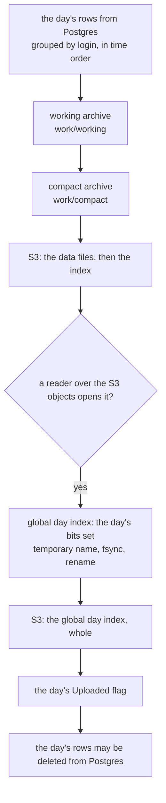

# archiving-a-day

The archiver's recipe for one day of an MT server (RMS-847). The day's rows become a compact [records archive](fixed-key-minute-indexed-records.md) in S3, and the server's [global day index](global-day-index.md) gets the day's bits. The crate owns the FORMAT. Everything that makes a version durable and shared is the archiver's: the empty directory, the temporary name, `fsync` and rename, the uploads, the verification, the `Uploaded` flag. It must be done exactly in the order below. Types: `FixedKeyMinuteIndexedRecordsArchiveWriter` and `FixedKeyMinuteIndexedRecordsArchiveReader` over `LocalFileIo`, `MinuteIndexedRecordsCompactionPlan`, `GlobalDayIndex`, `GlobalDayIndexReader`.

## The order



The order inside archiving a day is:

1. the day's compact archive is uploaded, and its index opens;
2. the day's bits are set and the global day index is uploaded;
3. only then is the day's `Uploaded` flag set;
4. only then may its rows be deleted from Postgres.

Otherwise rows can be deleted while no bit says the day exists, and a read then skips data that is in S3. A bit set before the day's archive is in S3 would also send a read to objects that are not there yet. Setting a bit again is harmless, so any step may be retried.

Step 4 is a bound: no row is deleted before the flag. Whether the same pass deletes the rows, and after what comparison with their copies in S3, is the archiver's decision (§2.5 of the specification, the Task manager document `architecture/archived-data-history-records.md` of project RMS).

## A day, end to end

The example archives two days and keeps the global day index as a local file. The S3 steps are comments at the places where they run. `Day step n` and `Index step n` refer to the two lists below.

```rust
use std::path::Path;

use archived_data::*;
use rust_extensions::date_time::DateTimeAsMicroseconds;
use tokio::io::AsyncWriteExt;

/// An account id, 8 bytes little-endian.
#[derive(Debug, Clone, Copy, PartialEq, Eq, PartialOrd, Ord)]
struct Login(u64);

impl PrimaryKeyFixedSize for Login {
    const LEN: usize = 8;

    fn from_slice(src: &[u8]) -> Self {
        Self(u64::from_le_bytes(src.try_into().unwrap()))
    }

    fn copy_to(&self, out: &mut Vec<u8>) {
        out.extend_from_slice(&self.0.to_le_bytes());
    }
}

/// A deal as the archiver encodes it: its time first, as every record starts, then its volume.
fn deal(time: DateTimeAsMicroseconds, volume: u64) -> Vec<u8> {
    let mut record = time.unix_microseconds.to_le_bytes().to_vec();
    record.extend_from_slice(&volume.to_le_bytes());
    record
}

/// Day steps 1 to 5. `rows` come grouped by login, in time order. Returns the logins the day holds.
async fn archive_day(
    work: &Path,
    day_start: DateTimeAsMicroseconds,
    rows: &[(Login, DateTimeAsMicroseconds, u64)],
) -> Vec<Login> {
    // Day step 1: an empty working directory.
    let _ = std::fs::remove_dir_all(work);

    // Day step 2: write, then finish. Only finish's Ok says every record is in the files.
    let working = LocalFileIo::new(work.join("working"));
    let mut writer =
        FixedKeyMinuteIndexedRecordsArchiveWriter::new(working.clone(), "mt5-demo", day_start)
            .await
            .unwrap();

    for (login, time, volume) in rows {
        writer.write(*login, &deal(*time, *volume)).await.unwrap();
    }

    writer.finish().await.unwrap();

    // Day step 3: compact.
    let source = FixedKeyMinuteIndexedRecordsArchiveReader::<Login, _, _>::open(working, day_start)
        .await
        .unwrap();
    let plan = source.compaction_plan().await.unwrap();
    let compact = LocalFileIo::new(work.join("compact"));
    source.write_compacted_to(&plan, &compact).await.unwrap();

    // Its files are exactly the index and the plan's data files, with the plan's sizes.
    let mut on_disk: Vec<String> = std::fs::read_dir(compact.dir())
        .unwrap()
        .map(|entry| entry.unwrap().file_name().into_string().unwrap())
        .collect();
    on_disk.sort();

    let mut planned: Vec<String> = (0..plan.data_file_sizes().len())
        .map(|no| data_file_name(no as u8))
        .collect();
    planned.push(index_file_name().to_string());
    planned.sort();

    assert_eq!(on_disk, planned);
    assert_eq!(std::fs::metadata(compact.index_path()).unwrap().len(), plan.index_size());

    for (no, size) in plan.data_file_sizes().iter().enumerate() {
        assert_eq!(std::fs::metadata(compact.data_path(no as u8)).unwrap().len(), *size);
    }

    // The compact archive is complete once a reader opens it.
    let archived = FixedKeyMinuteIndexedRecordsArchiveReader::<Login, _, _>::open(compact, day_start)
        .await
        .unwrap();

    // Day step 4 (S3): PUT data_path(n) as <prefix>/data_file_name(n) for every n of the plan,
    // each whole, and only then index_path() as <prefix>/index_file_name().
    // Day step 5 (S3): check every object against the plan's size, then open a reader over the
    // S3 objects. Only that open's Ok counts the day as uploaded.

    archived.keys().await.unwrap()
}

/// Index steps 3 to 6 for one archived day.
async fn update_day_index(
    file: &Path,
    temp: &Path,
    day_start: DateTimeAsMicroseconds,
    logins: &[Login],
) {
    // Index step 3 (S3): ONE ranged GET of the object's first GLOBAL_DAY_INDEX_SYNC_TIME_LEN bytes.
    // If GlobalDayIndex::<Login>::sync_time_of(&bytes) is newer than the local file's, download it first.

    // Index step 4: a new version is the old one, plus the day's logins, with a later sync time.
    // With neither a local file nor an S3 object (index step 2), it starts from a new index.
    let mut index = match tokio::fs::read(file).await {
        Ok(bytes) => GlobalDayIndex::<Login>::from_bytes(bytes).await.unwrap(),
        Err(error) if error.kind() == std::io::ErrorKind::NotFound => {
            GlobalDayIndex::new(DateTimeAsMicroseconds::new(0))
        }
        Err(error) => panic!("{error}"),
    };

    for login in logins {
        index.set_day(*login, day_start).unwrap();
    }

    let old = index.sync_time().unix_microseconds;
    let now = DateTimeAsMicroseconds::now().unix_microseconds;
    index.set_sync_time(DateTimeAsMicroseconds::new(now.max(old + 1)));
    let bytes = index.to_bytes().unwrap();

    // Index step 5: write under a temporary name, fsync, and rename over the old file.
    // A tokio file writes in the background: flush is what reports a write that failed. sync_all
    // alone returns Ok after it, and the rename would put a short file over the old version.
    let mut out = tokio::fs::File::create(temp).await.unwrap();
    out.write_all(&bytes).await.unwrap();
    out.flush().await.unwrap();
    out.sync_all().await.unwrap();
    drop(out);
    tokio::fs::rename(temp, file).await.unwrap();

    // Index step 6 (S3): upload the file whole.
}

#[tokio::main]
async fn main() {
    let root = std::env::temp_dir().join(format!(
        "archived-data-docs-archiving-a-day-1-{}",
        std::process::id()
    ));
    let _ = std::fs::remove_dir_all(&root);
    std::fs::create_dir_all(&root).unwrap();

    let file = root.join("mt5-demo.day-index");
    let temp = root.join("mt5-demo.day-index.tmp");

    // Index step 1, at start: delete a temporary file that a crash left behind.
    let _ = std::fs::remove_file(&temp);
    // Index step 2 (S3): with no local file, download the S3 object to `file` before archiving.

    let september_14 = DateTimeAsMicroseconds::create(2026, 9, 14, 0, 0, 0, 0);
    let september_15 = DateTimeAsMicroseconds::create(2026, 9, 15, 0, 0, 0, 0);
    let at = |day: DateTimeAsMicroseconds, hour: i64| {
        DateTimeAsMicroseconds::new(day.unix_microseconds + hour * 3_600_000_000)
    };

    let days = [
        (september_14, vec![(Login(7), at(september_14, 9), 100)]),
        (
            september_15,
            vec![
                (Login(7), at(september_15, 10), 250),
                (Login(7), at(september_15, 16), 40),
                (Login(42), at(september_15, 0), 75),
            ],
        ),
    ];

    for (day_start, rows) in days {
        let logins = archive_day(&root.join("work"), day_start, &rows).await;
        update_day_index(&file, &temp, day_start, &logins).await;
        // Index step 7: only now set the day's Uploaded flag, and only then delete its rows from Postgres.
    }

    let index = GlobalDayIndex::<Login>::from_bytes(std::fs::read(&file).unwrap())
        .await
        .unwrap();
    let september = (
        DateTimeAsMicroseconds::create(2026, 9, 1, 0, 0, 0, 0),
        DateTimeAsMicroseconds::create(2026, 9, 30, 0, 0, 0, 0),
    );

    assert_eq!(index.days_with_data(&Login(7), september.0, september.1), [september_14, september_15]);
    assert_eq!(index.days_with_data(&Login(42), september.0, september.1), [september_15]);
    assert!(index.days_with_data(&Login(8), september.0, september.1).is_empty());
    assert!(!temp.exists());

    std::fs::remove_dir_all(&root).unwrap();
}
```

## The day archive

All of it goes through `LocalFileIo` until the upload. The writer, the reader and the plan are described in [fixed-key-minute-indexed-records](fixed-key-minute-indexed-records.md).

1. **Start from an empty working directory** for the day, and delete whatever an earlier pass left there. `LocalFileIo`'s `create_*` replaces only the files it creates, so a leftover `dataXX` of an earlier, larger run would otherwise sit beside the new archive, named by no index ([io](io.md#localfileio-localfilewriter-localfilereader)).
2. **Write** the rows with `FixedKeyMinuteIndexedRecordsArchiveWriter` over `LocalFileIo::new(<work>/working)`, then `finish`. Only `finish` returning `Ok` says every record is in the files. A working archive whose writer did not finish is refused at open, or it opens without what was still in the writer's caches after its last flush ([lifecycle](lifecycle.md)). `write` PANICS on a row whose time is outside the day, which is `day_start <= time < day_start + 24 h`, so select the day's rows by exactly that range ([refusals, panics and failures](fixed-key-minute-indexed-records.md#refusals-panics-and-failures)).
3. **Compact**: open a reader on the working directory, call `compaction_plan()`, then `write_compacted_to(&plan, &LocalFileIo::new(<work>/compact))`. The local compact archive is complete when a reader OPENS it. Its files are then exactly the index and `plan.data_file_sizes().len()` data files, with the sizes `plan.index_size()` and `plan.data_file_sizes()`. `plan.keys_count()` and `plan.records_count()` are the logins and the records it holds: compare them with the rows that were read. A day with no record compacts to a 20-byte index and no data file.
4. **Upload** each of those files whole, under `<prefix>/` + `data_file_name(n)`. Upload the data files first and `index_file_name()` LAST, so an index object never names data that is not there yet. The local paths are `data_path(n)` and `index_path()` of the compact directory's `LocalFileIo`, and the sizes are the plan's. An S3 implementation names its objects the same way ([io](io.md#an-s3-implementation)). The archive does not store its day: a reader is given the same `day_start` the writer was, so the prefix has to say which day it holds. A reader given another day opens all the same, and answers `Corrupted` when a read meets a record that is not in that day.
5. **Verify** the objects against the local files, whose sizes are the plan's. Only then count the day as uploaded: the archive in S3 is complete when a reader over the S3 objects opens its index, never on the strength of an upload returning `Ok`. That `open` reads only the index (L0 and the header of its last L1 page) and opens no data file, so the data files are covered by the check against the local files.

**Compaction is deterministic** ([lifecycle](lifecycle.md#determinism)), so a day rebuilt from the same rows uploads identical bytes under the same object names. Two conditions hold this up:

- the `max_data_file_bytes` of the reader that makes the plan (`set_max_data_file_bytes`, 4 GiB unless set) must be the same on every run, because it decides which data file each key lands in;
- records of one login with an EQUAL time must be written in the same order on every run, because they keep the order they were written in. Rows written as (7, 09:00, A), (7, 09:00, B) and as (7, 09:00, B), (7, 09:00, A) compact to different bytes: the same index, another data file. So break equal times the same way on every run, by sorting on something unique after the time, such as the deal id.

No other difference in the write order shows in the compact bytes: neither the order of the logins, nor the order of one login's records whose times differ.

### Writing the rows: ORDER BY login, time

Hand the rows to the writer grouped by account and, inside an account, in time order: the order of `ORDER BY login, time`, with the tie-breaker above. Never interleave accounts. Only the order of the `write` calls matters to the writer. Whether Postgres sorts the rows or the archiver groups them in memory is the archiver's choice (§4 of the specification records why the MT4 archiver does the second).

The writer keeps `DEFAULT_WRITER_L2_CACHE_FRAMES` = 1024 L2 frames of 12 968 bytes (about 13 MiB) and `DEFAULT_WRITER_DATA_CACHE_PAGES` = 1024 data frames of 32 KiB (32 MiB) ([the writer's caches](fixed-key-minute-indexed-records.md#the-writers-caches)), and a day holds 3 000 to 50 000 accounts.

- Rows in time order across accounts evict an L2 frame and a data frame, and read them back, for nearly every record once more than 1024 accounts are in play. With 3 000 accounts of 4 records each, the writer read 18 000 frames back for the 9 000 records after each account's first, and none when the same rows came grouped by account.
- Rows grouped by account keep one account's frames hot. Each record is no earlier than the ones before it, so it goes at the end of its chain: into the last frame, or into a new frame chained after it, and no frame is ever halved.
- Rows that cannot be grouped need caches that hold the whole day: the writer's `set_l2_cache_size` and `set_data_cache_size`. With both set to 3 000, the same rows in time order read nothing back. That costs 12 968 bytes and at least one 32 KiB data frame for every account.

## The global day index

The format and the types are in [global-day-index](global-day-index.md). A version is never changed in place.

1. **At start**, delete a temporary file left by a crash. The index is never written under its own name.
2. **If there is no local file**, download it from S3 before archiving. With neither, start from `GlobalDayIndex::new`.
3. **Before updating**, read the first 8 bytes (`GLOBAL_DAY_INDEX_SYNC_TIME_LEN`) of the S3 object with ONE ranged GET, using `GlobalDayIndex::sync_time_of` on the bytes or `GlobalDayIndexReader::read_sync_time` over the object's reader. When that time is newer than the local file's, download the object first.
4. **Build a new version**: `from_bytes` of the local file, then `set_day(login, day_start)` for every login with records that day, then `set_sync_time` to a time later than the old version's, then `to_bytes()`. `set_day` sets the day `day_start` falls in. That day is the archive's day only when `day_start` is a midnight ([global-day-index](global-day-index.md#the-days-of-a-year)).
5. **Write it under a temporary name, `fsync` it, and rename it over the old file**, on the same filesystem. The rename is atomic, so the disk always holds a whole version. Rename only a file whose every write succeeded: a `tokio::fs::File` writes in the background, so `flush` it before `sync_all`, which does not report a write that failed. Never change the file in place. Do not write it through `LocalFileIo` either: `create_index_writer` removes the old file before a byte of the new one is written, and `LocalFileWriter::finish` syncs the content but not the directory entry ([io](io.md#localfileio-localfilewriter-localfilereader)). A machine crash can still undo a rename whose directory was not synced. The disk then holds the old version, which is still whole: step 3 finds the S3 object newer, or the day, which has no `Uploaded` flag yet, is archived again.
6. **Upload the file to S3 whole.**
7. **Keep the order inside archiving a day**: the day's compact archive uploaded (its index opens), then the day's bits set and the index uploaded, then the day's `Uploaded` flag, and only after it its rows deleted from Postgres ([the order](#the-order)).

A `GlobalDayIndexReader` over the S3 object holds the offsets of the version it opened. Once step 6 replaces the object, it reads the new bytes at those offsets and can answer wrong days with no error. A service that reads the index therefore compares `read_sync_time` with the reader's `sync_time()`, and opens a new reader when they differ ([global-day-index](global-day-index.md#globaldayindexreader--the-index-where-it-lies)).

## Merging late rows into an archived day

Rows that arrive after their day was archived are merged by rebuilding the day. `get_range` and `get_day` only answer about a key the caller names, and `keys()` is what lists them:

1. Open a reader on the archived day: the S3 objects, or a local copy outside the directory that day step 1 empties.
2. `keys()` gives every key the archive holds, ascending, with one read of each L1 page and no cache. `get_day(&key)` gives each of the key's records whole, its time first, without its length prefix.
3. Run day steps 1 to 5 on the merged rows. `keys()` ascend, so merging them with the late rows' logins keeps the rows grouped by login. Inside a login, keep time order, and break equal times with the same tie-breaker as on the first run.
4. Call `set_day` for the logins of the late rows. A day already set changes nothing, so the global day index steps can simply run again.

Replacing a day's objects in place is not atomic. Until the new index is uploaded, a reader can open the old index over the new data files. A reader opened earlier keeps the old index, too, whatever the data files under it have become. Readers assume that an archive does not change while they read it, so the rebuilt day needs either a prefix of its own or a moment when no reader has it open.
