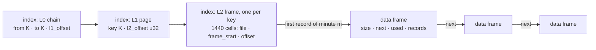

# fixed-key-minute-indexed-records

The history of ONE server-clock day: a fixed-size key (an account) owns records of variable length (its
deals) kept in time order, and a minute index says where each minute of its day starts. Use it for every deal
of every account of one day, read back by account and time range. It is a split archive only: an index and
data files reached through the [IO traits](io.md). The byte layout is specified in the Task manager document
`architecture/archived-data-history-records.md` of project RMS, agreed with the owner on 16.09.2026; this
document summarises it and records [every decision the document left open](#decisions-the-document-left-open).

| Type | What it does |
| --- | --- |
| `FixedKeyMinuteIndexedRecordsArchiveWriter<TKey, TFactory, TWriter, TReader>` | builds the WORKING archive of one day from records written in any order |
| `FixedKeyMinuteIndexedRecordsArchiveReader<TKey, TFactory, TReader>` | reads a working or a compact archive; plans and writes the compaction |
| `MinuteIndexedRecordsCompactionPlan` | the exact sizes of the compact index and data files, worked out before a byte is written |

- `TKey` is the crate's `PrimaryKeyFixedSize` ([fixed-key-preallocated-slots](fixed-key-preallocated-slots.md)).
- `TFactory`, `TWriter` and `TReader` are the IO of the archive's files, inferred from the factory a constructor is
  given. Over `LocalFileIo` the types, when one has to be named, are
  `FixedKeyMinuteIndexedRecordsArchiveWriter<TKey, LocalFileIo, LocalFileWriter, LocalFileReader>` and
  `FixedKeyMinuteIndexedRecordsArchiveReader<TKey, LocalFileIo, LocalFileReader>`.
- A record is bytes whose first 8 are its time, an `i64` little-endian of microseconds. The archive never
  looks past the time; strings inside a record are the caller's, e.g. [Pascal strings](pascal-strings.md).
- The archive's life (write, flush, finish, compact) is the split archive's: [lifecycle](lifecycle.md). The
  archiver's recipe for a whole day, upload included, is [archiving-a-day](archiving-a-day.md).

## A day written and read back

```rust
use archived_data::*;
use rust_extensions::date_time::DateTimeAsMicroseconds;

/// An account id, 8 bytes little-endian.
#[derive(Debug, Clone, Copy, PartialEq, Eq, PartialOrd, Ord)]
struct Login(u64);

impl PrimaryKeyFixedSize for Login {
    const LEN: usize = 8;

    fn from_slice(src: &[u8]) -> Self {
        Self(u64::from_le_bytes(src.try_into().unwrap()))
    }

    fn copy_to(&self, out: &mut Vec<u8>) {
        out.extend_from_slice(&self.0.to_le_bytes());
    }
}

/// A record: its time as an `i64` little-endian of microseconds, then the deal.
fn deal(time: i64, what: &str) -> Vec<u8> {
    let mut record = time.to_le_bytes().to_vec();
    record.extend_from_slice(what.as_bytes());
    record
}

/// The deals of `records`: what follows each record's time.
fn deals(records: &[Vec<u8>]) -> Vec<&str> {
    records.iter().map(|record| std::str::from_utf8(&record[8..]).unwrap()).collect()
}

#[tokio::main]
async fn main() {
    let dir = std::env::temp_dir().join(format!("archived-data-docs-records-1-{}", std::process::id()));
    let _ = std::fs::remove_dir_all(&dir);

    let day = DateTimeAsMicroseconds::new(1_789_430_400_000_000); // 2026-09-15T00:00:00Z
    let at = |minute: i64, second: i64| day.unix_microseconds + minute * 60_000_000 + second * 1_000_000;

    let mut writer = FixedKeyMinuteIndexedRecordsArchiveWriter::new(LocalFileIo::new(&dir), "mt5-1 2026-09-15", day)
        .await
        .unwrap();

    // Two logins, out of time order.
    writer.write(Login(7), &deal(at(600, 0), "close")).await.unwrap();
    writer.write(Login(7), &deal(at(10, 30), "buy")).await.unwrap();
    writer.write(Login(3), &deal(at(10, 5), "sell")).await.unwrap();
    writer.write(Login(7), &deal(at(11, 0), "add")).await.unwrap();
    writer.write(Login(7), &deal(at(10, 30), "buy more")).await.unwrap(); // an equal time: after "buy"

    assert_eq!((writer.keys_count(), writer.records_count()), (2, 5));
    assert_eq!(writer.data_file_bytes(), 2 * DATA_FRAME_LEN as u64); // a 32 KiB frame per key
    writer.finish().await.unwrap();

    let reader = FixedKeyMinuteIndexedRecordsArchiveReader::<Login, _, _>::open(LocalFileIo::new(&dir), day)
        .await
        .unwrap();

    // Minutes 10 and 11 whole. Both ends are inclusive, so `to` is the last microsecond of minute 11.
    let (from, to) = (DateTimeAsMicroseconds::new(at(10, 0)), DateTimeAsMicroseconds::new(at(12, 0) - 1));
    let records = reader.get_range(&Login(7), from, to).await.unwrap();
    assert_eq!(deals(&records), ["buy", "buy more", "add"]);
    assert_eq!(records[0], deal(at(10, 30), "buy")); // whole, without the length prefix

    assert_eq!(deals(&reader.get_day(&Login(7)).await.unwrap()), ["buy", "buy more", "add", "close"]);
    assert_eq!(reader.minutes_with_records(&Login(7)).await.unwrap(), [10, 11, 600]);
    assert_eq!(reader.keys().await.unwrap(), [Login(3), Login(7)]);
    assert!(reader.get_day(&Login(99)).await.unwrap().is_empty());

    std::fs::remove_dir_all(&dir).unwrap();
}
```

- `write` takes the records of any key in any order; a record of an equal time goes after those written
  before it.
- Nothing written is readable until `flush` or `finish` returns `Ok`; the working archive opens only when its
  last flush completed and nothing was written to its files after it ([lifecycle](lifecycle.md)).
- The archive does not store its day: the reader is told `day_start`, as the writer was.

## The layout



Little-endian throughout; every offset is a `u32` inside its own file. L0 and L1 are the split archive's
frames ([split-format](split-format.md)), with the offset of an L2 frame where a data reference would be.

| Part | Where | Header | Body |
| --- | --- | --- | --- |
| L0 | index, frame 0 at offset 0, chained | `size u32 · next u32 · count u32 · hash u64` | `count × (from K · to K · l1_offset u32)` |
| L1 | index | `size u32 · next u32 · count u32` | `count × (key K · l2_offset u32)`, ascending |
| L2 | index, one per key | `size u32` = 12 968 · `next u32` = 0 | 1440 cells, one per minute |
| data frame | data file, a chain per key | `size u32 · next u32 · used u16` | `used` bytes of records |

```text
cell   = file u8 · frame_start u32 · offset u32       9 bytes
         file: the data file · frame_start: the frame's offset in it · offset: the record's offset from the frame's start
empty  = nine 0xFF bytes, read as empty by its offset alone (offset = 0xFFFF_FFFF)
record = len u16 · len bytes, the first 8 the time: i64 little-endian of microseconds

minute = (time − day_start) / 60 000 000              0 ..= 1439; any other time is outside the day
L2     = 8 + 1440 × 9 = 12 968 bytes
```

- A cell points at the FIRST record of its minute. Records of an equal time keep the order they were written
  in.
- A key's records are one chain of data frames in time order. `next` is an offset in the SAME data file, `0`
  on the last frame, so a key's chain never leaves its file.
- An L2 frame of another size, or with a `next`, is `Corrupted`.

| Constant | Value | What |
| --- | --- | --- |
| `MINUTES_PER_DAY` | 1440 | the cells of an L2 frame |
| `RECORD_TIME_LEN` | 8 | the time every record starts with; the shortest record |
| `MAX_RECORD_LEN` | 8 192 | the longest record, without its 2-byte length prefix |
| `DATA_FRAME_LEN` | 32 768 | a working data frame, header included, so 32 758 bytes of records; the most a compact frame is |

Two shapes of the same format:

- **working**, written by the writer: every data frame 32 KiB in data file 0; frames halved and chained as they
  fill; L1 pages and L2 frames appended to the index as they are needed;
- **compact**, written by `write_compacted_to`: every key's records one run of frames cut to their content; ONE
  L0 frame, the L2 frames, then the L1 pages.

Source: [layout.rs](../src/fixed_key_minute_indexed_records/layout.rs),
[minute_cells.rs](../src/fixed_key_minute_indexed_records/minute_cells.rs),
[records_frame.rs](../src/fixed_key_minute_indexed_records/records_frame.rs).

## Writing the working archive

| Method | Returns | Notes |
| --- | --- | --- |
| `new(factory, name, day_start).await` | `Result<Self, ArchiveError>` | `factory: TFactory` by value, `name: impl Into<String>`, `day_start: DateTimeAsMicroseconds`; `DEFAULT_L0_CAPACITY` (1024) intervals per L0 frame, `DEFAULT_L1_CAPACITY` (1024) keys per L1 page |
| `new_with_capacity(factory, name, day_start, capacity_l0, capacity_l1).await` | `Result<Self, ArchiveError>` | `capacity_l0` intervals per L0 frame and `capacity_l1` keys per L1 page, both `usize` |
| `write(key, &record).await` | `Result<(), ArchiveError>` | `&mut self`; `key: TKey` by value, `record: &[u8]` |
| `flush().await` | `Result<(), ArchiveError>` | `&mut self` |
| `finish(self).await` | `Result<(), ArchiveError>` | consumes the writer |
| `name()` | `&str` | the name both panics of `write` carry |
| `day_start()` | `DateTimeAsMicroseconds` | the first microsecond of the day of 1440 minutes |
| `keys_count()` · `records_count()` | `usize` · `u64` | keys and records written |
| `l0_intervals()` · `l0_frames()` | `usize` · `usize` | L0 intervals, one per L1 page; frame 0 plus every continuation a flush reserved |
| `data_file_bytes()` | `u64` | what data file 0 has reserved for frames: its size once flushed |
| `set_l1_cache_size(pages)` · `set_l2_cache_size(frames)` · `set_data_cache_size(frames)` | | [the caches](#the-writers-caches) |

`factory` implements both `IoWriterFactory<TWriter>` and `IoReaderFactory<TReader>`: the writer reads its own
evicted pages back. `new` creates the index and appends L0 frame 0, with a hash that does not verify; data file
0 is created with the first record, so an archive that never got one is an index alone.

Both constructors panic, before the index is created, when `TKey::LEN` is 0, or when an L0 frame of
`capacity_l0` intervals or an L1 page of `max(capacity_l1, 1024)` keys cannot fit its `u32` size;
`new_with_capacity` also when a capacity is 0.

**The first record of a key:**

- its L2 frame is reserved at the end of the index, every cell `0xFF` but its minute's;
- a new 32 KiB data frame at the end of data file 0 holds the record;
- the key goes into L1 with its L2 frame's offset, by the split page rules: into its page while the page has
  room; a key above every key of the LAST page, when that page is full, starts a new page; any other key of a
  full page halves the page, and the upper half moves in front of the next page's keys when it fits there, into a
  new page when it does not ([fixed-key-preallocated-slots](fixed-key-preallocated-slots.md)).

**Any other record — its place** (§1.6 of the document), found from the key's L2 frame:

- its minute has records: after every record of the minute no later than it;
- its minute has none: before the first record of the nearest later minute that has one;
- no later minute has one: at the end of the chain.

**How it goes in** (§1.7, the crate's one overflow rule). A frame is full, here, when it has no room for the
record and its 2-byte length:

| The frame at the place | What happens |
| --- | --- |
| has room | the record goes in; the records after it in the frame move up |
| is full, and the place is the END of the chain: after the last record of its last frame | a new frame, chained after it, holds the record; nothing moves |
| is full, and the place is before one of its records | the frame is halved at the record boundary nearest the middle of its records, ties to the lower; the record goes into the lower half when its place is at or before that boundary, into the upper half otherwise; the upper half, with the record when it went there, moves in front of the next frame's records when that frame holds it whole, and otherwise into a new frame chained between the two, or after the halved frame when it was the chain's last |

- A place at the start of a frame is in that frame, even when the frame before it has room. So a record that
  falls between the last record of one frame and the first record of the next goes into the next frame: at its
  start when it has room, into the lower half it is halved to when it is full. Only the end of the chain gets a
  new frame with nothing moved.
- A new frame is appended at the end of data file 0, so in the working form a `next` can point back into the
  file.
- Every cell follows the records it points at, the next frame's records included when the upper half moves in
  front of them. A record placed before its minute's first record becomes the minute's first.
- Everything an insert touches is decided and read into the caches before anything changes: the key's L2
  frame, every frame the place is searched through, the next frame of a frame that halves, and for a new key its
  L1 page and, when that page is full, the next one. The change is then made with no await (the archive's first
  key creates data file 0 just before it), so a write that fails or is dropped never leaves a record half moved
  or a key half placed.

**`flush`, `finish`**: the split working archive's ([lifecycle](lifecycle.md)).

- `flush` writes every dirty L1 page and L2 frame to the index in offset order, every dirty data frame to data
  file 0, then the L0 chain (the continuations it has, new ones appended at the end) and frame 0 LAST. With
  nothing written since the last flush, it writes nothing at all.
- `finish(self)` flushes, then finishes the index and, when it was created, data file 0: each awaited even
  after the other failed, and even when the flush failed or was refused. The flush's error comes first, then the
  first failed finish.
- The index opens only when its last flush completed and nothing was written to its files after it: the first
  byte to reach the index or the data file after a completed flush spoils frame 0's hash first.

Source: [writer.rs](../src/fixed_key_minute_indexed_records/writer.rs),
[writer_key.rs](../src/fixed_key_minute_indexed_records/writer_key.rs),
[writer_insert.rs](../src/fixed_key_minute_indexed_records/writer_insert.rs).

### The writer's caches

| Cache | Default | A size of 0 |
| --- | --- | --- |
| L1 pages | `DEFAULT_WRITER_L1_CACHE_PAGES` = 64 | keeps 1: the size is at least 1 |
| L2 frames | `DEFAULT_WRITER_L2_CACHE_FRAMES` = 1024, about 13 MiB | keeps no L2 frame between writes |
| data frames | `DEFAULT_WRITER_DATA_CACHE_PAGES` = 1024, 32 MiB | keeps no data frame between writes: every frame a write changed reaches the data file before it returns |

Sizes count pages and frames. A cache is trimmed to its size, least recently used first, at the end of every
write; a write may hold more while it runs. A smaller cache only costs IO.

### Write the rows grouped by account

**Give the writer each account's records together and in time order, the order of `ORDER BY login, time`, and
never interleaved across accounts.** The archive sees only the order of the `write` calls: whether a database
sorts the rows or the caller groups them in memory is the caller's choice (§4 of the document records why the
MT4 archiver does the second).

- The writer keeps 1024 L2 frames of 13 KiB and 1024 data frames, and a day holds 3 000 to 50 000 accounts.
- Rows in time order across accounts evict and read back an L2 frame, and a data frame, for nearly every record
  once more than 1024 accounts are in play: with 3 000 accounts of 20 records each, 57 000 of the 60 000 writes
  read both back, and grouped by account none does.
- Rows grouped by account keep one account's pages hot and append every record at the end of its chain.
- Rows that cannot be grouped need `set_l2_cache_size` and `set_data_cache_size` of at least the number of
  accounts, 13 KiB and at least one 32 KiB frame an account: the same 60 000 writes then read nothing back.

Inside a minute the records are a linear list: a record finds its place by walking from its minute's first
record. In a release build, 17 000 records of about 330 bytes, all of ONE minute and in time order, took 1.44 s
to write; as many spread over the day took 57–98 ms.

## Refusals, panics and failures

```rust
use archived_data::*;
use rust_extensions::date_time::DateTimeAsMicroseconds;

/// An account id, 8 bytes little-endian.
#[derive(Debug, Clone, Copy, PartialEq, Eq, PartialOrd, Ord)]
struct Login(u64);

impl PrimaryKeyFixedSize for Login {
    const LEN: usize = 8;

    fn from_slice(src: &[u8]) -> Self {
        Self(u64::from_le_bytes(src.try_into().unwrap()))
    }

    fn copy_to(&self, out: &mut Vec<u8>) {
        out.extend_from_slice(&self.0.to_le_bytes());
    }
}

/// A record: its time as an `i64` little-endian of microseconds, then the deal.
fn deal(time: i64, what: &str) -> Vec<u8> {
    let mut record = time.to_le_bytes().to_vec();
    record.extend_from_slice(what.as_bytes());
    record
}

#[tokio::main]
async fn main() {
    let dir = std::env::temp_dir().join(format!("archived-data-docs-records-2-{}", std::process::id()));
    let _ = std::fs::remove_dir_all(&dir);

    let day = DateTimeAsMicroseconds::new(1_789_430_400_000_000); // 2026-09-15T00:00:00Z
    let mut writer = FixedKeyMinuteIndexedRecordsArchiveWriter::new(LocalFileIo::new(&dir), "mt5-1 2026-09-15", day)
        .await
        .unwrap();

    // 7 bytes: shorter than the time a record starts with.
    match writer.write(Login(7), &[0; 7]).await {
        Err(ArchiveError::ContractViolation(message)) => assert!(message.contains("a record of 7 bytes")),
        other => panic!("not refused: {other:?}"),
    }

    // Longer than MAX_RECORD_LEN. Its time is outside the day, too, but the length is checked first: no panic.
    let mut long = deal(day.unix_microseconds - 1, "");
    long.resize(MAX_RECORD_LEN + 1, b'x');
    assert!(matches!(writer.write(Login(7), &long).await, Err(ArchiveError::ContractViolation(_))));

    // Nothing changed, and the writer is usable.
    assert_eq!((writer.keys_count(), writer.records_count()), (0, 0));
    writer.write(Login(7), &deal(day.unix_microseconds, "buy")).await.unwrap();
    writer.finish().await.unwrap();

    let reader = FixedKeyMinuteIndexedRecordsArchiveReader::<Login, _, _>::open(LocalFileIo::new(&dir), day)
        .await
        .unwrap();
    assert_eq!(reader.get_day(&Login(7)).await.unwrap(), [deal(day.unix_microseconds, "buy")]);

    std::fs::remove_dir_all(&dir).unwrap();
}
```

**Refusals**: `Err(ContractViolation)`; no key and no record is added, nothing moves, and the writer stays
usable.

- a record shorter than `RECORD_TIME_LEN` (8) bytes or longer than `MAX_RECORD_LEN`. The length is checked
  before the time is read, so such a record is refused even when its time is outside the day;
- a new key whose `copy_to` does not write exactly `LEN` bytes. A key the archive already holds is found by its
  `Ord` alone and is not encoded again;
- a new key needing index room past 4 GiB: its L2 frame, an L1 page when placing it adds one, and the L0
  continuations the next flush will need. The continuations are counted for EVERY new key, not only for one
  that adds an L1 page: every new key reserves its L2 frame in the index, so a key that fits a page already
  there could take the room a continuation of an earlier page needs, and the next flush would run into the
  limit. A key already in the archive needs no index room.

A refused record length does nothing at all. A refused new key still trims the caches to their sizes, as every
write does: it adds nothing to the archive, but it can send pages an EARLIER write changed to the files, and an
archive that opened before it then opens again only after the next flush.

**Panics**, as the document requires, before anything is written or moved:

- a record whose time is outside the day, naming the archive, the record's time and the day's start;
- a data frame that would take data file 0 past 4 GiB, naming the archive and the file's size.

```text
archive mt5-1 2026-09-15: a record at 2026-09-14T23:59:59.999999 (1789430399999999 µs) is outside its day, which starts at 2026-09-15T00:00:00.000000 (1789430400000000 µs)
archive mt5-1 2026-09-15: its data file is 4294967296 bytes, and 32768 more for a data frame would take it past 4294967296 bytes
```

- The first panic fires before the call is marked in flight, the second after: a writer whose panic was caught
  is usable after the first and refuses every later call after the second.
- Every key takes at least one 32 KiB frame, and the working form has ONE data file. So a working archive holds
  at most 131 072 frames (4 GiB), and at most 131 072 keys: the frame after that is the second panic. A record
  that needs no new frame is still written.
- With the default capacities and a key of a few bytes, that limit comes long before the index's 4 GiB:
  131 072 keys take about 1.6 GiB of L2 frames.

**Failures**: any other `Err` (an IO error, a frame read back damaged), and a `write` or `flush` future dropped
at an await, leave every later `write`, `flush` and `finish` refused as `ContractViolation`
([lifecycle](lifecycle.md), [errors](errors.md)); that `finish` still finishes the index and the data file. A
writer an earlier call left unusable refuses FIRST, before it looks at the record: a record outside the day gets
that refusal, not a panic, and a record of a wrong length gets it too.

## Reading

| Method | Returns | Notes |
| --- | --- | --- |
| `open(factory, day_start).await` | `Result<Self, ArchiveError>` | a working or a compact archive; `factory: TFactory` by value, an `IoReaderFactory<TReader>`; `day_start: DateTimeAsMicroseconds` |
| `get_range(&key, from, to).await` | `Result<Vec<Vec<u8>>, ArchiveError>` | `from`, `to`: `DateTimeAsMicroseconds`, both inclusive |
| `get_day(&key).await` | `Result<Vec<Vec<u8>>, ArchiveError>` | every record of the key |
| `minutes_with_records(&key).await` | `Result<Vec<u16>, ArchiveError>` | the minutes with at least one record |
| `keys().await` | `Result<Vec<TKey>, ArchiveError>` | every key, ascending |
| `keys_count().await` | `Result<usize, ArchiveError>` | one small read per L1 frame, uncached |
| `day_start()` | `DateTimeAsMicroseconds` | |
| `l0_intervals()` · `l0_frames()` | `usize` · `usize` | `l0_frames()` is 1 for every compact archive |
| `set_l1_cache_size(pages).await` · `set_l2_cache_size(frames).await` · `set_data_cache_size(frames).await` | | `&self`; 10 each by default |
| `set_max_data_file_bytes(bytes)` · `max_data_file_bytes()` | `()` · `u64` | for the next [compaction](#compaction-into-the-compact-archive) |
| `compaction_plan().await` · `write_compacted_to(&plan, &out).await` | `Result<MinuteIndexedRecordsCompactionPlan, ArchiveError>` · `Result<(), ArchiveError>` | [compaction](#compaction-into-the-compact-archive) |

**`open`** reads the index's L0 chain, which lives in memory for the reader's life, and refuses as `Corrupted`
what every split reader refuses at open ([split-format](split-format.md#what-open-checks)): an L0 header that
fails its hash (a working index whose last flush did not complete or that was written to after it, or bytes that
are not an index), a broken chain, intervals out of order, an index that ends before or inside the L1 page at
its highest offset. No data file is opened; each is opened on first use, once.

- An index the factory cannot open is `Io`: over `LocalFileIo`, `NotFound` for a directory with no `index` file.
- A compact index ends with its L1 pages, so that check covers every L2 frame. A working index can end with L2
  frames past its last L1 page, where only frame 0's hash proves it whole: one cut inside a trailing L2 frame
  opens, and answers `Corrupted` at the first read of that key.
- Panics when `TKey::LEN` is 0 or an L1 page of 1024 keys cannot fit its `u32` size.

**`get_range(&key, from, to)`**: every record of `key` whose time `t` is `from <= t <= to`.

- Each record whole, without its length prefix, in time order; records of an equal time in the order they were
  written.
- A key the archive does not hold: an empty list.
- `from > to`, or a range wholly outside the day (`to` before its start, or `from` at or past its end): an empty
  list, and nothing is read.
- A range reaching past the day is clamped to it.
- The walk starts at the first minute from `from` on that has a record, and ends at the first record later than
  `to` or at the end of the key's chain.
- A failed read or a damaged frame is an `Err`, never a shorter list.

**`get_day(&key)`**: every record of the key, whole and in time order; an unknown key is an empty list.

**`minutes_with_records(&key)`**: the minutes `0 ..= 1439` in which the key has at least one record, ascending,
read off the key's L2 frame alone, through the L1 and L2 caches: no data frame is read and no data file opened.
It says WHICH minutes, never how much is in them: a cell names only the first record of its minute. A reader
that serves a day in slices plans them by it, so no slice is a whole day of a key whose day is too big to hold,
while a quiet key's day is still read in one call. An unknown key has none. No record is read, so nothing is
checked against the reader's day: the minutes are those of the day the archive was written for.

**`keys()`**: every key the archive holds, ascending: one read of each L1 page (two for a working page of a
`capacity_l1` above 1024), through none of the caches, so every call reads them again. Keys that do not ascend
across the pages are `Corrupted`; a failed read is an `Err`, never a shorter list. The other
reads answer only about a key the caller names; a caller that rebuilds the archive from its own records — a
merge of late rows into an archived day (RMS-847) — needs every key.

**What a walk checks.** Each of these is `Corrupted`:

- a record whose time is outside the reader's day;
- a record earlier than the one before it;
- the first record of a minute that is not where that minute's cell points, the minute the walk starts at
  included;
- a chain that returns to a frame it walked;
- a record that does not fit its frame or is shorter than its time, a frame whose records reach past its size, a
  frame reaching past the end of its file.

So a reader told the wrong day answers `Corrupted` for a `get_range` or `get_day` that meets a record, and an
empty list for one that meets none, exactly as it would on the right day. `minutes_with_records`, `keys` and
`keys_count` read no record, so they answer the same whatever day the reader was told.

That holds for a `day_start` that differs from the writer's by a minute or more, as another day always does:
the first record a read meets is then outside the minute of its cell, or outside the day. A `get_range` that
meets none can still be one whose range holds records: its walk starts at the minute its own `day_start`
gives. A `day_start` off by LESS than a minute is not always caught. The reader's minutes no longer line up
with the cells: some reads answer `Corrupted`, and a `get_range` can leave out records of its range with no
error. Nothing checks that `day_start` is a whole minute, a midnight, or the writer's: give the reader exactly
the value the writer was given.

**Caches.** L1 pages, L2 frames and data frames are cached like the split readers' pages:
`DEFAULT_READER_L1_CACHE_PAGES`, `DEFAULT_READER_L2_CACHE_FRAMES` and `DEFAULT_READER_DATA_CACHE_PAGES`, 10
each, bounded by count, each under its own `RwLock`. A shrink evicts down to the new size before it returns; 0
keeps nothing. The reader is shared by reference (`Arc`) between concurrent callers, and assumes the archive
does not change while it is read.

### The read-ahead window

A walk reads the frames the data cache does not hold through a window of its own.

- A frame the window holds whole costs no read.
- On a miss the next read starts at the frame. While each frame starts where the one before it ended (a compact
  key's run, or a working key whose frames were appended one after another) the read doubles: 32 KiB, 64, 128,
  256, then 512 KiB. When the chain jumps, it is one frame, 32 KiB, again.
- A walk that starts on a frame the cache does not hold starts with a read of ONE frame. So, with nothing
  cached, a compact key of one frame is one read, of two or three frames two, of up to 7 frames at most three, of
  up to 15 at most four; a day of 17 000 records of about 330 bytes (173 frames) is 14 reads. A working chain
  that jumps about its file reads a frame at a time.
- A walk holds one read at a time, at most 512 KiB. Every read is clamped to its file. A frame longer than its
  read, which no writer of this crate makes, costs one read more.

Source: [reader.rs](../src/fixed_key_minute_indexed_records/reader.rs),
[reader_keys.rs](../src/fixed_key_minute_indexed_records/reader_keys.rs),
[records_cursor.rs](../src/fixed_key_minute_indexed_records/records_cursor.rs),
[records_read_ahead.rs](../src/fixed_key_minute_indexed_records/records_read_ahead.rs).

## Compaction into the compact archive

```rust
use archived_data::*;
use rust_extensions::date_time::DateTimeAsMicroseconds;

/// An account id, 8 bytes little-endian.
#[derive(Debug, Clone, Copy, PartialEq, Eq, PartialOrd, Ord)]
struct Login(u64);

impl PrimaryKeyFixedSize for Login {
    const LEN: usize = 8;

    fn from_slice(src: &[u8]) -> Self {
        Self(u64::from_le_bytes(src.try_into().unwrap()))
    }

    fn copy_to(&self, out: &mut Vec<u8>) {
        out.extend_from_slice(&self.0.to_le_bytes());
    }
}

/// A record: its time as an `i64` little-endian of microseconds, then the deal.
fn deal(time: i64, what: &str) -> Vec<u8> {
    let mut record = time.to_le_bytes().to_vec();
    record.extend_from_slice(what.as_bytes());
    record
}

#[tokio::main]
async fn main() {
    let dir = std::env::temp_dir().join(format!("archived-data-docs-records-3-{}", std::process::id()));
    let _ = std::fs::remove_dir_all(&dir);
    let (working, compact, again) = (dir.join("working"), dir.join("compact"), dir.join("again"));

    let day = DateTimeAsMicroseconds::new(1_789_430_400_000_000); // 2026-09-15T00:00:00Z
    let minute = |m: i64| DateTimeAsMicroseconds::new(day.unix_microseconds + m * 60_000_000);

    let mut writer = FixedKeyMinuteIndexedRecordsArchiveWriter::new(LocalFileIo::new(&working), "mt5-1 2026-09-15", day)
        .await
        .unwrap();

    for n in (0..300).rev() {
        writer.write(Login(n % 3), &deal(minute(n as i64 * 4).unix_microseconds, "deal")).await.unwrap();
    }

    writer.finish().await.unwrap();

    let source = FixedKeyMinuteIndexedRecordsArchiveReader::<Login, _, _>::open(LocalFileIo::new(&working), day)
        .await
        .unwrap();
    let plan = source.compaction_plan().await.unwrap();
    assert_eq!((plan.keys_count(), plan.records_count()), (3, 300));
    source.write_compacted_to(&plan, &LocalFileIo::new(&compact)).await.unwrap();

    // Complete: the index opens. Its files are the plan's: the index and one data file, of the planned sizes.
    let compacted = FixedKeyMinuteIndexedRecordsArchiveReader::<Login, _, _>::open(LocalFileIo::new(&compact), day)
        .await
        .unwrap();
    let size = |name: &str| std::fs::metadata(compact.join(name)).unwrap().len();
    assert_eq!(size(index_file_name()), plan.index_size());
    assert_eq!([size(&data_file_name(0))], plan.data_file_sizes());
    assert_eq!(compacted.l0_frames(), 1);

    // The same answers as the working archive.
    assert_eq!(compacted.keys().await.unwrap(), source.keys().await.unwrap());

    for key in [Login(0), Login(1), Login(2)] {
        assert_eq!(compacted.get_day(&key).await.unwrap(), source.get_day(&key).await.unwrap());
        assert_eq!(
            compacted.get_range(&key, minute(100), minute(200)).await.unwrap(),
            source.get_range(&key, minute(100), minute(200)).await.unwrap(),
        );
        assert_eq!(
            compacted.minutes_with_records(&key).await.unwrap(),
            source.minutes_with_records(&key).await.unwrap(),
        );
    }

    // A compact archive compacts to itself.
    let plan = compacted.compaction_plan().await.unwrap();
    compacted.write_compacted_to(&plan, &LocalFileIo::new(&again)).await.unwrap();

    for name in [index_file_name().to_string(), data_file_name(0)] {
        assert_eq!(std::fs::read(again.join(&name)).unwrap(), std::fs::read(compact.join(&name)).unwrap());
    }

    std::fs::remove_dir_all(&dir).unwrap();
}
```

**`compaction_plan()`** walks every record of every key once, through none of the caches, each record checked as
a read checks it, and works out where each key's records land and the exact size of the compact index and of
every compact data file.

- The data files are laid out under the reader's `max_data_file_bytes()`: `DEFAULT_MAX_DATA_FILE_BYTES` (4 GiB)
  until `set_max_data_file_bytes`, which panics above 4 GiB or below one data frame (32 KiB). It says nothing
  about the archive being read.
- Keys that do not ascend across L1 pages are `Corrupted`. An index past 4 GiB, a key whose records are longer
  than a data file, or data needing data file 256 is a `ContractViolation`.
- Memory: the first record of every minute of every key that has one, about 12 bytes each.
- An archive with no keys plans a 20-byte index and no data files.

| `MinuteIndexedRecordsCompactionPlan` | Returns |
| --- | --- |
| `index_size()` | `u64`: the compact index's exact size |
| `data_file_sizes()` | `&[u64]`: one size per data file, in file order; none for an archive with no records |
| `keys_count()` | `usize` |
| `records_count()` | `u64` |

The plan is `Debug + Clone + PartialEq + Eq`. A caller whose writers must know a file's size up front, such as
an S3 upload, builds its factory from `index_size()` and `data_file_sizes()` and then hands the plan back.

**`write_compacted_to(&plan, &out)`** (`out: &TOut`, any `IoWriterFactory<TWriter>`, not necessarily the IO the
archive is read through) writes each data file in order, append only, each finished before the next is created,
then the index, append only, finished LAST.

- The archive is complete when its index exists AND opens ([lifecycle](lifecycle.md)). An `Err` in the data pass
  creates no index, so a place that was empty has none; one in the index pass can leave a short index, which
  `open` refuses as `Corrupted`, because its L1 pages come last.
- The data pass walks every record again, through no cache. A source that no longer matches the plan is
  `Corrupted`; a plan of another key length is a `ContractViolation`, before any file is created.
- Memory: one key's frame at a time.

**The compact form:**

- Every key's records are ONE run of frames, back to back, in key order. Each frame holds records while the next
  one fits 32 KiB with the header, so 32 758 bytes of records at most, has no free space after them, and chains
  to the frame right after it; `next` is 0 on the key's last frame.
- A run goes into the current data file only whole; otherwise the next data file starts. A data file ends only
  between keys.
- The index is ONE L0 frame of exact size, then an L2 frame per key in key order, its cells pointing into the
  compact data and empty minutes `0xFF`, and LAST the L1 pages, full pages of `COMPACT_L1_CAPACITY` (1024) keys,
  the last one zero-padded.
- The bytes depend only on the keys, each key's records in the order a read returns them, and
  `max_data_file_bytes`. Any working frames, any capacities and cache sizes, and any write order that keeps one
  key's records of an EQUAL time in the same order compact to the same files, and a compact archive compacts to
  itself.

```text
pages      = ceil(keys / 1024)
index_size = (20 + pages × (2 × LEN + 4))         the L0 frame
           + keys × 12 968                         the L2 frames
           + pages × (12 + 1024 × (LEN + 4))       the L1 pages
```

Source: [reader_compact.rs](../src/fixed_key_minute_indexed_records/reader_compact.rs),
[records_compaction_plan.rs](../src/fixed_key_minute_indexed_records/records_compaction_plan.rs),
[compact_records_run.rs](../src/fixed_key_minute_indexed_records/compact_records_run.rs),
[compact_records_index.rs](../src/fixed_key_minute_indexed_records/compact_records_index.rs).

## Decisions the document left open

| # | Decision | Why |
| --- | --- | --- |
| 1 | Names (its open question 2): module `fixed_key_minute_indexed_records`, `FixedKeyMinuteIndexedRecordsArchiveWriter` / `FixedKeyMinuteIndexedRecordsArchiveReader`, `MinuteIndexedRecordsCompactionPlan`. The key trait is the crate's `PrimaryKeyFixedSize`. | The pattern of the two modules before it. The document's candidate, `PreallocatedSlotKey`, is the SLOT trait of the preallocated modules (`SLOTS`, `slot_index`), not a key. |
| 2 | A record is 8 to `MAX_RECORD_LEN` = 8 192 bytes; anything else is refused. | `len u16` allows 65 535 and a frame holds 32 758 bytes of records. Halving a full frame leaves up to half a frame plus half a record on either side, so the record being inserted fits beside it only while three records fit a frame; 8 KiB keeps that with room, against deals of at most ~1.8 KiB. |
| 3 | "Halved" is at the record boundary nearest the middle of the frame's records, ties to the lower; the record goes into the lower half when its place is at or before that boundary. | Deterministic, and never an empty half under decision 2. |
| 4 | The next frame "has room" when it holds the whole upper half, the record included when it went there. | The half moves whole or not at all. |
| 5 | When the upper half moves in front of the next frame's records, the cells of those records move too. | The document names only the cells of the moved half; the next frame's records move just the same. |
| 6 | A frame chained "between" two others is appended at the end of the data file, so in the working form `next` can point BACK into the file. The split archive's "a continuation lies past its frame" cannot find a cycle there, so the writer counts hops (a `next` naming its own frame, or a walk of more hops than its data file has frames, is `Corrupted`) and a reader remembers the frames it visited (a walk that returns to one is `Corrupted`). | An append-only file cannot place a frame between two others any other way. Compact runs always chain forward. |
| 7 | A record whose place is the start of a frame goes into that frame, even when the frame before it has room. | The document's place is "before the first later record"; finding the previous frame of a singly linked chain would cost a walk. |
| 8 | The working form's one data file is data file 0, every frame 32 KiB, the room past a frame's records zeroed. | Deterministic bytes; a frame's offset is a multiple of its size, which the writer checks before it reads back a frame a cell or a `next` names. |
| 9 | The archive does not store its day: the reader is given `day_start` as the writer was, and refuses a record it meets that does not agree with it; a read that meets no record cannot tell. | The document gives the day to the writer only and has no field for it. |
| 10 | Reads take `DateTimeAsMicroseconds` bounds, both ends inclusive, and return each record's bytes without its length prefix. | The record's time is that type's microseconds. |
| 11 | A compact frame is at most 32 KiB INCLUDING its header, the size of a working frame, cut greedily. | The document's "each at most 32 KiB of records" read as one cap for both forms; every record of decision 2 fits one. |
| 12 | The compact index is L0 · L2 frames · L1 pages, L1 LAST. | The split readers' open already refuses an index cut before or inside its last L1 page; with L1 last that check covers every L2 frame too. |
| 13 | The plan keeps every key's first record of each minute (about 12 bytes each), so the index is written from the plan alone. | The index comes after the data files, and an L2 frame per key held whole would be 13 KiB each. |
| 14 | A key whose run is longer than `max_data_file_bytes` is a `ContractViolation` of the plan. | A run never crosses data files. |
| 15 | A walk reads through a window of 32 KiB doubling to 512 KiB while its chain runs back to back, one frame again when it jumps. | A read a frame made the longest day 173 GETs; one fixed large window would read eight frames for every one a working chain uses. |
