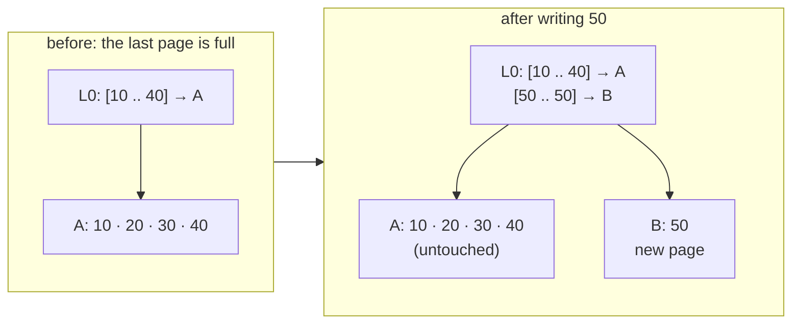
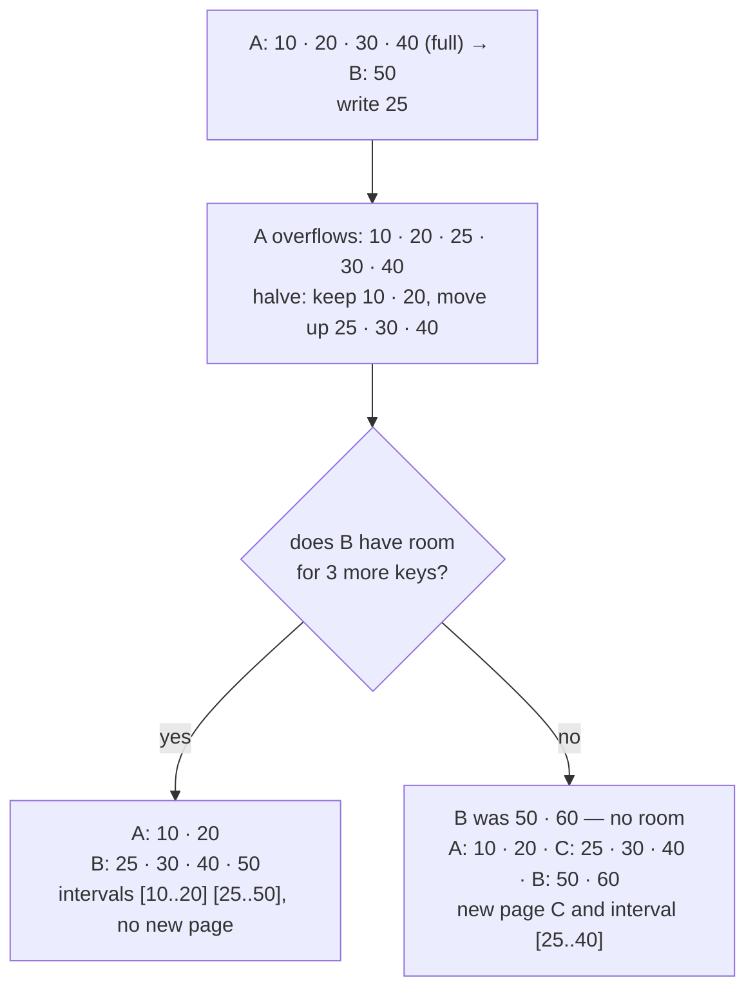
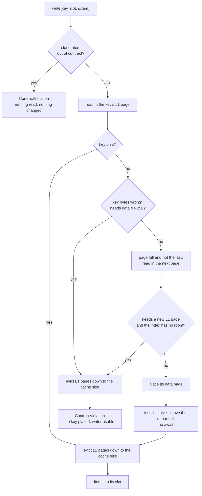
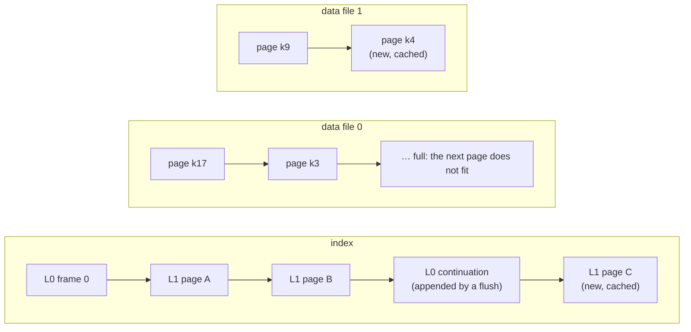
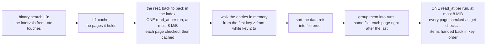
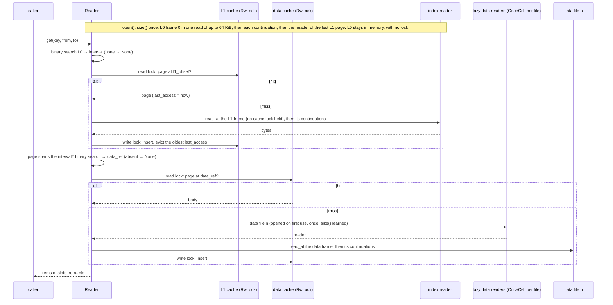

# fixed-key-preallocated-slots

The module `fixed_key_preallocated_slots`; the module itself is private, and everything public in it is exported at the crate root, `archived_data::…`. A fixed-size primary key owns exactly one data page, and the page is preallocated: it has a slot for every period, and a slot is addressed by its position. The slot's position IS the second key: period `N` of a fixed calendar is slot `N`. It is the shape of aggregated data — one value per key per period, every period of the archive known in advance. `FixedKeyPreallocatedSlotsArchiveWriter` writes a working archive from items in any key order; `FixedKeyPreallocatedSlotsArchiveReader` reads working and compact archives — `get` one key, `get_range` every key between two bounds — and compacts them. The caller implements three traits: `PrimaryKeyFixedSize`, `PreallocatedSlotKey` and `PreallocatedDataItem`.

This page is also the reference for everything the two preallocated modules share; [variable-key-preallocated-slots](variable-key-preallocated-slots.md) covers only what a variable-size key changes (see [the last section](#shared-with-the-variable-key-module)).

| Structures | Format | IO |
| --- | --- | --- |
| `FixedKeyPreallocatedSlotsArchiveWriter`, `FixedKeyPreallocatedSlotsArchiveReader` | the split archive: an index and data files `0 ..= 255` | `ArchiveFileWriter` / `ArchiveFileReader` by role, from an `IoWriterFactory` / `IoReaderFactory`: [io](io.md) |
| `FixedKeyPreallocatedSlotsArchiveWriterSingleFile`, `FixedKeyPreallocatedSlotsArchiveReaderSingleFile` | the older one-file format, `u64` offsets | the writer over `AsyncRead + AsyncWrite + AsyncSeek + Unpin`, the reader over `AsyncRead + AsyncSeek + Unpin`: [single-file](single-file.md) |

## The shape of the archive

```text
index         L0 frame 0 at offset 0, chained   header 20 B   count × (from K · to K · l1_offset u32)   2·LEN + 4 B each
index         L1 page, one per L0 interval      header 12 B   count × (key K · data_ref)                LEN + 5 B each, ascending
data file n   data page, one per key            header 10 B   SLOTS × ITEM_LEN, slot 0 first

data_ref = file_no u8 · offset u32
```

- An L0 interval names one L1 page by its first and last key, `from` and `to`. The intervals are ordered and disjoint, and a reader keeps all of them in memory: a lookup is one binary search over L0, then one over the page.
- Every key has one data page of `10 + SLOTS × ITEM_LEN` bytes in one of the data files; its `data_ref` says which file, and where in it.
- An L1 page's keys are strictly ascending, and its first and last keys are its interval's `from` and `to`; a page that breaks that is `Corrupted` when it is read, because a binary search over it could answer "absent" for a key that is there. A data page holds exactly `SLOTS × ITEM_LEN` bytes of items, with `item_len == ITEM_LEN`, or it is `Corrupted`.
- The number of keys is the sum of the `count` fields of every L1 frame header. Nothing stores it separately.
- Little-endian throughout. The [frame headers](split-format.md#frames), the L0 chain and its hash, continuations, the [limits](split-format.md#limits) — a 4 GiB index, 256 data files of at most 4 GiB each — and [what `open` checks](split-format.md#what-open-checks): [split-format](split-format.md).

## The three traits

| Trait | Members | Says | Example |
| --- | --- | --- | --- |
| `PrimaryKeyFixedSize: Ord + Clone` | `const LEN: usize`, `fn from_slice(src: &[u8]) -> Self`, `fn copy_to(&self, out: &mut Vec<u8>)` | the key, its bytes, and how it sorts | an account id: a `u64`, 8 bytes |
| `PreallocatedSlotKey` | `const SLOTS: usize`, `fn slot_index(&self) -> usize` | how many slots a page has, and which one this is | an hour of a day: 24 slots |
| `PreallocatedDataItem: Default` | `const ITEM_LEN: usize`, `fn from_slice(src: &[u8]) -> Self`, `fn copy_to(&self, out: &mut Vec<u8>)` | one slot's bytes, and what an empty slot is | a volume, 8 bytes, empty = 0; a 128-byte record, empty = all `0xFF` |

- Keys sort on `Ord`, never on their bytes, so the byte form need not sort the same way: a little-endian `u64` does not.
- `from_slice` gets exactly `LEN` (or `ITEM_LEN`) bytes and must give back the value whose `copy_to` wrote them. The crate cannot check that.
- `copy_to` must append exactly `LEN` (or `ITEM_LEN`) bytes, and `slot_index` must be below `SLOTS`. The crate checks both on its own side, through crate-internal traits with one blanket implementation each, which no implementation can override: a broken implementation is a `ContractViolation`, never a silently corrupted archive.
- `Default` is the EMPTY item. A new data page is filled with it, so a slot never written reads back as `Default`. There is no "slot is used" flag: an item equal to `Default` reads back exactly like a slot never written.
- The sizes are checked when a writer or a reader is created, and a size no header can hold panics: `LEN` 0, `SLOTS` 0, `ITEM_LEN` 0 or above 65 535 (`item_len` is a `u16`), a data page, an L1 page or an L0 frame past `u32::MAX` bytes.
- `PreallocatedSlotKey` and `PreallocatedDataItem` are the same traits in the variable-key module; `PrimaryKeyFixedSize` is this module's.

## Writing and reading

Rows arrive in any order; `finish` makes them the archive; the reader answers by key and by range.

```rust
use archived_data::*;

/// An account id, 8 bytes little-endian.
#[derive(Debug, Clone, Copy, PartialEq, Eq, PartialOrd, Ord)]
struct Login(u64);

impl PrimaryKeyFixedSize for Login {
    const LEN: usize = 8;

    fn from_slice(src: &[u8]) -> Self {
        Self(u64::from_le_bytes(src.try_into().unwrap()))
    }

    fn copy_to(&self, out: &mut Vec<u8>) {
        out.extend_from_slice(&self.0.to_le_bytes());
    }
}

/// An hour of a day: 24 slots.
#[derive(Debug, Clone, Copy)]
struct Hour(usize);

impl PreallocatedSlotKey for Hour {
    const SLOTS: usize = 24;

    fn slot_index(&self) -> usize {
        self.0
    }
}

/// The volume traded in an hour; 0 is the empty slot.
#[derive(Debug, Clone, Copy, Default, PartialEq)]
struct Volume(u64);

impl PreallocatedDataItem for Volume {
    const ITEM_LEN: usize = 8;

    fn from_slice(src: &[u8]) -> Self {
        Self(u64::from_le_bytes(src.try_into().unwrap()))
    }

    fn copy_to(&self, out: &mut Vec<u8>) {
        out.extend_from_slice(&self.0.to_le_bytes());
    }
}

#[tokio::main]
async fn main() {
    let dir = std::env::temp_dir().join(format!(
        "archived-data-docs-fixed-key-preallocated-slots-1-{}",
        std::process::id()
    ));
    let _ = std::fs::remove_dir_all(&dir);

    // (login, hour, volume) in no key order; login 10, hour 1 is written twice.
    let rows = [
        (30, 9, 300),
        (10, 1, 5),
        (20, 23, 200),
        (10, 0, 100),
        (30, 10, 310),
        (10, 1, 110),
    ];

    let mut writer = FixedKeyPreallocatedSlotsArchiveWriter::new(LocalFileIo::new(&dir))
        .await
        .unwrap();
    for (login, hour, volume) in rows {
        writer
            .write(Login(login), Hour(hour), &Volume(volume))
            .await
            .unwrap();
    }
    assert_eq!(writer.keys_count(), 3);
    writer.finish().await.unwrap();

    let reader = FixedKeyPreallocatedSlotsArchiveReader::<Login, Hour, Volume, _, _>::open(
        LocalFileIo::new(&dir),
    )
    .await
    .unwrap();

    // Slots 0..=2 of login 10: the last item written to each slot, Default for slot 2.
    assert_eq!(
        reader.get(&Login(10), Hour(0), Hour(2)).await.unwrap(),
        Some(vec![Volume(100), Volume(110), Volume(0)])
    );

    // A key the archive does not hold.
    assert_eq!(reader.get(&Login(15), Hour(0), Hour(23)).await.unwrap(), None);

    // from > to: an empty list at once, reading nothing, whether the key is there or not.
    assert_eq!(
        reader.get(&Login(15), Hour(5), Hour(4)).await.unwrap(),
        Some(vec![])
    );

    // Every key from 15 to 30, ascending, with its slots 9..=10.
    assert_eq!(
        reader
            .get_range(&Login(15), &Login(30), Hour(9), Hour(10))
            .await
            .unwrap(),
        vec![
            (Login(20), vec![Volume(0), Volume(0)]),
            (Login(30), vec![Volume(300), Volume(310)]),
        ]
    );

    assert_eq!(reader.keys_count().await.unwrap(), 3);

    drop(reader);
    std::fs::remove_dir_all(&dir).unwrap();
}
```

## The writer

`FixedKeyPreallocatedSlotsArchiveWriter<TPrimaryKey, TSlotKey, TItem, TFactory, TWriter, TReader>` builds a WORKING archive ([writer.rs](../src/fixed_key_preallocated_slots/writer.rs)). Its one factory implements both `IoWriterFactory<TWriter>` and `IoReaderFactory<TReader>` — `LocalFileIo` does — because the writer reads its own evicted L1 pages back.

| Method | Does |
| --- | --- |
| `async fn new(factory: TFactory) -> Result<Self, ArchiveError>` | `new_with_capacity(factory, DEFAULT_L0_CAPACITY, DEFAULT_L1_CAPACITY)`: 1024 and 1024 |
| `async fn new_with_capacity(factory: TFactory, capacity_l0: usize, capacity_l1: usize) -> Result<Self, ArchiveError>` | creates the index and appends L0 frame 0 |
| `async fn write(&mut self, key: TPrimaryKey, slot: TSlotKey, item: &TItem) -> Result<(), ArchiveError>` | puts `item` into slot `slot` of the data page of `key` |
| `async fn flush(&mut self) -> Result<(), ArchiveError>` | makes everything written so far the archive |
| `async fn finish(self) -> Result<(), ArchiveError>` | `flush`, then `finish` on every file |
| `fn set_l1_cache_size(&mut self, pages: usize)` | L1 pages kept in memory: 64 by default, at least 1 |
| `fn set_data_cache_size(&mut self, pages: usize)` | data pages kept in memory: 1024 by default, 0 = none |
| `fn set_max_data_file_bytes(&mut self, bytes: u64)` | the size at which data files roll over: 4 GiB by default; before the first key |
| `fn max_data_file_bytes(&self) -> u64` | that size |
| `fn keys_count(&self) -> usize` | the keys placed so far |
| `fn l0_intervals(&self) -> usize` | the L0 intervals so far, one per L1 page |
| `fn l0_frames(&self) -> usize` | the L0 frames the index has room for: frame 0 plus every continuation a flush reserved |
| `fn data_files(&self) -> usize` | the data files created so far |

`new_with_capacity(factory, capacity_l0, capacity_l1)`:

- `capacity_l0` is the number of intervals per L0 FRAME, not a limit on L0: more intervals chain more frames, which a flush reserves at the end of the index. `capacity_l1` is the number of keys per L1 page; every working L1 page takes `12 + capacity_l1 × (LEN + 5)` bytes, however many keys it holds.
- It creates the index and appends frame 0, sized for `capacity_l0` intervals, with a hash that does not verify: the index is refused at open until a flush completes ([the frame-0 hash](lifecycle.md#when-a-working-archive-opens-the-frame-0-hash)). Data file 0 is created with the first key, data file `n` with its first page.
- `Io` when the factory cannot create the index or the append of frame 0 fails. Panics when a capacity is 0, or when a page of these types cannot fit its `u32` size.

### A new key and a known key

A known key has its item written into its slot in place: into the cached data page, or, when the page is not cached, straight into its data file with `write_at`, whichever data file holds it.

A new key:

1. finds its interval: the last one with `from <= key`, or the first when the key is below them all (the first key of an archive has none, and starts the first L1 page);
2. gets a data page placed at the end of the current data file, `Default` in every slot;
3. goes, sorted, into that interval's L1 page when the page has room, and the interval's `from` and `to` follow;
4. when that page is full — it holds `capacity_l1` keys — Rule 1 or Rule 2 says where the key and the page's overflow go.

### Rule 1 — append

The key is past the last key of the LAST page, and that page is full: the page is NOT halved. A new page holds only the new key, and its interval is added after the last one. So keys written in ascending order fill every page completely; the only partial page is the last.



### Rule 2 — insert

Any other overflow halves the page. With the new key the page holds `capacity_l1 + 1` keys: the lower `⌊(capacity_l1 + 1) / 2⌋` stay, the upper `⌈(capacity_l1 + 1) / 2⌉` move. The upper half is below every key of the NEXT page, so when that page has room for all of it, it moves in front of that page's keys: this interval's `to` shrinks, the next one's `from` moves down, and no page or interval is added. Only when the next page has no room for the whole upper half — or there is no next page — is a new page allocated for it, with a new interval right after this one.



Both rules, seen through `l0_intervals()` at 4 keys per page:

```rust
use archived_data::*;

/// An account id, 8 bytes little-endian.
#[derive(Debug, Clone, Copy, PartialEq, Eq, PartialOrd, Ord)]
struct Login(u64);

impl PrimaryKeyFixedSize for Login {
    const LEN: usize = 8;

    fn from_slice(src: &[u8]) -> Self {
        Self(u64::from_le_bytes(src.try_into().unwrap()))
    }

    fn copy_to(&self, out: &mut Vec<u8>) {
        out.extend_from_slice(&self.0.to_le_bytes());
    }
}

/// An hour of a day: 24 slots.
#[derive(Debug, Clone, Copy)]
struct Hour(usize);

impl PreallocatedSlotKey for Hour {
    const SLOTS: usize = 24;

    fn slot_index(&self) -> usize {
        self.0
    }
}

/// The volume traded in an hour; 0 is the empty slot.
#[derive(Debug, Clone, Copy, Default, PartialEq)]
struct Volume(u64);

impl PreallocatedDataItem for Volume {
    const ITEM_LEN: usize = 8;

    fn from_slice(src: &[u8]) -> Self {
        Self(u64::from_le_bytes(src.try_into().unwrap()))
    }

    fn copy_to(&self, out: &mut Vec<u8>) {
        out.extend_from_slice(&self.0.to_le_bytes());
    }
}

#[tokio::main]
async fn main() {
    let dir = std::env::temp_dir().join(format!(
        "archived-data-docs-fixed-key-preallocated-slots-2-{}",
        std::process::id()
    ));
    let _ = std::fs::remove_dir_all(&dir);

    // 1024 intervals per L0 frame, 4 keys per L1 page.
    let mut writer =
        FixedKeyPreallocatedSlotsArchiveWriter::new_with_capacity(LocalFileIo::new(&dir), 1024, 4)
            .await
            .unwrap();

    // Ascending keys fill every page: [10 20 30 40] [50 60 70 80] [90].
    for login in [10, 20, 30, 40, 50, 60, 70, 80, 90] {
        writer.write(Login(login), Hour(0), &Volume(login)).await.unwrap();
    }
    assert_eq!(writer.l0_intervals(), 3);

    // Rule 2, the next page is full: [10 20] [25 30 40] [50 60 70 80] [90].
    writer.write(Login(25), Hour(0), &Volume(25)).await.unwrap();
    assert_eq!(writer.l0_intervals(), 4);

    // Rule 2, the next page has room: [10 20] [25 30 40] [50 60] [70 80 85 90].
    writer.write(Login(85), Hour(0), &Volume(85)).await.unwrap();
    assert_eq!(writer.l0_intervals(), 4);

    // Rule 1, past the last key of the full last page: … [70 80 85 90] [95].
    writer.write(Login(95), Hour(0), &Volume(95)).await.unwrap();
    assert_eq!(writer.l0_intervals(), 5);

    writer.finish().await.unwrap();

    let reader = FixedKeyPreallocatedSlotsArchiveReader::<Login, Hour, Volume, _, _>::open(
        LocalFileIo::new(&dir),
    )
    .await
    .unwrap();
    assert_eq!(reader.l0_intervals(), 5);
    assert_eq!(reader.keys_count().await.unwrap(), 12);

    let keys: Vec<u64> = reader
        .get_range(&Login(0), &Login(100), Hour(0), Hour(0))
        .await
        .unwrap()
        .into_iter()
        .map(|(login, _)| login.0)
        .collect();
    assert_eq!(keys, [10, 20, 25, 30, 40, 50, 60, 70, 80, 85, 90, 95]);

    drop(reader);
    std::fs::remove_dir_all(&dir).unwrap();
}
```

### Decided before anything changes

Where a new key goes is decided before the key changes anything. The key's page is read in — and, when it is full and not the last page, the next page too — and every refusal is decided: the key's bytes, data file 256, the index's room for a new page; so is whether the next page has room for the upper half. Only then is the key's data page placed, which may await (a data file created, data pages written), and after that the key goes into L1 with no await between the first L1 change and the last: insert, halve, move the upper half or add the new page. So a write that fails or is dropped halfway never leaves an upper half on no page, and every key written before it is still there.



The pages read in are evicted only after the key is placed, so they are still cached when the page is cut. An L1 page is never cached while it holds more than `capacity_l1` keys, because any eviction may encode any cached page. A refused key leaves through the same eviction: the pages read in for it take the cache back down to its size, which can send an L1 page an EARLIER write changed to the index.

### Where pages go

- A data page goes into the current data file only if it fits there whole — it ends at or before `max_data_file_bytes`; otherwise the next data file starts and the page lands at offset 0. A page is never split across files. So data pages lie in the order their keys first arrived: the page of the `i`-th new key, counting from 0, is at offset `(i % per_file) × page` of data file `i / per_file`, where `page = 10 + SLOTS × ITEM_LEN` and `per_file = floor(max_data_file_bytes / page)`.
- `max_data_file_bytes` is `DEFAULT_MAX_DATA_FILE_BYTES` (4 GiB) unless `set_max_data_file_bytes` sets it before the first key. It can be as small as one data page, which is what tests use. It panics above 4 GiB, below one data page, or once a key is written.
- Every data file created stays open until `finish`: a known key's page may be in any earlier file.
- L1 pages are appended to the index in the order they are allocated, and L0 continuations where a flush reserves them, so the pages of a working index need not be in key order. Compaction puts them in key order.
- Every file grows only by append. An offset is handed out ahead of its bytes, and a page past its file's append frontier is always cached: [lifecycle](lifecycle.md#writing-every-file-grows-only-by-append).



### Caches

| Cache | Default | Set with | 0 means |
| --- | --- | --- | --- |
| L1 pages | `DEFAULT_WRITER_L1_CACHE_PAGES` = 64 | `set_l1_cache_size` | 1: the cache holds at least one page |
| data pages | `DEFAULT_WRITER_DATA_CACHE_PAGES` = 1024 | `set_data_cache_size` | no cache: every new data page is appended at once, every item written straight to its file |

- Each cache evicts its least recently used page. A changed page leaving a cache is rewritten in place when it was appended already, or else appended together with every page before it that is not appended yet; an unchanged one is dropped.
- An L1 page that is not cached was appended already. It is read back — one `read_at` of the whole page — through a reader of the index made by the same factory, created on first need.
- The writer never reads a data file: an item for a data page that is not cached is written into the file.
- A write placing a new key holds up to three L1 pages more than the cache size while it places the key — the key's page, the next one, a new one — and evicts down to the cache size before it writes the item.
- Both setters only store the size and write nothing: the L1 cache comes down to a new size in the next `write`, the data cache when the next new key's data page is placed.
- A smaller cache only costs IO.

### Refusals and failures

```rust
use archived_data::*;

/// An account id, 8 bytes little-endian.
#[derive(Debug, Clone, Copy, PartialEq, Eq, PartialOrd, Ord)]
struct Login(u64);

impl PrimaryKeyFixedSize for Login {
    const LEN: usize = 8;

    fn from_slice(src: &[u8]) -> Self {
        Self(u64::from_le_bytes(src.try_into().unwrap()))
    }

    fn copy_to(&self, out: &mut Vec<u8>) {
        out.extend_from_slice(&self.0.to_le_bytes());
    }
}

/// An hour of a day: 24 slots.
#[derive(Debug, Clone, Copy)]
struct Hour(usize);

impl PreallocatedSlotKey for Hour {
    const SLOTS: usize = 24;

    fn slot_index(&self) -> usize {
        self.0
    }
}

/// The volume traded in an hour; 0 is the empty slot.
#[derive(Debug, Clone, Copy, Default, PartialEq)]
struct Volume(u64);

impl PreallocatedDataItem for Volume {
    const ITEM_LEN: usize = 8;

    fn from_slice(src: &[u8]) -> Self {
        Self(u64::from_le_bytes(src.try_into().unwrap()))
    }

    fn copy_to(&self, out: &mut Vec<u8>) {
        out.extend_from_slice(&self.0.to_le_bytes());
    }
}

#[tokio::main]
async fn main() {
    let dir = std::env::temp_dir().join(format!(
        "archived-data-docs-fixed-key-preallocated-slots-3-{}",
        std::process::id()
    ));
    let _ = std::fs::remove_dir_all(&dir);

    let mut writer = FixedKeyPreallocatedSlotsArchiveWriter::new(LocalFileIo::new(&dir))
        .await
        .unwrap();
    writer.write(Login(7), Hour(3), &Volume(100)).await.unwrap();

    // Hour 24 is not below SLOTS = 24: refused, and nothing changed.
    let refused = writer.write(Login(8), Hour(24), &Volume(1)).await;
    assert!(matches!(refused, Err(ArchiveError::ContractViolation(_))));
    assert_eq!(writer.keys_count(), 1);

    // The writer is still usable.
    writer.write(Login(8), Hour(23), &Volume(1)).await.unwrap();
    writer.finish().await.unwrap();

    let reader = FixedKeyPreallocatedSlotsArchiveReader::<Login, Hour, Volume, _, _>::open(
        LocalFileIo::new(&dir),
    )
    .await
    .unwrap();
    assert_eq!(reader.keys_count().await.unwrap(), 2);
    assert_eq!(
        reader.get(&Login(8), Hour(23), Hour(23)).await.unwrap(),
        Some(vec![Volume(1)])
    );

    // A slot out of range is refused on read too, before anything is read.
    let refused = reader.get(&Login(7), Hour(0), Hour(24)).await;
    assert!(matches!(refused, Err(ArchiveError::ContractViolation(_))));

    drop(reader);
    std::fs::remove_dir_all(&dir).unwrap();
}
```

A refusal is a `ContractViolation` that adds nothing to the archive — no key, no data page, no item — and the writer stays usable after it:

- the slot is not below `SLOTS`, or the item's `copy_to` did not write `ITEM_LEN` bytes — checked first, on every `write`, before anything is read;
- a new key's `copy_to` did not write `LEN` bytes;
- a new key whose data page would need data file 256;
- a new key that needs a new L1 page when the index has no room for it below 4 GiB — room counted with the L0 continuations the next flush will need for the new interval, so a flush never runs into the limit.

The three refusals of a new key are decided after its L1 page was read into the cache, and the write evicts L1 pages down to the cache size on its way out, as every write does. So a refused write may read the index, and may send to it an L1 page an EARLIER write changed: when that is the first byte to reach a file since a completed flush, the index stops opening until the next flush, as after any write that reached a file. A read or an eviction that fails there is a failure — the `Err` is that one, not the refusal.

Anything else stops the writer:

- Any other `Err` — `Io`, an L1 page read back `Corrupted` — and a `write` or `flush` future dropped at an await before it returned (neither is cancel-safe) leave every later `write`, `flush` and `finish` refused as a `ContractViolation`. A call is marked in flight on the way in and cleared only when it returns `Ok` or a refusal, because a dropped future runs no error path. `finish` still finishes every file. The archive is then a working archive in an unknown state, and is rebuilt.
- A `Default` whose `copy_to` does not write `ITEM_LEN` bytes is found only when the first new data page is built, after data file 0 was created: a `ContractViolation` that stops the writer, not a refusal.

Refusals and failures of every writer: [lifecycle](lifecycle.md#a-refusal-changes-nothing-a-failure-stops-the-writer). Every error and panic of the crate in one place: [errors](errors.md#every-outcome-in-one-place).

### flush, finish, and when the archive opens

Nothing written is readable until `flush` or `finish` returns `Ok`. `flush` writes every cached L1 page and data page that changed, then the L0 chain with frame 0 last; with nothing written since the last flush, it writes nothing at all. A working archive opens only when its last flush completed AND nothing reached its files after it; otherwise `open` is `Err(Corrupted)` — an index no flush completed on is never read as an empty archive, nor a half-flushed one as an archive missing a key an earlier flush saved. A `write` whose changes all stayed in the caches reached no file: it is not in the archive until a flush, and does not stop the index from opening. `finish` flushes, then calls `finish` on the index and on every data file created, awaiting each even after another failed, and returns the flush's error first, else the first failed finish. A writer dropped without `finish` leaves each file writer's `Drop` to persist what reached it. Neither a file's `finish` nor `Drop` means the archive is complete: only the writer's `finish` returning `Ok` says every key written is in the working archive. The order of a flush: [flush and finish](lifecycle.md#flush-and-finish). Why an index opens or does not: [the frame-0 hash](lifecycle.md#when-a-working-archive-opens-the-frame-0-hash).

## The reader

`FixedKeyPreallocatedSlotsArchiveReader<TPrimaryKey, TSlotKey, TItem, TFactory, TReader>` reads a working or a compact archive through any `IoReaderFactory<TReader>` — local files, or S3 objects read a range per call — and compacts it ([reader.rs](../src/fixed_key_preallocated_slots/reader.rs), [reader_range.rs](../src/fixed_key_preallocated_slots/reader_range.rs), [reader_compact.rs](../src/fixed_key_preallocated_slots/reader_compact.rs)). Every method but `open` takes `&self`, so concurrent callers share one reader through an `Arc`. The archive is assumed not to change while it is read.

| Method | Does |
| --- | --- |
| `async fn open(factory: TFactory) -> Result<Self, ArchiveError>` | reads L0; opens no data file |
| `async fn get(&self, key: &TPrimaryKey, from: TSlotKey, to: TSlotKey) -> Result<Option<Vec<TItem>>, ArchiveError>` | the slots `from..=to` of one key |
| `async fn get_range(&self, from: &TPrimaryKey, to: &TPrimaryKey, from_slot: TSlotKey, to_slot: TSlotKey) -> Result<Vec<(TPrimaryKey, Vec<TItem>)>, ArchiveError>` | every key in `from..=to`, ascending, with its slots `from_slot..=to_slot` |
| `async fn keys_count(&self) -> Result<usize, ArchiveError>` | the keys of the archive |
| `async fn set_l1_cache_size(&self, pages: usize)` | L1 pages cached: 10 by default |
| `async fn set_data_cache_size(&self, pages: usize)` | data pages cached: 10 by default |
| `fn set_max_data_file_bytes(&self, bytes: u64)` | the data file size of the next `compaction_plan` |
| `fn max_data_file_bytes(&self) -> u64` | that size; `DEFAULT_MAX_DATA_FILE_BYTES` until set |
| `fn l0_intervals(&self) -> usize` | the L0 intervals, one per L1 page |
| `fn l0_frames(&self) -> usize` | how many frames L0 was read from; 1 for every compact archive |
| `async fn compaction_plan(&self) -> Result<CompactionPlan, ArchiveError>` | the exact sizes of the compact archive |
| `async fn write_compacted_to<TOut, TWriter>(&self, plan: &CompactionPlan, out: &TOut) -> Result<(), ArchiveError>` | writes the compact archive through `out: IoWriterFactory<TWriter>` |

`open(factory)`:

- creates the index reader and learns its `size()` once, reads the L0 chain — frame 0 with one read of up to 64 KiB (one more when the frame is longer), then each continuation — and keeps every interval in memory, with no lock, for the reader's life;
- refuses as `Corrupted` bytes that are not a split index, a working index whose last flush did not complete or whose files a byte reached after it, a broken chain, intervals that are not ordered and disjoint, and an index that ends before or inside an L1 page its L0 names — the header of the last L1 page costs one more small read ([what open checks](split-format.md#what-open-checks));
- opens no data file; a missing index is `Io`;
- panics when a page of these types cannot fit its `u32` size, the same check the writer makes.

### get

`get(&key, from, to)` returns the items of slots `from..=to` of `key`, inclusive, in slot order. The example is [above](#writing-and-reading).

- `from == to` is one item. A slot never written is `Default`.
- `Ok(None)`: the archive does not hold the key. A key outside every interval costs no read; one inside an interval costs its L1 page, and opens no data file.
- `from > to`: `Ok(Some(vec![]))` at once, reading nothing and opening no data file — also for a key that is not there, so it says nothing about whether the key is.
- A slot not below `SLOTS`: `ContractViolation`, before anything else — with `from > to` too.
- A failed read or a corrupted page is an `Err`, never `None`. A `data_ref` into a data file the factory cannot open is `Io`.
- Cost: the L1 page and the data page, each through its cache; a miss is usually one `read_at`. The first read of a data file also opens it.

### get_range

`get_range(&from, &to, from_slot, to_slot)` returns EVERY key `k` of the archive with `from <= k <= to`, in ascending key order, each with the items of its slots `from_slot..=to_slot` exactly as `get` gives them — all at once.

- `from > to`: `Ok(vec![])` at once, reading nothing.
- `from_slot > to_slot`: every key in the range with no items; the L1 pages are read, no data page is.
- A range between two keys, or over an empty archive: `Ok(vec![])`.
- A slot not below `SLOTS`: `ContractViolation`, before anything else.
- A failed read or a damaged page anywhere in the range is an `Err` — never a partial `Ok`. A data file the factory cannot open is `Io`.



L1 pages ([split_range_l1_pages.rs](../src/split_range_l1_pages.rs)):

- The intervals the range touches are found in L0, in memory. A page the L1 cache holds comes from it, as `get`'s pages do.
- The pages it does not hold, and that lie one after another in the index, are read in RUNS: one `read_at` of at most 8 MiB per run, clamped to the index. Each page is decoded and checked as a read of that page alone is, and inserted into the L1 cache.
- A page's size is known only once it is read, so a page is taken to follow the one before it when it starts at most one default page length, `12 + 1024 × (LEN + 5)`, after it: in a compact index, exactly the pages back to back. A page chained to a continuation, or longer than its run's read, is loaded on its own, and so is a page with no neighbour to share a read with.
- Every page, cached or just read, must span its interval exactly, or it is `Corrupted`.
- So a wide range of a compact archive costs a handful of index reads, and the same range again, with an L1 cache that holds its pages, none. In a working index the pages lie in the order they were allocated, which need not be key order, so fewer of them share a read.

Data pages ([split_data_runs.rs](../src/split_data_runs.rs), [split_range_items.rs](../src/split_range_items.rs)):

- They are read in FILE order, never through the data cache and never filling it: the refs are sorted by `(file_no, offset)`, the pages that follow one another in one data file — each starting where the one before it ends — come in one `read_at` per run of at most 8 MiB, every page is checked as `get` checks it, and the items are handed back in key order. A run is whole pages: a data page longer than 8 MiB is a run, and a read, of its own. A page chained to a continuation is read on its own.
- A contiguous range of a compact archive is a handful of reads. So is a dense range of a working archive, whose pages lie in the order their keys first arrived, whatever that order was. A sparse range of a working archive still costs about one read per key: its pages have gaps between them.

Memory: every key of the range with `(to_slot − from_slot + 1) × size_of::<TItem>()` bytes of items, plus one run at a time — at most 8 MiB, or one data page when a page is longer.

### keys_count

`keys_count().await` is the sum of the `count` of every L1 frame header: one small read — a 12-byte header — per L1 frame, uncached, so about one per page. A header that cannot hold its `count` is `Corrupted`. The writer's `keys_count()` is not async: it counts the keys it placed.

### Caches and settings

| Cache | Default | Set with |
| --- | --- | --- |
| L1 pages | `DEFAULT_READER_L1_CACHE_PAGES` = 10 | `set_l1_cache_size(pages).await` |
| data pages | `DEFAULT_READER_DATA_CACHE_PAGES` = 10 | `set_data_cache_size(pages).await` |

- Each cache is bounded by page count, under its own `RwLock`, and evicts the page with the oldest `last_access`.
- A setter evicts down to `pages` before it returns, and the cache holds at most `pages` from then on: 0 empties it and caches nothing more. An insert reads the size under the write lock, so one racing a shrink cannot leave the cache above it.
- `get` goes through both caches, `get_range` through the L1 cache only, `keys_count`, `compaction_plan` and `write_compacted_to` through neither.
- `set_max_data_file_bytes(bytes)` sets the data file size the next `compaction_plan` lays the compact data files out with, `DEFAULT_MAX_DATA_FILE_BYTES` until set. It says nothing about the archive being read. Panics above 4 GiB or below one data page.

### Inside a read



- A hit only stamps the page's `last_access`, an `AtomicDateTimeAsMicroseconds`, under the READ lock, so callers of cached pages never wait on each other. A miss reads with no cache lock held and takes the WRITE lock only to insert — dropping its own copy if another caller inserted the page meanwhile — evicting the page with the oldest `last_access` ([page_cache.rs](../src/page_cache.rs)).
- A cached L1 page is checked like a page just read: its first and last keys must be the `from` and `to` of the interval asking for it, or it is `Corrupted`. In a damaged index two intervals can name one page; the page is then cached against one of them, and handing it to the other would answer `None` for a key that is there, or a range with keys repeated and missing.
- Data files are opened lazily, once each. `open` opens none; the first read of file `n` opens it through a `OnceCell`, however many callers race for it, learns its `size()`, and keeps it for the reader's life. A file that fails to open is not remembered, so the next read tries again ([lazy_data_readers.rs](../src/lazy_data_readers.rs)).
- Reads are exact: `read_at` returns exactly `len` bytes or `UnexpectedEof`, so the reader clamps every speculative read to the file's size. The usual L1 page and the usual data page each cost ONE `read_at`, and a frame whose size reaches past its file is `Corrupted` without a read past the end ([exact reads](split-format.md#exact-reads)).
- No position is shared: `read_at` carries its offset, so misses — of one file or of many — do not wait on each other. Whether a dropped `read_at` is safe is the IO implementation's business: [io](io.md). The reader itself keeps nothing half done — no cache lock is held across a read, and a data file whose first open was dropped or failed is opened again by the next read — so a `get` or a `get_range` that failed or was dropped at an await leaves the reader usable.

## Compaction and the compact shape

```rust
use archived_data::*;

/// An account id, 8 bytes little-endian.
#[derive(Debug, Clone, Copy, PartialEq, Eq, PartialOrd, Ord)]
struct Login(u64);

impl PrimaryKeyFixedSize for Login {
    const LEN: usize = 8;

    fn from_slice(src: &[u8]) -> Self {
        Self(u64::from_le_bytes(src.try_into().unwrap()))
    }

    fn copy_to(&self, out: &mut Vec<u8>) {
        out.extend_from_slice(&self.0.to_le_bytes());
    }
}

/// An hour of a day: 24 slots.
#[derive(Debug, Clone, Copy)]
struct Hour(usize);

impl PreallocatedSlotKey for Hour {
    const SLOTS: usize = 24;

    fn slot_index(&self) -> usize {
        self.0
    }
}

/// The volume traded in an hour; 0 is the empty slot.
#[derive(Debug, Clone, Copy, Default, PartialEq)]
struct Volume(u64);

impl PreallocatedDataItem for Volume {
    const ITEM_LEN: usize = 8;

    fn from_slice(src: &[u8]) -> Self {
        Self(u64::from_le_bytes(src.try_into().unwrap()))
    }

    fn copy_to(&self, out: &mut Vec<u8>) {
        out.extend_from_slice(&self.0.to_le_bytes());
    }
}

#[tokio::main]
async fn main() {
    let working = std::env::temp_dir().join(format!(
        "archived-data-docs-fixed-key-preallocated-slots-4-{}",
        std::process::id()
    ));
    let compact = std::env::temp_dir().join(format!(
        "archived-data-docs-fixed-key-preallocated-slots-4-compact-{}",
        std::process::id()
    ));
    let _ = std::fs::remove_dir_all(&working);
    let _ = std::fs::remove_dir_all(&compact);

    let mut writer = FixedKeyPreallocatedSlotsArchiveWriter::new(LocalFileIo::new(&working))
        .await
        .unwrap();
    for login in [3, 1, 2] {
        writer.write(Login(login), Hour(0), &Volume(login)).await.unwrap();
    }
    writer.finish().await.unwrap();

    let reader = FixedKeyPreallocatedSlotsArchiveReader::<Login, Hour, Volume, _, _>::open(
        LocalFileIo::new(&working),
    )
    .await
    .unwrap();

    // A data page is 10 + 24 × 8 = 202 bytes; two of them fit 504 bytes.
    let page = 202;
    reader.set_max_data_file_bytes(2 * page + 100);
    let plan = reader.compaction_plan().await.unwrap();

    // 3 keys: one L1 page. LEN 8: an L0 entry of 20 bytes, an L1 page of 12 + 1024 × 13.
    assert_eq!(plan.keys_count(), 3);
    assert_eq!(plan.index_size(), 20 + 20 + (12 + 1024 * 13));
    assert_eq!(plan.data_file_sizes(), [2 * page, page]);

    reader
        .write_compacted_to(&plan, &LocalFileIo::new(&compact))
        .await
        .unwrap();

    // Every file has exactly its planned size.
    let size = |name: &str| std::fs::metadata(compact.join(name)).unwrap().len();
    assert_eq!(size(index_file_name()), plan.index_size());
    assert_eq!(size(&data_file_name(0)), 2 * page);
    assert_eq!(size(&data_file_name(1)), page);

    let compacted = FixedKeyPreallocatedSlotsArchiveReader::<Login, Hour, Volume, _, _>::open(
        LocalFileIo::new(&compact),
    )
    .await
    .unwrap();
    assert_eq!(compacted.l0_frames(), 1);
    assert_eq!(
        compacted.get(&Login(3), Hour(0), Hour(0)).await.unwrap(),
        Some(vec![Volume(3)])
    );

    drop(reader);
    drop(compacted);
    std::fs::remove_dir_all(&working).unwrap();
    std::fs::remove_dir_all(&compact).unwrap();
}
```

- `compaction_plan().await` walks the L1 pages once, through no cache, groups the keys into compact pages and works out the exact size of the compact index and of every compact data file under the reader's `max_data_file_bytes`: `CompactionPlan::index_size()`, `data_file_sizes()` (none for an empty archive) and `keys_count()`. Keys that do not ascend across L1 pages are `Corrupted`; a compact index past 4 GiB, or data needing data file 256, is a `ContractViolation`.
- `write_compacted_to(&plan, &out).await` writes each data file in order, `append` only, each finished before the next is created; then the index, `append` only, finished LAST. It never calls `write_at`. It walks the source's L1 pages twice — once for the data files, once for the index — through no cache, with one read per key's data page. Memory: the source L1 page it walks, plus one data page or the compact L1 page it builds. A source that no longer matches the plan is `Corrupted`.
- The compact archive depends only on the keys, the items and `max_data_file_bytes` — not on the write order, the working page sizes or how the frames were chained — so two runs over one archive write identical files as long as `max_data_file_bytes` is the same. It is complete when its index exists AND opens. The protocol — data files first, the index last, what a failed run leaves: [compaction](lifecycle.md#compaction-the-data-files-first-the-index-last), [determinism](lifecycle.md#determinism), [CompactionPlan](lifecycle.md#compactionplan).

The compact shape: ONE L0 frame of exact size (`next` 0), then full L1 pages of `COMPACT_L1_CAPACITY` = 1024 keys, the last one zero-padded to 1024 entries, then every data page as ONE frame, in ascending key order across the data files.

```text
n          = keys,  p = ceil(n / 1024) compact L1 pages
index      = 20 + p × (2·LEN + 4)                      the L0 frame
           + p × (12 + 1024 × (LEN + 5))               the L1 pages
page       = 10 + SLOTS × ITEM_LEN                     one data page
per_file   = floor(max_data_file_bytes / page)
ref(i)     = (i / per_file,  (i % per_file) × page)    the data page of the key of rank i
data file  = per_file × page for every full file, the rest in the last
empty      = a 20-byte index and NO data files
```

Every `ref(i)` is a closed form, so the index needs nothing from the data pass and is written last. `l0_frames()` of a compact archive is 1, and `l0_intervals()` is `p`.

## Constants

| Constant | Value | Is |
| --- | --- | --- |
| `DEFAULT_L0_CAPACITY` | 1024 | intervals per L0 frame of a working archive, by default |
| `DEFAULT_L1_CAPACITY` | 1024 | keys per L1 page of a working archive, by default; a reader's first read of an L1 page asks for a page of this capacity |
| `COMPACT_L1_CAPACITY` | 1024 | keys per L1 page of every compact archive |
| `DEFAULT_WRITER_L1_CACHE_PAGES` | 64 | the writer's L1 cache |
| `DEFAULT_WRITER_DATA_CACHE_PAGES` | 1024 | the writer's data page cache |
| `DEFAULT_READER_L1_CACHE_PAGES` | 10 | the reader's L1 cache |
| `DEFAULT_READER_DATA_CACHE_PAGES` | 10 | the reader's data page cache |
| `DEFAULT_MAX_DATA_FILE_BYTES` | 4 GiB, `1 << 32` | where data files roll over until `set_max_data_file_bytes`; also the most a data file may hold, `MAX_DATA_FILE_BYTES` |
| `MAX_INDEX_BYTES` | 4 GiB, `1 << 32` | the most an index may hold: every offset stored in it is a `u32` |
| `MAX_DATA_FILES` | 256 | the data files of one archive, `0 ..= 255`: a `data_ref` names its file in one byte |

## Shared with the variable-key module

The same code at the crate root, so the same behaviour, in `VariableKeyPreallocatedSlotsArchiveWriter` / `…Reader`:

- the traits `PreallocatedSlotKey` and `PreallocatedDataItem`, the data page and the empty item;
- the data files: pages placed in the order their keys first arrive, rollover at `max_data_file_bytes`, data file 256 refused;
- the writer: every method but the constructor's sizes, a new key and a known key, the decision before anything changes, the four placements (a new page past the last one, an insert, a full page split into the next page, a full page split into a new page), the caches, the refusals — a variable key adds its own, and is checked on every `write`, before anything is read — and failures, `flush` and `finish`;
- the reader: `open`, `get`, `get_range`, `keys_count`, the caches and their setters, and everything in [Inside a read](#inside-a-read);
- compaction: `CompactionPlan`, `compaction_plan` and `write_compacted_to`, and the compact data files with `ref(i)`.

What a variable key changes — [variable-key-preallocated-slots](variable-key-preallocated-slots.md): `PrimaryKeyVariableSize` and its length prefix; L0 frames and L1 pages sized in BYTES, so a page overflows when an entry no longer fits and is split by bytes, and the half-page rule refuses a key whose entry is more than half of a page's room for entries; the L0 continuations a new key needs, bounded rather than counted; a reader's first read of an L1 page, and `get_range`'s test of which pages follow one another, sized by the default 16 KiB page; compact L1 pages of exact size, closed at 1024 keys or before the entry that would take them past 16 KiB (one entry longer than that still gets a page of its own); and a key prefix as a range, `last_key_starting_with`.
