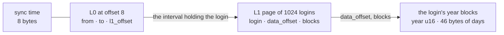

# global-day-index

Module `global_day_index`. ONE file per MT server — a login is unique only inside its server — that says, for every login, on which days it has data, so a read over a period opens only the day archives that hold something. `GlobalDayIndex<TKey>` is the index in memory: the old version plus a day's logins, written out whole as the next version. `GlobalDayIndexReader<TKey, TReader>` answers `days_with_data` from the file where it lies — a local file, or an S3 object read a range per call — by reading one L1 page and one login's blocks. The login is any `PrimaryKeyFixedSize`. The file is never split and never changed in place: how the archiver writes, renames and uploads each version is [archiving-a-day](archiving-a-day.md).

The format is specified in the Task manager document `architecture/archived-data-history-records.md` of project RMS. The decisions it left open are [at the end](#decisions-the-document-left-open).

## The file

Little-endian throughout. `K` is `TKey::LEN`.

| part | where | bytes |
| --- | --- | --- |
| sync time | offset 0, `GLOBAL_DAY_INDEX_SYNC_TIME_LEN` = 8 bytes | `i64` of microseconds: when this version was synchronised. The archiver compares it to tell which of two copies is newer |
| L0 | offset 8 | the [split L0 frame](split-format.md#frames), with its hash: `size u32 · next u32 · count u32 · hash u64`, then `count × (from K · to K · l1_offset u32)`. Written as ONE frame of exactly that size, `next` 0 |
| L1 | after L0, one page per `COMPACT_L1_CAPACITY` = 1024 logins | split L1 frames: `size u32 · next u32 · count u32`, then `count × (login K · data_offset u32 · blocks u16)`, logins ascending. Every page is `12 + 1024 × (K + 6)` bytes; the last one is zero-padded |
| data | after the last L1 page | for each login, in login order, `blocks × 48` bytes: `year u16`, then 46 bytes of days. Years ascending |

`l1_offset` and `data_offset` are absolute offsets in the file. A year with no day has no block, and a login has at least one block.

```text
pages = ⌈logins / 1024⌉
size  = 8 + (20 + pages × (2K + 4)) + pages × (12 + 1024 × (K + 6)) + blocks × 48

K = 8:  no login                          28 bytes
        one login with one year       14 444 bytes
        3 000 logins, one year each  187 132 bytes
```

A lookup goes through the file in this order:



Sources: [layout.rs](../src/global_day_index/layout.rs) (L1 entries), [index.rs](../src/global_day_index/index.rs) (`to_bytes`), [year_days.rs](../src/global_day_index/year_days.rs) (blocks and days), [reader.rs](../src/global_day_index/reader.rs). The tests in [tests.rs](../src/global_day_index/tests.rs) build a reference file byte by byte.

## The days of a year

A day is its position in the calendar of a LEAP year, so a date has the same position in every year: 1 January is 0, 29 February is 59, 1 March is always 60. Day `d` is bit `1 << (d % 8)` of byte `d / 8` of the 46 bytes.

```text
position = start of the month + day of the month − 1
starts   = 0 31 60 91 121 152 182 213 244 274 305 335      January … December

day   0    1 January       byte 0    0x01
day   7    8 January       byte 0    0x80
day   8    9 January       byte 1    0x01
day  58   28 February      byte 7    0x04
day  59   29 February      byte 7    0x08    never set in a common year
day  60    1 March         byte 7    0x10    in every year
day 365   31 December      byte 45   0x20
bits 366 and 367           byte 45   0x40, 0x80, always 0
```

- 366 days take 46 bytes, and the last two bits are always 0.
- A common year never sets day 59.
- A year is a `u16`: 0 to 65 535.
- The day of a moment is `unix_microseconds` floored to a multiple of 86 400 000 000, so it is a whole day of the `i64` timeline, which is UTC for `DateTimeAsMicroseconds`. The calendar is the proleptic Gregorian one, computed by the crate in [calendar.rs](../src/calendar.rs) rather than by `chrono`.
- The archiver marks a day archive with `set_day(login, day_start)`, which sets the day that `day_start` falls in. When `day_start` is a midnight, `days_with_data` gives back exactly that `day_start`.
- The records writer, `FixedKeyMinuteIndexedRecordsArchiveWriter`, does not check that its `day_start` is a midnight. An archive that starts at 21:00 covers two days of this calendar, and `set_day(login, day_start)` sets only the first: a read over the second day alone does not find the archive.

## GlobalDayIndex — a version in memory

```rust
use archived_data::*;
use rust_extensions::date_time::DateTimeAsMicroseconds;

/// An account id, 8 bytes little-endian.
#[derive(Debug, Clone, Copy, PartialEq, Eq, PartialOrd, Ord)]
struct Login(u64);

impl PrimaryKeyFixedSize for Login {
    const LEN: usize = 8;

    fn from_slice(src: &[u8]) -> Self {
        Self(u64::from_le_bytes(src.try_into().unwrap()))
    }

    fn copy_to(&self, out: &mut Vec<u8>) {
        out.extend_from_slice(&self.0.to_le_bytes());
    }
}

fn day(year: i32, month: u32, day: u32) -> DateTimeAsMicroseconds {
    DateTimeAsMicroseconds::create(year, month, day, 0, 0, 0, 0)
}

#[tokio::main]
async fn main() {
    let mut index = GlobalDayIndex::<Login>::new(DateTimeAsMicroseconds::new(1_000));

    // Any moment of a day sets that day, and setting it again changes nothing.
    let afternoon = DateTimeAsMicroseconds::create(2024, 2, 29, 13, 45, 0, 0);
    index.set_day(Login(7), afternoon).unwrap();
    index.set_day(Login(7), day(2024, 2, 29)).unwrap();
    index.set_day(Login(7), day(2025, 3, 1)).unwrap();
    index.set_day(Login(42), day(2025, 3, 1)).unwrap();
    index.set_sync_time(DateTimeAsMicroseconds::new(2_000));

    // A year a u16 cannot hold is refused, and changes nothing.
    let too_far = DateTimeAsMicroseconds::create(65_536, 1, 1, 0, 0, 0, 0);
    assert!(matches!(
        index.set_day(Login(7), too_far),
        Err(ArchiveError::ContractViolation(_))
    ));

    let bytes = index.to_bytes().unwrap();

    // The sync time, L0 of one interval, one L1 page, three year blocks.
    assert_eq!(bytes.len(), 8 + (20 + 20) + (12 + 1024 * 14) + 3 * 48);
    let sync_time = GlobalDayIndex::<Login>::sync_time_of(&bytes[..GLOBAL_DAY_INDEX_SYNC_TIME_LEN]);
    assert_eq!(sync_time.unwrap(), DateTimeAsMicroseconds::new(2_000));

    // Login 7's blocks come first. In 2024, 29 February is day 59: 0x08 of byte 7.
    let blocks = &bytes[bytes.len() - 3 * 48..];
    assert_eq!(blocks[..2], 2024u16.to_le_bytes());
    assert_eq!(blocks[2 + 7], 0x08);
    // In 2025, a common year, 1 March is day 60, as in every year: 0x10 of byte 7.
    assert_eq!(blocks[48..50], 2025u16.to_le_bytes());
    assert_eq!(blocks[48 + 2 + 7], 0x10);

    // The bytes are read back by the same reader that reads a file, with every block checked.
    let parsed = GlobalDayIndex::<Login>::from_bytes(bytes.clone()).await.unwrap();
    assert_eq!(parsed, index);
    assert_eq!(parsed.logins_count(), 2);

    let cut = bytes[..bytes.len() - 1].to_vec();
    assert!(matches!(
        GlobalDayIndex::<Login>::from_bytes(cut).await,
        Err(ArchiveError::Corrupted(_))
    ));

    // Day starts, ascending. The day of `from` and the day of `to` are both included.
    let found = parsed.days_with_data(&Login(7), day(2024, 1, 1), day(2025, 12, 31));
    assert_eq!(found, [day(2024, 2, 29), day(2025, 3, 1)]);

    let evening = DateTimeAsMicroseconds::create(2025, 3, 1, 23, 0, 0, 0);
    assert_eq!(parsed.days_with_data(&Login(42), evening, evening), [day(2025, 3, 1)]);

    // An unknown login, and from > to, have no day.
    assert!(parsed.days_with_data(&Login(8), day(2024, 1, 1), day(2025, 12, 31)).is_empty());
    assert!(parsed.days_with_data(&Login(7), day(2025, 12, 31), day(2024, 1, 1)).is_empty());
}
```

`GlobalDayIndex<TKey: PrimaryKeyFixedSize>` derives `Debug`, `Clone`, `PartialEq` and `Eq`. `Debug` needs a key that is `Debug`; every key gives the other three.

| method | returns | contract |
| --- | --- | --- |
| `new(sync_time: DateTimeAsMicroseconds)` | `Self` | An index of no login. |
| `async from_bytes(bytes: Vec<u8>)` | `Result<Self, ArchiveError>` | `read_from` over the bytes in memory. |
| `async read_from<TReader: ArchiveFileReader>(reader: TReader)` | `Result<Self, ArchiveError>` | The whole index: `GlobalDayIndexReader::open`, then every L1 page and every login's blocks, each checked as a lookup checks them. After `open`'s reads it makes one `read_at` per L1 page and one per login: a ranged GET each over S3, a call on the blocking pool each over a `LocalFileReader`. So download an S3 object, or read a local file, whole and call `from_bytes`. For a file of 200 000 logins (22 MB), in a release build, that took about 0.15 s, and `read_from` over the local file about 1.2 s. |
| `sync_time_of(first_bytes: &[u8])` | `Result<DateTimeAsMicroseconds, ArchiveError>` | The sync time in the first 8 bytes, which is what ONE ranged GET of an S3 object returns. Bytes past the 8th are ignored. Fewer than 8 bytes is `Corrupted`. |
| `sync_time(&self)` | `DateTimeAsMicroseconds` | |
| `set_sync_time(&mut self, sync_time)` | `()` | Nothing is checked. The archiver gives every new version a sync time later than the old version's. |
| `logins_count(&self)` | `usize` | |
| `set_day(&mut self, login: TKey, day: DateTimeAsMicroseconds)` | `Result<(), ArchiveError>` | Sets the day that `day` falls in, at any moment of it. A login that is not there yet is added, and a year with no block gets one. A day already set stays as it is, so setting it again is harmless. A year outside 0 to 65 535 is a `ContractViolation` and changes nothing. No method unsets a day or removes a login. |
| `days_with_data(&self, login: &TKey, from, to)` | `Vec<DateTimeAsMicroseconds>` | The first microsecond of every day that is set, from the day of `from` to the day of `to`, both included, ascending. An unknown login, and `from > to`, give an empty list. |
| `to_bytes(&self)` | `Result<Vec<u8>, ArchiveError>` | The whole file. The bytes depend only on the sync time and the days, never on the order the days were set in. A `ContractViolation` is returned for a file past 4 GiB (its offsets are `u32`), for a login with more than 65 535 year blocks, and for a key whose `copy_to` does not write `LEN` bytes. |

`from_bytes` and `read_from` panic where `open` panics (see the next section).

## GlobalDayIndexReader — the index where it lies

The example's `Object` keeps its bytes in memory and serves one range per call, the way an S3 implementation of `ArchiveFileReader` does, where `read_at` is one ranged GET and `size` is the object's size. A complete implementation to start from is in [io](io.md#implementing-the-traits), and what an S3 one must do is in [io](io.md#an-s3-implementation).

```rust
use std::sync::Arc;
use std::sync::atomic::{AtomicUsize, Ordering};

use archived_data::*;
use rust_extensions::date_time::DateTimeAsMicroseconds;

/// An account id, 8 bytes little-endian.
#[derive(Debug, Clone, Copy, PartialEq, Eq, PartialOrd, Ord)]
struct Login(u64);

impl PrimaryKeyFixedSize for Login {
    const LEN: usize = 8;

    fn from_slice(src: &[u8]) -> Self {
        Self(u64::from_le_bytes(src.try_into().unwrap()))
    }

    fn copy_to(&self, out: &mut Vec<u8>) {
        out.extend_from_slice(&self.0.to_le_bytes());
    }
}

/// An object read a range per call. It counts its reads.
#[derive(Clone)]
struct Object {
    bytes: Arc<Vec<u8>>,
    reads: Arc<AtomicUsize>,
}

impl Object {
    fn reads(&self) -> usize {
        self.reads.load(Ordering::Relaxed)
    }
}

impl ArchiveFileReader for Object {
    async fn read_at(&self, offset: u64, len: usize) -> std::io::Result<Vec<u8>> {
        self.reads.fetch_add(1, Ordering::Relaxed);
        let start = offset as usize;

        match start.checked_add(len).and_then(|end| self.bytes.get(start..end)) {
            Some(bytes) => Ok(bytes.to_vec()),
            None => Err(std::io::ErrorKind::UnexpectedEof.into()),
        }
    }

    async fn size(&self) -> std::io::Result<u64> {
        Ok(self.bytes.len() as u64)
    }
}

#[tokio::main]
async fn main() {
    let september_15 = DateTimeAsMicroseconds::create(2026, 9, 15, 0, 0, 0, 0);
    let mut index = GlobalDayIndex::<Login>::new(DateTimeAsMicroseconds::new(5));

    for login in [3, 7, 42] {
        index.set_day(Login(login), september_15).unwrap();
    }

    let object = Object {
        bytes: Arc::new(index.to_bytes().unwrap()),
        reads: Arc::default(),
    };

    // ONE read of the first 8 bytes. This is how to tell whether the object is newer than a local copy.
    let sync_time = GlobalDayIndexReader::<Login, _>::read_sync_time(&object).await.unwrap();
    assert_eq!(sync_time, DateTimeAsMicroseconds::new(5));
    assert_eq!(object.reads(), 1);

    // open reads the sync time, L0, and the header of the last L1 page.
    let reader = GlobalDayIndexReader::<Login, _>::open(object.clone()).await.unwrap();
    assert_eq!(object.reads(), 4);
    assert_eq!(reader.sync_time(), sync_time);

    let september = (
        DateTimeAsMicroseconds::create(2026, 9, 1, 0, 0, 0, 0),
        DateTimeAsMicroseconds::create(2026, 9, 30, 0, 0, 0, 0),
    );

    // The first lookup reads the L1 page, which then stays cached, and the login's blocks.
    let days = reader.days_with_data(&Login(7), september.0, september.1).await.unwrap();
    assert_eq!(days, [september_15]);
    assert_eq!(object.reads(), 6);

    // The next lookup reads only the blocks.
    let days = reader.days_with_data(&Login(42), september.0, september.1).await.unwrap();
    assert_eq!(days, [september_15]);
    assert_eq!(object.reads(), 7);

    // Login 5 lies inside the page's interval, and the cached page says it is not there: no read.
    let days = reader.days_with_data(&Login(5), september.0, september.1).await.unwrap();
    assert!(days.is_empty());
    assert_eq!(object.reads(), 7);

    // One small read of each L1 header.
    assert_eq!(reader.logins_count().await.unwrap(), 3);
    assert_eq!(object.reads(), 8);
}
```

`GlobalDayIndexReader<TKey: PrimaryKeyFixedSize, TReader: ArchiveFileReader>`:

| method | returns | reads |
| --- | --- | --- |
| `async open(reader: TReader)` | `Result<Self, ArchiveError>` | `size` once, then the sync time (one `read_at` of 8 bytes) and L0 (one `read_at` of up to 64 KiB from offset 8, and more for a longer L0 or for continuations). Then, with no read, it checks that every L1 header lies inside the file. Last, it reads the 12-byte header of the L1 page at the highest offset, and of each continuation, to check that the page ends inside the file. An index with no login is two reads. No year block is read. |
| `async read_sync_time(reader: &TReader)` | `Result<DateTimeAsMicroseconds, ArchiveError>` | ONE `read_at(0, 8)` and no `size`. This is the one ranged GET that says whether S3 is newer. Nothing says the file is an index: any 8 bytes are a sync time. A file shorter than 8 bytes gives `Io`, with the reader's `UnexpectedEof`. Compare `sync_time_of`, which gives `Corrupted`. |
| `sync_time(&self)` | `DateTimeAsMicroseconds` | none: the sync time read by `open`. |
| `async set_l1_cache_size(&self, pages: usize)` | `()` | none. The default is `DEFAULT_READER_L1_CACHE_PAGES` = 10 pages. A shrink evicts at once, and 0 keeps no page. |
| `async logins_count(&self)` | `Result<usize, ArchiveError>` | One 12-byte read per L1 frame, uncached: the sum of their `count`s, each header checked as a lookup checks it. |
| `async days_with_data(&self, login: &TKey, from, to)` | `Result<Vec<DateTimeAsMicroseconds>, ArchiveError>` | The same answer as `GlobalDayIndex::days_with_data`. With `from > to`, nothing is read. A login outside every L0 interval costs no read. Otherwise the reader takes the login's L1 page (one read on a cache miss) and, when the login is on the page, makes ONE read of all its year blocks. |

`read_sync_time` and `sync_time_of` do not use the key, but they belong to types generic over it, so the caller names one: `GlobalDayIndexReader::<Login, _>::read_sync_time(&object)`.

`open` refuses with `Corrupted`:

- a file shorter than 28 bytes, the sync time plus an L0 header;
- an L0 header that fails its hash, which means the bytes are not a global day index. For example, a split archive's index keeps its L0 at offset 0, not 8;
- a broken L0 chain: a frame shorter than its header, or one that reaches past the end of the file, or a `next` that does not lie past its own frame, or one that points past the end of the file;
- a frame with too few bytes for the intervals it declares, or intervals that are not ordered and disjoint;
- an L1 page whose header lies past the end of the file, or a file that ends inside the L1 page at the highest offset. The frame headers of that one page are read here, so a `size` shorter than a header and a broken `next` in them are refused here too.

A lookup refuses with `Corrupted`:

- an L1 frame with a `size` shorter than its header, one that reaches past the end of the file, or a broken `next`;
- an L1 frame whose `count` is 0 or more than its size holds, or whose size is not a header plus whole entries;
- logins on a page that are not strictly ascending, or a login with no block;
- a page that does not span its L0 interval exactly;
- blocks that reach past the end of the file;
- a block with no day, a bit past day 365, or day 59 of a common year;
- years that are not strictly ascending.

A failed read is `Io`. A lookup never answers with a shorter list.

All of this holds over a file reader that keeps the `read_at` contract: exactly `len` bytes, or `UnexpectedEof` ([io](io.md#archivefilereader)). Nothing here checks that a read returned `len` bytes. A file reader that answers a range past the end with the bytes it has makes `read_sync_time` panic on a file shorter than 8 bytes. Once its object is replaced by a shorter one, it can also make a lookup panic, or answer an empty list with no error.

Some things are not checked:

- The file ends with its data, and `open` checks its end only against the last L1 page. So a file cut inside its data opens, and only a lookup of a login whose blocks lie past the end is `Corrupted`. `from_bytes` and `read_from` read every block, so they refuse such a file.
- Bytes past the last block are accepted, and the next `to_bytes` drops them.
- Nothing checks that a login's `data_offset` and `blocks` name its own blocks. A damaged offset that points at another login's valid blocks is read as this login's days, and so is a damaged `blocks` that takes in the next login's blocks, when their years are later.

`open` panics when `TKey::LEN` is 0, or when an L1 page of 1024 entries of the key cannot fit its `u32` size.

The reader is meant to be shared through an `Arc` by concurrent callers. It holds no lock across a read, so its lookups run side by side as far as the file reader lets them, and two lookups that miss the same L1 page at the same moment both read it.

It assumes that the file does not change while it is read: its size, its L0 and its cached L1 pages are those of the version it opened. Over an object that was replaced, it reads the new bytes at the old offsets. Those can be another login's valid blocks, so it answers wrong days with no error. The archiver replaces the S3 object with each new version, so open a new reader whenever `read_sync_time` differs from `sync_time()`. A lookup can still race a replacement that happens between the check and the read. An S3 reader that pins the object version it opened (by its ETag, for example) closes that gap. A `LocalFileReader` on unix keeps the file it opened: a rename puts the new version under the name, and the open reader goes on reading the old one.

## A local copy

`LocalFileReader` cannot be opened on just any path: its constructor is `pub(crate)`. The only public way to get one is `LocalFileIo`, which opens `index_file_name()` (`index`) and `data_file_name(n)` inside its directory (see [io](io.md#localfileio-localfilewriter-localfilereader)). That leaves three ways to read a local copy:

- read the whole file and call `GlobalDayIndex::from_bytes`. This works for any file name, and it is the way to build the next version;
- keep the copy as the file `index` of a directory of its own, and open it with `LocalFileIo::create_index_reader`;
- implement `ArchiveFileReader` over the file yourself, as `LocalCopy` does below. This also works for any file name, and reads the file where it lies.

```rust
use std::path::Path;

use archived_data::*;
use rust_extensions::date_time::DateTimeAsMicroseconds;
use tokio::io::{AsyncReadExt, AsyncSeekExt};

/// An account id, 8 bytes little-endian.
#[derive(Debug, Clone, Copy, PartialEq, Eq, PartialOrd, Ord)]
struct Login(u64);

impl PrimaryKeyFixedSize for Login {
    const LEN: usize = 8;

    fn from_slice(src: &[u8]) -> Self {
        Self(u64::from_le_bytes(src.try_into().unwrap()))
    }

    fn copy_to(&self, out: &mut Vec<u8>) {
        out.extend_from_slice(&self.0.to_le_bytes());
    }
}

/// A local file of any name. A tokio file has one position, so its reads take turns.
struct LocalCopy {
    file: tokio::sync::Mutex<tokio::fs::File>,
}

impl LocalCopy {
    async fn open(path: &Path) -> std::io::Result<Self> {
        let file = tokio::fs::File::open(path).await?;
        Ok(Self { file: tokio::sync::Mutex::new(file) })
    }
}

impl ArchiveFileReader for LocalCopy {
    async fn read_at(&self, offset: u64, len: usize) -> std::io::Result<Vec<u8>> {
        let mut file = self.file.lock().await;
        file.seek(std::io::SeekFrom::Start(offset)).await?;

        // read_exact is UnexpectedEof when the file ends first, never a short read.
        let mut bytes = vec![0; len];
        file.read_exact(&mut bytes).await?;
        Ok(bytes)
    }

    async fn size(&self) -> std::io::Result<u64> {
        Ok(self.file.lock().await.metadata().await?.len())
    }
}

#[tokio::main]
async fn main() {
    let dir = std::env::temp_dir().join(format!("archived-data-docs-global-day-index-3-{}", std::process::id()));
    let _ = std::fs::remove_dir_all(&dir);
    std::fs::create_dir_all(&dir).unwrap();

    let september_15 = DateTimeAsMicroseconds::create(2026, 9, 15, 0, 0, 0, 0);
    let mut index = GlobalDayIndex::<Login>::new(DateTimeAsMicroseconds::new(1));
    index.set_day(Login(7), september_15).unwrap();

    // A local copy under a name of the archiver's choice. The archiver writes it under a temporary
    // name and renames it: see archiving-a-day.
    let path = dir.join("mt5-demo.day-index");
    std::fs::write(&path, index.to_bytes().unwrap()).unwrap();

    // 1. The whole file, into memory.
    let bytes = tokio::fs::read(&path).await.unwrap();
    assert_eq!(GlobalDayIndex::<Login>::from_bytes(bytes).await.unwrap(), index);

    // 2. A copy kept as the file `index` of a directory of its own, through LocalFileIo.
    let own = dir.join("mt5-demo");
    std::fs::create_dir_all(&own).unwrap();
    std::fs::copy(&path, own.join(index_file_name())).unwrap();

    let file = LocalFileIo::new(&own).create_index_reader().await.unwrap();
    let reader = GlobalDayIndexReader::<Login, _>::open(file).await.unwrap();
    let days = reader.days_with_data(&Login(7), september_15, september_15).await.unwrap();
    assert_eq!(days, [september_15]);

    // 3. The file where it lies, under its own name, through a reader of your own.
    let file = LocalCopy::open(&path).await.unwrap();
    let sync_time = GlobalDayIndexReader::<Login, _>::read_sync_time(&file).await.unwrap();
    assert_eq!(sync_time, DateTimeAsMicroseconds::new(1));

    let reader = GlobalDayIndexReader::<Login, _>::open(file).await.unwrap();
    let days = reader.days_with_data(&Login(7), september_15, september_15).await.unwrap();
    assert_eq!(days, [september_15]);

    std::fs::remove_dir_all(&dir).unwrap();
}
```

## Decisions the document left open

| # | decision |
| --- | --- |
| 1 | Names: the module is `global_day_index`, the types are `GlobalDayIndex` and `GlobalDayIndexReader`, and the login is any `PrimaryKeyFixedSize`. |
| 2 | L0 and L1 are the split archive's frames. The L0 hash is what refuses a file that is not an index. There are 1024 logins per L1 page, as in every compact index. `data_offset` is absolute in the file. |
| 3 | Days are `DateTimeAsMicroseconds`: `set_day` takes any moment of the day, and `days_with_data` returns day starts. The crate computes the calendar itself, not through `chrono`. |
| 4 | These are `Corrupted` on read: a block with no day, a bit past day 365, day 59 of a common year, or years that are not ascending. `set_day` refuses a day in a year that a `u16` cannot hold. |
| 5 | Bytes are parsed by the reader over an in-memory file ([bytes_file_reader.rs](../src/global_day_index/bytes_file_reader.rs)), so a local copy and an S3 object are checked by one code path. That is why `from_bytes` is `async`. |
