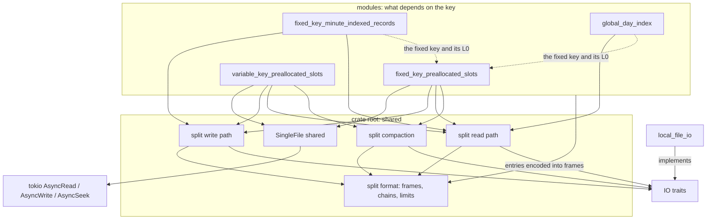

# internals

The map of the source, for a maintainer or an AI agent that has to change the crate: how the code is layered, what `src/lib.rs` promises, what every source file holds, which rules live in more than one file, how the tests are built, and what a change must keep true. The other topics say what the crate does; this one says where it is done. File links lead into `src/`.

## The layering

- **One module per storage shape**, a directory each: `fixed_key_preallocated_slots`, `variable_key_preallocated_slots`, `fixed_key_minute_indexed_records`, `global_day_index`. The fifth directory, `local_file_io`, is not a shape: it implements the IO traits over local files.
- **Only what depends on the KEY lives inside a module**: the key trait and the check of what it writes, how an L0 interval and an L1 entry encode, the sizes that follow from them, where a new key goes when its page overflows, the compact L1 pages, and the public writer and reader that put it together.
- **Everything else is at the crate root**, shared by every shape and read and written the same way in each: the IO traits, the slot and item traits, frame headers and chains, the frame-0 hash, files that grow by append, the page caches, the walk from L0 to a page, range reads, the data page, the compaction plan.
- **Two formats live side by side**: the split archive — an index and data files, through the IO traits — and the older SingleFile format — one file, through `tokio::io`. A root file named `split_*` belongs to the split archive. A root file without that prefix may belong to either: the groups below say which.



Not every shape uses every shared group. What each one takes from the crate root, and what it keeps for itself:

| Crate root group | The two preallocated modules | `fixed_key_minute_indexed_records` | `global_day_index` |
| --- | --- | --- | --- |
| IO traits | writer: both factories; reader: `IoReaderFactory` | the same | `ArchiveFileReader` alone: one file, no factory |
| Slot and item traits | yes | — | — |
| SingleFile shared | the `…SingleFile` structures | — | — |
| Split format | all of it | frame headers and chains, the working L0 chain, `SplitL0Interval`, the limits. Its own L2 frame and data frame. `DataRef` only as a cache key | frame headers and chains, `SplitL0Interval`, `refuse_l1_offsets_past_the_index`. L0 at offset 8, its own year blocks |
| Split write path | all of it | `SplitIndexWriter`, `SplitKeyPlacement`, `InFlightGuard`, `AppendFrontier`. Its own index pages, data frames, flush and finish | — (`to_bytes` builds the file in memory) |
| Split read path | all of it | `open_split_index`, `count_split_l1_keys`, the L1 walk (`split_l1_page`, `split_data_ref_of`), `SizedReader`, `LazyDataReaders`. Its own cursor and read-ahead | `refuse_an_index_cut_inside_its_last_l1_page`, `count_split_l1_keys`, the L1 walk, `SizedReader` |
| Split compaction | `CompactionPlan` and both compact writers | its own `MinuteIndexedRecordsCompactionPlan`; from here only `refuse_unordered` and `source_changed_while_compacting` | — |
| Caches | `PageCache`, `WriterPageCache`; in the `…SingleFile` writers `WriterPage` without it | `PageCache`, `WriterPageCache` | `PageCache` |
| Calendar | — | the minute of a record, the moments in a panic message | the days of a year |

**Three modules key by a fixed-size key.** The trait and its split L0 codec live in `fixed_key_preallocated_slots`, and the two other modules import them through the crate root:

- `fixed_key_minute_indexed_records` uses `PrimaryKeyFixedSize`, `CheckedKeyBytes`, `split_l0_frame_len`, `encode_split_l0_bodies`, `decode_split_l0_chain`, `DEFAULT_L0_CAPACITY`, `DEFAULT_L1_CAPACITY`, `COMPACT_L1_CAPACITY`;
- `global_day_index` uses `PrimaryKeyFixedSize`, `CheckedKeyBytes`, `split_l0_frame_len`, `decode_split_l0_chain`, `COMPACT_L1_CAPACITY`.

A change to the fixed key's L0 entry (`from K · to K · l1_offset u32`) changes three formats, and a change to one of these constants reaches every module that uses it.

## Where a call goes

The files a public call passes through, in order. `<module>` is either preallocated module.

| Call | Path |
| --- | --- |
| split `Writer::new` | `<module>/writer.rs` → `check_…_sizes` in `<module>/split_layout.rs` (panics) → `SplitWorkingL0Chain::unflushed_frame` ([split_l0_chain.rs](../src/split_l0_chain.rs)) → `SplitIndexWriter::create` ([split_index_writer.rs](../src/split_index_writer.rs)) |
| split `write`, a known key | `<module>/writer.rs`: the checks of the slot and the item (with variable keys, of the key too) → `InFlightGuard::begin` → `data_ref_of`, which loads the key's L1 page (`SplitWriterL1Pages::touch`, or `SplitIndexWriter::read_back`) → `SplitWriterL1Pages::evict` → `SplitWriterDataPages::write_item` ([split_writer_data_pages.rs](../src/split_writer_data_pages.rs)): into the cached page, or `SplitDataWriters::write_at` |
| split `write`, a new key | the same up to `data_ref_of`, which finds nothing → `place_new_key` → a `SplitKeyPlacement` → `insert_key`: `SplitWriterDataPages::preallocate` → `SplitDataWriters::reserve_page`, then the L1 change with no await → `SplitWriterL1Pages::evict` → `write_item` |
| split `flush` | `<module>/writer.rs` → `flush_split_working_archive` ([split_working_flush.rs](../src/split_working_flush.rs)) → `SplitWriterL1Pages::flush` → `SplitWriterDataPages::flush` → `SplitWorkingL0Chain::lay_out` → `SplitIndexWriter::append` / `write_at` → `frame_0_verifies` |
| split `finish` | `flush`, then `finish_split_writers` ([finish_split_writers.rs](../src/finish_split_writers.rs)) |
| split `Reader::open` | `<module>/reader.rs` → `open_split_index` ([split_reader_index.rs](../src/split_reader_index.rs)) → `SizedReader::open` → `read_split_l0_chain` → `read_split_chain` ([split_frame_chain.rs](../src/split_frame_chain.rs)) → `SplitFrameHeader::decode` and the hash ([split_frame.rs](../src/split_frame.rs), [split_l0_hash.rs](../src/split_l0_hash.rs)) → the module's L0 decode → the two refusals of a cut index |
| split `get` | `<module>/reader.rs` → `split_get_items` ([split_reader_pages.rs](../src/split_reader_pages.rs)) → `split_data_ref_of` → `split_l1_page` (`PageCache`; on a miss `read_split_chain` and the module's L1 decode) → `split_data_body` (`PageCache`; on a miss `LazyDataReaders::get` → `read_split_data_page`) → `items_of_split_body` |
| split `get_range` | `<module>/reader_range.rs` → `split_entries_between` → `read_split_range_l1_pages` ([split_range_l1_pages.rs](../src/split_range_l1_pages.rs)) → `read_split_range_items` ([split_range_items.rs](../src/split_range_items.rs)) → `read_split_data_bodies` ([split_data_runs.rs](../src/split_data_runs.rs)) |
| split `compaction_plan` | `<module>/reader_compact.rs`: every L1 page through no cache → `refuse_unordered` → `CompactL1PagePlan`s → `DataFileLayout::new` → `CompactionPlan::new` ([compaction_plan.rs](../src/compaction_plan.rs)) |
| split `write_compacted_to` | `<module>/reader_compact.rs` → `CompactDataFilesWriter::push` / `finish` ([compact_data_files_writer.rs](../src/compact_data_files_writer.rs)) → `CompactIndexWriter::create` / `push_l1_page` / `finish` ([compact_index_writer.rs](../src/compact_index_writer.rs)) |
| records `write` | [writer.rs](../src/fixed_key_minute_indexed_records/writer.rs) → `l2_offset_of` ([writer_key.rs](../src/fixed_key_minute_indexed_records/writer_key.rs)) → a new key: `place_new_key`, `insert_first_record`; a known key: `insert_record` ([writer_insert.rs](../src/fixed_key_minute_indexed_records/writer_insert.rs)): `find_place` → `plan_insert` → `apply_insert` → `evict` |
| records `get_range`, `get_day` | [reader.rs](../src/fixed_key_minute_indexed_records/reader.rs) `records_of` → `split_data_ref_of`, `split_l1_page` → the key's `MinuteCells` → `RecordsCursor` ([records_cursor.rs](../src/fixed_key_minute_indexed_records/records_cursor.rs)) → `RecordsReadAhead` ([records_read_ahead.rs](../src/fixed_key_minute_indexed_records/records_read_ahead.rs)) → `frame_record` |
| records compaction | [reader_compact.rs](../src/fixed_key_minute_indexed_records/reader_compact.rs) → a `RecordsCursor` per key into a `CompactRecordsCutter` → `place_records_run`, `MinuteIndexedRecordsCompactionPlan::new` → `CompactRecordsDataFiles` → `write_compact_records_index` |
| `GlobalDayIndex::from_bytes` | [index.rs](../src/global_day_index/index.rs) → `BytesFileReader` → `read_from` → `GlobalDayIndexReader::open` ([reader.rs](../src/global_day_index/reader.rs)) → every L1 page and every login's year blocks ([year_days.rs](../src/global_day_index/year_days.rs)) |

To read the code for the first time, start with the doc comment of `ArchiveFileWriter` in [archive_file_writer.rs](../src/archive_file_writer.rs) — it states when an archive is complete — then [split_frame.rs](../src/split_frame.rs), [split_l0_chain.rs](../src/split_l0_chain.rs), [split_working_flush.rs](../src/split_working_flush.rs) and the writer and reader of `fixed_key_preallocated_slots`.

## lib.rs

[lib.rs](../src/lib.rs) is three lists and no logic: the modules, their re-exports, and the documents compiled as doctests.

- **Every module is private**: `mod name;`, never `pub mod`. One file holds one structure or one piece of functionality.
- **Every module is re-exported whole**, on one line: `pub use name::*;` when it holds something public, `pub(crate) use name::*;` when it does not. Sixteen root modules are `pub use`: `archive_file_reader`, `archive_file_writer`, `cache_defaults`, `compaction_plan`, `error`, `io_reader_factory`, `io_writer_factory`, `pascal_string`, `preallocated_data_item`, `preallocated_slot_key`, `split_limits`, and the five directories.
- **An item's own visibility decides what is public.** A `pub(crate)` item stays internal inside a `pub use` module: `CheckedSlotIndex` in `preallocated_slot_key.rs`, `reserve_index_bytes` in `split_limits.rs`, `refuse_unordered` in `compaction_plan.rs`. The methods of a `pub(crate)` type are written `pub fn`.
- **The crate is one flat namespace.** Code names an item as `crate::Item`, never by its file, so a file is split or renamed without touching its users. The public API is the same list seen from outside: 55 names, `archived_data::Name`, and no public module path.
- **Every re-exported name, `pub` or `pub(crate)`, is unique in the whole crate** — the price of the flat namespace. Prefixes keep the names apart: `split_` / `Split…` for the split archive, `variable_` / `variable_split_` for variable keys, `records_` / `Records…` for the minute-indexed module, `day_index_` for the global day index. A name without a prefix says nothing about its format: `L0Entry` and `encode_l1_page` are the SingleFile layout of the fixed key, `DataRef` and `SizedReader` belong to the split archive, `le_u32` to neither.
- **A directory repeats the pattern in its `mod.rs`**, under a head comment that describes the module — for a storage shape, its byte layout.
- **A file that exports nothing — `impl` blocks of a type defined elsewhere, and private helpers — has a `mod` line and no `use` line**: `reader_range.rs`, `reader_compact.rs`, `reader_single_file_compact.rs`, and in the minute-indexed module `reader_keys.rs`, `reader_compact.rs`, `writer_key.rs`, `writer_insert.rs`. A type's `impl` is split by concern, one file each.
- **Test-only modules stand under `#[cfg(test)]`**: `in_memory_io`, `split_test_frames`, `split_test_io`, `test_items` at the root; `test_types`, `split_test_support`, `test_support`, `test_dir` and every `tests*.rs` in the directories. Only `split_test_frames` is re-exported (`#[cfg(test)] pub(crate) use split_test_frames::*;`); the others are named by path: `crate::in_memory_io::InMemoryIo`, `crate::split_test_io::Gate`, `crate::test_items::Login`.
- **A seam a test needs inside a non-test file is `#[cfg(test)]` too**: `SplitIndexWriter::set_max_bytes`, `set_max_index_bytes` on the three split writers, `forget_in_flight` on the two preallocated ones, the records writer's `set_max_data_file_bytes`, `LocalFileIo::counters` with `FinishCounters`. Two are not gated: the field `PageCache::pages` is `pub(crate)` and `PageCache::resize_locked` is a method of its own, so a test can hold the write lock and land a resize between a miss and its insert.
- **No `unsafe`, no `#[allow(...)]`**, anywhere in `src/`.

### Three kinds of "no"

How the code says no; [errors](errors.md) lists every case.

- **A contract that can be checked when a structure is built panics**: the `check_…_sizes` functions, `check_max_data_file_bytes`, `set_max_data_file_bytes` after the first key. They are `assert!`s with the contract as the message.
- **A call the caller got wrong at run time is `ContractViolation`, and bytes that are not the format are `Corrupted`.** The readers are written to answer bad bytes with `Corrupted`, not with a panic, and a failed read is never an absent key. The run-time panics are few and deliberate: the records writer's two — a record outside its day, a data file past its limit — which its specification asks for, and `LocalFileWriter`'s — a call after `finish`, a sync that fails in `Drop`.
- **An invariant of the crate's own is an `expect` that states it** (`"a placed key's pages are cached"`), or — where an earlier failed call could have broken it — a `ContractViolation` whose message ends `the writer is not usable after an earlier error`.

### The docs block

```text
#[cfg(doctest)]
mod docs {
    #[doc = include_str!("../docs/io.md")]
    struct Io;
    …
    #[doc = include_str!("../docs/internals.md")]
    struct Internals;
}
```

- One private struct per document, named after the file in CamelCase: `io.md` → `Io`, `split-format.md` → `SplitFormat`, `lifecycle.md` → `Lifecycle`, `fixed-key-preallocated-slots.md` → `FixedKeyPreallocatedSlots`, `variable-key-preallocated-slots.md` → `VariableKeyPreallocatedSlots`, `single-file.md` → `SingleFile`, `fixed-key-minute-indexed-records.md` → `FixedKeyMinuteIndexedRecords`, `global-day-index.md` → `GlobalDayIndex`, `archiving-a-day.md` → `ArchivingADay`, `pascal-strings.md` → `PascalStrings`, `errors.md` → `Errors`, `internals.md` → `Internals`.
- `cargo test --doc` compiles and RUNS every `rust` block of the documents listed there. A document that is not listed is not tested: a new one needs its struct.
- A fenced block with no language tag is compiled as Rust. Tag every block: `rust`, `text`, `mermaid`, `toml`.
- A doctest is a crate of its own: it sees the `pub` API and nothing `pub(crate)`. What is internal is proved by unit tests.
- An example that touches the disk works in a directory of its own, `archived-data-docs-<document>-<n>-<pid>` under `std::env::temp_dir()`, removed at its start and at its end. The doctests are compiled together into one binary (edition 2024); each still runs in a process of its own.

## Crate root: traits and IO

What an implementation outside the crate writes. Contracts: [io](io.md) for the four IO traits, [fixed-key-preallocated-slots](fixed-key-preallocated-slots.md) for the slot and the item. The two key traits are not here: `PrimaryKeyFixedSize` and `PrimaryKeyVariableSize` live in their modules.

| File | Holds |
| --- | --- |
| [archive_file_writer.rs](../src/archive_file_writer.rs) | `ArchiveFileWriter`: one file of an archive being written, by ROLE — `append`, `write_at` (in place), `size`, `finish`. Its doc comment is the contract: what `finish` and `Drop` mean, when an archive is complete, and the shape an implementation takes (`Arc<tokio::sync::Mutex<Option<Inner>>>`). **Public:** the trait |
| [archive_file_reader.rs](../src/archive_file_reader.rs) | `ArchiveFileReader`: one file being read — `read_at` (exactly `len` bytes or `UnexpectedEof`), `size`. No position is held. **Public:** the trait |
| [io_writer_factory.rs](../src/io_writer_factory.rs) | `IoWriterFactory<TWriter>`: the index and the data files `0 ..= 255` of ONE archive, asked for by role — `create_index_writer`, `create_data_writer(no: u8)`. **Public:** the trait |
| [io_reader_factory.rs](../src/io_reader_factory.rs) | `IoReaderFactory<TReader>`: `create_index_reader`, `create_data_reader(no: u8)`. **Public:** the trait |
| [preallocated_slot_key.rs](../src/preallocated_slot_key.rs) | `PreallocatedSlotKey` (`SLOTS`, `slot_index`) and `CheckedSlotIndex`, the crate's own range check with one blanket implementation: an index not below `SLOTS` is a `ContractViolation`. **Public:** `PreallocatedSlotKey` |
| [preallocated_data_item.rs](../src/preallocated_data_item.rs) | `PreallocatedDataItem` (`ITEM_LEN`, `from_slice`, `copy_to`; `Default` is the empty item) and `CheckedItemBytes`, the crate's own byte-count check: a `copy_to` that wrote another count is a `ContractViolation`. **Public:** `PreallocatedDataItem` |

## Crate root: SingleFile shared

Used only by the `…SingleFile` structures of the two preallocated modules — [single-file](single-file.md). Nothing here is public, and none of these files has unit tests of its own: each module's `tests.rs` covers them.

| File | Holds |
| --- | --- |
| [data_page.rs](../src/data_page.rs) | The SingleFile data page: `size u32 · next u64 (0) · item_len u16` (`DATA_HEADER_LEN`, 14 bytes), then `SLOTS × ITEM_LEN`. `data_page_len`, `check_data_page_sizes` (panics), `empty_data_page`, `slot_at`, `items_of_slots`, `check_data_page`, `read_data_page` |
| [l0_chain.rs](../src/l0_chain.rs) | The SingleFile L0 CHAIN framing: `size u32 · next u64 · count u32` (`L0_HEADER_LEN`, 16 bytes), then the module's entries. `encode_l0_frame`; `read_l0_chain` — frame 0 at offset 0, a first read of 64 KiB, a `next` that points into or before its own frame is `Corrupted`; `WorkingL0Chain` — frame 0 reserved at 0, continuations of the same size allocated at the end of the file and never given back, `lay_out` in chain order with frame 0 first; `L0FrameRead`. Also `L0FrameBody`, the encoded entries of one frame, which the split L0 chain uses too |
| [source_io.rs](../src/source_io.rs) | Reads over `AsyncRead + AsyncSeek`: `read_up_to` (a ranged read that stops at the end of the file), `read_exact_at` (a short file is an `Io` error), `read_self_sized` (a page that states its own size: a guess in one request, then the rest) |
| [positioned_sink.rs](../src/positioned_sink.rs) | `PositionedSink`: the writers' sink over `AsyncRead + AsyncWrite + AsyncSeek`. It remembers where it stands, so consecutive writes need no seek; a failed call forgets the position |
| [writer_data_pages.rs](../src/writer_data_pages.rs) | `WriterDataPages`: the writers' data pages — preallocated with `TItem::default()`, cached (`DEFAULT_WRITER_DATA_CACHE_PAGES` by default), stored on eviction or on `flush`; an item of a page that is not cached goes straight to the sink |

## Crate root: the split archive

Shared by every structure that reads or writes an index and data files. Byte layouts: [split-format](split-format.md). Rules of writing, flushing and compacting: [lifecycle](lifecycle.md).

### The format: frames, chains, references, limits

| File | Holds |
| --- | --- |
| [split_limits.rs](../src/split_limits.rs) | The limits, each a field width: the 4 GiB index, the 256 data files, the 4 GiB data file. `reserve_index_bytes` refuses past the index limit (`ContractViolation`); `check_max_data_file_bytes` panics above 4 GiB or below one page. **Public:** `MAX_INDEX_BYTES`, `MAX_DATA_FILES`, `MAX_DATA_FILE_BYTES`, `DEFAULT_MAX_DATA_FILE_BYTES` |
| [split_frame.rs](../src/split_frame.rs) | The header every split frame starts with: `size u32 · next u32`, then `count u32 · hash u64` (L0, 20 bytes), `count u32` (L1, 12 bytes) or `item_len u16` (data, 10 bytes) — `SPLIT_L0_HEADER_LEN`, `SPLIT_L1_HEADER_LEN`, `SPLIT_DATA_HEADER_LEN`. `SplitFrameKind`; `SplitFrameHeader::decode`, which checks an L0 hash before any field is used; `SplitFrame::from_bytes`; `encode_split_l0_frame`, `encode_split_l1_frame` |
| [split_l0_hash.rs](../src/split_l0_hash.rs) | The L0 header hash: FNV-1a 64, written out rather than taken from `std`, over the format constant `SPLIT_L0_HASH_FORMAT` (`archived-data/split/L0/v1`) and the three header fields. `fnv1a_64`, `split_l0_header_hash`. A unit test pins one value: a change of the constant or of the field order is a change of format |
| [split_frame_chain.rs](../src/split_frame_chain.rs) | Reading a frame and its continuations — `read_split_chain` — or only their headers — `read_split_header_chain` — over a `SizedReader`. A frame no longer than the guess is one `read_at`. A `next` that points into or before its own frame, or past the end of the file, and a frame that reaches past the file, are `Corrupted` |
| [split_data_page.rs](../src/split_data_page.rs) | The split data page: `size u32 · next u32 · item_len u16`, then `SLOTS × ITEM_LEN`, across a chain. Lengths, `check_split_data_page_sizes` (panics), `encode_split_data_page`, `empty_split_data_page`, `split_slot_at`, `items_of_split_body`, `decode_split_data_frames`, `read_split_data_page` |
| [split_l0_chain.rs](../src/split_l0_chain.rs) | The split L0 chain. `SplitWorkingL0Chain` lays L0 out on a working index — the continuations first, frame 0 LAST, behind a hash that does not verify until the flush completes: `unflushed_frame` (hash inverted), `lay_out`, `invalidation` (the 8-byte write that spoils the hash again). `SplitL0FrameWrite`. `read_split_l0_chain` reads it back. `refuse_l1_offsets_past_the_index` refuses, with no read, an L0 that names an L1 page past the end of the index |
| [split_l0_interval.rs](../src/split_l0_interval.rs) | `SplitL0Interval<TKey>` — `from · to · l1_offset` — the same type in every split structure; `check_spanned_by`, the check that an L1 page spans its interval exactly; `split_l0_interval_of`, the lookup of the interval holding a key |
| [data_ref.rs](../src/data_ref.rs) | `DataRef`: `file_no u8 · offset u32` (`DATA_REF_LEN`, 5 bytes), ordered as `(file_no, offset)`. `encode_to`, `decode`, and `cache_key` / `from_cache_key`: one `u64` per page across every data file |
| [data_file_layout.rs](../src/data_file_layout.rs) | `DataFileLayout`: where the data page of the key of rank `n` lands, with rollover — `ref_of`, `file_sizes`. A page goes into a file only whole; a rank that needs data file 256 is a `ContractViolation` |

### The write path

Nothing here is public. The frame-0 protocol it implements: [lifecycle](lifecycle.md#when-a-working-archive-opens-the-frame-0-hash).

| File | Holds |
| --- | --- |
| [append_frontier.rs](../src/append_frontier.rs) | `AppendFrontier`: a file that grows only by append, with offsets reserved ahead of the bytes — `reserve`, `check_append`, `confirm_append`, `is_appended` |
| [split_index_writer.rs](../src/split_index_writer.rs) | `SplitIndexWriter`: the writer's index file over that frontier — `create`, `reserve` / `check_reservable` (the 4 GiB limit), `append`, `write_at`, `read_back` through a reader of the same file, created on first need. It also keeps whether frame 0's hash verifies in the file: `spoil_frame_0`, the one `write_at` of 8 bytes before the first byte written after a completed flush; `frame_0_verifies`; `is_frame_0_spoiled` |
| [split_data_writers.rs](../src/split_data_writers.rs) | `SplitDataWriters`: the writer's data files over that frontier — `reserve_page` (a file is created with its first page), `append_page`, `write_at`, `set_layout` (panics once a file exists). Both writes spoil frame 0's hash first |
| [split_key_placement.rs](../src/split_key_placement.rs) | `SplitKeyPlacement`: where a new key goes — `NewPage`, `Insert`, `SplitIntoNext`, `SplitIntoNewPage` — decided before anything changes. Only the enum is here: each module decides in its own `place_new_key` |
| [split_writer_l1_pages.rs](../src/split_writer_l1_pages.rs) | `SplitWriterL1Pages<TEntry>`: the preallocated writers' L1 pages, cached and appended in file order. `store` rewrites an appended page in place and appends every page between the frontier and a page past it first. The module hands in `encode` |
| [split_writer_data_pages.rs](../src/split_writer_data_pages.rs) | `SplitWriterDataPages`: the preallocated writers' data pages — `preallocate`, `write_item`, `flush` — cached and appended in file order by the same rule. A cache of 0 appends every new page at once |
| [split_working_flush.rs](../src/split_working_flush.rs) | `flush_split_working_archive`: the flush of a preallocated working archive in its one order — L1 pages, data pages, L0 continuations, frame 0 last — or nothing at all when nothing was written since the last flush |
| [finish_split_writers.rs](../src/finish_split_writers.rs) | `finish_split_writers`: `finish` on the index, then on every data file, each awaited even after another failed; the first failure is returned |
| [in_flight_guard.rs](../src/in_flight_guard.rs) | `InFlightGuard`: refuses every call on a writer whose earlier write or flush failed or was dropped — `begin`, `complete`, `complete_if_ok`, `refuse_if_in_flight` |

### The read path

Nothing here is public.

| File | Holds |
| --- | --- |
| [sized_reader.rs](../src/sized_reader.rs) | `SizedReader`: a reader that learns its file's size once and clamps every read to it — `read_up_to` (at most one `read_at`), `read_exact` (a range the file does not hold is `Corrupted`, with no read) |
| [lazy_data_readers.rs](../src/lazy_data_readers.rs) | `LazyDataReaders`: data files opened on first use, once, and kept. A file that fails to open is not remembered |
| [split_reader_index.rs](../src/split_reader_index.rs) | A split reader's open — `open_split_index`: L0 read and decoded, an index cut before or inside its last L1 page refused (`refuse_an_index_cut_inside_its_last_l1_page`) — and its count of keys, `count_split_l1_keys` |
| [split_reader_pages.rs](../src/split_reader_pages.rs) | A split reader's walk from L0 to an L1 page and a data page through its caches, and `get`'s items: `split_get_items`, `split_l1_page`, `split_data_ref_of`, `split_data_body`, `read_split_data_body`. A cached L1 page is checked against the interval that asks for it. The L1 walk is generic over what an entry holds besides its key: a data page, an L2 frame, a login's year blocks |
| [split_range_l1_pages.rs](../src/split_range_l1_pages.rs) | A range's L1 entries — `split_entries_between`, `read_split_range_l1_pages`: the intervals it touches, their cached pages, and the uncached ones that lie back to back in the index read with one `read_at` per run of at most 8 MiB, each checked as a load of it alone is, and cached |
| [split_data_runs.rs](../src/split_data_runs.rs) | `get_range`'s data pages — `read_split_data_bodies`: neighbouring pages of one data file read with one `read_at` per run of at most 8 MiB (`MAX_SPLIT_DATA_RUN_BYTES`), each page checked |
| [split_range_items.rs](../src/split_range_items.rs) | `read_split_range_items`: the items of every key of a range, its pages read in file order and handed back in key order |

### Compaction

The plan and the writers of the two preallocated modules. The minute-indexed module has its own plan and writers, and takes two functions from here.

| File | Holds |
| --- | --- |
| [compaction_plan.rs](../src/compaction_plan.rs) | `CompactionPlan`: the sizes of a compaction worked out first — `index_size`, `data_file_sizes`, `keys_count`. Also `refuse_unordered` and `source_changed_while_compacting`, which the minute-indexed module uses too. **Public:** `CompactionPlan` |
| [compact_l1_page_plan.rs](../src/compact_l1_page_plan.rs) | `CompactL1PagePlan`: one compact L1 page — its first and last key as the index stores them, its count, its exact length |
| [compact_index_writer.rs](../src/compact_index_writer.rs) | `CompactIndexWriter`: the compact index written from a plan, append only, every page checked against it — `create`, `push_l1_page`, `finish` |
| [compact_data_files_writer.rs](../src/compact_data_files_writer.rs) | `CompactDataFilesWriter`: the compact data files written from a plan, append only — `push`, `finish`. A file is created with its first page and finished, at its planned size, before the next is created |

## Crate root: caches

| File | Holds |
| --- | --- |
| [page_cache.rs](../src/page_cache.rs) | `PageCache<T>`, the readers' cache: a `tokio::sync::RwLock` map by a `u64` key — an offset, or `DataRef::cache_key` — with `last_access` stamped under the READ lock and the oldest page found by a linear scan on insert. Two sets of methods: `set_capacity` + `insert` for the `…SingleFile` readers (a shrink takes effect at the next insert), `resize` + `insert_within_capacity` for the split readers (a shrink evicts at once, and the cache stays within its capacity). `resize_locked` is `resize` under a write lock already held |
| [cache_defaults.rs](../src/cache_defaults.rs) | The default cache sizes: every reader 10 pages (L1, data, L2); every writer 64 L1 pages, 1024 data pages, 1024 L2 frames. **Public:** `DEFAULT_READER_L1_CACHE_PAGES`, `DEFAULT_READER_DATA_CACHE_PAGES`, `DEFAULT_READER_L2_CACHE_FRAMES`, `DEFAULT_WRITER_L1_CACHE_PAGES`, `DEFAULT_WRITER_DATA_CACHE_PAGES`, `DEFAULT_WRITER_L2_CACHE_FRAMES` |
| [writer_page.rs](../src/writer_page.rs) | `WriterPage<T>`, a writer's cached page: its value, whether it is dirty, when it was last used — the entry of `WriterPageCache` too. `least_recently_used` and `dirty_offsets` over a plain `HashMap`, a linear scan: all the cache the `…SingleFile` writers have |
| [writer_page_cache.rs](../src/writer_page_cache.rs) | `WriterPageCache<T>`, the split writers' cache: beside the map, every page is filed under the tick of its last use, so the least recently used page is found in `O(log n)`. It holds pages and nothing else: when to evict, and where an evicted page goes, is its owner's |

## Crate root: the rest

| File | Holds |
| --- | --- |
| [calendar.rs](../src/calendar.rs) | The proleptic Gregorian calendar over day counts, for any `i64` of microseconds: `days_from_civil`, `civil_from_days`, `is_leap_year`, and `format_microseconds` — a moment written out in a message without `chrono`. `MICROSECONDS_PER_MINUTE`, `MICROSECONDS_PER_DAY` |
| [pascal_string.rs](../src/pascal_string.rs) | Strings inside a record — [pascal-strings](pascal-strings.md). **Public:** `write_pascal_string`, `read_pascal_string`, `PASCAL_STRING_MAX_BYTES` |
| [le_bytes.rs](../src/le_bytes.rs) | Little-endian field readers at an offset: `le_u16`, `le_u32`, `le_u64` |
| [error.rs](../src/error.rs) | `ArchiveError::{Io, Corrupted, ContractViolation}` with `Display`, `Error::source`, `From<io::Error>` and `From<ArchiveError> for io::Error` — [errors](errors.md). **Public:** `ArchiveError` |

## Modules

| Module | Shape | For | Public structures | Topic |
| --- | --- | --- | --- | --- |
| `fixed_key_preallocated_slots` | A fixed-size primary key owns one preallocated page of fixed-size slots. A slot is addressed by position: every period of a fixed calendar | Aggregated data: one row per key per period, every period of the archive known in advance | split: `FixedKeyPreallocatedSlotsArchiveWriter` / `…Reader`; SingleFile: `…WriterSingleFile` / `…ReaderSingleFile` | [fixed-key-preallocated-slots](fixed-key-preallocated-slots.md), [single-file](single-file.md) |
| `variable_key_preallocated_slots` | The same, with a primary key of 1 to 32 767 bytes behind a length prefix. L1 pages are sized in bytes and split by bytes. A compact L1 page closes at 1024 keys, or before an entry that would take it past 16 KiB; a page of one key takes that key whatever its length | The same data, keyed by something that has no fixed width: a name, a path, a composite id | split: `VariableKeyPreallocatedSlotsArchiveWriter` / `…Reader`; SingleFile: `…WriterSingleFile` / `…ReaderSingleFile` | [variable-key-preallocated-slots](variable-key-preallocated-slots.md), [single-file](single-file.md) |
| `fixed_key_minute_indexed_records` | ONE day: a fixed-size key owns variable-length records in time order, in a chain of data frames — 32 KiB each in a working archive, at most 32 KiB in a compact one — with a minute index of 1440 cells. Split archive only | History: every deal of every account of one server-clock day, read back by account and time range | `FixedKeyMinuteIndexedRecordsArchiveWriter` / `…Reader`, `MinuteIndexedRecordsCompactionPlan` | [fixed-key-minute-indexed-records](fixed-key-minute-indexed-records.md), [archiving-a-day](archiving-a-day.md) |
| `global_day_index` | ONE file per server: for every login, a bitmap of the days it has data on, by year. Not split, rebuilt whole | Opening only the day archives of a period that hold something | `GlobalDayIndex`, `GlobalDayIndexReader` | [global-day-index](global-day-index.md), [archiving-a-day](archiving-a-day.md) |
| `local_file_io` | Not a shape: both IO factories over one local directory per archive | Working archives, and a compaction's output before its upload | `LocalFileIo`, `LocalFileWriter`, `LocalFileReader`; `index_file_name`, `data_file_name` | [io](io.md) |

The two preallocated modules differ only in the key. The data page, the frame chains, the data files, the caches, the writer's refusals and the reader's `get` / `get_range` / `keys_count` / `compaction_plan` / `write_compacted_to` behave the same way in both — and, for SingleFile, `get` / `keys_count` / `compacted_len` / `write_compacted_to`.

### fixed_key_preallocated_slots

| File | Holds |
| --- | --- |
| [mod.rs](../src/fixed_key_preallocated_slots/mod.rs) | The head comment — the byte layout of both formats — and the re-exports |
| [primary_key.rs](../src/fixed_key_preallocated_slots/primary_key.rs) | `PrimaryKeyFixedSize` (`LEN`, `from_slice`, `copy_to`; `Ord + Clone`) and `CheckedKeyBytes`, the crate's own check that `copy_to` wrote `LEN` bytes (`ContractViolation`). The key of three modules. **Public:** `PrimaryKeyFixedSize` |
| [layout.rs](../src/fixed_key_preallocated_slots/layout.rs) | The capacities, 1024 each, used by both formats and by the other fixed-key modules. The SingleFile layout: `L0Entry` (`from`, `to`, `offset u64`), the L1 header `size u32 · count u32` (`L1_HEADER_LEN`, 8 bytes), entry, frame and page lengths, `check_type_sizes` (panics), `encode_l0_bodies` / `decode_l0_chain`, `encode_l1_page` / `decode_l1_header` / `decode_l1_page`. **Public:** `DEFAULT_L0_CAPACITY`, `DEFAULT_L1_CAPACITY`, `COMPACT_L1_CAPACITY` |
| [split_layout.rs](../src/fixed_key_preallocated_slots/split_layout.rs) | The split layout of a fixed key: entry, frame and page lengths, `check_split_type_sizes` (panics), `encode_split_l0_bodies` / `decode_split_l0_chain` — the L0 of the two other fixed-key modules too — `encode_split_l1_page`, `check_split_l1_header`, `decode_split_l1_chain` |
| [writer.rs](../src/fixed_key_preallocated_slots/writer.rs) | The split writer: `new`, `new_with_capacity`, the cache and data-file setters, `write`, `flush`, `finish`. Inside: `place_new_key` (the decision, with the pages it needs read into the cache), `insert_key` (the change, with no await), `check_new_page_room` (the index room, counted with the L0 continuations the next flush will need). **Public:** `FixedKeyPreallocatedSlotsArchiveWriter` |
| [reader.rs](../src/fixed_key_preallocated_slots/reader.rs) | The split reader: `open`, the cache setters, `set_max_data_file_bytes`, `get`, `keys_count`, `l0_intervals`, `l0_frames`; `source_l1_page` and `source_data_body` read through no cache. **Public:** `FixedKeyPreallocatedSlotsArchiveReader` |
| [reader_range.rs](../src/fixed_key_preallocated_slots/reader_range.rs) | `impl` of the reader: `get_range` |
| [reader_compact.rs](../src/fixed_key_preallocated_slots/reader_compact.rs) | `impl` of the reader: `compaction_plan`, `write_compacted_to` |
| [writer_single_file.rs](../src/fixed_key_preallocated_slots/writer_single_file.rs) | The SingleFile writer over `AsyncRead + AsyncWrite + AsyncSeek`: `new`, `new_with_capacity`, `write`, `flush`, `finish`. **Public:** `FixedKeyPreallocatedSlotsArchiveWriterSingleFile` |
| [reader_single_file.rs](../src/fixed_key_preallocated_slots/reader_single_file.rs) | The SingleFile reader over `AsyncRead + AsyncSeek`, the source behind a `tokio::sync::Mutex`: `open`, `get`, `keys_count`, the cache setters. **Public:** `FixedKeyPreallocatedSlotsArchiveReaderSingleFile` |
| [reader_single_file_compact.rs](../src/fixed_key_preallocated_slots/reader_single_file_compact.rs) | `impl` of that reader: `compacted_len`, `write_compacted_to` into any `AsyncWrite` |

### variable_key_preallocated_slots

| File | Holds |
| --- | --- |
| [mod.rs](../src/variable_key_preallocated_slots/mod.rs) | The head comment — the byte layout of both formats — and the re-exports |
| [primary_key.rs](../src/variable_key_preallocated_slots/primary_key.rs) | `PrimaryKeyVariableSize` (`from_slice`, `copy_to` — the key bytes only; `Ord + Clone`) and `CheckedVariableKeyBytes`: an empty key, or one longer than `MAX_VARIABLE_KEY_LEN`, is a `ContractViolation`. **Public:** `PrimaryKeyVariableSize` |
| [key_prefix.rs](../src/variable_key_preallocated_slots/key_prefix.rs) | The length prefix in front of every key: one byte below 128, else two bytes big-endian with the top bit set; a single `0x00` is the end marker. `key_prefix_len`, `encode_key_prefix`, `decode_key_prefix`. **Public:** `MAX_VARIABLE_KEY_LEN` (32 767) |
| [entry_walk.rs](../src/variable_key_preallocated_slots/entry_walk.rs) | `EntryWalk`: the entries of a frame or a page walked to the end marker or to the end of the bytes — shared by the SingleFile and the split layout of this module; `count_mismatch` |
| [key_starting_with.rs](../src/variable_key_preallocated_slots/key_starting_with.rs) | The upper bound of a prefix range. **Public:** `last_key_starting_with` |
| [layout.rs](../src/variable_key_preallocated_slots/layout.rs) | The sizes, used by both formats: 64 KiB per L0 frame, 16 KiB per L1 page, 1024 keys and 16 KiB per compact L1 page. The SingleFile layout: `VariableL0Interval`, `VariableL1Entry`, entry lengths, the half-page rule (`max_variable_l1_entry_len`, `refuse_oversized_key`), `check_variable_sizes` (panics), L0 bodies packed by bytes, L1 pages built and decoded; `push_key_field`, which the split layout uses too. **Public:** `DEFAULT_L0_FRAME_BYTES`, `DEFAULT_L1_PAGE_BYTES`, `COMPACT_L1_MAX_KEYS`, `COMPACT_L1_PAGE_BYTES` |
| [split_layout.rs](../src/variable_key_preallocated_slots/split_layout.rs) | The split layout of a variable key: `VariableSplitL1Entry`, entry lengths, the half-page rule (`max_variable_split_l1_entry_len`, `refuse_split_oversized_key`), `check_variable_split_sizes` (panics), `encode_variable_split_l0_bodies` (packed greedily by bytes), `variable_split_l0_frames_bound` (the bound of the L0 frames a flush will need), `decode_variable_split_l0_chain`, `check_variable_split_l1_frame_header`, `decode_variable_split_l1_chain` |
| [writer.rs](../src/variable_key_preallocated_slots/writer.rs) | The split writer, with the public methods of the fixed one and its sizes in bytes. Inside: `place_new_key`, `check_index_room` (the L0 continuations bounded, not counted), `insert_key`, `split_off_overflow` and `split_off_len` (the split by bytes, done and foreseen). **Public:** `VariableKeyPreallocatedSlotsArchiveWriter` |
| [reader.rs](../src/variable_key_preallocated_slots/reader.rs) | The split reader: `open`, the cache setters, `set_max_data_file_bytes`, `get`, `keys_count`, `l0_intervals`, `l0_frames`. **Public:** `VariableKeyPreallocatedSlotsArchiveReader` |
| [reader_range.rs](../src/variable_key_preallocated_slots/reader_range.rs) | `impl` of the reader: `get_range` |
| [reader_compact.rs](../src/variable_key_preallocated_slots/reader_compact.rs) | `impl` of the reader: `compaction_plan`, `write_compacted_to`; `SplitPageFill`, which says when a compact L1 page closes |
| [writer_single_file.rs](../src/variable_key_preallocated_slots/writer_single_file.rs) | The SingleFile writer. **Public:** `VariableKeyPreallocatedSlotsArchiveWriterSingleFile` |
| [reader_single_file.rs](../src/variable_key_preallocated_slots/reader_single_file.rs) | The SingleFile reader: `open`, `get`, `keys_count`, the cache setters. **Public:** `VariableKeyPreallocatedSlotsArchiveReaderSingleFile` |
| [reader_single_file_compact.rs](../src/variable_key_preallocated_slots/reader_single_file_compact.rs) | `impl` of that reader: `compacted_len`, `write_compacted_to`; `PageFill`, the SingleFile twin of `SplitPageFill` |

### fixed_key_minute_indexed_records

| File | Holds |
| --- | --- |
| [mod.rs](../src/fixed_key_minute_indexed_records/mod.rs) | The head comment — the byte layout — and the re-exports |
| [layout.rs](../src/fixed_key_minute_indexed_records/layout.rs) | The sizes of the format, with a compile-time check that three records of the longest length fit one frame. `check_record_len` (`ContractViolation`), `record_time`, `minute_of_day`. This module's L1 page, `key K · l2_offset u32`: lengths, `check_records_type_sizes` (panics), `encode_records_l1_page`, `check_records_l1_header`, `decode_records_l1_chain`. **Public:** `MINUTES_PER_DAY` (1440), `RECORD_TIME_LEN` (8), `MAX_RECORD_LEN` (8 KiB), `DATA_FRAME_LEN` (32 KiB) |
| [minute_cells.rs](../src/fixed_key_minute_indexed_records/minute_cells.rs) | The L2 frame: `MinuteCells`, 1440 cells of 9 bytes behind an 8-byte header (`L2_FRAME_LEN`, 12 968 bytes), an empty cell nine `0xFF` — `get`, `set`, `first_from`, `last_before`, `remap`. `RecordRef`: the data file, the frame, the offset inside it |
| [records_frame.rs](../src/fixed_key_minute_indexed_records/records_frame.rs) | The data frame. `frame_record` and `decode_records_frame_header`, used by reader and writer. `RecordsFrame`, a working frame in memory: `insert`, `split_off`, `halving_boundary`, `next` / `set_next`, `free` |
| [record_insert.rs](../src/fixed_key_minute_indexed_records/record_insert.rs) | What a write decides before it changes anything: `RecordPlace` (where the record belongs), `RecordInsert` (how it goes in), `RecordSplitInto` (where the upper half of a halved frame goes) |
| [writer.rs](../src/fixed_key_minute_indexed_records/writer.rs) | The writer: `new`, `new_with_capacity`, the three cache setters, `write`, `flush`, `finish`, the counters. Its own flush in the order of `split_working_flush.rs`, and both panics: a record outside the day, a data file past its limit. **Public:** `FixedKeyMinuteIndexedRecordsArchiveWriter` |
| [writer_key.rs](../src/fixed_key_minute_indexed_records/writer_key.rs) | `impl` of the writer, the keys: `l2_offset_of`, `place_new_key`, `insert_first_record`, `check_index_room` (the key's L2 frame, a new L1 page, the L0 continuations) |
| [writer_insert.rs](../src/fixed_key_minute_indexed_records/writer_insert.rs) | `impl` of the writer, a record of a known key: `insert_record`, `find_place`, `plan_insert`, `apply_insert`; `CellMoves`, where the cells of the records an insert moved point afterwards |
| [writer_index_pages.rs](../src/fixed_key_minute_indexed_records/writer_index_pages.rs) | `RecordsWriterIndexPages`: the L1 pages and the L2 frames the writer holds, a `WriterPageCache` each, over ONE index that grows by append — `evict`, `flush`, `store` |
| [writer_data_frames.rs](../src/fixed_key_minute_indexed_records/writer_data_frames.rs) | `RecordsWriterDataFrames`: data file 0 and the frames the writer holds of it — `create`, `allocate`, `load` (read back through a reader of the same file), `evict`, `flush`. Every write spoils frame 0's hash first |
| [reader.rs](../src/fixed_key_minute_indexed_records/reader.rs) | The reader: `open`, the three cache setters, `set_max_data_file_bytes`, `get_range`, `get_day`, `minutes_with_records`, `keys_count`. **Public:** `FixedKeyMinuteIndexedRecordsArchiveReader` |
| [reader_keys.rs](../src/fixed_key_minute_indexed_records/reader_keys.rs) | `impl` of the reader: `keys` |
| [reader_compact.rs](../src/fixed_key_minute_indexed_records/reader_compact.rs) | `impl` of the reader: `compaction_plan`, `write_compacted_to` |
| [records_cursor.rs](../src/fixed_key_minute_indexed_records/records_cursor.rs) | `RecordsCursor`: the walk along one key's chain, record by record, checking the day, the order, every minute's cell and that the chain never returns to a frame. `CursorRecord` |
| [records_read_ahead.rs](../src/fixed_key_minute_indexed_records/records_read_ahead.rs) | `RecordsReadAhead`: one walk's window onto a data file — 32 KiB, doubling while the chain runs back to back, up to 512 KiB (`MAX_RECORDS_READ_AHEAD`) |
| [records_compaction_plan.rs](../src/fixed_key_minute_indexed_records/records_compaction_plan.rs) | The plan: `index_size`, `data_file_sizes`, `keys_count`, `records_count`. `PlannedRecordsKey`; `place_records_run`, which lands a key's run whole in one data file. **Public:** `MinuteIndexedRecordsCompactionPlan` |
| [compact_records_run.rs](../src/fixed_key_minute_indexed_records/compact_records_run.rs) | `CompactRecordsCutter`: one key's records cut into compact frames — `measuring` for a plan, `writing` for the files. `CompactRecordsRun`: the run's length, its record count, the first record of every minute |
| [compact_records_data_files.rs](../src/fixed_key_minute_indexed_records/compact_records_data_files.rs) | `CompactRecordsDataFiles`: the compact data files, appended run by run, each finished at its planned size before the next is created |
| [compact_records_index.rs](../src/fixed_key_minute_indexed_records/compact_records_index.rs) | `write_compact_records_index`: the compact index from the plan alone — ONE L0 frame, an L2 frame per key, then the L1 pages |

### global_day_index

| File | Holds |
| --- | --- |
| [mod.rs](../src/global_day_index/mod.rs) | The head comment — the byte layout — and the re-exports |
| [layout.rs](../src/global_day_index/layout.rs) | Where things are: the sync time in the first 8 bytes, L0 right after it (`DAY_INDEX_L0_AT`). This module's L1 page, `login K · data_offset u32 · blocks u16`: `LoginDays`, lengths, `check_day_index_l1_header`, `decode_day_index_l1_chain`. **Public:** `GLOBAL_DAY_INDEX_SYNC_TIME_LEN` (8) |
| [year_days.rs](../src/global_day_index/year_days.rs) | `YearDays`: one year block of 48 bytes, `year u16` and 46 bytes of day bits in the calendar of a leap year — `set`, `days`, `day_of`, `starts_between`, `decode`. `decode_year_blocks`, `days_between` |
| [index.rs](../src/global_day_index/index.rs) | The index in memory: `new`, `from_bytes`, `read_from`, `sync_time_of`, `set_day`, `set_sync_time`, `days_with_data`, `logins_count`, `to_bytes`. **Public:** `GlobalDayIndex` |
| [reader.rs](../src/global_day_index/reader.rs) | The index where it lies, over any `ArchiveFileReader`: `open`, `read_sync_time`, `days_with_data`, `logins_count`, `set_l1_cache_size`. **Public:** `GlobalDayIndexReader` |
| [bytes_file_reader.rs](../src/global_day_index/bytes_file_reader.rs) | `BytesFileReader`: bytes in memory behind `ArchiveFileReader`, so `from_bytes` parses through the same reader, and the same checks, as a file |

### local_file_io

| File | Holds |
| --- | --- |
| [mod.rs](../src/local_file_io/mod.rs) | The head comment and the re-exports |
| [file_names.rs](../src/local_file_io/file_names.rs) | The names of an archive's files in its directory: `index`, and `data00` … `dataff` — two lowercase hex digits. **Public:** `index_file_name`, `data_file_name` |
| [factory.rs](../src/local_file_io/factory.rs) | Both factories over one directory: `new`, `dir`, `index_path`, `data_path`. `create_*` makes the directory, removes a file already there and starts a new one; `create_*_reader` opens a file that exists. **Public:** `LocalFileIo` |
| [writer.rs](../src/local_file_io/writer.rs) | One local file being written, in the shape `ArchiveFileWriter` prescribes: positional writes on tokio's blocking pool, `finish` = `sync_all`, `Drop` syncing a file nobody finished. **Public:** `LocalFileWriter` |
| [reader.rs](../src/local_file_io/reader.rs) | One local file being read: positional reads on the blocking pool, the size checked before every read. **Public:** `LocalFileReader` |
| [blocking_file_ops.rs](../src/local_file_io/blocking_file_ops.rs) | `run_blocking_file_op` (one operation on the blocking pool; a panic in it is resumed), `file_io_error` (what was being done, and to which file, with the error's kind kept), `pwrite_all` and `pread_exact` (`pwrite` / `pread` on unix, `seek_write` / `seek_read` on Windows) |

## Rules that live in more than one file

A change to one of these is a change to every file of its row.

| Rule | Where |
| --- | --- |
| The flush order of a working archive: L1 pages (and L2 frames), the check that the index is appended up to what is reserved, data pages, nothing more when nothing was written, L0 continuations, frame 0 last | [split_working_flush.rs](../src/split_working_flush.rs) for the preallocated writers; `flush_in_flight` in [fixed_key_minute_indexed_records/writer.rs](../src/fixed_key_minute_indexed_records/writer.rs) |
| Frame 0's hash is spoiled before every byte that reaches a file of a working archive | The bytes reach a file in three places, and each calls `SplitIndexWriter::spoil_frame_0` first: [split_index_writer.rs](../src/split_index_writer.rs), [split_data_writers.rs](../src/split_data_writers.rs), [fixed_key_minute_indexed_records/writer_data_frames.rs](../src/fixed_key_minute_indexed_records/writer_data_frames.rs) |
| A page past a file's append frontier is always cached, and a page leaving the cache appends every page before it first | `store` in [split_writer_l1_pages.rs](../src/split_writer_l1_pages.rs), [split_writer_data_pages.rs](../src/split_writer_data_pages.rs), [writer_index_pages.rs](../src/fixed_key_minute_indexed_records/writer_index_pages.rs), [writer_data_frames.rs](../src/fixed_key_minute_indexed_records/writer_data_frames.rs) |
| Where a new key goes on an L1 page: a new page past the last one, an insert, a split into the next page, a split into a new page | by key count: `place_new_key` in [fixed_key_preallocated_slots/writer.rs](../src/fixed_key_preallocated_slots/writer.rs) and in [fixed_key_minute_indexed_records/writer_key.rs](../src/fixed_key_minute_indexed_records/writer_key.rs); by bytes: [variable_key_preallocated_slots/writer.rs](../src/variable_key_preallocated_slots/writer.rs) |
| A failed or dropped `write` or `flush` refuses every later call | `InFlightGuard` in the three split writers: `begin` on the way in, `complete` only on `Ok` or on a refusal that changed nothing |
| `finish` reaches every file, and the first failure is returned | [finish_split_writers.rs](../src/finish_split_writers.rs); `finish` in [fixed_key_minute_indexed_records/writer.rs](../src/fixed_key_minute_indexed_records/writer.rs) |
| The L0 header hash | [split_l0_hash.rs](../src/split_l0_hash.rs); and on purpose, from the written-down rule, `l0_hash` in [split_test_frames.rs](../src/split_test_frames.rs) |
| The layout of a key in the SingleFile and in the split format | `layout.rs` and `split_layout.rs` of each preallocated module; `PageFill` and `SplitPageFill` in the variable module |
| "The source changed while it was being compacted" | `source_changed_while_compacting` in [compaction_plan.rs](../src/compaction_plan.rs); `changed_underneath` in both `reader_single_file_compact.rs` |
| The literal sizes of every format | the reference archives of the tests, written by hand with none of the crate's code — see below |

## Test infrastructure

Unit tests live in two places. A file whose logic stands alone has its tests at its end, in `#[cfg(test)] mod tests` — 40 files do. What a module does as a whole is tested in its `tests*.rs` files. A test is named by the sentence it proves: `a_flush_dropped_at_any_write_leaves_an_index_refused`.

### At the crate root

| File | Holds |
| --- | --- |
| [in_memory_io.rs](../src/in_memory_io.rs) | Both factories in memory. `FileRole` (`Index`, `Data(u8)`); `InMemoryIo` — `file`, `put` (bytes no writer would produce), `prepare` (the file the NEXT writer of a role will write, handed out before the archive creates it), `roles`, `created_roles`; a clone shares every file. `InMemoryFile` carries what a test observes and controls: **counters** — `appends`, `write_ats`, `write_ats_of(offset, len)` (by the range written), `read_ats`, `bytes_read`, `largest_read`, `eof_reads`, `readers_opened`, `finishes`, `finish_attempts`, `finishes_spawned_by_drop`; **failures** — `fail_reads`, `fail_appends`, `fail_write_ats`, each at once or `…_after(n)` calls, and `fail_finish`, whose error names the file's role; **gates** — `shut_reads_at(offset)` parks every read at that offset, `shut_writes` every append and `write_at`, `shut_writes_after(n)` every one after `n` of them, until `open_reads` / `open_writes`. Its own tests prove it keeps the IO contract |
| [split_test_io.rs](../src/split_test_io.rs) | What every module's split tests do with the files of an `InMemoryIo`: `file_bytes`, `data_files`, `data_read_ats`, `data_readers_opened`; `refused` and `NOT_USABLE`; and a call polled one step at a time, to stop it where a test wants it — `poll_once`, `poll_until_parked`, `drop_when_parked`, `assert_still_waiting`, `wait_until`, `Gate` |
| [split_test_frames.rs](../src/split_test_frames.rs) | Frames built by hand, with none of the crate's encoders, so a test can put into a file what no writer produces: `l0_frame`, `l1_frame`, `data_frame`, `l0_hash`, `restamp_l0`. Reads and patches of a file's bytes: `patch_u16` / `patch_u32` / `patch_u64`, `patch_l0_u32`, `le_u32_at`, `le_u64_at`, `frame_offsets`. `TinySlot` (3 slots), `TinyItem` (4 bytes, empty `0xEE`), `ZeroSlots` (`SLOTS` = 0, for the size check that must panic) |
| [test_items.rs](../src/test_items.rs) | The slot, the item and the randomness every module's tests write with: `Hour` (24 slots), `Record` (128 bytes, empty `0xFF`), `Rng` — a deterministic xorshift — and `seeded`; `Login`, the `u64` key of the newer modules' tests; `DATA_PAGE` (3082 bytes), `DEFAULT_PAGES_PER_FILE` |

### In the modules

| File | Holds |
| --- | --- |
| `fixed_key_preallocated_slots/` [test_types.rs](../src/fixed_key_preallocated_slots/test_types.rs) | This module's `Login`, a twin of the one in `test_items.rs`; `reference_day`, the SingleFile compact file built from the written-down layout |
| `fixed_key_preallocated_slots/` [split_test_support.rs](../src/fixed_key_preallocated_slots/split_test_support.rs) | `Writer` and `Reader` over `InMemoryIo`, `rows`, `build`, `compact`, `assert_reads_back`; `parse_index`, a parser that checks every invariant of an index straight off its bytes; `reference_split_day`, the reference compact archive; `hand_built`, an archive whose L0, L1 and data frames are chained |
| `variable_key_preallocated_slots/` [test_types.rs](../src/variable_key_preallocated_slots/test_types.rs) | `Name`, a key of any length that sorts as its bytes; `reference_compact`, the SingleFile compact file built by hand |
| `variable_key_preallocated_slots/` [split_test_support.rs](../src/variable_key_preallocated_slots/split_test_support.rs) | The same as the fixed module's, for variable keys: `random_keys`, `numbered_keys`, `build`, `compact`, `parse_index`, `reference_split_compact`, `hand_built` |
| `fixed_key_minute_indexed_records/` [test_support.rs](../src/fixed_key_minute_indexed_records/test_support.rs) | `Writer` and `Reader` over `InMemoryIo`, `record`, `random_rows`, `Model` (what an archive must answer), `build`, `open`, `compact`, `assert_reads_back`; `parse_archive`, which reads an archive off its bytes with none of the crate's code. `pub(crate)`: the round-trip test of `local_file_io` uses it |
| `local_file_io/` [test_dir.rs](../src/local_file_io/test_dir.rs) | `TestDir`: a directory of its own for every test under the system's temporary directory, removed when the test ends |

### What each test file covers

`fixed_key_preallocated_slots`:

| File | Covers |
| --- | --- |
| [tests.rs](../src/fixed_key_preallocated_slots/tests.rs) | The `…SingleFile` structures: any insert order with splits, the L0 chain and its reused continuations, a corrupted chain, `get`, an empty, a cut and a garbage file, the compact file byte for byte against `reference_day`, the reader's caches, tokio files |
| [tests_split_writer.rs](../src/fixed_key_preallocated_slots/tests_split_writer.rs) | The split writer: the four placements, ascending writes that fill every page, the L0 chain, data files rolling over, the 257th data file, the panics of the data-file size, files created on first need, `finish` over every file |
| [tests_split_writer_failures.rs](../src/fixed_key_preallocated_slots/tests_split_writer_failures.rs) | A write or flush that fails or is dropped at any await, and the refusals: no key lost, every later call refused, the index limit counted with the L0 continuations |
| [tests_split_working_index.rs](../src/fixed_key_preallocated_slots/tests_split_working_index.rs) | The frame-0 hash: an index never flushed, a flush that fails or is dropped at any write, a writer dropped after writing, the spoil before the first byte of a cycle, a flush with nothing to write |
| [tests_split_reader.rs](../src/fixed_key_preallocated_slots/tests_split_reader.rs) | The split reader: `get`, the caches and their resize races, data files opened lazily, one `read_at` per usual page, continuation frames on L0, L1 and data, every corrupted header, chain and reference, an index cut before or inside its last L1 page, bytes that are not an index, two intervals that name one page |
| [tests_split_range.rs](../src/fixed_key_preallocated_slots/tests_split_range.rs) | `get_range`: its bounds, the reads a compact and a working archive cost, the L1 cache warm and cold, a damaged page inside a run, chained frames |
| [tests_split_compaction.rs](../src/fixed_key_preallocated_slots/tests_split_compaction.rs) | Compaction: byte for byte against `reference_split_day` whatever the write order, plan sizes equal to what is written, the empty archive, 257 data files, a source that disagrees with its plan, a data pass and an index pass that fail |

`variable_key_preallocated_slots`:

| File | Covers |
| --- | --- |
| [tests.rs](../src/variable_key_preallocated_slots/tests.rs) | The `…SingleFile` structures with variable keys: the length prefix at every boundary, the half-page rule, the 32 767-byte key, the split by bytes, a count that disagrees with its entries, the compact L1 page capped by keys and by bytes |
| [tests_split_writer.rs](../src/variable_key_preallocated_slots/tests_split_writer.rs) | The split writer: what the fixed module's file covers, with pages split by bytes |
| [tests_split_writer_failures.rs](../src/variable_key_preallocated_slots/tests_split_writer_failures.rs) | The same failures and drops; and the index room with long keys: a longer key that needs a continuation though it needs no page, bounds that grow after their page is placed, one long key that must not halve the index, no flush ever out of room |
| [tests_split_working_index.rs](../src/variable_key_preallocated_slots/tests_split_working_index.rs) | The frame-0 hash, as in the fixed module |
| [tests_split_reader.rs](../src/variable_key_preallocated_slots/tests_split_reader.rs) | The split reader, as in the fixed module, and an L1 frame whose count disagrees with its entries |
| [tests_split_range.rs](../src/variable_key_preallocated_slots/tests_split_range.rs) | `get_range`, as in the fixed module, and the range up to `last_key_starting_with` |
| [tests_split_compaction.rs](../src/variable_key_preallocated_slots/tests_split_compaction.rs) | Compaction, as in the fixed module, identical whatever the write order, the page sizes and the data files; the compact L1 page capped by keys and by bytes |

`fixed_key_minute_indexed_records`:

| File | Covers |
| --- | --- |
| [tests_writer.rs](../src/fixed_key_minute_indexed_records/tests_writer.rs) | The writer: time order, equal times in arrival order, the cells, the shape of the working files, the refusals, both panics |
| [tests_overflow.rs](../src/fixed_key_minute_indexed_records/tests_overflow.rs) | The overflow rule on data frames: a new last frame, an insert with room, a frame halved into the next one, into a new frame between two, into a new last frame; every cell follows its record |
| [tests_working_index.rs](../src/fixed_key_minute_indexed_records/tests_working_index.rs) | The frame-0 hash over an index that holds L2 frames, and a working index cut inside a trailing L2 frame |
| [tests_reader.rs](../src/fixed_key_minute_indexed_records/tests_reader.rs) | `get_range` to the microsecond and clamped to the day, `get_day`, `minutes_with_records`, a reader told another day, a cell that points elsewhere, a chain in a cycle |
| [tests_read_ahead.rs](../src/fixed_key_minute_indexed_records/tests_read_ahead.rs) | The read window: a compact run in a few reads, a working chain that jumps, a frame longer than a read, a data file cut inside a run |
| [tests_compaction.rs](../src/fixed_key_minute_indexed_records/tests_compaction.rs) | Compaction: the same answers as the working archive, the same bytes whatever order and frames the records came in, plan sizes, a data file that ends only between keys, a key longer than a data file, a changed source, a cut index |

`global_day_index` and `local_file_io`:

| File | Covers |
| --- | --- |
| [global_day_index/tests.rs](../src/global_day_index/tests.rs) | The file byte for byte against the written-down layout, the bits of 29 February and 1 March, a new version built on an old one, `days_with_data` across years, the sync time read alone, more logins than a page, bytes that are not an index |
| [local_file_io/tests.rs](../src/local_file_io/tests.rs) | The IO contract kept by real files — what the tests of `in_memory_io.rs` prove of the test implementation — and what only a file system can get wrong: a reader of a replaced file, `Drop` outside any runtime, the names in the directory |
| [local_file_io/tests_round_trip.rs](../src/local_file_io/tests_round_trip.rs) | A day written to local files, compacted into another directory and read back: byte for byte what the same writes produce in memory |

## Running the tests

```text
cargo test                                               unit tests, then every rust block of docs/
cargo test --lib                                         unit tests only
cargo test --lib fixed_key_minute_indexed_records::      one module
cargo test --lib split_l0_chain::tests                   the inline tests of one file
cargo test --doc                                         the documents only
cargo test --doc docs::Internals                         one document
cargo clippy --all-targets                               must print no warning
```

- A doctest is named `src/../docs/<file>.md - docs::<Struct> (line N)`, so `docs::<Struct>` filters one document and the line finds the block.
- There is no `tests/` directory: every test is a unit test inside `src/` or a block of `docs/`.
- No test needs a network or a fixture. The tests that touch the disk — those of `local_file_io`, and `through_tokio_files_and_an_arc_shared_compaction_task` in the `tests.rs` of each preallocated module — write under the system's temporary directory and remove what they wrote.

## What a change must keep true

- **Zero warnings** from `cargo build`, `cargo test`, `cargo clippy --all-targets` and `cargo doc --no-deps`, and no diff from `cargo fmt --check`. Nothing enforces it — `lib.rs` denies no lint, and there is no rustfmt or cargo configuration — so it is checked by running them. A warning is fixed at its cause, never allowed away.
- **Every `rust` block of `docs/` compiles and runs**, and every other fenced block carries a language tag.
- **Two dependencies**: `tokio` (`io-util`, `sync`, `fs`, `rt`; `full` only as a dev-dependency) and `rust-extensions`, of which the crate uses `DateTimeAsMicroseconds` and its atomic form. `Cargo.toml` states it: the dependency list is deliberately these two.
- **The formats are pinned by tests that share no code with the crate.** The reference archives (`reference_day`, `reference_split_day`, `reference_compact`, `reference_split_compact`, the `reference` of the global day index) are written from literal sizes, the parsers (`parse_index`, `parse_archive`) read bytes on their own, and one value of the L0 hash is written down. A change that moves a byte fails them: that is their purpose, and a change of format changes them by hand.
- **A compaction is a function of the content and `max_data_file_bytes`**: the same bytes whatever order the source was written in.
- **Every future is `Send`**: each storage module has a test that runs its calls — writing, reading, compacting — inside `tokio::spawn`.
- **`lib.rs` and every `mod.rs` keep their pattern**: a private `mod` line and one glob re-export per file, in alphabetical order, and a name that is unique in the crate for every item re-exported.

A new file gets a `mod` line, a `use` line unless it exports nothing, its tests, and a row in this document. A new document gets its struct in the `docs` block of `lib.rs`.

## The public surface

Every public item of the crate in one program: 8 traits, 17 structures, the error, 5 functions and 24 constants. The block is a doctest: it stops compiling when an item is renamed, removed or made private, and fails when a constant changes — which is when the tables above, and the topics that quote the value, need the same change. It does not notice a new public item: add it here together with its row.

```rust
use archived_data::{
    // the traits the caller implements
    ArchiveFileReader, ArchiveFileWriter, IoReaderFactory, IoWriterFactory, PreallocatedDataItem,
    PreallocatedSlotKey, PrimaryKeyFixedSize, PrimaryKeyVariableSize,
    // the split archives and their plans
    CompactionPlan, FixedKeyMinuteIndexedRecordsArchiveReader,
    FixedKeyMinuteIndexedRecordsArchiveWriter, FixedKeyPreallocatedSlotsArchiveReader,
    FixedKeyPreallocatedSlotsArchiveWriter, MinuteIndexedRecordsCompactionPlan,
    VariableKeyPreallocatedSlotsArchiveReader, VariableKeyPreallocatedSlotsArchiveWriter,
    // the SingleFile structures
    FixedKeyPreallocatedSlotsArchiveReaderSingleFile,
    FixedKeyPreallocatedSlotsArchiveWriterSingleFile,
    VariableKeyPreallocatedSlotsArchiveReaderSingleFile,
    VariableKeyPreallocatedSlotsArchiveWriterSingleFile,
    // the global day index, local files, the error
    ArchiveError, GlobalDayIndex, GlobalDayIndexReader, LocalFileIo, LocalFileReader,
    LocalFileWriter,
};
use archived_data::*;

fn main() {
    // cache_defaults.rs
    assert_eq!(DEFAULT_READER_L1_CACHE_PAGES, 10);
    assert_eq!(DEFAULT_READER_DATA_CACHE_PAGES, 10);
    assert_eq!(DEFAULT_READER_L2_CACHE_FRAMES, 10);
    assert_eq!(DEFAULT_WRITER_L1_CACHE_PAGES, 64);
    assert_eq!(DEFAULT_WRITER_DATA_CACHE_PAGES, 1024);
    assert_eq!(DEFAULT_WRITER_L2_CACHE_FRAMES, 1024);

    // split_limits.rs
    assert_eq!(MAX_INDEX_BYTES, 1u64 << 32);
    assert_eq!(MAX_DATA_FILES, 256);
    assert_eq!(MAX_DATA_FILE_BYTES, 1u64 << 32);
    assert_eq!(DEFAULT_MAX_DATA_FILE_BYTES, MAX_DATA_FILE_BYTES);

    // fixed_key_preallocated_slots/layout.rs
    assert_eq!(DEFAULT_L0_CAPACITY, 1024);
    assert_eq!(DEFAULT_L1_CAPACITY, 1024);
    assert_eq!(COMPACT_L1_CAPACITY, 1024);

    // variable_key_preallocated_slots/key_prefix.rs, layout.rs, key_starting_with.rs
    assert_eq!(MAX_VARIABLE_KEY_LEN, 32_767);
    assert_eq!(DEFAULT_L0_FRAME_BYTES, 64 * 1024);
    assert_eq!(DEFAULT_L1_PAGE_BYTES, 16 * 1024);
    assert_eq!(COMPACT_L1_MAX_KEYS, 1024);
    assert_eq!(COMPACT_L1_PAGE_BYTES, 16 * 1024);
    assert_eq!(last_key_starting_with(b"eur").unwrap().len(), MAX_VARIABLE_KEY_LEN);

    // fixed_key_minute_indexed_records/layout.rs
    assert_eq!(MINUTES_PER_DAY, 1440);
    assert_eq!(RECORD_TIME_LEN, 8);
    assert_eq!(MAX_RECORD_LEN, 8 * 1024);
    assert_eq!(DATA_FRAME_LEN, 32 * 1024);

    // global_day_index/layout.rs
    assert_eq!(GLOBAL_DAY_INDEX_SYNC_TIME_LEN, 8);

    // local_file_io/file_names.rs
    assert_eq!(index_file_name(), "index");
    assert_eq!(data_file_name(0), "data00");
    assert_eq!(data_file_name(255), "dataff");

    // pascal_string.rs
    assert_eq!(PASCAL_STRING_MAX_BYTES, 255);
    let mut bytes = Vec::new();
    assert_eq!(write_pascal_string("EURUSD", &mut bytes), 6);
    assert_eq!(read_pascal_string(&bytes).unwrap(), ("EURUSD", &[][..]));
}
```
