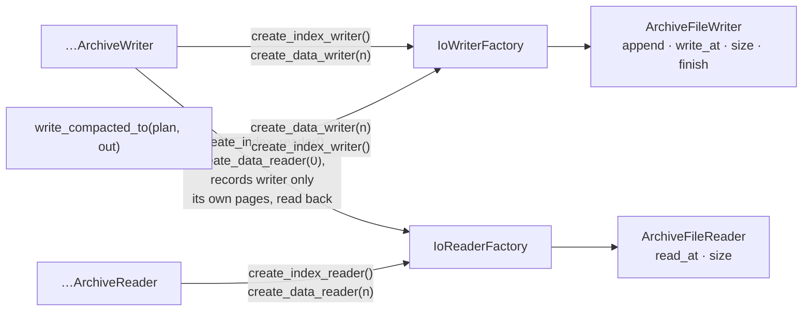

# io

How an archive reaches its bytes. A split archive never opens a file: it asks a factory for a ROLE — the index, or data file `n` — and reads or writes that one file through `ArchiveFileReader` / `ArchiveFileWriter`. `LocalFileIo` is both factories over a local directory; an S3 implementation is the service's to write, after the template below. Every split structure of the three archive modules works through these traits, and `GlobalDayIndexReader::open` / `GlobalDayIndex::read_from` read their one file through an `ArchiveFileReader`. The `…SingleFile` structures do not: they use tokio's `AsyncRead` / `AsyncWrite` / `AsyncSeek` ([single-file](single-file.md)).

| Item | What it is | Source |
| --- | --- | --- |
| `ArchiveFileWriter` | one file being written: `append`, `write_at`, `size`, `finish` | [archive_file_writer.rs](../src/archive_file_writer.rs) |
| `ArchiveFileReader` | one file being read: `read_at`, `size` | [archive_file_reader.rs](../src/archive_file_reader.rs) |
| `IoWriterFactory<TWriter>` | the writers of ONE archive: `create_index_writer`, `create_data_writer` | [io_writer_factory.rs](../src/io_writer_factory.rs) |
| `IoReaderFactory<TReader>` | the readers of ONE archive: `create_index_reader`, `create_data_reader` | [io_reader_factory.rs](../src/io_reader_factory.rs) |
| `LocalFileIo`, `LocalFileWriter`, `LocalFileReader` | both factories over one local directory, and the files they hand out | [local_file_io/](../src/local_file_io/mod.rs) |
| `index_file_name`, `data_file_name` | `index`, `data00` … `dataff`: the names of the files, and of the S3 objects | [file_names.rs](../src/local_file_io/file_names.rs) |

The crate's own tests run on `InMemoryIo` ([in_memory_io.rs](../src/in_memory_io.rs)): both factories in memory, with counters, failures and gates. It is not public ([internals](internals.md)).

## Roles, not files

What a file is called, where it lives and whether it is a file at all is the factory's business, so the same archive is written to local files and read out of S3 by swapping the factory.



What an implementation sees:

| Caller | Files | Calls |
| --- | --- | --- |
| a working writer, `…ArchiveWriter` | the index at `new`, frame 0 appended to it at once; data file `n` when the first key whose data page belongs in it is written, in order `0, 1, …` — the file is created empty, and the page is appended when it leaves the writer's cache, at a flush at the latest; each kept until `finish`. The records writer — `FixedKeyMinuteIndexedRecordsArchiveWriter` — has data file 0 only, created with the first record | `append` in offset order; `write_at` over appended bytes; `finish` on the index, then on every data file, each awaited even after another failed. What it evicted comes back through `create_index_reader()` — and the records writer's data frames through `create_data_reader(0)` — each reader opened on first need, kept, asked no `size()`, and read only where bytes were appended, also bytes appended after it was opened |
| a reader, `…ArchiveReader` | the index at `open`; data file `n` at the first read that needs it, once, kept for the reader's life. One that failed to open is tried again by the next read | `size()` once per file, when it is opened; then `read_at`, only inside that size |
| a compaction's output, the `out` of `write_compacted_to(&plan, &out)` | data files `0, 1, …` in order, each finished at its planned size before the next is created; then the index, finished LAST. An archive with no keys has no data file | `append` and `finish` only |

No archive of the crate asks `ArchiveFileWriter::size`: the archive counts what it appended, and an `append` whose returned offset is not that count is a `ContractViolation`.

A writer and a reader take their factory BY VALUE and keep it — `new(factory)`, `open(factory)` — and the crate implements the traits for neither `&TFactory` nor `Arc<TFactory>`, so hand over a clone to keep one: a clone of `LocalFileIo` is the same directory. `write_compacted_to(&plan, &out)` only borrows its output.

None of the four traits is `dyn`-compatible — their methods return `impl Future` — so there is no `Box<dyn ArchiveFileReader>`: an archive is generic over its factory and its file types, the last type parameters of every split structure — `TFactory, TWriter, TReader` of a writer, `TFactory, TReader` of a reader. Over local files, a reader of the key, slot and item of the [second example](#implementing-the-traits) is `FixedKeyPreallocatedSlotsArchiveReader<Login, Hour, Volume, LocalFileIo, LocalFileReader>`; where the compiler can tell, `_` does.

## Writing and reading one file

`LocalFileIo` as both factories, used directly:

```rust
use archived_data::*;

#[tokio::main]
async fn main() {
    let dir = std::env::temp_dir().join(format!("archived-data-docs-io-1-{}", std::process::id()));
    let _ = std::fs::remove_dir_all(&dir);

    let io = LocalFileIo::new(&dir);
    assert_eq!(io.dir(), dir);
    assert_eq!(io.index_path(), dir.join(index_file_name()));
    assert_eq!(io.data_path(10), dir.join("data0a"));
    assert_eq!(data_file_name(255), "dataff");

    // Nothing is touched until a file is asked for: the directory is created with the first writer.
    assert!(!dir.exists());
    let writer = io.create_index_writer().await.unwrap();
    assert!(dir.exists());
    assert_eq!(writer.path(), io.index_path());
    assert_eq!(writer.append(b"hello").await.unwrap(), 0);

    // A reader of the same file sees every byte of a call that returned — also of calls made after it was opened.
    let reader = io.create_index_reader().await.unwrap();
    assert_eq!(reader.size().await.unwrap(), 5);

    assert_eq!(writer.append(b" world").await.unwrap(), 5);
    writer.write_at(0, b"J").await.unwrap();
    assert_eq!(writer.size().await.unwrap(), 11);
    assert_eq!(reader.size().await.unwrap(), 11);
    assert_eq!(reader.read_at(1, 4).await.unwrap(), b"ello");

    // A file grows only by append.
    let error = writer.write_at(10, b"!!").await.unwrap_err();
    assert_eq!(error.kind(), std::io::ErrorKind::InvalidInput);
    let path = writer.path().display();
    assert_eq!(error.to_string(), format!("2 bytes at 10 reach past the end of the 11-byte file {path}"));

    writer.finish().await.unwrap();
    writer.finish().await.unwrap(); // finds nothing to finish: Ok

    // Exactly `len` bytes, or UnexpectedEof: never a short read.
    let error = reader.read_at(8, 4).await.unwrap_err();
    assert_eq!(error.kind(), std::io::ErrorKind::UnexpectedEof);
    assert_eq!(error.to_string(), format!("4 bytes at 8 reach past the end of the 11-byte file {path}"));
    assert_eq!(reader.read_at(11, 0).await.unwrap(), b"");

    // A file that does not exist is an error, never an empty reader — and nothing is created for it.
    // LocalFileReader is not Debug, so the Err is matched: unwrap_err() would not compile.
    let missing = io.create_data_reader(0).await;
    assert!(matches!(missing, Err(error) if error.kind() == std::io::ErrorKind::NotFound));
    assert!(!io.data_path(0).exists());

    assert_eq!(std::fs::read(reader.path()).unwrap(), b"Jello world");
    std::fs::remove_dir_all(&dir).unwrap();
}
```

### ArchiveFileWriter

`pub trait ArchiveFileWriter: Send + Sync` — one file of an archive being written: bytes are appended at the end, and bytes already written are overwritten in place.

| Method | Returns | Contract |
| --- | --- | --- |
| `append(&self, bytes: &[u8])` | `io::Result<u64>` | writes `bytes` at the end; returns the offset they start at |
| `write_at(&self, offset: u64, bytes: &[u8])` | `io::Result<()>` | overwrites bytes already written; a range reaching past the end is `InvalidInput` — a file grows only by `append` |
| `size(&self)` | `io::Result<u64>` | how many bytes the file holds |
| `finish(&self)` | `impl Future<Output = io::Result<()>> + Send + 'static` | confirms THIS file: what was written to it is persisted. `Err` means the file is not there |

`append`, `write_at` and `size` are declared `fn … -> impl Future<Output = …> + Send` and written by an implementation as `async fn`: for them the table shows what the future resolves to.

- Every future is `Send`.
- `finish` runs once. A second call finds nothing to finish and returns `Ok(())` — also after a first call that failed, so the first call's result is the answer.
- `finish` never says the archive is complete. A compact archive is complete when its index opens; a working one opens only when its last flush completed and nothing was written after it ([lifecycle](lifecycle.md)).
- `Drop` of a writer never finished finishes it: what reached the file is persisted, so an archive abandoned halfway leaves its files behind.
- After `finish`, every other method panics: writing to a finished file is a bug in the caller, not a state to recover from.
- `finish`'s future is `'static`: it owns what it needs, so an implementation writes `finish` as a plain `fn` returning an `async move` block. An `async fn finish(&self)` borrows the writer and does not compile.

### ArchiveFileReader

`pub trait ArchiveFileReader: Send + Sync` — one file of an archive being read, with random access: a local file reads at an offset, an S3 object reads a range per call.

| Method | Returns | Contract |
| --- | --- | --- |
| `read_at(&self, offset: u64, len: usize)` | `io::Result<Vec<u8>>` | EXACTLY `len` bytes from `offset`; a range reaching past the end is `UnexpectedEof`, never a short read |
| `size(&self)` | `io::Result<u64>` | how many bytes the file holds |

Both are declared `fn … -> impl Future<Output = …> + Send` and written as `async fn`.

- Every future is `Send`.
- Nothing holds a position, so concurrent reads of one file need not wait on each other; whether they do is the implementation's choice.
- A reader of this crate asks a file's `size()` once, when it opens the file, and never reads past it: a range its own bytes point past the end is `Corrupted`, refused without a read ([exact reads](split-format.md#exact-reads)). The archive is assumed not to change while it is read.
- `size()` is not always asked before a `read_at`. A writer reading its own pages back asks none: it reads only bytes it appended. `GlobalDayIndexReader::read_sync_time` is one `read_at` of the first 8 bytes and nothing else, so on a shorter file it returns the reader's `UnexpectedEof`, as `ArchiveError::Io`.

### IoWriterFactory and IoReaderFactory

`pub trait IoWriterFactory<TWriter: ArchiveFileWriter>` and `pub trait IoReaderFactory<TReader: ArchiveFileReader>` hand out the files of ONE archive: its index, and its data files `0 ..= 255`.

| Method | Returns | Contract |
| --- | --- | --- |
| `create_index_writer(&self)` | `io::Result<TWriter>` | a NEW, EMPTY index; a file that exists under the same name is replaced |
| `create_data_writer(&self, no: u8)` | `io::Result<TWriter>` | the same, for data file `no` |
| `create_index_reader(&self)` | `io::Result<TReader>` | the index; a file that does not exist is an `Err`, never an empty reader |
| `create_data_reader(&self, no: u8)` | `io::Result<TReader>` | the same, for data file `no` |

- The archive asks only for a role. What the file is called, where it lives and whether it is a file at all is the factory's to resolve.
- An implementation writes the four methods as plain `async fn`. The futures are `Send`, so an archive is written, read and compacted inside `tokio::spawn`. The traits ask nothing of the factory type itself, but such an `async fn` borrows `&self` into a `Send` future, so a factory that is not `Sync` does not compile; an archive moved into a task needs its factory `Send` as well.
- A working writer reads its own pages back, so it takes ONE factory that implements BOTH traits — `TFactory: IoWriterFactory<TWriter> + IoReaderFactory<TReader>` — and such a reader sees every byte the writer of its file has written, also bytes written after the reader was created. A reader needs only `IoReaderFactory`, a compaction's output only `IoWriterFactory`.
- An `io::Error` from any method becomes `ArchiveError::Io`, the error kept whole. Which error a missing file is, is the factory's: the contract says only `Err`. Over `LocalFileIo`, and over the example below, opening an archive that has no index is `Err(ArchiveError::Io(error))` with `error.kind() == NotFound`, and so is every read that needs a data file that does not exist ([errors](errors.md#io-the-io-failed)). `ArchiveError` converts back into `io::Error` — `Io` as the error it holds, the others as `InvalidData` ([conversions](errors.md#display-source-and-conversions)).

## Implementing the traits

A complete implementation in memory — the template for an S3 one — used to write, read and compact an archive of [fixed_key_preallocated_slots](fixed-key-preallocated-slots.md):

```rust
use std::collections::HashMap;
use std::future::Future;
use std::sync::{Arc, Mutex};

use archived_data::*;

/// An account id, 8 bytes little-endian.
#[derive(Debug, Clone, Copy, PartialEq, Eq, PartialOrd, Ord)]
struct Login(u64);

impl PrimaryKeyFixedSize for Login {
    const LEN: usize = 8;

    fn from_slice(src: &[u8]) -> Self {
        Self(u64::from_le_bytes(src.try_into().unwrap()))
    }

    fn copy_to(&self, out: &mut Vec<u8>) {
        out.extend_from_slice(&self.0.to_le_bytes());
    }
}

/// An hour of a day: 24 slots.
#[derive(Debug, Clone, Copy)]
struct Hour(usize);

impl PreallocatedSlotKey for Hour {
    const SLOTS: usize = 24;

    fn slot_index(&self) -> usize {
        self.0
    }
}

/// The volume traded in an hour; 0 is the empty slot.
#[derive(Debug, Clone, Copy, Default, PartialEq)]
struct Volume(u64);

impl PreallocatedDataItem for Volume {
    const ITEM_LEN: usize = 8;

    fn from_slice(src: &[u8]) -> Self {
        Self(u64::from_le_bytes(src.try_into().unwrap()))
    }

    fn copy_to(&self, out: &mut Vec<u8>) {
        out.extend_from_slice(&self.0.to_le_bytes());
    }
}

type Bytes = Arc<Mutex<Vec<u8>>>;

/// The files of ONE archive, by the names an S3 implementation gives its objects, and the names of the
/// files finished, in the order they were. A clone shares both.
#[derive(Clone, Default)]
struct MemoryIo {
    files: Arc<Mutex<HashMap<String, Bytes>>>,
    finished: Arc<Mutex<Vec<String>>>,
}

impl MemoryIo {
    fn create(&self, name: String) -> MemoryWriter {
        let bytes = Bytes::default();
        self.files.lock().unwrap().insert(name.clone(), bytes.clone()); // replaces a file of that name

        let inner = Inner { name, bytes, finished: self.finished.clone() };
        MemoryWriter { inner: Arc::new(tokio::sync::Mutex::new(Some(inner))) }
    }

    fn open(&self, name: String) -> std::io::Result<MemoryReader> {
        match self.files.lock().unwrap().get(&name) {
            Some(bytes) => Ok(MemoryReader { bytes: bytes.clone() }),
            None => Err(std::io::Error::new(std::io::ErrorKind::NotFound, name)),
        }
    }

    fn finished(&self) -> Vec<String> {
        self.finished.lock().unwrap().clone()
    }

    fn size_of(&self, name: &str) -> u64 {
        self.files.lock().unwrap()[name].lock().unwrap().len() as u64
    }
}

impl IoWriterFactory<MemoryWriter> for MemoryIo {
    async fn create_index_writer(&self) -> std::io::Result<MemoryWriter> {
        Ok(self.create(index_file_name().to_string()))
    }

    async fn create_data_writer(&self, no: u8) -> std::io::Result<MemoryWriter> {
        Ok(self.create(data_file_name(no)))
    }
}

impl IoReaderFactory<MemoryReader> for MemoryIo {
    async fn create_index_reader(&self) -> std::io::Result<MemoryReader> {
        self.open(index_file_name().to_string())
    }

    async fn create_data_reader(&self, no: u8) -> std::io::Result<MemoryReader> {
        self.open(data_file_name(no))
    }
}

/// Everything a writer holds until its file is finished.
struct Inner {
    name: String,
    bytes: Bytes,
    finished: Arc<Mutex<Vec<String>>>,
}

impl Inner {
    /// S3 sends the bytes here: one PUT, or the last parts of a multipart upload and its completion.
    fn finish(self) {
        self.finished.lock().unwrap().push(self.name);
    }
}

struct MemoryWriter {
    inner: Arc<tokio::sync::Mutex<Option<Inner>>>,
}

const FINISHED: &str = "the file is finished: nothing can be written to it";

impl ArchiveFileWriter for MemoryWriter {
    async fn append(&self, bytes: &[u8]) -> std::io::Result<u64> {
        let inner = self.inner.lock().await;
        let mut content = inner.as_ref().expect(FINISHED).bytes.lock().unwrap();

        let offset = content.len() as u64;
        content.extend_from_slice(bytes);
        Ok(offset)
    }

    async fn write_at(&self, offset: u64, bytes: &[u8]) -> std::io::Result<()> {
        let inner = self.inner.lock().await;
        let mut content = inner.as_ref().expect(FINISHED).bytes.lock().unwrap();

        match offset.checked_add(bytes.len() as u64) {
            Some(end) if end <= content.len() as u64 => {
                content[offset as usize..end as usize].copy_from_slice(bytes);
                Ok(())
            }
            _ => Err(std::io::ErrorKind::InvalidInput.into()),
        }
    }

    async fn size(&self) -> std::io::Result<u64> {
        let inner = self.inner.lock().await;
        Ok(inner.as_ref().expect(FINISHED).bytes.lock().unwrap().len() as u64)
    }

    fn finish(&self) -> impl Future<Output = std::io::Result<()>> + Send + 'static {
        let inner = self.inner.clone();

        async move {
            let taken = inner.lock().await.take();

            if let Some(inner) = taken {
                inner.finish();
            }

            Ok(())
        }
    }
}

impl Drop for MemoryWriter {
    fn drop(&mut self) {
        // Held only by a finish in flight, which has taken the Inner already.
        let Ok(mut slot) = self.inner.try_lock() else {
            return;
        };

        // Still there: never finished. An S3 writer spawns its upload here, with tokio::spawn.
        if let Some(inner) = slot.take() {
            inner.finish();
        }
    }
}

/// No position: every read is one call over the bytes written so far.
struct MemoryReader {
    bytes: Bytes,
}

impl ArchiveFileReader for MemoryReader {
    async fn read_at(&self, offset: u64, len: usize) -> std::io::Result<Vec<u8>> {
        let content = self.bytes.lock().unwrap();

        match offset.checked_add(len as u64) {
            Some(end) if end <= content.len() as u64 => Ok(content[offset as usize..end as usize].to_vec()),
            _ => Err(std::io::ErrorKind::UnexpectedEof.into()),
        }
    }

    async fn size(&self) -> std::io::Result<u64> {
        Ok(self.bytes.lock().unwrap().len() as u64)
    }
}

#[tokio::main]
async fn main() {
    let working = MemoryIo::default();

    let mut writer = FixedKeyPreallocatedSlotsArchiveWriter::new(working.clone()).await.unwrap();
    writer.write(Login(7), Hour(3), &Volume(100)).await.unwrap();
    writer.write(Login(9), Hour(0), &Volume(5)).await.unwrap();
    writer.finish().await.unwrap();
    assert_eq!(working.finished(), ["index", "data00"]);

    let reader = FixedKeyPreallocatedSlotsArchiveReader::<Login, Hour, Volume, _, _>::open(working).await.unwrap();
    let items = reader.get(&Login(7), Hour(2), Hour(4)).await.unwrap().unwrap();
    assert_eq!(items, [Volume(0), Volume(100), Volume(0)]);

    // Compacted into another archive: data files first, the index last, each of the size its plan gave.
    let plan = reader.compaction_plan().await.unwrap();
    let compact = MemoryIo::default();
    reader.write_compacted_to(&plan, &compact).await.unwrap();

    assert_eq!(compact.finished(), ["data00", "index"]);
    assert_eq!(compact.size_of("data00"), plan.data_file_sizes()[0]);
    assert_eq!(compact.size_of("index"), plan.index_size());

    let reader = FixedKeyPreallocatedSlotsArchiveReader::<Login, Hour, Volume, _, _>::open(compact).await.unwrap();
    let items = reader.get(&Login(9), Hour(0), Hour(1)).await.unwrap().unwrap();
    assert_eq!(items, [Volume(5), Volume(0)]);
}
```

The shape `ArchiveFileWriter` prescribes, which the example and `LocalFileWriter` follow:

- Everything lives in an `Inner`, held as `Arc<tokio::sync::Mutex<Option<Inner>>>`. The lock costs next to nothing beside the IO it guards, and a tokio guard can be held across the IO, so appends take their offsets in the order they lock.
- `finish` clones the `Arc` into its future, which locks, takes the `Inner` out and finishes it. Called again, it finds nothing and returns `Ok(())`. The future does it all: `finish()` that is never awaited finishes nothing, and leaves the file to `Drop`.
- `Drop` takes the `Inner` too, with `try_lock`, and finishes it only if it is still there — the file was never finished; otherwise it does nothing. `try_lock` fails only while a `finish` in flight holds the lock, and that `finish` takes the `Inner`.
- Every other method reaches into the `Inner` and panics when it is gone.
- A finish that does IO is spawned by `Drop`, since nobody is left to await it or to be handed its error. `tokio::spawn` panics outside a runtime: `LocalFileWriter` syncs on the blocking pool, or on a thread of its own when there is no runtime. The example's `Drop` finishes inline: in memory there is nothing to wait for.
- Await `finish` before the writer is dropped. A `finish` future first polled after the drop finds the `Inner` gone and returns `Ok(())` at once, without waiting for the finish `Drop` started and without its error.

## An S3 implementation

The crate depends on no S3 client, so the S3 factories are the service's. What they must do:

- **Names**: one prefix per archive, and under it the objects `index_file_name()` and `data_file_name(n)`. A directory compacted with `LocalFileIo` is then uploaded file by file under the same names.
- **Writing**: an object cannot be written in the middle, so the writer keeps the bytes where it can — in memory, in a temporary file — and sends them on `finish`: one PUT, or the last parts of a multipart upload and its completion. `finish` returning `Ok` means the object is there.
- **Sizes known up front** come from the compaction plan: `index_size()` and `data_file_sizes()` are the exact size of every file before a byte of it is written — what a PUT with a content length needs.
- **A compaction writes each file in one pass**: data files in order, then the index, each from its first byte to its last by `append` and finished before the next file is created, never with `write_at` or `size`.
- **`Drop`** of a writer never finished spawns its upload. A compaction that fails therefore leaves behind what reached its writers; a short index among them is refused by `open` as `Corrupted`.
- **Reading**: `size` is asked once per opened file — a HEAD request; `read_at` is one ranged GET of exactly `len` bytes, a shorter body being `UnexpectedEof`; a missing object is an `Err`, never an empty reader. An archive reader opens each data file once and shares it between concurrent reads.
- **The working archive stays local**: its writer rewrites bytes in place and reads its own pages back, so it is written through `LocalFileIo`, and only the compact archive goes to S3 — [the day archive](archiving-a-day.md#the-day-archive) is the recipe, upload order included.
- **Complete** means a reader over the S3 objects opens the index — never an upload returning `Ok` ([lifecycle](lifecycle.md)).

## LocalFileIo, LocalFileWriter, LocalFileReader

One local directory per archive: the index is the file `index`, data file `n` the file `data_file_name(n)`. `LocalFileIo` implements BOTH factories, so a working writer runs over it, and so do a reader and a compaction's output.

| Item | Signature | Notes |
| --- | --- | --- |
| `LocalFileIo::new` | `fn new(dir: impl Into<PathBuf>) -> LocalFileIo` | touches nothing until a file is asked for; a clone is the same directory; `Debug` |
| `LocalFileIo::dir` | `fn dir(&self) -> &Path` | |
| `LocalFileIo::index_path` | `fn index_path(&self) -> PathBuf` | `dir` joined with `index` |
| `LocalFileIo::data_path` | `fn data_path(&self, no: u8) -> PathBuf` | `dir` joined with `data_file_name(no)` |
| `LocalFileWriter::path`, `LocalFileReader::path` | `fn path(&self) -> &Path` | the file written or read |
| `index_file_name` | `fn index_file_name() -> &'static str` | `"index"` |
| `data_file_name` | `fn data_file_name(no: u8) -> String` | `data` and two lowercase hex digits: `data00`, `data0a` (10), `dataab` (171), `dataff` (255) |

`LocalFileWriter` and `LocalFileReader` have no public constructor: they come only from `LocalFileIo`, as `IoWriterFactory<LocalFileWriter>` and `IoReaderFactory<LocalFileReader>`. Neither is `Clone` or `Debug`: a file shared between tasks goes into an `Arc`, and `unwrap_err()` on a `create_*` result does not compile — match the `Err`, as the example above does. A local file of another name — a global day index, say — needs an `ArchiveFileReader` of your own, or its bytes go to `GlobalDayIndex::from_bytes`, or it is kept as the file `index` of a directory of its own ([a local copy](global-day-index.md#a-local-copy)).

What they do beyond the contract:

- **`create_index_writer` / `create_data_writer`** create the directory when it is missing, its missing parents with it, remove a file already there under the name, and create a NEW one. On unix whatever is still open on the old file keeps it, because the file is unlinked, not cut: a reader keeps reading the old bytes, and an earlier writer of the same name keeps writing into a file nobody will open. The crate's `InMemoryIo` and the `MemoryIo` of the example above behave the same way: a file created again is a new file, and whatever held the old one keeps it.
- **They replace only the files they create.** A compaction into a directory where an earlier, larger archive left more data files leaves the extra `dataXX` behind, named by no index. What belongs to an archive is its index and its data files `0 .. n` — `n` being the plan's `data_file_sizes().len()`, or a preallocated writer's `data_files()`; a working archive of the records module has `data00` alone, from its first record on — never a listing of the directory; or empty the directory first.
- **`create_index_reader` / `create_data_reader`** open a file that exists. A missing file, or a missing directory, is `NotFound`, and nothing is created.
- **IO is positional**: `pwrite` / `pread` on unix, `seek_write` / `seek_read` on Windows; the file position is never used. Every write, read, reader `size` and sync is one call on tokio's blocking pool. A panic inside it is resumed in the caller, and a call the runtime never ran — it is shutting down — is an `Err` of kind `Other`, never a success.
- **All of it needs a tokio runtime.** Polled outside one, `create_*` and every call that reaches the file system — an `append` or a `write_at` of at least one byte, `read_at`, a reader's `size`, `finish` — panic, as tokio's `spawn_blocking` does there. A `finish` that panics so has already taken the file, and nothing syncs it afterwards. Of the calls that reach the file system, only `Drop`'s sync does without a runtime.
- **A reader** holds no position and no lock, so concurrent reads of one file run side by side. Every byte of a writer's call is in the file when the call returns, so a reader of the same file, even one opened earlier, sees it. A reader's `size()` is the file's size at the moment of the call: it sees the file grow.
- **A writer** holds its guard across the IO, so appends take their offsets in the order they lock, and a failed one is cut off before the next one starts. `append` writes at the size the writer counts and returns it; an empty `append` writes nothing. A failed `append` cuts the file back to where it started — if the cut fails too, the error says so. `write_at` reaching past the counted size is `InvalidInput`; a failed one can leave its range partly written. The writer's `size()` is its count, with no call to the file system.
- **Neither `append` nor `write_at` is cancel-safe**: dropped halfway, its bytes may still land — an `append`'s uncounted, so the next one starts at the same offset. The archive writers refuse every later call after a dropped one anyway ([lifecycle](lifecycle.md)). A `finish` dropped halfway is not undone either: it has taken the file, the sync it queued still runs, and nobody learns how it ended.
- **Any call after `finish`** — `append`, `write_at`, `size` — panics, naming the file: `the archive file <path> is already finished: nothing can be written to it`. `path()` still answers.
- **`finish` is `sync_all`** of the file's content. It does not sync the directory entry of a new file: a crash of the MACHINE can lose a file whose `finish` returned. That is enough for a working copy rebuilt from its source; a file that must survive a crash on its own — the global day index — is written under a temporary name, synced and renamed by its owner ([the global day index](archiving-a-day.md#the-global-day-index)).
- **`Drop`** of a writer never finished hands the sync to the blocking pool of the runtime it is dropped in, or to a thread of its own when it is dropped outside any runtime — a writer that outlived its runtime. A failure there panics where it runs, naming the file — `the finish of an archive file dropped unfinished failed: sync <path>: …` — since nobody is left to return it to: the code that dropped the writer does not see it.
- **A writer dropped BY its runtime's shutdown** — a task still owned it — can get no sync at all: the blocking pool of a multi-thread runtime is closing by then and drops the call unrun, with no panic and no error. Every byte written is in the file all the same; it is the `fsync` that is missing.
- **`read_at`** checks the file's size first, so a range past the end is `UnexpectedEof` with no read and no allocation — `len` 0 included, and an offset past the end of any file; 0 bytes at the very end are `Ok`. A file cut between the check and the read is `UnexpectedEof` all the same.
- **Every error of the file system names its file** — or the directory that could not be created — and keeps its kind, so a missing file stays `NotFound`: `open <path>: …`, `append 5 bytes at 0 to <path>: …`, `4 bytes at 8 reach past the end of the 11-byte file <path>`. The one error that names nothing is the call the runtime never ran: `a blocking file operation did not run: …`.
