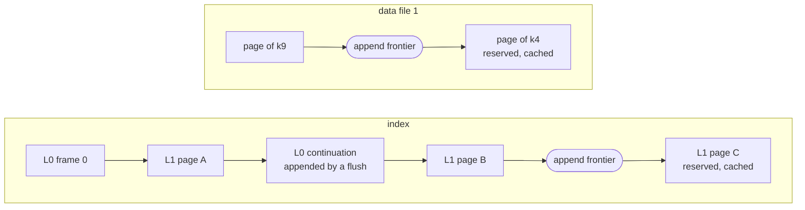
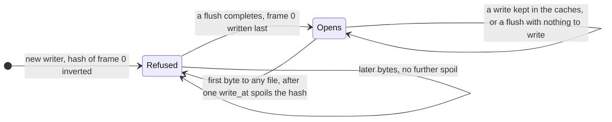
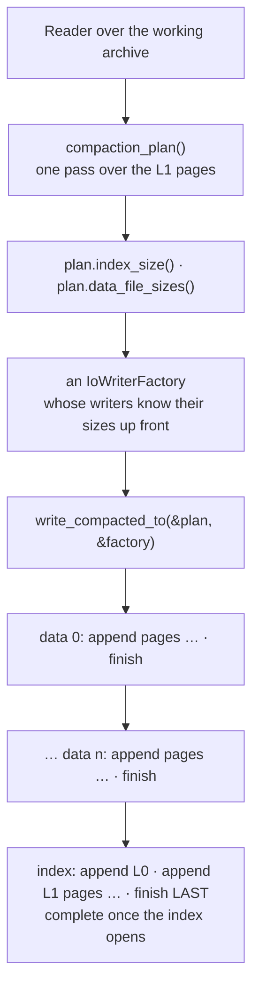

# lifecycle

How a split archive lives, the same way in every module. A WORKING archive is written in any key order and opens only when its last flush completed; `compaction_plan()` and `write_compacted_to()` turn it into the COMPACT archive that is kept, which is complete when its index opens; readers read both. The types are each module's writer and reader — `FixedKeyPreallocatedSlotsArchiveWriter` / `FixedKeyPreallocatedSlotsArchiveReader`, and the variable-key and records ones alike — and the plan: `CompactionPlan`, or `MinuteIndexedRecordsCompactionPlan` in the records module. The files are reached through [io](io.md), and their bytes are [split-format](split-format.md).

## The shape of a use


```rust
use archived_data::*;

/// An account id, 8 bytes little-endian.
#[derive(Debug, Clone, Copy, PartialEq, Eq, PartialOrd, Ord)]
struct Login(u64);

impl PrimaryKeyFixedSize for Login {
    const LEN: usize = 8;

    fn from_slice(src: &[u8]) -> Self {
        Self(u64::from_le_bytes(src.try_into().unwrap()))
    }

    fn copy_to(&self, out: &mut Vec<u8>) {
        out.extend_from_slice(&self.0.to_le_bytes());
    }
}

/// An hour of a day: 24 slots.
#[derive(Debug, Clone, Copy)]
struct Hour(usize);

impl PreallocatedSlotKey for Hour {
    const SLOTS: usize = 24;

    fn slot_index(&self) -> usize {
        self.0
    }
}

/// The volume traded in an hour; 0 is the empty slot.
#[derive(Debug, Clone, Copy, Default, PartialEq)]
struct Volume(u64);

impl PreallocatedDataItem for Volume {
    const ITEM_LEN: usize = 8;

    fn from_slice(src: &[u8]) -> Self {
        Self(u64::from_le_bytes(src.try_into().unwrap()))
    }

    fn copy_to(&self, out: &mut Vec<u8>) {
        out.extend_from_slice(&self.0.to_le_bytes());
    }
}

type Reader = FixedKeyPreallocatedSlotsArchiveReader<Login, Hour, Volume, LocalFileIo, LocalFileReader>;

#[tokio::main]
async fn main() {
    let root = std::env::temp_dir().join(format!("archived-data-docs-lifecycle-1-{}", std::process::id()));
    let _ = std::fs::remove_dir_all(&root);
    let working = LocalFileIo::new(root.join("working"));
    let compact = LocalFileIo::new(root.join("compact"));

    // 1. Write 100 accounts in shuffled order. Small frames and pages, so the working L0 is a chain.
    let mut writer = FixedKeyPreallocatedSlotsArchiveWriter::new_with_capacity(working.clone(), 4, 8)
        .await
        .unwrap();
    for n in 0..100 {
        let login = n * 37 % 100 + 1;
        writer.write(Login(login), Hour(login as usize % 24), &Volume(login * 10)).await.unwrap();
    }
    writer.finish().await.unwrap();

    // 2. Plan on a reader of the working archive: 40 data pages of 202 bytes per data file.
    let source = Reader::open(working.clone()).await.unwrap();
    assert!(source.l0_frames() > 1);
    source.set_max_data_file_bytes(40 * 202);
    let plan = source.compaction_plan().await.unwrap();
    assert_eq!(plan.keys_count(), 100);
    assert_eq!(plan.data_file_sizes(), [40 * 202, 40 * 202, 20 * 202]);

    // 3. Compact into another directory: every file is exactly the size the plan said.
    source.write_compacted_to(&plan, &compact).await.unwrap();
    let size = |path: std::path::PathBuf| std::fs::metadata(path).unwrap().len();
    assert_eq!(size(compact.index_path()), plan.index_size());
    for (no, planned) in plan.data_file_sizes().iter().enumerate() {
        assert_eq!(size(compact.data_path(no as u8)), *planned);
    }

    // 4. Read the compact archive: one L0 frame, the same answers.
    let reader = Reader::open(compact.clone()).await.unwrap();
    assert_eq!(reader.l0_frames(), 1);
    assert_eq!(reader.keys_count().await.unwrap(), 100);
    for login in 1..=100 {
        let key = Login(login);
        assert_eq!(
            reader.get(&key, Hour(0), Hour(23)).await.unwrap(),
            source.get(&key, Hour(0), Hour(23)).await.unwrap()
        );
    }

    let range = reader.get_range(&Login(10), &Login(12), Hour(10), Hour(12)).await.unwrap();
    assert_eq!(
        range,
        [
            (Login(10), vec![Volume(100), Volume(0), Volume(0)]),
            (Login(11), vec![Volume(0), Volume(110), Volume(0)]),
            (Login(12), vec![Volume(0), Volume(0), Volume(120)]),
        ]
    );

    std::fs::remove_dir_all(&root).unwrap();
}
```

1. **Write** the rows into a working archive with the module's writer over local files — `LocalFileIo`, which is both factories, as the writer needs. Keys may arrive in any order. Only `finish` returning `Ok` says every row is in the working archive.
2. **Plan** with a reader of the working archive: the plan knows the exact size of the compact index and of every compact data file, which is what an S3 upload needs up front. Plan from an archive whose writer's `finish` returned `Ok`: an unfinished one is refused at open, or opens without what stayed in its writer's caches after its last flush.
3. **Compact** with `write_compacted_to(&plan, &factory)`, through a factory built from those sizes — or into another local directory with `LocalFileIo`, whose files are then uploaded one by one ([archiving-a-day](archiving-a-day.md)). The data files are written first and the index last, so the archive is complete when its index exists AND opens: a run that stops before its index is whole leaves — in an empty place — no index, or a short one that `open` refuses, and running it again replaces every file it writes.
4. **Read** with a reader over a factory of the files where they lie — local files, or S3 objects read a range per call: L0 is read at open, data files are opened on first use, pages are cached. `get` reads one key, `get_range` every key between two bounds ([fixed-key-preallocated-slots](fixed-key-preallocated-slots.md)).

The `…SingleFile` structures go the same way with ONE file and no plan: `…ArchiveWriterSingleFile` writes a working file in any key order, and `…ArchiveReaderSingleFile::write_compacted_to` streams the compact file — deterministic, its size known up front from `compacted_len()` — into any `AsyncWrite`, a file or straight into an S3 upload, which a `…ArchiveReaderSingleFile` then reads with a few ranged reads. See [single-file](single-file.md).

## Writing: every file grows only by append

An offset is handed out ahead of its bytes: a new L1 page or data page is placed at the end of what its file has RESERVED, and its bytes reach the file later — when the page leaves its cache, or at `flush`. What keeps every file without a hole:

- **A page past its file's append frontier is always cached.**
- A page leaving its cache appends every not-yet-appended page before it first — all of them cached, by the same rule.
- A page already appended, and changed since, is rewritten in place with `write_at`.
- An item for a data page the cache does not hold goes straight to its file, with `write_at`.
- With a data cache of 0 — `set_data_cache_size(0)` — a new data page is appended at once, and every item is written straight to its file. Set on a writer that already holds data pages, it empties the cache at the next NEW key: until then an item for a page still cached stays in the cache.



- The writer's constructor creates the index and appends L0 frame 0 at offset 0. Data file 0 is created with the first key, data file `n` with its first page; a preallocated writer's `data_files()` says how many exist so far.
- Every data writer created stays open until `finish`: a known key's page may live in any earlier data file, and its item is written there in place.
- A data page goes into the current data file only whole, else the next data file starts ([limits](split-format.md#limits)).
- An L1 page that left the cache was appended already, and is read back through a reader of the index from the same factory, created on first need. That is why a writer takes a factory implementing both `IoWriterFactory` and `IoReaderFactory`, such as `LocalFileIo`. The preallocated writers never read a data file; the records writer reads its data frames back the same way.
- The records writer keeps the same rule over its L1 pages and L2 frames — one index, one frontier — and its data frames ([fixed-key-minute-indexed-records](fixed-key-minute-indexed-records.md)).
- Where a new key goes is the module's ([fixed-key-preallocated-slots](fixed-key-preallocated-slots.md)): an overflowing L1 page is split only when it has to be — a key past the last key of the last page starts a new page, so keys written in ascending order fill every page — and any other overflow splits the page, its upper part moving in front of the next page's keys when it fits there.

## A refusal changes nothing, a failure stops the writer

| Outcome | What it is | After it |
| --- | --- | --- |
| refusal | an `Err(ContractViolation)` decided before anything changes | the writer stays usable |
| failure | any other `Err` — an `Io`, a `Corrupted` page the writer read back, a `ContractViolation` that is not one of the refusals below — or a `write` / `flush` future dropped before it returned | every later `write`, `flush` and `finish` is a `ContractViolation` |

- **Refusals**: a slot or an item out of contract; a key out of contract — a new fixed key whose `copy_to` does not write `LEN` bytes, a variable key of 0 or more than 32 767 bytes or too large for the half-page rule; a new key needing data file 256; a new key needing index room past 4 GiB. That room is counted with the L0 continuations the next flush will need, so a flush never runs into the limit; with variable keys those continuations are bounded rather than counted — the smaller of a bound by interval count and one by L0 bytes — so one long key costs a frame or so, not half the index ([variable-key-preallocated-slots](variable-key-preallocated-slots.md)). The records writer adds its own ([fixed-key-minute-indexed-records](fixed-key-minute-indexed-records.md)). Every refusal, failure and panic in one place: [errors](errors.md).
- **Where a new key goes is decided before anything changes**: its L1 page — and the next one, when the page overflows — are read into the cache, and every refusal is made, before the key's data page is placed. A refused key takes no data page.
- The page is then cut, and its upper part placed, with no await in between: a write that fails or is dropped never loses a key written before it.
- **A refusal writes nothing of the refused key, and can still write.** A slot, an item or a variable key out of contract is refused before anything at all. A refusal made once the key's L1 page was read in — data file 256, index room, a fixed key that does not encode — evicts the L1 cache back down to its size before it returns, as any write does (the records writer: its L2 and data caches too). That can send a page an EARLIER write changed to its file, and that byte spoils frame 0's hash like any other: an archive that opened before the refused call may not open after it, until the next flush. An eviction that fails there makes the call a failure.
- **Neither `write` nor `flush` is cancel-safe.** A call is marked in flight on the way in, and the mark is cleared only when the call returns `Ok` or a refusal, because a dropped future runs no error path; so a failure, and a future dropped at an await, both leave the mark, and every later call is refused.
- A `ContractViolation` is not always a refusal: one outside the list above is a failure — a fixed key whose `copy_to` wrote `LEN` bytes when the key was placed and another count when its L1 page is encoded, a file whose `append` lands elsewhere than at its end. What tells the two apart is the next call: after a failure it is refused with "an earlier write or flush failed or was dropped before it completed: the writer is not usable".
- After a failure the archive is in an unknown state: it is a working archive, and is rebuilt from its source. `finish` on such a writer is refused too, and still finishes every file.

## flush and finish

`async fn flush(&mut self) -> Result<(), ArchiveError>` ends a cycle — everything written since the last flush that completed — in this one order:

1. every dirty L1 page reaches the index, in offset order: appended, or rewritten in place;
2. the index must now be appended up to everything reserved, because the continuations are reserved next, at its end; otherwise the flush is a `ContractViolation` — a second guard behind the in-flight mark, for a writer an earlier error left unusable;
3. every dirty data page reaches its data file, in file order;
4. when frame 0 still verifies — no byte reached any file since the last completed flush, in a `write` or in steps 1 and 3 — the flush stops here, with no write at all; a new writer's first flush always goes on, since its frame 0 does not verify yet;
5. L0 is laid out: the continuations it links are rewritten in place, in chain order, and new ones are appended at the end of the index;
6. frame 0 is written LAST: its entries, then its 20-byte header with the real hash.

**Nothing written is readable until `flush` or `finish` returns `Ok`.** Pages stay cached after a flush, clean. A flush that goes on past step 4 rewrites its continuations and frame 0 whether L0 changed or not. The records writer flushes the same way, its L2 frames in step 1 with the L1 pages and its data frames in step 3.

`async fn finish(self) -> Result<(), ArchiveError>`:

- It flushes, then calls `finish()` on the index and on EVERY data file created — the index first, then the data files in order — awaiting each even after another failed.
- It returns the flush's error first, else the first failed finish.
- A writer dropped without `finish` leaves each file writer's own `Drop` to persist what reached that file ([io](io.md)).
- `finish` and `Drop` alike mean "what reached this file is persisted", never "the archive is complete". **Only `finish` returning `Ok` says everything written is in the archive.**

## When a working archive opens: the frame-0 hash

**A working archive opens only when its last flush completed AND nothing was written to its files after it; otherwise `open` is `Err(Corrupted)`.**

```rust
use archived_data::*;

/// An account id, 8 bytes little-endian.
#[derive(Debug, Clone, Copy, PartialEq, Eq, PartialOrd, Ord)]
struct Login(u64);

impl PrimaryKeyFixedSize for Login {
    const LEN: usize = 8;

    fn from_slice(src: &[u8]) -> Self {
        Self(u64::from_le_bytes(src.try_into().unwrap()))
    }

    fn copy_to(&self, out: &mut Vec<u8>) {
        out.extend_from_slice(&self.0.to_le_bytes());
    }
}

/// An hour of a day: 24 slots.
#[derive(Debug, Clone, Copy)]
struct Hour(usize);

impl PreallocatedSlotKey for Hour {
    const SLOTS: usize = 24;

    fn slot_index(&self) -> usize {
        self.0
    }
}

/// The volume traded in an hour; 0 is the empty slot.
#[derive(Debug, Clone, Copy, Default, PartialEq)]
struct Volume(u64);

impl PreallocatedDataItem for Volume {
    const ITEM_LEN: usize = 8;

    fn from_slice(src: &[u8]) -> Self {
        Self(u64::from_le_bytes(src.try_into().unwrap()))
    }

    fn copy_to(&self, out: &mut Vec<u8>) {
        out.extend_from_slice(&self.0.to_le_bytes());
    }
}

type Reader = FixedKeyPreallocatedSlotsArchiveReader<Login, Hour, Volume, LocalFileIo, LocalFileReader>;

#[tokio::main]
async fn main() {
    let dir = std::env::temp_dir().join(format!("archived-data-docs-lifecycle-2-{}", std::process::id()));
    let _ = std::fs::remove_dir_all(&dir);
    let io = LocalFileIo::new(&dir);

    let mut writer = FixedKeyPreallocatedSlotsArchiveWriter::new(io.clone()).await.unwrap();
    writer.write(Login(7), Hour(3), &Volume(100)).await.unwrap();

    // The index exists, but no flush has completed: frame 0's hash does not verify.
    assert!(matches!(Reader::open(io.clone()).await, Err(ArchiveError::Corrupted(_))));

    writer.flush().await.unwrap();
    let reader = Reader::open(io.clone()).await.unwrap();
    assert_eq!(reader.get(&Login(7), Hour(3), Hour(4)).await.unwrap(), Some(vec![Volume(100), Volume(0)]));

    // A write that stays in the caches reaches no file: the archive opens as the flush left it.
    writer.write(Login(7), Hour(4), &Volume(5)).await.unwrap();
    let reader = Reader::open(io.clone()).await.unwrap();
    assert_eq!(reader.get(&Login(7), Hour(3), Hour(4)).await.unwrap(), Some(vec![Volume(100), Volume(0)]));

    // With no data cache, a new key empties the cache and has its page appended at once: bytes reached a
    // file, the hash is spoiled.
    writer.set_data_cache_size(0);
    writer.write(Login(8), Hour(1), &Volume(1)).await.unwrap();
    assert!(matches!(Reader::open(io.clone()).await, Err(ArchiveError::Corrupted(_))));

    // `finish` flushes: everything written is in the archive.
    writer.finish().await.unwrap();
    let reader = Reader::open(io.clone()).await.unwrap();
    assert_eq!(reader.get(&Login(7), Hour(3), Hour(4)).await.unwrap(), Some(vec![Volume(100), Volume(5)]));
    assert_eq!(reader.get(&Login(8), Hour(1), Hour(1)).await.unwrap(), Some(vec![Volume(1)]));

    std::fs::remove_dir_all(&dir).unwrap();
}
```

The index of a working archive exists from the moment its writer is created, so its existing says nothing. What says the index describes its files is frame 0's [hash](split-format.md#the-l0-hash-the-formats-only-identity):

- the writer creates the index with frame 0's hash INVERTED, so an index no flush has completed on is refused at open — never an archive that holds no keys;
- a flush writes frame 0 LAST — its entries, then its header with the real hash — so the index verifies only once every other byte of the flush is in it;
- the FIRST byte to reach the index or any data file after a completed flush is preceded by one 8-byte `write_at` that spoils that hash in place — writes it inverted. That first byte is one of:
  - an L1 page or a data page leaving its cache, appended or rewritten in place;
  - a new key's data page appended at once, with no data cache;
  - an item written straight into a data page the cache does not hold;
  - the flush's own first write;
- later bytes find the hash spoiled and cost nothing more, and a flush with nothing written since the last one writes nothing at all;
- a spoil that fails stops its call before any byte of the call's own: the call is a failure, and the index still opens as the last completed flush left it — which is still what its files hold — unless the failed `write_at` itself left some of its 8 bytes in the index, and then it is refused.



So `open` is `Err(Corrupted)` whether the writer never completed a flush, stopped halfway through one — failed, dropped at an await, or died with the process — or stopped after anything reached a file since its last one. It is never an archive that opens and answers `None` for a key a flush saved, or answers what no flush saved. A `write` whose changes all stayed in the writer's caches wrote nothing to the files: it is not in the archive until a flush, and does not stop it from opening. The records writer keeps the same protocol.

Two things the hash does not do:

- It guards `open`, not a reader already open: a reader assumes its files do not change while it reads them ([exact reads](split-format.md#exact-reads)), so one opened between two flushes is not to be used once the writer sends another byte to a file.
- It orders the writes; it does not make them durable. A `flush` hands its bytes to the file writers and syncs nothing — `LocalFileWriter` syncs only in `finish`, or when it is dropped unfinished — so what a crash of the MACHINE leaves of a working archive is the file system's to say, and the archive is rebuilt from its source ([io](io.md)).

## Compaction: the data files first, the index LAST

The compact archive has exact sizes, and a caller writing to S3 must know each object's size before its upload starts. So compaction is PLANNED first, then written from the plan:

| Step | Call | Does |
| --- | --- | --- |
| plan | `async fn compaction_plan(&self) -> Result<CompactionPlan, ArchiveError>` | walks the L1 pages once, through no cache; groups the keys into compact L1 pages; works out the exact size of the index and of every data file under the reader's `max_data_file_bytes` |
| write | `async fn write_compacted_to(&self, plan: &CompactionPlan, out: &TOut) -> Result<(), ArchiveError>`, `TOut: IoWriterFactory<TWriter>` | writes each data file in order, append only, each finished before the next is created; then creates the index, appends it and finishes it LAST |



- `write_compacted_to` never calls `write_at`. It walks the source twice more — the data pass, the index pass — through no cache. Memory: the source L1 page it walks, plus one data page in the data pass or the compact L1 page it builds in the index pass.
- Every data page's place is a closed form of the plan, so the index needs nothing from the data pass:

```text
page       = 10 + SLOTS × ITEM_LEN
per_file   = floor(max_data_file_bytes / page)
ref(i)     = (i / per_file, (i % per_file) × page)     the data page of the key of rank i
data file  = per_file × page for every full file, the rest in the last
empty      = a 20-byte index and NO data files
```

- The compact shape is ONE L0 frame of exact size, `next` 0, then the L1 pages, then every data page as ONE frame in ascending key order across the data files. The L1 pages are each module's. Fixed keys: full pages of `COMPACT_L1_CAPACITY` = 1024 keys, the last zero-padded, so the index is `20 + p × (2·LEN + 4) + p × (12 + 1024 × (LEN + 5))` bytes for `p = ceil(n / 1024)` pages ([fixed-key-preallocated-slots](fixed-key-preallocated-slots.md)). Variable keys: pages of exact size, closed at `COMPACT_L1_MAX_KEYS` = 1024 keys or before `COMPACT_L1_PAGE_BYTES` = 16 KiB, their key bytes copied raw from the source ([variable-key-preallocated-slots](variable-key-preallocated-slots.md)).
- Plan errors: keys that do not ascend across L1 pages are `Corrupted`; a compact index past 4 GiB, or data needing data file 256, is a `ContractViolation`.
- **The source is checked against the plan.** A compact L1 page whose count, size, first or last key differs from the plan, more or fewer keys than planned, or a file that ends at a size other than planned, is `Corrupted`: the source changed between the two steps.

**A compact archive is complete when its index exists AND opens** — not when the index object exists:

- a run into an empty place that fails in its data pass leaves no index, and `open` is `Err(Io)` on the missing one;
- a run that fails in its index pass can leave a short index behind — a file writer dropped unfinished still persists what reached it, and an append that failed partway may leave part of a page — and `open` refuses it as `Corrupted`: its L0 frame is cut short, its L0 names an L1 page that starts past its end, or its last L1 page ends past it ([what open checks](split-format.md#what-open-checks));
- the last step of a run is the index's `finish`. When that is the step that fails, the run is an `Err` with every byte of the index appended, and what is left is the file writer's to say: over `LocalFileIo` the index file is whole — only its `sync_all` failed — and it opens;
- so the check that an output holds a whole compact archive is `open` succeeding on it.
- **Compact into an empty place** — a new directory, a new prefix. An index an earlier run left there is replaced only by the index pass: a run that fails in its data pass leaves the old index, and it still opens, over data files this run has already replaced.
- Running the compaction again replaces every file it writes. With `LocalFileIo`, a data file of an earlier run that had more data files stays behind, named by no index: what belongs to an archive is its index and `plan.data_file_sizes().len()` data files, never a listing of the directory ([io](io.md)).
- The records module compacts in the same two steps with a plan of its own: [fixed-key-minute-indexed-records](fixed-key-minute-indexed-records.md).

## Determinism

The compact archive depends only on the keys, the items and `max_data_file_bytes` — never on the order the keys were written in, the frame and page sizes of the working archive, or how its frames were chained. So two runs over one archive write identical files, a stored archive is verified by compacting again and comparing, and a compact archive compacts to itself. That rests on one condition: `max_data_file_bytes` decides which data file every page lands in, so it must be the same for every run of one archive.

```rust
use archived_data::*;

/// An account id, 8 bytes little-endian.
#[derive(Debug, Clone, Copy, PartialEq, Eq, PartialOrd, Ord)]
struct Login(u64);

impl PrimaryKeyFixedSize for Login {
    const LEN: usize = 8;

    fn from_slice(src: &[u8]) -> Self {
        Self(u64::from_le_bytes(src.try_into().unwrap()))
    }

    fn copy_to(&self, out: &mut Vec<u8>) {
        out.extend_from_slice(&self.0.to_le_bytes());
    }
}

/// An hour of a day: 24 slots.
#[derive(Debug, Clone, Copy)]
struct Hour(usize);

impl PreallocatedSlotKey for Hour {
    const SLOTS: usize = 24;

    fn slot_index(&self) -> usize {
        self.0
    }
}

/// The volume traded in an hour; 0 is the empty slot.
#[derive(Debug, Clone, Copy, Default, PartialEq)]
struct Volume(u64);

impl PreallocatedDataItem for Volume {
    const ITEM_LEN: usize = 8;

    fn from_slice(src: &[u8]) -> Self {
        Self(u64::from_le_bytes(src.try_into().unwrap()))
    }

    fn copy_to(&self, out: &mut Vec<u8>) {
        out.extend_from_slice(&self.0.to_le_bytes());
    }
}

type Reader = FixedKeyPreallocatedSlotsArchiveReader<Login, Hour, Volume, LocalFileIo, LocalFileReader>;

/// Writes `logins` in this order through a working archive of these frame and page sizes, compacts it
/// with 30 data pages per data file, and returns the plan and the bytes of every compact file.
async fn compacted(
    dir: std::path::PathBuf,
    logins: &[u64],
    capacity_l0: usize,
    capacity_l1: usize,
) -> (CompactionPlan, Vec<Vec<u8>>) {
    let working = LocalFileIo::new(dir.join("working"));
    let compact = LocalFileIo::new(dir.join("compact"));

    let mut writer =
        FixedKeyPreallocatedSlotsArchiveWriter::new_with_capacity(working.clone(), capacity_l0, capacity_l1)
            .await
            .unwrap();
    for login in logins {
        writer.write(Login(*login), Hour(*login as usize % 24), &Volume(*login)).await.unwrap();
    }
    writer.finish().await.unwrap();

    let source = Reader::open(working).await.unwrap();
    source.set_max_data_file_bytes(30 * 202);
    let plan = source.compaction_plan().await.unwrap();
    source.write_compacted_to(&plan, &compact).await.unwrap();

    let mut files = vec![std::fs::read(compact.index_path()).unwrap()];
    for no in 0..plan.data_file_sizes().len() {
        files.push(std::fs::read(compact.data_path(no as u8)).unwrap());
    }
    (plan, files)
}

#[tokio::main]
async fn main() {
    let root = std::env::temp_dir().join(format!("archived-data-docs-lifecycle-3-{}", std::process::id()));
    let _ = std::fs::remove_dir_all(&root);

    // The same rows in two orders, through working archives of different frame and page sizes.
    let ascending: Vec<u64> = (1..=70).collect();
    let shuffled: Vec<u64> = (0..70).map(|n| n * 31 % 70 + 1).collect();

    let (plan_a, files_a) = compacted(root.join("a"), &ascending, 1024, 1024).await;
    let (plan_b, files_b) = compacted(root.join("b"), &shuffled, 2, 3).await;
    assert_eq!(plan_a, plan_b);
    assert_eq!(files_a, files_b);
    assert_eq!(files_a.len(), 1 + 3); // the index, then 30 + 30 + 10 data pages

    // An empty archive: a 20-byte index — size 20 · next 0 · count 0, then the hash — and no data file.
    let (plan, files) = compacted(root.join("empty"), &[], 1024, 1024).await;
    assert_eq!((plan.index_size(), plan.data_file_sizes().len()), (20, 0));
    assert_eq!(files.len(), 1);
    assert_eq!(files[0][..12], [20, 0, 0, 0, 0, 0, 0, 0, 0, 0, 0, 0]);

    std::fs::remove_dir_all(&root).unwrap();
}
```

## CompactionPlan

What a compaction will write, worked out before a byte of it is written — one type for both preallocated modules ([compaction_plan.rs](../src/compaction_plan.rs)). It is `Debug + Clone + PartialEq + Eq`; its fields are private.

| Method | Returns |
| --- | --- |
| `index_size(&self) -> u64` | the exact size of the compact index |
| `data_file_sizes(&self) -> &[u64]` | the exact size of every compact data file, in file order; none for an empty archive |
| `keys_count(&self) -> usize` | the keys the compact archive will hold |

- Built by the reader's `compaction_plan()`, under the reader's `max_data_file_bytes`: `set_max_data_file_bytes(&self, bytes: u64)` on the reader, `DEFAULT_MAX_DATA_FILE_BYTES` until set, read back with `max_data_file_bytes()`. The setting affects only the next plan, says nothing about the archive being read, and panics above 4 GiB or below one data page.
- Handed back by reference to `write_compacted_to(&plan, &out)` of a reader of the same archive, which refuses a source that no longer matches it as `Corrupted`. The plan is not used up: a run that failed is run again from the same plan. A caller whose writers must know a file's size up front builds `out` from `index_size()` and `data_file_sizes()`.
- The records module's plan, `MinuteIndexedRecordsCompactionPlan`, has the same three methods and `records_count()` ([fixed-key-minute-indexed-records](fixed-key-minute-indexed-records.md)).

## Cache defaults

Every cache is counted in pages (or frames), never in bytes ([cache_defaults.rs](../src/cache_defaults.rs)):

| Constant | Value | Holds |
| --- | --- | --- |
| `DEFAULT_READER_L1_CACHE_PAGES` | 10 | L1 pages, in every reader: the split readers, the `…SingleFile` readers, `GlobalDayIndexReader` |
| `DEFAULT_READER_DATA_CACHE_PAGES` | 10 | data pages of the preallocated readers, split and `…SingleFile`; data frames of the records reader |
| `DEFAULT_READER_L2_CACHE_FRAMES` | 10 | L2 frames — a key's minute index — of the records reader |
| `DEFAULT_WRITER_L1_CACHE_PAGES` | 64 | L1 pages, in every writer: split, `…SingleFile` and records |
| `DEFAULT_WRITER_DATA_CACHE_PAGES` | 1024 | data pages of the preallocated writers, split and `…SingleFile`; data frames of the records writer, 32 KiB each: 32 MiB |
| `DEFAULT_WRITER_L2_CACHE_FRAMES` | 1024 | L2 frames of the records writer, 12 968 bytes each, about 13 MiB: one per key written that day |

- A writer's `fn set_l1_cache_size(&mut self, pages: usize)` keeps at least 1. Its `fn set_data_cache_size(&mut self, pages: usize)` takes 0: every new page is then appended at once and every item written straight to its file (the records writer's `set_data_cache_size` / `set_l2_cache_size` take 0 too, keeping nothing between writes). A smaller cache only costs IO. A write placing a new key holds up to three L1 pages more until it returns: the key's page, the next one, and a new one.
- A split reader's `async fn set_l1_cache_size(&self, pages: usize)` and `async fn set_data_cache_size(&self, pages: usize)` — and the records reader's `set_l2_cache_size` — evict down to the new size before they return; 0 empties the cache and caches nothing more ([fixed-key-preallocated-slots](fixed-key-preallocated-slots.md)).
