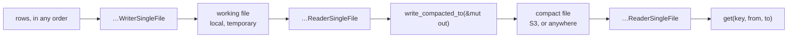
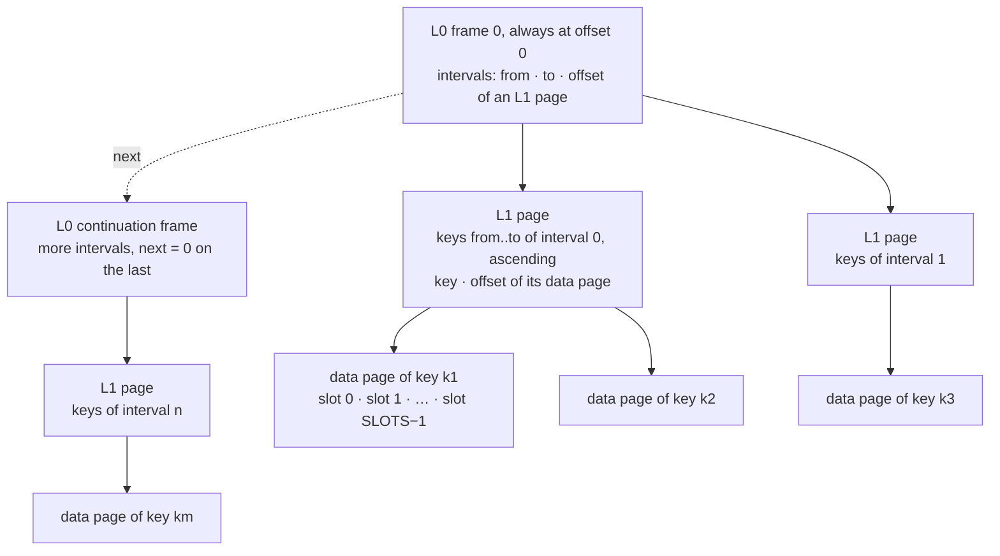
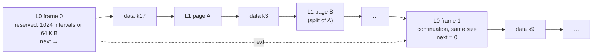
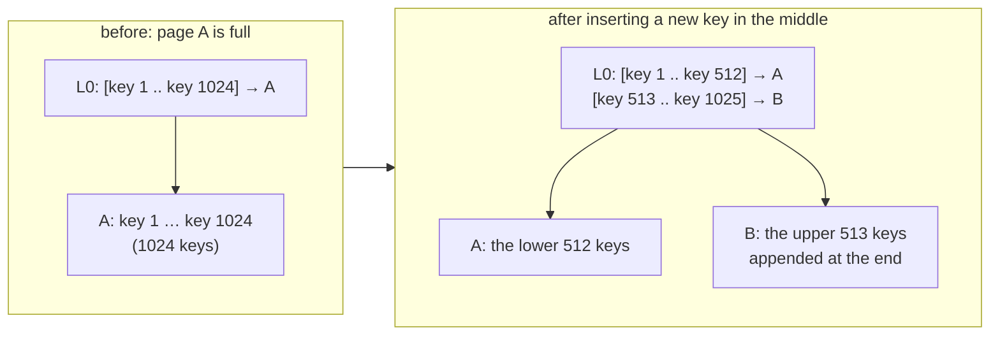
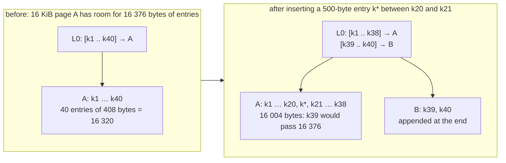
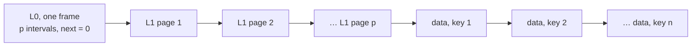
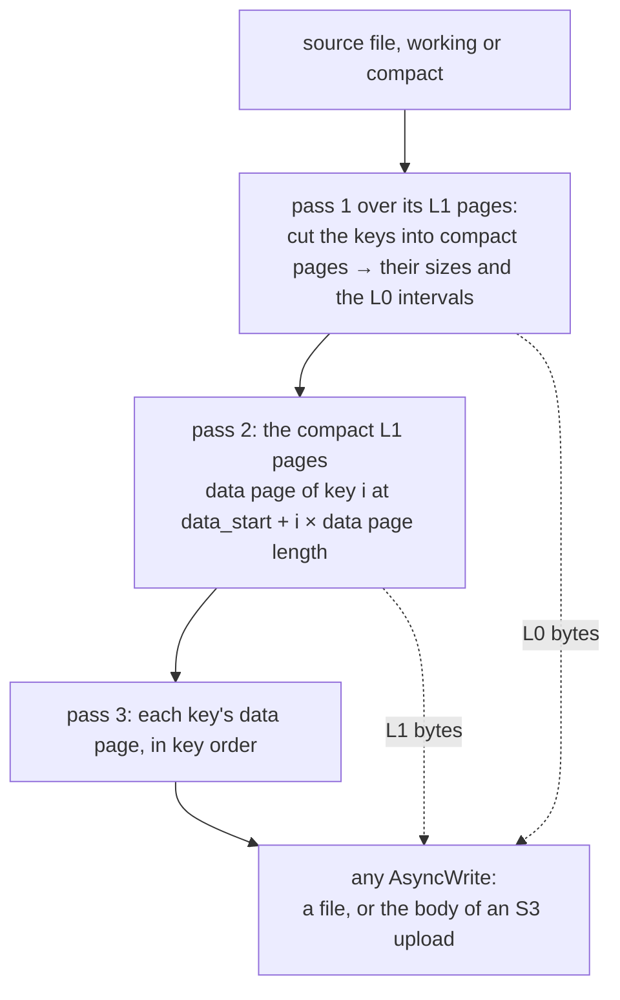
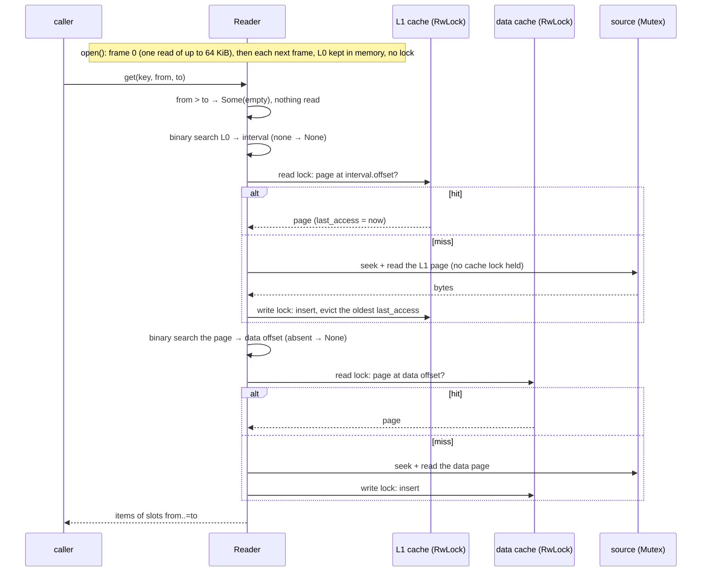

# single-file

The older ONE-file format of the two preallocated modules, and the four `…SingleFile` structures that write
and read it through tokio's `AsyncRead` / `AsyncWrite` / `AsyncSeek`: a local file, an in-memory
`std::io::Cursor`, or an S3 object through the service's reader, whose every read is one ranged GET. It is kept
because the objects already in S3 are in this format; a new archive is a [split archive](split-format.md). The
key, slot and item traits are the ones the split structures use: [fixed keys](fixed-key-preallocated-slots.md),
[variable keys](variable-key-preallocated-slots.md).

| Keys | Writes the working file | Reads either file, writes the compact one |
| --- | --- | --- |
| fixed | `FixedKeyPreallocatedSlotsArchiveWriterSingleFile<TPrimaryKey, TSlotKey, TItem, TSink>` | `FixedKeyPreallocatedSlotsArchiveReaderSingleFile<TPrimaryKey, TSlotKey, TItem, TSource>` |
| variable | `VariableKeyPreallocatedSlotsArchiveWriterSingleFile<TPrimaryKey, TSlotKey, TItem, TSink>` | `VariableKeyPreallocatedSlotsArchiveReaderSingleFile<TPrimaryKey, TSlotKey, TItem, TSource>` |

`TSink: AsyncRead + AsyncWrite + AsyncSeek + Unpin` (the writer reads its own pages back),
`TSource: AsyncRead + AsyncSeek + Unpin`; the compact file goes to any `AsyncWrite + Unpin`.

## The shape of a use



1. **Write** the rows into a working file with the module's `…WriterSingleFile`. Keys arrive in any order and
   pages split as they fill. This is the cheap step: it only moves the data out of wherever it was.
2. **Compact**: open a `…ReaderSingleFile` on the working file and stream `write_compacted_to` into any
   `AsyncWrite` — a file, or straight into an S3 upload. The compact file depends only on the keys and the
   items, never on the order they arrived in.
3. **Read** the compact file with a `…ReaderSingleFile` over the object: L0 is read at open, a `get` costs a
   ranged read per page it misses, and pages are cached.

## The layout

Every offset is an absolute `u64` from the start of the file. Little-endian throughout, except a variable
key's length prefix ([variable keys](variable-key-preallocated-slots.md)). `K` below is a fixed key's `LEN`
bytes; `P` is a variable key's length prefix followed by its bytes.



| Frame | Header | Body, fixed keys | Body, variable keys |
| --- | --- | --- | --- |
| L0 | `size u32 · next u64 · count u32` = 16 B | `count × (from K · to K · offset u64)`, zeros up to `size` | `count × (P from · P to · offset u64)`, zeros up to `size` |
| L1 | `size u32 · count u32` = 8 B | room for `capacity × (key K · offset u64)`: `count` entries, ascending, zeros past them | `count × (P key · offset u64)`, ascending, zeros up to `size` in a working file only |
| data | `size u32 · next u64 (always 0) · item_len u16` = 14 B | `SLOTS × ITEM_LEN` | the same |

- `size` is the whole frame or page, header included. A fixed L1 page's capacity is read from its `size`:
  `(size − 8) / (LEN + 8)`.
- Variable entries end at a `0x00` prefix — the end marker, which a working page's zero padding starts with —
  or at `size`, whichever comes first, and there must be exactly `count` of them.
- **L0 is a chain.** Frame 0 is at offset 0; `next` is the absolute offset of the continuation frame, `0` on
  the last one, so L0 has no fixed limit. A continuation always lies past the end of the frame pointing at it.
  A reader follows the chain at open and keeps every interval in memory; the intervals are ordered and
  disjoint across the WHOLE chain, and a lookup is one binary search over all of them. The framing is
  [l0_chain.rs](../src/l0_chain.rs), shared by the SingleFile structures of both modules; the split archive
  has its own.
- **The number of keys is the sum of the `count` fields of every L1 header.** Nothing stores it separately.

What is checked, and refused as `ArchiveError::Corrupted`:

| Where | Refused |
| --- | --- |
| L0, at `open` | a frame shorter than its 16-byte header, past the end of the file or cut short; a `next` into frame 0, into the frame itself, back into an earlier frame (so no cycle) or past the end of the file; fixed keys: a `count` of more intervals than the frame's `size` has room for; intervals that are not ordered and disjoint across the chain |
| L1, whenever a page is read from the file | a header past the end of the file; a `count` of 0, or a `size` too small for `count` entries (fixed keys: `size − 8` must be a multiple of `LEN + 8`); keys not strictly ascending; a first or last key that is not its interval's `from` / `to` — a binary search would answer "absent" for a key that is there |
| variable keys, L0 and L1 | entries that disagree with the frame's `count`; an entry cut short; an L0 interval whose `to` is the end marker; a two-byte prefix holding a length below 128 — every length has one spelling |
| data page, whenever a reader reads one | `size ≠ 14 + SLOTS × ITEM_LEN`, `next ≠ 0` or `item_len ≠ ITEM_LEN`: a file of other sizes is not this file |

A file cut short is not always `Corrupted`. An L1 page cut after its header and a data page cut short are
`ArchiveError::Io` (`UnexpectedEof`). An L1 header past the end is `Corrupted` to a read of the page — `get`,
`write_compacted_to`, the variable keys' `compacted_len` — and `Io` to `keys_count`, which reads the header
alone, and so to the fixed keys' `compacted_len`. Either way it is an `Err`, never an absent key.

These checks are all there is: the format has no hash and no checksum.

- A fixed L0 frame whose `count` is too low just ends earlier: the file opens, and the keys of the intervals it
  lost read as absent.
- The reader never asks the source for its length. A `size` is believed until the read comes back short, so a
  damaged L0 or L1 header can have up to 4 GiB allocated before the `Err`.

The error kinds, and `ArchiveError` as an `io::Error`, are in [errors](errors.md).

## The working file

```rust
use std::io::Cursor;

use archived_data::*;

/// An account id, 8 bytes little-endian.
#[derive(Debug, Clone, Copy, PartialEq, Eq, PartialOrd, Ord)]
struct Login(u64);

impl PrimaryKeyFixedSize for Login {
    const LEN: usize = 8;

    fn from_slice(src: &[u8]) -> Self {
        Self(u64::from_le_bytes(src.try_into().unwrap()))
    }

    fn copy_to(&self, out: &mut Vec<u8>) {
        out.extend_from_slice(&self.0.to_le_bytes());
    }
}

/// An hour of a day: 24 slots.
#[derive(Debug, Clone, Copy)]
struct Hour(usize);

impl PreallocatedSlotKey for Hour {
    const SLOTS: usize = 24;

    fn slot_index(&self) -> usize {
        self.0
    }
}

/// The volume traded in an hour; 0 is the empty slot.
#[derive(Debug, Clone, Copy, Default, PartialEq)]
struct Volume(u64);

impl PreallocatedDataItem for Volume {
    const ITEM_LEN: usize = 8;

    fn from_slice(src: &[u8]) -> Self {
        Self(u64::from_le_bytes(src.try_into().unwrap()))
    }

    fn copy_to(&self, out: &mut Vec<u8>) {
        out.extend_from_slice(&self.0.to_le_bytes());
    }
}

#[tokio::main]
async fn main() {
    // An empty sink that reads, writes and seeks: here in memory, usually a local temporary file.
    // 1 interval per L0 frame and 2 keys per L1 page, to show a split and a chain.
    let mut writer =
        FixedKeyPreallocatedSlotsArchiveWriterSingleFile::new_with_capacity(Cursor::new(Vec::new()), 1, 2);

    // Keys in any order; a known key's item is written into its slot in place.
    for (login, hour, volume) in [(30, 1, 300), (10, 0, 100), (20, 23, 200), (10, 2, 120), (30, 1, 310)] {
        writer.write(Login(login), Hour(hour), &Volume(volume)).await.unwrap();
    }

    // The third key split its page in half: two intervals, and frame 0 only until a flush.
    assert_eq!((writer.keys_count(), writer.l0_intervals(), writer.l0_frames()), (3, 2, 1));
    writer.flush().await.unwrap();
    assert_eq!(writer.l0_frames(), 2); // a continuation, allocated at the end of the file

    // A refusal changes nothing: the writer stays usable.
    let refused = writer.write(Login(40), Hour(24), &Volume(1)).await;
    assert!(matches!(refused, Err(ArchiveError::ContractViolation(_))));

    // `finish` flushes and hands the sink back.
    let bytes = writer.finish().await.unwrap().into_inner();

    let reader = FixedKeyPreallocatedSlotsArchiveReaderSingleFile::<Login, Hour, Volume, _>::open(
        Cursor::new(bytes),
    )
    .await
    .unwrap();
    assert_eq!((reader.l0_frames(), reader.l0_intervals()), (2, 2));
    assert_eq!(reader.keys_count().await.unwrap(), 3);
    assert_eq!(
        reader.get(&Login(10), Hour(0), Hour(2)).await.unwrap(),
        Some(vec![Volume(100), Volume(0), Volume(120)])
    );
    assert_eq!(reader.get(&Login(30), Hour(1), Hour(1)).await.unwrap(), Some(vec![Volume(310)]));
    assert_eq!(reader.get(&Login(40), Hour(0), Hour(23)).await.unwrap(), None);
}
```

Source: [fixed](../src/fixed_key_preallocated_slots/writer_single_file.rs),
[variable](../src/variable_key_preallocated_slots/writer_single_file.rs).

### Constructors

Both are sync and return `Self` — the split writers' are async and return a `Result`. The size of an L0 frame
is per FRAME, not a limit on L0: more intervals chain more frames.

| | Fixed keys | Variable keys |
| --- | --- | --- |
| `new(sink)` | `DEFAULT_L0_CAPACITY` = 1024 intervals per L0 frame, `DEFAULT_L1_CAPACITY` = 1024 keys per L1 page | `DEFAULT_L0_FRAME_BYTES` = 64 KiB per L0 frame, `DEFAULT_L1_PAGE_BYTES` = 16 KiB per L1 page |
| `new_with_capacity(sink, …)` | `capacity_l0`, `capacity_l1`: intervals and keys | `l0_frame_bytes`, `l1_page_bytes`: bytes, headers included |
| an L0 frame of the working file | `16 + capacity_l0 × (2·LEN + 8)` bytes | `l0_frame_bytes` |
| an L1 page of the working file | `8 + capacity_l1 × (LEN + 8)` bytes | `l1_page_bytes` |
| panics when | a capacity is 0; `LEN`, `SLOTS` or `ITEM_LEN` is 0 or `ITEM_LEN` > 65 535; a data page, an L1 page of `max(capacity_l1, 1024)` keys or an L0 frame does not fit its `u32` size | `l1_page_bytes` or `l0_frame_bytes` is below the [bounds of the half-page rule](#the-half-page-rule) or does not fit `u32`; `SLOTS`, `ITEM_LEN` and the data page as for fixed keys |

The sink must be EMPTY — it is written from offset 0 and never truncated, so open a file with
`truncate(true)` — and readable: the writer reads back the L1 pages it evicted.

### Where the pages go

Frame 0 is reserved at offset 0 for a whole frame: its `size` is the reserved length, its `count` the real one.
L1 pages and data pages are appended after it **in the order they were allocated**, mixed. Each flush lays L0
across the chain in order: frame 0, the continuations already allocated, then — only when L0 has outgrown
them — new continuations of the same size, allocated at the END of the file. A continuation is never given
back: later flushes reuse it, in chain order. With variable keys a flush may link fewer frames, when the
bounds of the intervals got shorter; the frames past the last linked one stay in the file, unused until L0
grows again, and the writer's `l0_frames()` goes on counting them while a reader's counts the linked ones.



### A new key

1. finds its interval: the last one with `from <= key`, or the first one for a key below every interval;
2. gets a data page appended at the end, filled with `TItem::default()` — the empty item;
3. is inserted, sorted, into that interval's L1 page, whose first and last keys become the interval's bounds;
4. if the page now overflows, it is split — fixed keys **in half**, variable keys **by bytes** — the second part
   moves to a new L1 page appended at the end, and a new L0 interval is inserted right after the old one.

A known key has its item written into its slot in place. A split never fails for lack of room in L0: an
interval that does not fit the current frames becomes one more continuation at the next flush.

The order the keys arrive in decides how full the working L1 pages are; the compact file is the same either
way.

- **Fixed keys** written in ascending or in descending order leave every working L1 page but one half full.
  The split archive's writer starts a new page for a key past the last one instead of halving a full last
  page ([fixed keys](fixed-key-preallocated-slots.md)); this one does not.
- **Variable keys** written in ascending order leave every page full: the page that overflows gives up only the
  new key. In any other order a key that lands in a full page pushes only that page's last entries — as many
  as it took the room of — onto a new page of `l1_page_bytes`, where the split archive's writer first tries the
  next page ([variable keys](variable-key-preallocated-slots.md)). Written in descending order that is nearly
  every key once the first page has filled: 2 000 keys of 20 bytes with the default sizes take 4 L1 pages
  ascending and 1 437 descending, 64 KiB of L1 pages against 22 MiB. Feed the writer ascending keys when the
  source can sort them.

**Fixed keys, in half.** A page holding more than `capacity_l1` keys keeps the lower `len / 2`; the upper half
moves.



**Variable keys, by bytes.** A page whose entries no longer fit `l1_page_bytes − 8` keeps its entries in key
order while the next one still fits; the rest moves. The left page stays as full as it can be.



### The half-page rule

Variable keys only. The writer refuses a key whose L1 entry is more than half the room a page has for entries:

```text
entry     = P(key) + 8 = (key_len < 128 ? 1 : 2) + key_len + 8
accepted  ⇔  2 × entry ≤ l1_page_bytes − 8
```

- A refused key is a `ContractViolation` ("key too large"), returned before anything is written. With 16 KiB
  pages an entry may be `(16 384 − 8) / 2 = 8 188` bytes, so the largest key is 8 178 bytes.
- It makes every split produce **exactly two pages that fit**. Before the insert the entries fit
  `room = l1_page_bytes − 8`, and the new entry is at most `room / 2`, so the total is at most `1.5 × room`. The
  left page stops only when the next entry — at most `room / 2` — would pass `room`, so it keeps more than
  `room / 2`, which leaves less than `room` for the right page.
- Sizes checked at construction, a panic: an L1 page must hold two entries of a one-byte key,
  `l1_page_bytes ≥ 8 + 2 × 10`; an L0 frame must hold one interval of the largest key such a page accepts,
  `l0_frame_bytes ≥ 16 + 2 × min((l1_page_bytes − 8) / 2 − 8, 2 + 32 767) + 8` — 16 384 with 16 KiB pages;
  both must fit a `u32`. So an L0 interval always fits a frame on its own.

### Caches

| Cache | Default | Set with | Smallest |
| --- | --- | --- | --- |
| L1 pages | `DEFAULT_WRITER_L1_CACHE_PAGES` = 64 | `set_l1_cache_size(&mut self, pages: usize)` | 1 — a smaller value is taken as 1; a smaller cache only costs IO |
| data pages | `DEFAULT_WRITER_DATA_CACHE_PAGES` = 1024 | `set_data_cache_size(&mut self, pages: usize)` | 0 — every new data page and every item go straight to the sink |

Both are least-recently-used. A page reaches the sink when it is evicted or at a flush; an item for a data page
that is not cached is written straight into its slot in the file. Set the sizes before the first write: a
smaller size evicts only when the cache next takes a page in, and a data cache set to 0 keeps the pages it
already holds — their items go on waiting in memory for the next flush.

### Flush, finish and what a stopped writer leaves

| Method | Does |
| --- | --- |
| `async fn write(&mut self, key: TPrimaryKey, slot: TSlotKey, item: &TItem) -> Result<(), ArchiveError>` | places a new key, then writes the item into its slot |
| `async fn flush(&mut self) -> Result<(), ArchiveError>` | the dirty L1 pages, then the dirty data pages, each in ascending offset order; then every frame of the L0 chain — new continuations allocated first, frame 0, then the continuations in chain order; then the sink's own `flush` |
| `async fn finish(self) -> Result<TSink, ArchiveError>` | `flush`, then the sink back: a `Cursor` to take the bytes out of, a file to `sync_all` if it must survive a crash |
| `keys_count(&self)`, `l0_intervals(&self)`, `l0_frames(&self)` → `usize` | no IO: the keys written, the intervals in memory, the frames allocated — frame 0 plus every continuation a flush allocated |

Every flush rewrites the whole L0 chain. **Nothing written is in the file for sure until `flush` or `finish`
returns `Ok`**, and the format has NO hash to refuse a file whose writer stopped anywhere else: between two
flushes, the pages evicted and the items written straight to the sink already sit in the file under an L0 that
does not describe them. Such a file is in no defined state — `open` may refuse it, or it may open and answer
what no flush saved, or answer `Corrupted` for keys a completed flush did save, their L1 page rewritten since.
A writer stopped before its first flush wrote frame 0 leaves an empty file, or zeros where frame 0 belongs, and
`open` refuses both as `Corrupted`. The split archive closes this gap with frame 0's hash
([lifecycle](lifecycle.md)).

### Refusals and failures

- **Refused before anything changes**, the writer stays usable — a `ContractViolation`: a slot index not below
  `SLOTS`; an item whose `copy_to` wrote other than `ITEM_LEN` bytes; with variable keys also an empty key, a
  key of more than `MAX_VARIABLE_KEY_LEN` = 32 767 bytes and a key the half-page rule refuses.
- A fixed key whose `copy_to` writes other than `LEN` bytes is NOT refused by `write`: it fails the eviction of
  its L1 page, or the next flush, as a `ContractViolation` that leaves the file unusable. The split writer
  refuses it up front.
- **Any other `Err` leaves the file in an unknown state**, and so does a `write` or `flush` future dropped
  before it returned: neither is cancel-safe — over a `tokio::fs::File` too, unlike a reader's calls — so never
  race one against a timeout. Nothing refuses the calls after one, and they do not repair it: a `finish` after
  a dropped `flush` can return `Ok` over a file with a page missing or out of place. The working file is
  temporary: rebuild it from its source.

## The compact file

```rust
use std::io::Cursor;

use archived_data::*;

/// An account id, 8 bytes little-endian.
#[derive(Debug, Clone, Copy, PartialEq, Eq, PartialOrd, Ord)]
struct Login(u64);

impl PrimaryKeyFixedSize for Login {
    const LEN: usize = 8;

    fn from_slice(src: &[u8]) -> Self {
        Self(u64::from_le_bytes(src.try_into().unwrap()))
    }

    fn copy_to(&self, out: &mut Vec<u8>) {
        out.extend_from_slice(&self.0.to_le_bytes());
    }
}

/// An hour of a day: 24 slots.
#[derive(Debug, Clone, Copy)]
struct Hour(usize);

impl PreallocatedSlotKey for Hour {
    const SLOTS: usize = 24;

    fn slot_index(&self) -> usize {
        self.0
    }
}

/// The volume traded in an hour; 0 is the empty slot.
#[derive(Debug, Clone, Copy, Default, PartialEq)]
struct Volume(u64);

impl PreallocatedDataItem for Volume {
    const ITEM_LEN: usize = 8;

    fn from_slice(src: &[u8]) -> Self {
        Self(u64::from_le_bytes(src.try_into().unwrap()))
    }

    fn copy_to(&self, out: &mut Vec<u8>) {
        out.extend_from_slice(&self.0.to_le_bytes());
    }
}

type Reader = FixedKeyPreallocatedSlotsArchiveReaderSingleFile<Login, Hour, Volume, Cursor<Vec<u8>>>;

#[tokio::main]
async fn main() {
    // A working file of 3 000 keys written in descending order: its pages split as they fill.
    let mut writer = FixedKeyPreallocatedSlotsArchiveWriterSingleFile::new(Cursor::new(Vec::new()));
    for login in (1..=3_000u64).rev() {
        writer.write(Login(login), Hour(login as usize % 24), &Volume(login)).await.unwrap();
    }
    let working = Reader::open(writer.finish().await.unwrap()).await.unwrap();

    let mut compact = Vec::new();
    let written = working.write_compacted_to(&mut compact).await.unwrap();
    assert_eq!(written, compact.len() as u64);
    assert_eq!(working.compacted_len().await.unwrap(), written);

    // 16 + p × (2·LEN + 8) + p × (8 + 1024 × (LEN + 8)) + n × (14 + SLOTS × ITEM_LEN), p = ⌈3000 / 1024⌉ = 3
    assert_eq!(written, 16 + 3 * 24 + 3 * 16_392 + 3_000 * 206);

    // The compact file answers the same, out of one L0 frame of three intervals.
    let reader = Reader::open(Cursor::new(compact.clone())).await.unwrap();
    assert_eq!((reader.l0_frames(), reader.l0_intervals()), (1, 3));
    assert_eq!(reader.keys_count().await.unwrap(), 3_000);
    let answer = reader.get(&Login(2_024), Hour(8), Hour(8)).await.unwrap();
    assert_eq!(answer, Some(vec![Volume(2_024)]));
    assert_eq!(answer, working.get(&Login(2_024), Hour(8), Hour(8)).await.unwrap());

    // Deterministic: the same keys and items written in ascending order, 8 intervals per L0 frame and 100
    // keys per L1 page — a chain of 8 frames — compact to the same bytes.
    let mut writer =
        FixedKeyPreallocatedSlotsArchiveWriterSingleFile::new_with_capacity(Cursor::new(Vec::new()), 8, 100);
    for login in 1..=3_000u64 {
        writer.write(Login(login), Hour(login as usize % 24), &Volume(login)).await.unwrap();
    }
    let other = Reader::open(writer.finish().await.unwrap()).await.unwrap();
    assert_eq!((other.l0_frames(), other.l0_intervals()), (8, 59));
    let mut again = Vec::new();
    other.write_compacted_to(&mut again).await.unwrap();
    assert!(again == compact);

    // And a compact file compacts to itself, byte for byte.
    let mut again = Vec::new();
    reader.write_compacted_to(&mut again).await.unwrap();
    assert!(again == compact);
}
```

Both are reader methods, over a working file or a compact one. Source:
[fixed](../src/fixed_key_preallocated_slots/reader_single_file_compact.rs),
[variable](../src/variable_key_preallocated_slots/reader_single_file_compact.rs).

| Method | Returns |
| --- | --- |
| `async fn write_compacted_to<TOut: AsyncWrite + Unpin>(&self, out: &mut TOut) -> Result<u64, ArchiveError>` | the compact file written to `out` from its first byte; the length written |
| `async fn compacted_len(&self) -> Result<u64, ArchiveError>` | that exact length, before writing: fixed keys from the L1 headers alone (one small read per L1 page), variable keys from a pass over every L1 page — keys vary in size |



| Part | Fixed keys | Variable keys |
| --- | --- | --- |
| L0 | ONE frame of exact size, `next` = 0, with `p = ⌈n / 1024⌉` intervals, whatever chain the source had | ONE frame of exact size, `next` = 0, one interval per L1 page |
| L1 | full pages of `COMPACT_L1_CAPACITY` = 1024 keys, the last zero-padded | pages of exact size, `8 + Σ entries`, with no padding and no end marker; a page closes at `COMPACT_L1_MAX_KEYS` = 1024 keys, or before the entry that would take it past `COMPACT_L1_PAGE_BYTES` = 16 KiB, header included |
| data | every page copied whole, in ascending key order | the same |
| key bytes | encoded again through `copy_to` | copied raw from the source, never re-encoded |

- A variable page that is still empty takes any entry: a working file written with larger L1 pages may hold a
  key whose entry alone does not fit 16 KiB, and that key gets a page of its own — of up to
  `8 + 2 + 32 767 + 8` = 32 785 bytes. The 1024-key and 16 KiB caps keep a page small: found through L0, cached
  whole, searched quickly.
- A file with no keys compacts to its L0 header alone: 16 bytes, `count` 0.
- Fixed keys: the compact file is byte for byte the layout of the files written before L0 could chain. The unit
  tests compare it with that layout written out by hand: `reference_day` in
  [test_types.rs](../src/fixed_key_preallocated_slots/test_types.rs).

```text
fixed keys:
compacted_len = 16 + p × (2·LEN + 8)                 L0
              + p × (8 + 1024 × (LEN + 8))           L1
              + n × (14 + SLOTS × ITEM_LEN)          data         where p = ⌈n / 1024⌉

variable keys:
compacted_len = 16 + Σ over pages (P(from) + P(to) + 8)          L0
              + Σ over pages (8 + Σ over its keys (P(key) + 8))   L1
              + n × (14 + SLOTS × ITEM_LEN)                        data

P(k) = (len(k) < 128 ? 1 : 2) + len(k)
```



- **Three passes over the source's L1 pages**, none through the reader's caches. Pass 1 knows every page's
  size, so every offset is known before the first data byte is written: the stream needs no seek, and `out`
  needs only `AsyncWrite`. Every page of the source is read on its own — pass 3 is one seek and one read per
  key — and `out` gets one `write_all` per frame or page of the compact file.
- **Deterministic**: the same keys and items give the same bytes, whatever order they were written in and
  whatever capacities, page sizes and caches the working file was written with. A stored file is verified by
  compacting it again and comparing.
- `out` is neither flushed nor shut down: the caller owns it, flushes it, and can run the whole stream again
  for a retry.
- Memory: nothing per key — the source's L0 and the compact one (for variable keys the page plan: the bounds
  and size of every compact page), one source L1 page, the compact page being filled and one data page.
- `Corrupted`: a page of the source that fails [its checks](#the-layout); keys that do not ascend across the
  source's L1 pages; a later pass that disagrees with pass 1 — the source changed underneath. A failed read or
  write is `Io`. With fixed keys, which are encoded again, a key whose `copy_to` writes other than `LEN` bytes
  is a `ContractViolation`. Whatever reached `out` before an `Err` is not a compact file.

## Reading

```rust
use std::sync::Arc;

use archived_data::*;

/// An account id, 8 bytes little-endian.
#[derive(Debug, Clone, Copy, PartialEq, Eq, PartialOrd, Ord)]
struct Login(u64);

impl PrimaryKeyFixedSize for Login {
    const LEN: usize = 8;

    fn from_slice(src: &[u8]) -> Self {
        Self(u64::from_le_bytes(src.try_into().unwrap()))
    }

    fn copy_to(&self, out: &mut Vec<u8>) {
        out.extend_from_slice(&self.0.to_le_bytes());
    }
}

/// An hour of a day: 24 slots.
#[derive(Debug, Clone, Copy)]
struct Hour(usize);

impl PreallocatedSlotKey for Hour {
    const SLOTS: usize = 24;

    fn slot_index(&self) -> usize {
        self.0
    }
}

/// The volume traded in an hour; 0 is the empty slot.
#[derive(Debug, Clone, Copy, Default, PartialEq)]
struct Volume(u64);

impl PreallocatedDataItem for Volume {
    const ITEM_LEN: usize = 8;

    fn from_slice(src: &[u8]) -> Self {
        Self(u64::from_le_bytes(src.try_into().unwrap()))
    }

    fn copy_to(&self, out: &mut Vec<u8>) {
        out.extend_from_slice(&self.0.to_le_bytes());
    }
}

type Reader = FixedKeyPreallocatedSlotsArchiveReaderSingleFile<Login, Hour, Volume, tokio::fs::File>;

#[tokio::main]
async fn main() {
    let dir = std::env::temp_dir().join(format!("archived-data-docs-single-file-3-{}", std::process::id()));
    let _ = std::fs::remove_dir_all(&dir);
    std::fs::create_dir_all(&dir).unwrap();

    // The working file: local, temporary, opened for read AND write, empty.
    let sink = tokio::fs::OpenOptions::new()
        .read(true)
        .write(true)
        .create(true)
        .truncate(true)
        .open(dir.join("day.temp"))
        .await
        .unwrap();
    let mut writer = FixedKeyPreallocatedSlotsArchiveWriterSingleFile::new(sink);
    for login in [7u64, 3, 5] {
        writer.write(Login(login), Hour(3), &Volume(login * 100)).await.unwrap();
    }
    writer.finish().await.unwrap();

    // The compact file is the one that is kept; `out` is the caller's to flush.
    let working = Reader::open(tokio::fs::File::open(dir.join("day.temp")).await.unwrap()).await.unwrap();
    let mut out = tokio::fs::File::create(dir.join("day")).await.unwrap();
    working.write_compacted_to(&mut out).await.unwrap();
    tokio::io::AsyncWriteExt::flush(&mut out).await.unwrap();

    // One reader per file, shared by concurrent callers.
    let reader = Arc::new(Reader::open(tokio::fs::File::open(dir.join("day")).await.unwrap()).await.unwrap());
    reader.set_l1_cache_size(4);
    reader.set_data_cache_size(100);

    // A call that may be dropped half way runs in a task of its own.
    let task = tokio::spawn({
        let reader = reader.clone();
        async move { reader.get(&Login(5), Hour(2), Hour(4)).await }
    });
    assert_eq!(task.await.unwrap().unwrap(), Some(vec![Volume(0), Volume(500), Volume(0)]));

    // An absent key is None; from > to is empty at once, with no read; a slot out of range is refused.
    assert_eq!(reader.get(&Login(4), Hour(0), Hour(23)).await.unwrap(), None);
    assert_eq!(reader.get(&Login(4), Hour(9), Hour(8)).await.unwrap(), Some(vec![]));
    assert!(matches!(
        reader.get(&Login(5), Hour(0), Hour(24)).await,
        Err(ArchiveError::ContractViolation(_))
    ));

    std::fs::remove_dir_all(&dir).unwrap();
}
```

A reader reads a working file or a compact one, and is shared through an `Arc` by concurrent callers: every
method takes `&self`. Source: [fixed](../src/fixed_key_preallocated_slots/reader_single_file.rs),
[variable](../src/variable_key_preallocated_slots/reader_single_file.rs).

| Method | Does |
| --- | --- |
| `async fn open(source: TSource) -> Result<Self, ArchiveError>` | reads the L0 chain — frame 0 with one read of up to 64 KiB, each continuation with one read of the previous frame's size, and the rest of a frame that is longer with one more — checks it and keeps it in memory, with no lock, for the reader's life. Panics on the type sizes the writer panics on (variable keys: the data page sizes only) |
| `async fn get(&self, key: &TPrimaryKey, from: TSlotKey, to: TSlotKey) -> Result<Option<Vec<TItem>>, ArchiveError>` | the items of slots `from..=to`; below |
| `async fn keys_count(&self) -> Result<usize, ArchiveError>` | the sum of the L1 header counts: one small read per L1 page, uncached |
| `l0_intervals(&self)`, `l0_frames(&self)` → `usize` | the intervals; the frames the chain was read from — 1 for every compact file |
| `set_l1_cache_size(&self, pages: usize)`, `set_data_cache_size(&self, pages: usize)` | sync, unlike the split readers' async ones; 10 pages each by default (`DEFAULT_READER_L1_CACHE_PAGES`, `DEFAULT_READER_DATA_CACHE_PAGES`) |
| `compacted_len`, `write_compacted_to` | [the compact file](#the-compact-file) |

`get` answers as the split readers' `get` does ([fixed keys](fixed-key-preallocated-slots.md)):

- the items of slots `from..=to`, inclusive, in slot order; `from == to` is one item; a slot never written
  reads back as `TItem::default()`;
- `Ok(None)`: the file does not hold the key;
- `from > to`: `Ok(Some(vec![]))` at once, WITHOUT reading anything, so it says nothing about whether the key
  is there;
- a slot index not below `SLOTS` is a `ContractViolation`, checked first;
- a failed read, or a page read from the source that fails [its checks](#the-layout), is an `Err`, never
  `None`. A CACHED L1 page is not checked again against the interval that asks for it — the split readers do
  check — so on a damaged file whose L0 names one L1 page from two intervals, a key of the second is
  `Corrupted` while the page is not cached and `Ok(None)` once the first interval has cached it;
- a miss reads the L1 page — fixed keys `8 + 1024 × (LEN + 8)` bytes, variable keys 16 KiB, then the rest if its
  header says it is longer — and the data page, one exact read: two ranged reads for an uncached key of a
  compact file, three when its L1 page is a variable key's page of more than 16 KiB.



- **Two caches, each under its own `RwLock`**: L1 pages and data pages. A hit only stamps the page's
  `last_access` (`rust_extensions::date_time::AtomicDateTimeAsMicroseconds`) under the READ lock, so callers of
  cached pages never wait on each other. A miss reads the source with no cache lock held and takes the WRITE
  lock only to insert — dropping its own copy if another caller inserted the page meanwhile — evicting the page
  with the oldest `last_access`. A smaller size takes effect at the next insert; 0 caches nothing more, and
  keeps the pages already cached.
- **The source is ONE position**, so its seek + read is one step under a `tokio::sync::Mutex`: the misses of
  one file go one at a time. Two files are two readers and do not wait on each other. The file is assumed
  immutable while it is read.
- **Not cancel-safe over a source that keeps a read in flight**, such as an S3 reader whose every read is one
  ranged GET. Dropping a `get`, `keys_count`, `compacted_len` or `write_compacted_to` halfway through a read
  leaves the shared source mid-request, and the NEXT caller's seek fails. A caller that may be dropped — a
  request handler — runs the call in a task of its own. `tokio::fs::File` and `Cursor` are not affected.

## Variable keys

```rust
use std::io::Cursor;

use archived_data::*;

/// An instrument symbol, of any length; sorts as the string does.
#[derive(Debug, Clone, PartialEq, Eq, PartialOrd, Ord)]
struct Symbol(String);

impl PrimaryKeyVariableSize for Symbol {
    fn from_slice(src: &[u8]) -> Self {
        Self(String::from_utf8(src.to_vec()).unwrap())
    }

    fn copy_to(&self, out: &mut Vec<u8>) {
        out.extend_from_slice(self.0.as_bytes());
    }
}

/// An hour of a day: 24 slots.
#[derive(Debug, Clone, Copy)]
struct Hour(usize);

impl PreallocatedSlotKey for Hour {
    const SLOTS: usize = 24;

    fn slot_index(&self) -> usize {
        self.0
    }
}

/// The volume traded in an hour; 0 is the empty slot.
#[derive(Debug, Clone, Copy, Default, PartialEq)]
struct Volume(u64);

impl PreallocatedDataItem for Volume {
    const ITEM_LEN: usize = 8;

    fn from_slice(src: &[u8]) -> Self {
        Self(u64::from_le_bytes(src.try_into().unwrap()))
    }

    fn copy_to(&self, out: &mut Vec<u8>) {
        out.extend_from_slice(&self.0.to_le_bytes());
    }
}

type Reader = VariableKeyPreallocatedSlotsArchiveReaderSingleFile<Symbol, Hour, Volume, Cursor<Vec<u8>>>;

#[tokio::main]
async fn main() {
    // 16 KiB L1 pages need L0 frames of at least 16 + 2 × ((16 384 − 8) / 2 − 8) + 8 = 16 384 bytes.
    let mut writer = VariableKeyPreallocatedSlotsArchiveWriterSingleFile::new_with_capacity(
        Cursor::new(Vec::new()),
        16_384,
        16_384,
    );

    // The half-page rule: an L1 entry (prefix + key + 8) may be at most (16 384 − 8) / 2 = 8 188 bytes.
    let refused = writer.write(Symbol("X".repeat(8_179)), Hour(0), &Volume(1)).await;
    assert!(matches!(refused, Err(ArchiveError::ContractViolation(_))));
    writer.write(Symbol("X".repeat(8_178)), Hour(0), &Volume(1)).await.unwrap();

    for (symbol, hour, volume) in [("USDJPY", 9, 900), ("EURUSD", 9, 700), ("XAUUSD", 10, 50)] {
        writer.write(Symbol(symbol.to_string()), Hour(hour), &Volume(volume)).await.unwrap();
    }
    let working = Reader::open(writer.finish().await.unwrap()).await.unwrap();
    assert_eq!(working.keys_count().await.unwrap(), 4);

    let mut compact = Vec::new();
    let written = working.write_compacted_to(&mut compact).await.unwrap();
    assert_eq!(working.compacted_len().await.unwrap(), written);

    // L0: 16 + (1 + 6) + (2 + 8 178) + 8 · one L1 page: 8 + 3 × (1 + 6 + 8) + (2 + 8 178 + 8) · data: 4 × 206
    assert_eq!(written, 8_211 + 8_241 + 4 * 206);

    let reader = Reader::open(Cursor::new(compact)).await.unwrap();
    assert_eq!(
        reader.get(&Symbol("EURUSD".to_string()), Hour(9), Hour(10)).await.unwrap(),
        Some(vec![Volume(700), Volume(0)])
    );
    assert_eq!(reader.get(&Symbol("GBPUSD".to_string()), Hour(9), Hour(9)).await.unwrap(), None);

    // The order of the keys decides the working file: 64-byte L1 pages hold four 14-byte entries. Ascending
    // keys fill every page; a descending key lands in a full first page and pushes its last entry onto a new
    // page. The compact files are the same bytes.
    let mut ascending =
        VariableKeyPreallocatedSlotsArchiveWriterSingleFile::new_with_capacity(Cursor::new(Vec::new()), 64, 64);
    let mut descending =
        VariableKeyPreallocatedSlotsArchiveWriterSingleFile::new_with_capacity(Cursor::new(Vec::new()), 64, 64);
    for i in 0..100u64 {
        ascending.write(Symbol(format!("K{i:04}")), Hour(0), &Volume(i)).await.unwrap();
        descending.write(Symbol(format!("K{:04}", 99 - i)), Hour(0), &Volume(99 - i)).await.unwrap();
    }
    assert_eq!((ascending.l0_intervals(), descending.l0_intervals()), (25, 97));

    let (mut from_ascending, mut from_descending) = (Vec::new(), Vec::new());
    let ascending = Reader::open(ascending.finish().await.unwrap()).await.unwrap();
    let descending = Reader::open(descending.finish().await.unwrap()).await.unwrap();
    ascending.write_compacted_to(&mut from_ascending).await.unwrap();
    descending.write_compacted_to(&mut from_descending).await.unwrap();
    assert!(from_ascending == from_descending);
}
```

What a variable key changes in this format, each described above:

- the length prefix `P` in every L0 and L1 entry, and the end marker — [the layout](#the-layout); the prefix
  itself is in [variable keys](variable-key-preallocated-slots.md);
- frames and pages sized in BYTES — [constructors](#constructors);
- a page split by bytes, and keys refused by the half-page rule — [a new key](#a-new-key),
  [the half-page rule](#the-half-page-rule);
- compact L1 pages of exact size, capped at 1024 keys and 16 KiB — [the compact file](#the-compact-file);
- an L1 page read 16 KiB first — [reading](#reading).
