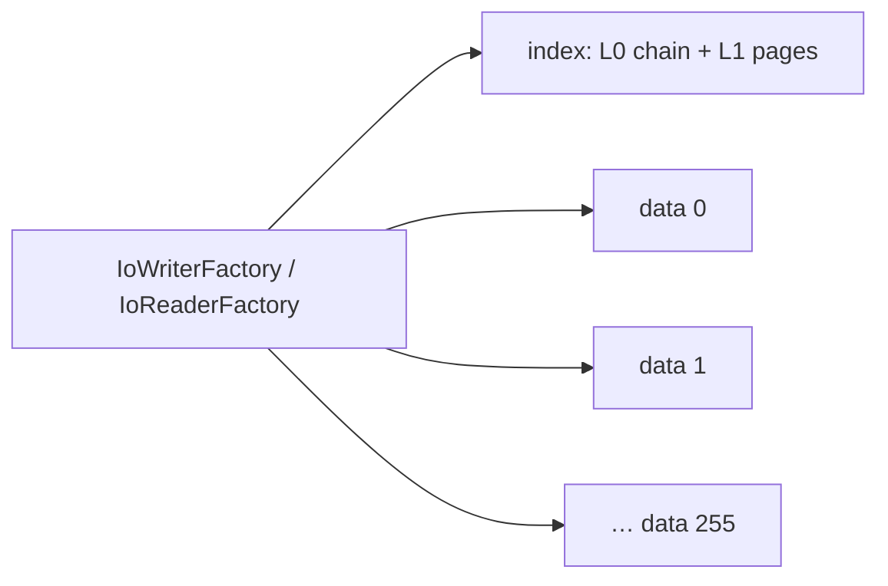
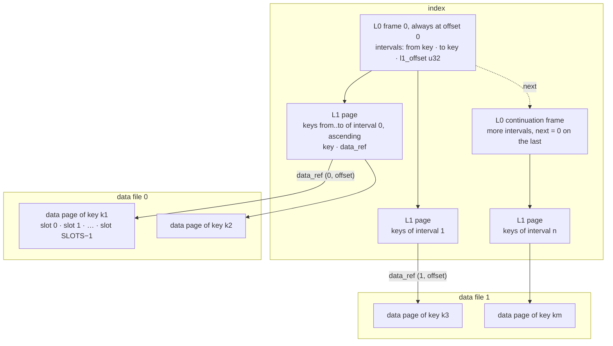
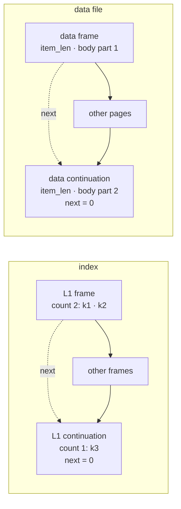

# split-format

The bytes every split structure shares. A split archive is an INDEX and DATA FILES `0 ..= 255`, reached by role through the IO traits ([io](io.md)); every frame in them starts with the same two little-endian fields, `size u32 · next u32`, and every L0 frame of the index carries the hash that is the format's only identity. [`fixed_key_preallocated_slots`](fixed-key-preallocated-slots.md), [`variable_key_preallocated_slots`](variable-key-preallocated-slots.md) and [`fixed_key_minute_indexed_records`](fixed-key-minute-indexed-records.md) read and write it, and [`global_day_index`](global-day-index.md) keeps its L0 and L1 frames inside one file. Read this page to check bytes, debug a damaged archive, or read an archive from elsewhere; how an archive is written and when it opens is [lifecycle](lifecycle.md), and the older one-file format of the `…SingleFile` structures — the objects already stored in it — is [single-file](single-file.md).

## The files of one archive



| File | Holds | Name under `LocalFileIo` |
| --- | --- | --- |
| the index | the L0 chain, frame 0 at offset 0, and the L1 pages; in the records module also one L2 frame per key | `index_file_name()` = `index` |
| data file `n`, `0 ..= 255` | the data pages (in the records module, chains of data frames) | `data_file_name(n)` = `data00` … `dataff` |

- An archive never learns a file name, or whether a file is a file: it asks its factory for the index or for data file `n` ([io](io.md)).
- Little-endian throughout. The one big-endian field is the length prefix of a variable key, on purpose ([variable-key-preallocated-slots](variable-key-preallocated-slots.md)).
- Every offset is a `u32` inside its own file.
- A data file is created when its first page is placed in it: an archive with no keys has an index and no data file. In a working archive that file can be empty for a while — the page's bytes reach it when the page leaves its writer's cache, or at a flush ([lifecycle](lifecycle.md#writing-every-file-grows-only-by-append)).
- `global_day_index` is ONE file: an 8-byte sync time, then the L0 frame at offset 8, the L1 frames and the logins' year blocks ([global-day-index](global-day-index.md)).



## Frames

```text
L0     size u32 · next u32 · count u32 · hash u64    20 bytes, then count entries, zero-padded to size
L1     size u32 · next u32 · count u32               12 bytes, then count entries, ascending by key, zero-padded to size
data   size u32 · next u32 · item_len u16            10 bytes, then SLOTS × ITEM_LEN

data_ref   file_no u8 · offset u32                    5 bytes
```

- `size` is the whole frame, its header included. A `size` shorter than the header is `Corrupted`.
- `next` is the absolute offset of a continuation frame in the SAME file; `0` = none.
- `count` is how many entries THIS frame holds.
- `hash` is the [L0 hash](#the-l0-hash-the-formats-only-identity) of the three fields before it.
- `item_len` is the item's `ITEM_LEN`, stated on every data frame.
- `data_ref` says where a key's data page is: which data file, and the offset in it. Refs order as `(file_no, offset)`, which is file order.

What an entry is, is the module's. `K` is a fixed key of `LEN` bytes; `P` is a length prefix and the key's bytes, `P(k) = (len(k) < 128 ? 1 : 2) + len(k)`:

| Module | L0 entry | L1 entry | In the data files |
| --- | --- | --- | --- |
| [fixed_key_preallocated_slots](fixed-key-preallocated-slots.md) | `from K · to K · l1_offset u32`: `2·LEN + 4` | `key K · data_ref`: `LEN + 5` | one data page per key, `SLOTS × ITEM_LEN` |
| [variable_key_preallocated_slots](variable-key-preallocated-slots.md) | `P from · P to · l1_offset u32` | `P key · data_ref`: `P(key) + 5` | the same data pages |
| [fixed_key_minute_indexed_records](fixed-key-minute-indexed-records.md) | `from K · to K · l1_offset u32` | `key K · l2_offset u32` | chains of data frames, `used u16` in place of `item_len`, then the records. The index also holds one L2 frame per key: `size u32 · next u32` (always 0), then 1440 cells |
| [global_day_index](global-day-index.md) | `from K · to K · l1_offset u32` | `login K · data_offset u32 · blocks u16` | none: each login's year blocks follow in the same file |

- An L1 page's keys are strictly ascending, and its first and last keys equal the `from` and `to` of the interval that names it. Otherwise the page is `Corrupted`: a binary search would answer "absent" for a key that is there.
- With variable keys, the entries of an L0 or L1 frame end at a `0x00` prefix or at the frame's end, and a compact L1 page has no padding ([variable-key-preallocated-slots](variable-key-preallocated-slots.md)).
- A data page's bodies total exactly `SLOTS × ITEM_LEN`, with `item_len == ITEM_LEN` on every frame.
- **The number of keys is the sum of the `count` fields of every L1 frame header.** Nothing stores it separately. A reader's `keys_count()` reads those headers: one `read_at` of 12 bytes per L1 frame, through no cache, every time it is called. A writer's `keys_count()` reads nothing: it is the writer's own count of the keys it placed.

## The L0 hash: the format's only identity

```text
hash          FNV-1a 64 of  "archived-data/split/L0/v1"    25 ASCII bytes
                            size · next · count            each u32 little-endian
offset basis  0xcbf2_9ce4_8422_2325
prime         0x0000_0100_0000_01b3
```

- There is no magic number and no version field: the hash is what says "a split index".
- It is checked on every L0 frame — frame 0 and every continuation — before anything else in the frame is used. Bytes that are not a split index — a SingleFile object, random bytes, zeros — are `Corrupted` at open, never an archive that holds no keys. Every field moves the hash, so a damaged header field is refused too.
- It covers the three header fields and nothing else. No checksum covers the entries, the L1 pages or the data pages — a reader checks their structure: sizes, order, spans — and nothing ties an index to the data files written with it, which is why a compaction goes into an empty place ([lifecycle](lifecycle.md#compaction-the-data-files-first-the-index-last)).
- The crate writes FNV-1a out ([split_l0_hash.rs](../src/split_l0_hash.rs)) instead of using `std`'s `DefaultHasher`, whose algorithm may change between Rust versions: a stored index must verify under every compiler that will ever read it.
- Test vector: `size 20 · next 0 · count 0`, the index of an empty compact archive, hashes to `0x5b5c_3270_5b03_98ca`.
- A WORKING index also uses frame 0's hash to say whether its last flush completed: [the frame-0 hash](lifecycle.md#when-a-working-archive-opens-the-frame-0-hash).

## L0 is a chain

- Frame 0 is always at offset 0 of the index (in `global_day_index`, at offset 8, after the sync time). `next` is the absolute offset of the next frame, `0` on the last, so L0 has no limit of its own — only the index's 4 GiB.
- A continuation always lies past the end of the frame pointing at it — it may start right where that frame ends. A `next` into the frame itself, backwards — into frame 0 or an earlier frame — or at or past the end of the file is `Corrupted`. So a chain cannot cycle, and every walk ends.
- The intervals are ordered and disjoint across the WHOLE chain: `from ≤ to`, and every `from` above the `to` before it. Otherwise the archive is `Corrupted`.
- A reader follows the chain when it opens, joins the entries of every frame, and keeps all of L0 in memory, with no lock, for its whole life. A lookup is one binary search over every interval.
- **A working index**: frame 0 is reserved at offset 0 — for `capacity_l0` intervals with fixed keys, for `l0_frame_bytes` with variable keys. When L0 outgrows the frames it has, a flush reserves continuations of the same size at the END of the index. A continuation is never given back: a later flush that lays L0 out rewrites in place every continuation it links. With fixed keys that is every one of them, because L0 never loses an interval. With variable keys a flush may link fewer frames than the index has reserved, when the intervals' bounds got shorter; the frames past the last one linked stay in the index, named by nothing. A flush writes the continuations first and frame 0 LAST ([lifecycle](lifecycle.md#flush-and-finish)).
- **A compact index**: ONE frame of exactly the size its entries need, `next` 0. Its reader's `l0_frames()` is 1.
- `l0_intervals()` and `l0_frames()` count them, on a writer and on a reader. A reader's `l0_frames()` is the frames its chain was read from; a writer's is frame 0 plus every continuation a flush has reserved — with variable keys, possibly more than its last flush linked.
- The SingleFile format chains its L0 by the same rules, with a `u64` `next` and no hash, and its flush lays the chain out in order — frame 0, the continuations it has, then new ones only if needed ([single-file](single-file.md)).

## Continuation frames

Of L0, L1 pages and preallocated data pages, this crate chains only L0, and only in a working index: every writer and every compaction writes an L1 page — and a preallocated data page — as ONE frame, `next` 0, and a compaction writes L0 as one frame too. The data frames of the records module are the one thing chained by design: one chain per key. Readers follow `next` on L0, L1 and data frames alike, so an archive written by something else — or rewritten in place one day — reads the same.



- **Entries never straddle frames.** Every L0 and L1 frame carries its own `count` and is decoded against it; the logical list is the frames' entries joined. An L1 frame holds at least one entry, and room for its `count`: with fixed keys its body is a whole number of entries; with variable keys a frame is walked to its end marker or its `size`, and must hold exactly `count` entries.
- A data page chained over frames is their bodies joined.
- **The one exception** to "a continuation lies past its frame": the data frames of a WORKING `fixed_key_minute_indexed_records` archive. There `next` chains the frames of one key's records, and a frame put between two others is appended at the end of the data file and points BACK at the next one. So the records reader asks no direction of a data frame's `next`, and a cycle is found by counting instead: the writer refuses, as `Corrupted`, a frame that points at itself and a walk of more hops than its data file has frames, and a reader a walk that returns to a frame it visited. A compact run always chains forward, and an L2 frame is never chained — one whose `next` is not 0 is `Corrupted` ([fixed-key-minute-indexed-records](fixed-key-minute-indexed-records.md)).

## What open checks

The `open` of a split reader — of any module — refuses as `Corrupted`, before it returns:

| Step | Reads | Refused |
| --- | --- | --- |
| 1 | `size()` of the index, once | — |
| 2 | L0: frame 0 in one `read_at` of up to 64 KiB, clamped to the index — and one more for the rest of a frame longer than that — then one read per continuation, guessed as long as the frame before it | an index shorter than an L0 header; an L0 header that fails its hash; a `size` shorter than the header or past the end of the index; a broken `next`; entries that do not fit their frame or, with variable keys, are not exactly its `count`; intervals out of order |
| 3 | nothing | an L0 that names an L1 page whose 12-byte header does not fit inside the index |
| 4 | the 12-byte header of the L1 page at the highest `l1_offset`, and of each continuation it chains to; nothing for an empty L0 | a frame of that page that ends past the end of the index, or whose `size` or `next` is broken |

No data file is opened. An index the factory cannot open, and a failed read, are `Err(Io)`. `GlobalDayIndexReader::open` checks the same over its one file, after one read of the 8-byte sync time: its L0 starts at offset 8, and a file shorter than a sync time and an L0 header — 28 bytes — is `Corrupted` ([global-day-index](global-day-index.md)).

- An index grows only by append, and a compaction appends its L1 pages in offset order, so what a cut takes is the END of the index. **An index cut anywhere before the end of the last frame its L0 names — an L1 page, or a continuation of L0 itself — is refused at open**, not at the first key read: a cut inside frame 0, or one reaching into a continuation linked into the chain, fails step 2, and one reaching into the L1 page at the highest offset fails step 3 or 4.
- That covers every byte of a COMPACT index of the three archive modules — the records module's L1 pages come last, after its L2 frames — and of a WORKING index of the preallocated modules, whose last bytes are an L1 page or an L0 continuation a flush appended.
- The one tail of a preallocated index it does not cover: a working index of VARIABLE keys whose last flush linked fewer L0 frames than the index has reserved can end with a continuation nothing names. A cut that takes only that frame, or part of it, opens — and takes nothing the archive holds.
- A WORKING index of `fixed_key_minute_indexed_records` can end with L2 frames, past its last L1 page. There only frame 0's hash proves the index whole: an index cut inside a trailing L2 frame opens, then answers `Corrupted` at the first read of that key.
- `global_day_index` keeps the logins' year blocks after its L1 pages: a file cut inside them opens, and the read of a login whose blocks are missing is `Corrupted`.
- What open refuses in a working index whose last flush did not complete is in [lifecycle](lifecycle.md#when-a-working-archive-opens-the-frame-0-hash).

## Limits

Each limit is a field width, not a tuning choice ([split_limits.rs](../src/split_limits.rs)):

| Constant | Value | Because |
| --- | --- | --- |
| `MAX_INDEX_BYTES` | `1 << 32`, 4 GiB | every offset stored in the index is a `u32` |
| `MAX_DATA_FILES` | 256 | `data_ref` names its data file in one byte |
| `MAX_DATA_FILE_BYTES` | `1 << 32`, 4 GiB | a data page's offset in its file is a `u32` |
| `DEFAULT_MAX_DATA_FILE_BYTES` | `MAX_DATA_FILE_BYTES` | the data file size a writer and a reader use until `set_max_data_file_bytes` |

- A data page goes into the current data file only whole — `offset + page ≤ max_data_file_bytes` — otherwise the next data file starts and the page lands at offset 0. A page never spans two files. In a compact records archive the unit is a key's whole run of frames.
- `max_data_file_bytes` can be set down to one data page (one 32 KiB data frame, for records): `set_max_data_file_bytes` on a preallocated writer, before its first key, and on a reader, for its next `compaction_plan`. It panics above 4 GiB, below that one page, and on a writer once a key is written. `max_data_file_bytes()` reads the setting back, on both. The records writer has no such setting: its working archive is ONE data file, of at most 4 GiB.
- **Crossing a limit is a `ContractViolation`.** A write that would need index room past 4 GiB, or data file 256, is refused before anything changes, and the writer stays usable ([lifecycle](lifecycle.md#a-refusal-changes-nothing-a-failure-stops-the-writer)); a compaction plan whose index would pass 4 GiB, or whose data needs data file 256, is refused — and so is a records plan in which one key's records are longer than a data file. The one exception: the records writer panics when a data frame would take its data file past 4 GiB, as its specification requires ([fixed-key-minute-indexed-records](fixed-key-minute-indexed-records.md)).

## Exact reads

- `read_at` returns exactly `len` bytes or `UnexpectedEof`, never a short read ([io](io.md)).
- So a reader learns each file's size once — the index at open, a data file the first time it is used — and clamps every speculative read to it. The usual frame is still ONE `read_at`: frame 0 within a read of up to 64 KiB, an L1 page within a read of the default page length, a data page in a read of its exact length; a continuation is guessed as long as the frame before it. A frame longer than its guess — an L1 page of a working archive written with a larger capacity than the default, say — costs one more read, for the rest of it.
- **A header whose `size` reaches past its file is `Corrupted`, without a read past the end.** So is any other range the archive's own bytes name beyond the end of a file.
- The files are assumed not to change while a reader reads them.

## An index, byte by byte

Three keys written with 1 interval per L0 frame and 2 keys per L1 page, so L0 needs a continuation and the keys need two L1 pages. The example reads the files back with `std::fs` and checks every header — the L0 hash computed by hand.

```rust
use archived_data::*;

/// An account id, 8 bytes little-endian.
#[derive(Debug, Clone, Copy, PartialEq, Eq, PartialOrd, Ord)]
struct Login(u64);

impl PrimaryKeyFixedSize for Login {
    const LEN: usize = 8;

    fn from_slice(src: &[u8]) -> Self {
        Self(u64::from_le_bytes(src.try_into().unwrap()))
    }

    fn copy_to(&self, out: &mut Vec<u8>) {
        out.extend_from_slice(&self.0.to_le_bytes());
    }
}

/// An hour of a day: 24 slots.
#[derive(Debug, Clone, Copy)]
struct Hour(usize);

impl PreallocatedSlotKey for Hour {
    const SLOTS: usize = 24;

    fn slot_index(&self) -> usize {
        self.0
    }
}

/// The volume traded in an hour; 0 is the empty slot.
#[derive(Debug, Clone, Copy, Default, PartialEq)]
struct Volume(u64);

impl PreallocatedDataItem for Volume {
    const ITEM_LEN: usize = 8;

    fn from_slice(src: &[u8]) -> Self {
        Self(u64::from_le_bytes(src.try_into().unwrap()))
    }

    fn copy_to(&self, out: &mut Vec<u8>) {
        out.extend_from_slice(&self.0.to_le_bytes());
    }
}

fn u32_at(bytes: &[u8], at: usize) -> u32 {
    u32::from_le_bytes(bytes[at..at + 4].try_into().unwrap())
}

/// FNV-1a 64 over "archived-data/split/L0/v1", then size, next and count little-endian.
fn l0_hash(size: u32, next: u32, count: u32) -> u64 {
    let mut bytes = b"archived-data/split/L0/v1".to_vec();
    for field in [size, next, count] {
        bytes.extend_from_slice(&field.to_le_bytes());
    }

    let mut hash: u64 = 0xcbf2_9ce4_8422_2325;
    for byte in bytes {
        hash ^= byte as u64;
        hash = hash.wrapping_mul(0x0000_0100_0000_01b3);
    }
    hash
}

/// `(size, next, count)` of the L0 frame at `at`, once its hash is checked.
fn l0_header(index: &[u8], at: usize) -> (u32, u32, u32) {
    let (size, next, count) = (u32_at(index, at), u32_at(index, at + 4), u32_at(index, at + 8));
    let hash = u64::from_le_bytes(index[at + 12..at + 20].try_into().unwrap());
    assert_eq!(hash, l0_hash(size, next, count));
    (size, next, count)
}

#[tokio::main]
async fn main() {
    let dir = std::env::temp_dir().join(format!("archived-data-docs-split-format-1-{}", std::process::id()));
    let _ = std::fs::remove_dir_all(&dir);
    let io = LocalFileIo::new(&dir);

    let mut writer = FixedKeyPreallocatedSlotsArchiveWriter::new_with_capacity(io.clone(), 1, 2)
        .await
        .unwrap();
    for login in 1..=3 {
        writer.write(Login(login), Hour(0), &Volume(login * 100)).await.unwrap();
    }
    writer.finish().await.unwrap();

    let index = std::fs::read(io.index_path()).unwrap();
    assert_eq!(index.len(), 156);

    // L0 frame 0 at offset 0: 20 + 1 × (8 + 8 + 4) bytes, chained to the frame at 116.
    assert_eq!(l0_header(&index, 0), (40, 116, 1));
    // Its interval: from 1 · to 2 · l1_offset 40.
    assert_eq!(index[20..28], 1u64.to_le_bytes());
    assert_eq!(index[28..36], 2u64.to_le_bytes());
    assert_eq!(u32_at(&index, 36), 40);

    // The L1 page at 40: size 12 + 2 × (8 + 5), next 0, count 2; then key · file_no · offset.
    assert_eq!((u32_at(&index, 40), u32_at(&index, 44), u32_at(&index, 48)), (38, 0, 2));
    assert_eq!(index[52..60], 1u64.to_le_bytes());
    assert_eq!((index[60], u32_at(&index, 61)), (0, 0));
    assert_eq!(index[65..73], 2u64.to_le_bytes());
    assert_eq!((index[73], u32_at(&index, 74)), (0, 202));

    // The L1 page of key 3 at 78: size 38, next 0, count 1. Then the continuation the flush appended at
    // the end of the index, naming that page.
    assert_eq!((u32_at(&index, 78), u32_at(&index, 82), u32_at(&index, 86)), (38, 0, 1));
    assert_eq!(l0_header(&index, 116), (40, 0, 1));
    assert_eq!(u32_at(&index, 116 + 36), 78);

    // Data file 0: a page per key, in the order the keys arrived, each 10 + 24 × 8 bytes:
    // size · next · item_len, then slot 0.
    let data = std::fs::read(io.data_path(0)).unwrap();
    assert_eq!(data.len(), 3 * 202);
    for (page, login) in data.chunks(202).zip(1u64..) {
        assert_eq!((u32_at(page, 0), u32_at(page, 4)), (202, 0));
        assert_eq!(u16::from_le_bytes([page[8], page[9]]), 8);
        assert_eq!(page[10..18], (login * 100).to_le_bytes());
    }

    std::fs::remove_dir_all(&dir).unwrap();
}
```

- The working L0 frame is as long as its capacity says — `20 + capacity_l0 × (2·LEN + 4)` — and zero-padded past its entries; frame 0 stays at offset 0, and the continuation is wherever the end of the index was when a flush needed it.
- The L1 pages lie at the offsets they were reserved at, in the order they were allocated; their keys are in key order, their data pages in the order the keys first arrived.
- The compact archive of the same three keys is a 13 364-byte index — ONE L0 frame of 40 bytes, `next` 0, holding one interval, 1 to 3, then one L1 page of 1024 entries, `12 + 1024 × 13` bytes, `count` 3 and zero-padded past it — and a data file of the three pages in key order. How to compact: [lifecycle](lifecycle.md#the-shape-of-a-use).
