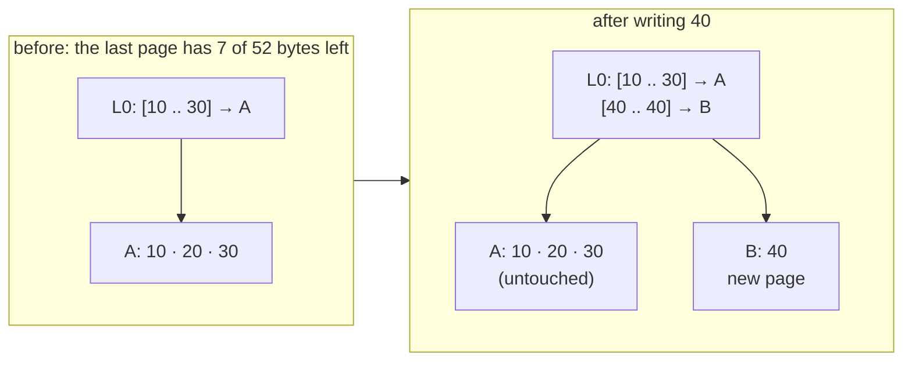
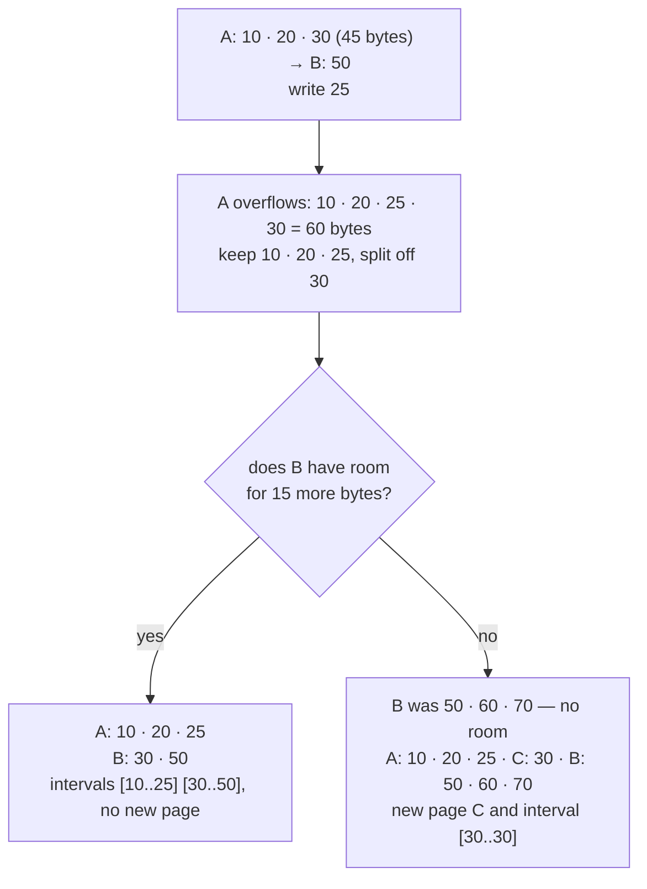

# variable-key-preallocated-slots

The split archive of [fixed-key-preallocated-slots](fixed-key-preallocated-slots.md) with a primary key of any length from 1 to 32 767 bytes: a name, a path, a composite id. Each key still owns one preallocated data page — a 10-byte header, then `SLOTS × ITEM_LEN` bytes of slots — and a slot is still addressed by its position. `VariableKeyPreallocatedSlotsArchiveWriter` builds a working archive from keys in any order, `VariableKeyPreallocatedSlotsArchiveReader` reads working and compact archives and compacts them, and the key implements `PrimaryKeyVariableSize`. Everything the key does not touch — the data pages and data files, the frames and their chains, the caches, flush and finish, the steps of a compaction, the IO — is [shared with the fixed module](fixed-key-preallocated-slots.md#shared-with-the-variable-key-module); this page is what a variable key changes. The one-file `…SingleFile` structures of this module are in [single-file](single-file.md).

| | Fixed key | Variable key |
| --- | --- | --- |
| A key in the index | `LEN` bytes | a [length prefix](#the-length-prefix), then 1 ..= 32 767 bytes |
| Working L0 frame, L1 page | sized in intervals, in keys | sized in bytes, headers included |
| An L1 page that overflows | halved by count | [split by bytes](#placing-a-new-key-split-by-bytes) |
| The longest key | `LEN` | [half the room of a page](#the-half-page-rule): 8 179 bytes with 16 KiB pages |
| Index room checked for a new key | when it starts a page: the page, and the L0 continuations of one more interval, counted | always: its new page if it starts one, and the L0 continuations, [bounded](#index-room-l0-continuations-are-bounded-not-counted) |
| A reader's first read of an L1 page, and `get_range`'s test of which pages follow one another | one page of 1024 keys, `12 + 1024 × (LEN + 5)` bytes | [16 KiB](#reading) |
| A compact L1 page | 1024 keys, `12 + 1024 × (LEN + 5)` bytes, the last one zero-padded | at most 1024 keys, closed before the entry that would take it past 16 KiB, [its exact size](#compaction-compact-l1-pages-by-bytes) |
| Every key under a prefix | — | [`last_key_starting_with`](#every-key-that-starts-with-a-prefix) |

## An archive keyed by names

Write in any key order, finish, read one key, read every key under a prefix, compact into another directory.

```rust
use archived_data::*;

/// A name such as `node/a`, kept as its UTF-8 bytes: bytes sort as the strings do.
#[derive(Debug, Clone, PartialEq, Eq, PartialOrd, Ord)]
struct Name(Vec<u8>);

impl Name {
    fn new(name: &str) -> Self {
        Self(name.as_bytes().to_vec())
    }
}

impl PrimaryKeyVariableSize for Name {
    fn from_slice(src: &[u8]) -> Self {
        Self(src.to_vec())
    }

    fn copy_to(&self, out: &mut Vec<u8>) {
        out.extend_from_slice(&self.0);
    }
}

/// An hour of a day: 24 slots.
#[derive(Debug, Clone, Copy)]
struct Hour(usize);

impl PreallocatedSlotKey for Hour {
    const SLOTS: usize = 24;

    fn slot_index(&self) -> usize {
        self.0
    }
}

/// The volume traded in an hour; 0 is the empty slot.
#[derive(Debug, Clone, Copy, Default, PartialEq)]
struct Volume(u64);

impl PreallocatedDataItem for Volume {
    const ITEM_LEN: usize = 8;

    fn from_slice(src: &[u8]) -> Self {
        Self(u64::from_le_bytes(src.try_into().unwrap()))
    }

    fn copy_to(&self, out: &mut Vec<u8>) {
        out.extend_from_slice(&self.0.to_le_bytes());
    }
}

#[tokio::main]
async fn main() {
    let dir = std::env::temp_dir().join(format!("archived-data-docs-variable-key-1-{}", std::process::id()));
    let _ = std::fs::remove_dir_all(&dir);
    let (working, compact) = (dir.join("working"), dir.join("compact"));

    let mut writer = VariableKeyPreallocatedSlotsArchiveWriter::new(LocalFileIo::new(&working)).await.unwrap();
    for (name, hour, volume) in [("node/b", 3, 30), ("node", 1, 10), ("node/a/x", 2, 20), ("node0", 5, 50), ("node/a", 4, 40)] {
        writer.write(Name::new(name), Hour(hour), &Volume(volume)).await.unwrap();
    }
    writer.finish().await.unwrap();

    let reader = VariableKeyPreallocatedSlotsArchiveReader::<Name, Hour, Volume, _, _>::open(LocalFileIo::new(&working))
        .await
        .unwrap();
    let items = reader.get(&Name::new("node/b"), Hour(2), Hour(4)).await.unwrap();
    assert_eq!(items, Some(vec![Volume(0), Volume(30), Volume(0)]));
    assert_eq!(reader.get(&Name::new("node/c"), Hour(0), Hour(23)).await.unwrap(), None);

    // Every key that starts with "node/", of any length: not "node", not "node0".
    let last = Name(last_key_starting_with(b"node/").unwrap());
    let under = reader.get_range(&Name::new("node/"), &last, Hour(2), Hour(4)).await.unwrap();
    assert_eq!(
        under,
        [
            (Name::new("node/a"), vec![Volume(0), Volume(0), Volume(40)]),
            (Name::new("node/a/x"), vec![Volume(20), Volume(0), Volume(0)]),
            (Name::new("node/b"), vec![Volume(0), Volume(30), Volume(0)]),
        ]
    );

    let plan = reader.compaction_plan().await.unwrap();
    // L0, one frame: 20 + P("node") + P("node0") + 4 = 35 bytes.
    // L1, one page: 12 + Σ (P(key) + 5) = 12 + 10 + 12 + 14 + 12 + 11 = 71 bytes.
    assert_eq!(plan.index_size(), 35 + 71);
    assert_eq!(plan.data_file_sizes(), [5 * (10 + 24 * 8)]);
    reader.write_compacted_to(&plan, &LocalFileIo::new(&compact)).await.unwrap();

    let compacted = VariableKeyPreallocatedSlotsArchiveReader::<Name, Hour, Volume, _, _>::open(LocalFileIo::new(&compact))
        .await
        .unwrap();
    assert_eq!((compacted.keys_count().await.unwrap(), compacted.l0_frames()), (5, 1));
    assert_eq!(compacted.get(&Name::new("node0"), Hour(5), Hour(5)).await.unwrap(), Some(vec![Volume(50)]));

    std::fs::remove_dir_all(&dir).unwrap();
}
```

`Name` keeps the bytes of the string, not a `String`: [`last_key_starting_with`](#every-key-that-starts-with-a-prefix) returns the prefix followed by `0xFF` bytes, which no `String` can hold. A key that is never read by prefix can keep a `String`.

## PrimaryKeyVariableSize

The key's trait. The crate implements it for no type: a key is a struct of the caller's, like `Name` above. The slot and the item use the same traits as the fixed module, `PreallocatedSlotKey` and `PreallocatedDataItem`: see [the three traits](fixed-key-preallocated-slots.md#the-three-traits).

| Item | Contract |
| --- | --- |
| `trait PrimaryKeyVariableSize: Ord + Clone` | the archive sorts on `Ord`, so the byte form does not have to sort the same way |
| `fn copy_to(&self, out: &mut Vec<u8>)` | appends ONLY the key bytes; the crate writes the [length prefix](#the-length-prefix) |
| `fn from_slice(src: &[u8]) -> Self` | `src` is exactly the bytes `copy_to` wrote, without the prefix |
| `pub const MAX_VARIABLE_KEY_LEN: usize` | `0x7FFF` = 32 767, the longest key; a constant of the crate, not a member of the trait |

- Every `write` — of a known key too, where the fixed writer checks only a new key's bytes — checks what `copy_to` wrote, through an internal trait no implementation can override: 0 bytes (an empty key) or more than `MAX_VARIABLE_KEY_LEN` bytes is a `ContractViolation`. Then the [half-page rule](#the-half-page-rule) may refuse a key that is shorter. A refused key changes nothing, and the writer stays usable.
- The writer calls `copy_to` once per `write`, and keeps a new key's bytes beside the key: L0 and L1 are encoded from those bytes, a page read back keeps the bytes it was read with, and a compaction copies the bytes of its source. Encoding a page or L0 never asks a key for its bytes again.
- Every key read from the index is rebuilt with `from_slice` and compared with `Ord`. So `from_slice` of what `copy_to` wrote must be the same key under `Ord`, and two keys are one key when `Ord` says they are equal: the second is a known key, its item goes into the first one's data page, and the index keeps the bytes of the first.
- `from_slice` cannot fail. The crate checks the frames and the prefixes of a damaged index, not the key bytes: a key type that cannot hold every byte string — one that keeps a `String` — has to decide what it does with bytes it did not write.
- The reader never calls `copy_to`: `get` and `get_range` only compare. A key asked for, or a bound of a range, need not be one the writer would accept — the empty key, or the 32 767 bytes of `last_key_starting_with`.

## The length prefix

Every key inside an L0 or an L1 entry is preceded by its length, in the split archive and in the [single-file](single-file.md) format alike:

| Length | Bytes | Examples |
| --- | --- | --- |
| `0` | `00`: the **end marker**, not a key | `00` |
| `1 ..= 127` | one byte, the length | 1 → `01`, 127 → `7F` |
| `128 ..= 32 767` | two bytes, `len \| 0x8000`, **big-endian** | 128 → `80 80`, 255 → `80 FF`, 256 → `81 00`, 32 767 → `FF FF` |

```text
b0 = the first byte
b0 & 0x80 == 0     the length is b0, the prefix is one byte; b0 == 0 is the end marker
otherwise          read b1: the length is ((b0 & 0x7F) << 8) | b1, the prefix is two bytes
```

- The rest of the archive is little-endian. **The prefix is big-endian on purpose**: the flag that says "two bytes" has to be in the FIRST byte read.
- Every length has exactly one spelling. A two-byte prefix holding a length below 128 (`80 05`, and `80 00` too) is `Corrupted`, so the compact bytes of a set of keys are unique.
- A flagged first byte that is the last byte of its frame is `Corrupted`.

### Entries, and where they end

`P(k)` is a key's prefix followed by its bytes. The frame headers, `data_ref` and the continuations are in [split-format](split-format.md#frames).

```text
L0 entry   P(from) · P(to) · l1_offset u32              P(from) + P(to) + 4 bytes
L1 entry   P(key) · data_ref (file_no u8 · offset u32)  P(key) + 5 bytes

P(k) = (len(k) < 128 ? 1 : 2) + len(k)
```

- The entries of ONE L0 or L1 frame end at a `00` prefix — the end marker — or at the frame's `size`, whichever comes first. The number of entries found must equal that frame's `count`, or it is `Corrupted`.
- A working frame is zero-padded past its entries, so the first padding byte is the end marker. A frame its entries fill exactly, and every compact frame, ends at `size` with no marker.
- Entries never straddle frames: every frame is walked on its own, and a chained L0, or a chained L1 page, is the entries of its frames joined. A frame zero-padded past its entries would otherwise put an end marker in the middle of the list.
- A `00` where an entry's `to` should be, and an entry cut short at the end of its frame, are `Corrupted`.
- An L1 frame holds at least one entry and room for its `count` entries of a one-byte key, 7 bytes each: `count ≥ 1` and `count × 7 ≤ size − 12`, or it is `Corrupted`. That is checked wherever a frame's entries are read — `get`, `get_range`, a compaction, the writer reading a page back — and by `keys_count`, which reads the headers alone. `open` reads the headers of the last L1 page only to see that the page ends inside the index, and does not check their `count`.
- An L0 frame may hold no entry: the one frame of an archive with no keys.

## Writing

`VariableKeyPreallocatedSlotsArchiveWriter<TPrimaryKey, TSlotKey, TItem, TFactory, TWriter, TReader>`, over one factory that implements both `IoWriterFactory<TWriter>` and `IoReaderFactory<TReader>`, as `LocalFileIo` does ([io](io.md)) — the writer reads its own evicted L1 pages back. Both sizes are in **bytes**, headers included:

| Constructor | L0 frame | L1 page |
| --- | --- | --- |
| `new(factory).await` | `DEFAULT_L0_FRAME_BYTES` = 64 KiB | `DEFAULT_L1_PAGE_BYTES` = 16 KiB |
| `new_with_capacity(factory, l0_frame_bytes, l1_page_bytes).await` | `l0_frame_bytes`: a 20-byte header and the entries | `l1_page_bytes`: a 12-byte header and `l1_page_bytes − 12` bytes of room |

- `l0_frame_bytes` is the size of each L0 FRAME, not a limit on L0: L0 chains as many frames as it needs.
- Both return `Result<Self, ArchiveError>`: they create the index and append L0 frame 0, `l0_frame_bytes` long, with a hash that does not verify until a flush completes ([the frame-0 hash](lifecycle.md#when-a-working-archive-opens-the-frame-0-hash)); a factory or an append that fails is `Io`.
- `DEFAULT_L0_FRAME_BYTES`, `DEFAULT_L1_PAGE_BYTES`, `COMPACT_L1_MAX_KEYS` and `COMPACT_L1_PAGE_BYTES` size the `…SingleFile` structures too.
- Every L1 page of a working archive is `l1_page_bytes` long and every L0 frame `l0_frame_bytes`, each zero-padded past its entries.
- A flush packs L0 greedily, by bytes: a frame closes before the first entry that does not fit its `l0_frame_bytes − 20` bytes, and the next frame takes it — frame 0, then the continuations already reserved, then new ones at the end of the index. A continuation is never given back, and when bounds got shorter a flush may link fewer frames than it has reserved.

### Size checks at construction

Sizes that can never be written panic before the index is created, like the fixed module's capacity checks:

```text
l1_page_bytes  ≥ 12 + 2 × 7 = 26                                             two entries of a one-byte key
l0_frame_bytes ≥ 20 + 2 × min((l1_page_bytes − 12) / 2 − 5, 2 + 32 767) + 4    one interval of the longest key a page accepts
l0_frame_bytes ≤ u32::MAX,  l1_page_bytes ≤ u32::MAX                         their u32 size fields
```

`/` rounds down. The slot and item sizes are checked as in the fixed module: `SLOTS > 0`, `ITEM_LEN` in `1 ..= 65 535`, a data page that fits a `u32`. Every panic of the crate is listed in [errors](errors.md#panics).

| `l1_page_bytes` | Largest L1 entry | Longest key | Least `l0_frame_bytes` |
| --- | --- | --- | --- |
| 26, the least | 7 | 1 | 28 |
| 64 | 26 | 20 | 66 |
| 16 384, the default | 8 186 | 8 179 | 16 386 |
| 65 535 | 32 761 | 32 754 | 65 536, the default 64 KiB exactly |
| 65 536, 64 KiB | 32 762 | 32 755 | 65 538 |
| 65 560 and more | 32 774 and more | 32 767, the longest there is | 65 562 |

L1 pages of 64 KiB or more therefore need an L0 frame larger than the default: `new_with_capacity(factory, DEFAULT_L0_FRAME_BYTES, 65_536)` panics. The checks run in this order: the slot and item sizes, the L1 page, the two `u32`s, the L0 frame.

With them, an L0 interval always fits a frame on its own, and an interval that does not fit the frames L0 has becomes one more continuation at the next flush — whose room in the index was [checked](#index-room-l0-continuations-are-bounded-not-counted) when the key that needs it was written.

### Writer methods

The names and the contracts are [the fixed writer's](fixed-key-preallocated-slots.md#the-writer): [where pages go](fixed-key-preallocated-slots.md#where-pages-go), [the caches](fixed-key-preallocated-slots.md#caches), [refusals and failures](fixed-key-preallocated-slots.md#refusals-and-failures), [flush and finish](fixed-key-preallocated-slots.md#flush-finish-and-when-the-archive-opens); the append frontier, the order of a flush and when a working archive opens are in [lifecycle](lifecycle.md#writing-every-file-grows-only-by-append). What a variable key changes:

| Method | Returns | Variable key |
| --- | --- | --- |
| `new(factory).await` | `Result<Self, ArchiveError>` | 64 KiB L0 frames, 16 KiB L1 pages; the fixed writer's are 1024 intervals and 1024 keys |
| `new_with_capacity(factory, l0_frame_bytes, l1_page_bytes).await` | `Result<Self, ArchiveError>` | in bytes, where the fixed writer's `capacity_l0`, `capacity_l1` are counts; [panics](#size-checks-at-construction) |
| `write(key, slot, &item).await` | `Result<(), ArchiveError>` | `key` by value, as in the fixed writer. Every write, of a known key too, checks the key's bytes before it reads anything: an empty key, one past 32 767 bytes and one past the [half-page rule](#the-half-page-rule) are refused. A new key may be refused for [index room](#index-room-l0-continuations-are-bounded-not-counted) although it needs no page |
| `flush().await` | `Result<(), ArchiveError>` | L0 packed by bytes; it may link fewer frames than are reserved |
| `finish(self).await` | `Result<(), ArchiveError>` | the same |
| `set_l1_cache_size(pages)` | — | the same: pages, at least 1, `DEFAULT_WRITER_L1_CACHE_PAGES` = 64 |
| `set_data_cache_size(pages)` | — | the same: `DEFAULT_WRITER_DATA_CACHE_PAGES` = 1024; 0 appends every new data page at once and writes every item straight to its file |
| `set_max_data_file_bytes(bytes: u64)` | — | the same: 4 GiB by default; panics above 4 GiB, below one data page, or once a key is written |
| `max_data_file_bytes()` | `u64` | the same |
| `keys_count()` | `usize` | the same: the keys written |
| `l0_intervals()` | `usize` | the same |
| `l0_frames()` | `usize` | frame 0 and every continuation a flush reserved; a flush may link fewer |
| `data_files()` | `usize` | the same: the data files created so far |

`write` checks the slot, the item, the key's length, then the half-page rule, each a `ContractViolation` that changes nothing; then a writer stopped by an earlier failure refuses the call.

## Placing a new key: split by bytes

A new key:

1. finds its interval, the last one with `from <= key` — the first one for a key below every `from`; the first key of an archive has none, and starts the first L1 page;
2. gets a data page placed at the end of the current data file — at the start of the next one, when it does not fit there whole — filled with `Default`;
3. is inserted, sorted, into that interval's L1 page;
4. if the page's entries no longer fit its `l1_page_bytes − 12` bytes of room, one of the two rules below applies.

A known key has its item written into its slot in place.

The pictures use 64-byte pages — 52 bytes of room — and the nine-byte keys `key-00010`, `key-00020`, …, written `10`, `20`, …: each entry is 1 + 9 + 5 = 15 bytes, so three fit a page.

**Rule 1 — append.** The key is past the last key of the LAST L1 page, and its entry does not fit there: the page is NOT split. A new page holds only the new key, and its interval is added after the last one. Keys written in ascending order therefore fill every page as far as the next key allows: every page but the last is closed by a key whose entry did not fit it.



**Rule 2 — insert.** Any other overflow splits the page **by bytes**: the left page keeps entries in key order while the next one still fits its room, and the rest is split off. That part is below every key of the NEXT page, so when its entries fit into the room that page has left, it moves in front of that page's keys: this interval's `to` shrinks, the next one's `from` moves down, and no page or interval is added. Only when the next page has no room for the whole part — or there is no next page — is a new page allocated for it, with a new interval.



The page is not halved: the left page keeps everything that fits, so it is still full after the split, and a later key into its interval usually overflows it again and splits off what no longer fits — into the next page, while that one has room. Such a write changes two L1 pages — each read back first when the cache no longer holds it — where the fixed writer, which halves, changes one until the half fills up. Measured over 400 000 random 8-byte keys, 1024 entries a page, with the default caches: 1.7 times the index reads and writes of the fixed writer, for the same 512 L1 pages. Keys written in ascending order never split a page (rule 1), and an L1 cache that holds every page (`set_l1_cache_size`) reads none back and rewrites none before the flush: in both cases the two writers cost the same index IO.

Where a new key goes is [decided before anything changes](fixed-key-preallocated-slots.md#decided-before-anything-changes), as in the fixed writer: its page is read in, which is how the writer learns the key is new; a key whose data page would need data file 256 is refused there; when the key's entry overflows the page and it is not the last page, the next page is read in too; then the next page's room for the part split off, and the index's room, are checked. Only then is the key's data page placed, and the L1 change after it — the insert, the cut, the move of the part split off — has no await in it, so a write that fails or is dropped never leaves a split-off part on no page. An L1 page is never cached while its entries do not fit it, because any eviction may encode any cached page.

## The half-page rule

A key whose L1 entry is more than half the room of a page is refused. With 64-byte pages a key may have 20 bytes; the writer goes on after a refusal; an L0 frame one byte short of an interval of two 20-byte keys panics, and so does the default L0 frame under L1 pages of 64 KiB.

```rust
use archived_data::*;

/// A key of any bytes.
#[derive(Debug, Clone, PartialEq, Eq, PartialOrd, Ord)]
struct Name(Vec<u8>);

impl PrimaryKeyVariableSize for Name {
    fn from_slice(src: &[u8]) -> Self {
        Self(src.to_vec())
    }

    fn copy_to(&self, out: &mut Vec<u8>) {
        out.extend_from_slice(&self.0);
    }
}

/// An hour of a day: 24 slots.
#[derive(Debug, Clone, Copy)]
struct Hour(usize);

impl PreallocatedSlotKey for Hour {
    const SLOTS: usize = 24;

    fn slot_index(&self) -> usize {
        self.0
    }
}

/// The volume traded in an hour; 0 is the empty slot.
#[derive(Debug, Clone, Copy, Default, PartialEq)]
struct Volume(u64);

impl PreallocatedDataItem for Volume {
    const ITEM_LEN: usize = 8;

    fn from_slice(src: &[u8]) -> Self {
        Self(u64::from_le_bytes(src.try_into().unwrap()))
    }

    fn copy_to(&self, out: &mut Vec<u8>) {
        out.extend_from_slice(&self.0.to_le_bytes());
    }
}

#[tokio::main]
async fn main() {
    let dir = std::env::temp_dir().join(format!("archived-data-docs-variable-key-2-{}", std::process::id()));
    let _ = std::fs::remove_dir_all(&dir);

    // 64-byte pages: 52 bytes of room, so an entry of at most 26 bytes, 1 + 20 + 5.
    // An L0 frame must hold one interval of two such keys: 20 + 2 × 21 + 4 = 66 bytes.
    let mut writer = VariableKeyPreallocatedSlotsArchiveWriter::new_with_capacity(LocalFileIo::new(&dir), 66, 64)
        .await
        .unwrap();

    let too_large = writer.write(Name(vec![b'k'; 21]), Hour(0), &Volume(1)).await;
    assert!(matches!(&too_large, Err(ArchiveError::ContractViolation(message)) if message.starts_with("key too large")));
    let empty = writer.write(Name(Vec::new()), Hour(0), &Volume(1)).await;
    assert!(matches!(empty, Err(ArchiveError::ContractViolation(_))));

    // Refusals change nothing: the writer goes on.
    writer.write(Name(vec![b'k'; 20]), Hour(0), &Volume(2)).await.unwrap();
    assert_eq!(writer.keys_count(), 1);
    writer.finish().await.unwrap();

    let reader = VariableKeyPreallocatedSlotsArchiveReader::<Name, Hour, Volume, _, _>::open(LocalFileIo::new(&dir))
        .await
        .unwrap();
    assert_eq!(reader.get(&Name(vec![b'k'; 20]), Hour(0), Hour(0)).await.unwrap(), Some(vec![Volume(2)]));

    // 65 bytes cannot hold that interval: a panic, before anything is created.
    let short = dir.join("short");
    let created = tokio::spawn(VariableKeyPreallocatedSlotsArchiveWriter::<Name, Hour, Volume, _, _, _>::new_with_capacity(
        LocalFileIo::new(&short),
        65,
        64,
    ));
    assert!(matches!(created.await, Err(error) if error.is_panic()));
    assert!(!short.exists());

    // 64 KiB L1 pages accept keys of 32 755 bytes: their interval needs an L0 frame of 65 538 bytes,
    // two more than the default.
    let wide = tokio::spawn(VariableKeyPreallocatedSlotsArchiveWriter::<Name, Hour, Volume, _, _, _>::new_with_capacity(
        LocalFileIo::new(dir.join("wide")),
        DEFAULT_L0_FRAME_BYTES,
        65_536,
    ));
    assert!(matches!(wide.await, Err(error) if error.is_panic()));

    std::fs::remove_dir_all(&dir).unwrap();
}
```

```text
entry     = P(key) + 5 = (key_len < 128 ? 1 : 2) + key_len + 5
accepted  ⇔  2 × entry ≤ l1_page_bytes − 12
```

- A refused key is a `ContractViolation` whose message starts with "key too large", returned before anything is written or placed; the writer stays usable.
- With the default 16 KiB page an entry may be `(16 384 − 12) / 2 = 8 186` bytes, so the longest key is 8 179 bytes: 2 + 8 179 + 5. With L1 pages of 65 560 bytes and more, only `MAX_VARIABLE_KEY_LEN` decides.

The rule is what makes every split produce **exactly two pages that fit**. With `room = l1_page_bytes − 12`:

- Before the insert the page's entries fit in `room`, and the new entry is at most `room / 2`, so the total is at most `1.5 × room`.
- The left page stops only when the next entry would pass `room`. That entry is at most `room / 2`, so the left page holds more than `room / 2`.
- That leaves less than `room` for the part split off: it fits a page of its own, or the next page when that page has the room.

## Index room: L0 continuations are bounded, not counted

The index may not pass 4 GiB ([limits](split-format.md#limits)). A new key that needs index bytes the index has no room left for is [refused](lifecycle.md#a-refusal-changes-nothing-a-failure-stops-the-writer) with a `ContractViolation` before the key changes anything — it takes no data page — and the writer stays usable. A key needs its new L1 page, when it starts one — the first key, rule 1, a split into a new page — and the L0 continuations the next flush will need once the key is placed, so a flush never runs into the limit. Every new key is checked, not only one that starts a page: an insert can lengthen an interval's bounds, and so L0.

L0 entries vary in size, so those continuations are BOUNDED, not counted, from what L0 will be once the key is placed. No L0 entry is longer than `E`, an interval whose two bounds both have the length of the longest key written, and one key grows L0 by at most `2 × E`: a split changes one interval and adds or changes another.

```text
E         = 2 × P(longest key written, this one included) + 4    no L0 entry is longer
bytes     = the L0 bytes now + 2 × E                             what L0 can grow to with this key
n         = the intervals now, + 1 when the key starts a page
body      = l0_frame_bytes − 20

by count  = max(1, ceil(n / floor(body / E)))                    every closed frame holds at least floor(body / E) entries
by bytes  = 1 + floor(bytes / (body − E + 1))                    every closed frame holds more than body − E bytes
frames    = min(by count, by bytes)
needed    = (a new page ? l1_page_bytes : 0) + max(0, frames − l0_frames()) × l0_frame_bytes
```

The key is refused when `needed` bytes past what the index has reserved would pass 4 GiB. `l0_frames()` is frame 0 and every continuation reserved so far.

- A frame packed greedily closes only before an entry that does not fit, so neither bound is ever too few.
- Either alone can be far too many. By count, one long key counts every interval as long as its own: with a key near the half-page limit, the continuations counted would match the L1 pages byte for byte, and the index would refuse new keys at half its size. By bytes, an `E` near a whole frame leaves almost nothing to count on. The writer keeps L0's bytes as it goes, so taking the smaller costs nothing.
- The smaller of the two is close only while several intervals of length `E` fit a frame. Measured with 16 KiB pages and ascending 200-byte keys, 79 to a page: with the default 64 KiB frame the first refusal comes at 255 748 L1 pages — 97.6% of 4 GiB in frame 0 and pages, and the flush after it fills the index to 4 GiB exactly — and at 253 716 pages when one key of 8 179 bytes, the longest those pages accept, was written first. With `l0_frame_bytes` at its least, 16 386, that one key makes `E` the whole body of a frame, 16 366 bytes: by count that is a frame for every interval, by bytes a frame for every byte, and new keys are refused at 131 064 pages — half of 4 GiB — where the flush after it leaves an index of 51% of 4 GiB. So keep an L0 frame several times the longest interval the keys can make, as the default is for 16 KiB pages.
- Near the limit: a key longer than every key before it can be refused for a continuation although it needs no page, and the bound may refuse a key a flush would still have had room for. It never accepts one a flush has no room for.

## Reading

`VariableKeyPreallocatedSlotsArchiveReader<TPrimaryKey, TSlotKey, TItem, TFactory, TReader>` over an `IoReaderFactory<TReader>` reads working and compact archives, and is shared through an `Arc` by concurrent callers. Its methods, caches and contracts are [the fixed reader's](fixed-key-preallocated-slots.md#the-reader): [get](fixed-key-preallocated-slots.md#get), [get_range](fixed-key-preallocated-slots.md#get_range), [keys_count](fixed-key-preallocated-slots.md#keys_count), [the caches](fixed-key-preallocated-slots.md#caches-and-settings), [inside a read](fixed-key-preallocated-slots.md#inside-a-read); what `open` checks and the exact reads are in [split-format](split-format.md#what-open-checks). What a variable key changes:

| Method | Returns | Variable key |
| --- | --- | --- |
| `open(factory).await` | `Result<Self, ArchiveError>` | each L0 frame's entries walked to its end marker or its `size`, count checked; panics only on the slot and item sizes — `SLOTS` 0, `ITEM_LEN` outside `1 ..= 65 535`, a data page past `u32::MAX` — where the fixed reader also checks its key and page sizes |
| `get(&key, from, to).await` | `Result<Option<Vec<TItem>>, ArchiveError>` | the same: the items of slots `from..=to`; `Ok(None)` for a key the archive does not hold; `from > to` is `Ok(Some(vec![]))` at once, reading nothing, so it says nothing about whether the key is there; a slot not below `SLOTS` is a `ContractViolation` before anything else, with `from > to` too |
| `get_range(&from, &to, from_slot, to_slot).await` | `Result<Vec<(TPrimaryKey, Vec<TItem>)>, ArchiveError>` | the same: every key in `from..=to`, ascending, each with its slots `from_slot..=to_slot`; the runs of L1 pages are guessed with 16 KiB (below) |
| `keys_count().await` | `Result<usize, ArchiveError>` | the same: the sum of the L1 frame `count`s, one small uncached read per L1 frame; each header checked for `count ≥ 1` and `count × 7 ≤ size − 12` |
| `compaction_plan().await` | `Result<CompactionPlan, ArchiveError>` | compact L1 pages [by bytes](#compaction-compact-l1-pages-by-bytes) |
| `write_compacted_to(&plan, &out).await` | `Result<(), ArchiveError>` | the same |
| `set_l1_cache_size(pages).await`, `set_data_cache_size(pages).await` | — | the same: `DEFAULT_READER_L1_CACHE_PAGES` = `DEFAULT_READER_DATA_CACHE_PAGES` = 10 |
| `set_max_data_file_bytes(bytes: u64)`, `max_data_file_bytes()` | —, `u64` | the same: the next plan's data file size |
| `l0_intervals()`, `l0_frames()` | `usize` | the same: `l0_frames()` is the frames the chain was read from — 1 for every compact archive, and for a working one possibly fewer than its writer's `l0_frames()`, which counts every frame reserved |

- **The first read of an L1 page asks for `DEFAULT_L1_PAGE_BYTES` = 16 KiB, clamped to the index, whatever the page's size.** A working page of the default size or less and every compact page up to 16 KiB cost that one `read_at`; a longer page — a working archive written with larger pages, or the compact page of one key too long for 16 KiB — costs one more read for the rest. Continuations follow as in the fixed reader.
- `get_range` reads uncached pages in runs, taking a page to follow the one before it when it starts at most 16 KiB after it: in a compact index, whose pages are at most 16 KiB but for a key too long for one, exactly the pages back to back. The fixed reader's guess is one page of 1024 keys.

## Every key that starts with a prefix

Keys compare by `Ord`, and a range is two keys, not a prefix. For a key whose `Ord` is the order of its bytes, `last_key_starting_with(prefix)` is the upper bound of every key under `prefix`:

```rust
use archived_data::*;

fn main() {
    let prefix = b"node/";
    let last = last_key_starting_with(prefix).unwrap();
    assert_eq!(last.len(), MAX_VARIABLE_KEY_LEN);
    assert!(last.starts_with(prefix) && last[prefix.len()..].iter().all(|byte| *byte == 0xFF));

    // In byte order, prefix ..= last is every key that starts with the prefix, and no other.
    let under = |key: &[u8]| &prefix[..] <= key && key <= &last[..];
    assert!(!under(b"node.") && !under(b"node") && !under(b"node0"));
    assert!(under(b"node/") && under(b"node/abcdefgh") && under(b"node/\xFF\x01"));

    // One 0xFF is not that bound: node/ FF 01 sorts past it.
    let one = [&prefix[..], &[0xFF]].concat();
    assert!(&b"node/\xFF\x01"[..] > &one[..]);

    // A prefix of 32 767 bytes is its own bound; a longer one is refused.
    assert_eq!(last_key_starting_with(&last).unwrap(), last);
    assert!(matches!(
        last_key_starting_with(&vec![0; MAX_VARIABLE_KEY_LEN + 1]),
        Err(ArchiveError::ContractViolation(_))
    ));
}
```

```text
from = prefix
to   = last_key_starting_with(prefix) = prefix · 0xFF … 0xFF      MAX_VARIABLE_KEY_LEN = 32 767 bytes in all
```

`pub fn last_key_starting_with(prefix: &[u8]) -> Result<Vec<u8>, ArchiveError>`; the caller builds its key from the bytes, as `Name(…)` does in the [first example](#an-archive-keyed-by-names). `from ..= to` is then EXACTLY every key that starts with `prefix`, of any length:

- a key that starts with `prefix` has at most `32 767 − len(prefix)` bytes after it, and those sort at or below as many `0xFF`s;
- a key at or above `prefix` that does not start with it differs from it first at a greater byte, and so sorts past every key that does.

Contracts:

- A prefix longer than 32 767 bytes is a `ContractViolation`: no key starts with it. A prefix of exactly 32 767 bytes is returned as it is. The empty prefix gives 32 767 `0xFF`s, at or above every key, so `Name(Vec::new()) ..= Name(last_key_starting_with(b"")?)` is the whole archive.
- A reader only compares the bound and never asks it for its bytes: it is 32 767 bytes long, and a comparison stops at the first byte that differs.
- Only for a key whose `Ord` is the order of the bytes `copy_to` writes — like `Name`, a struct deriving `Ord` around the `Vec<u8>` it writes. For any other `Ord` the bound means nothing: build the range from what `Ord` compares.
- The key type must be able to hold the bound, whose bytes past the prefix are all `0xFF`. `0xFF` never occurs in UTF-8, so a key that keeps a `String` cannot; it keeps the string's bytes instead, which sort the same way.

A SHORTER run of `0xFF` is not that bound. `prefix ..= prefix + [0xFF; n]` holds only keys that start with `prefix`, but not all of them, and it says nothing about their length:

| Keys | `node/ ..= node/ + [0xFF; 1]` | `node/ ..= last_key_starting_with(b"node/")` |
| --- | --- | --- |
| `node.`, `node`, `node0` | no | no |
| `node/`, `node/a`, `node/ab`, `node/abcdefgh` | yes — `node/ab` is 2 bytes past the prefix, `node/abcdefgh` 8 | yes |
| `node/` `FF 01` | **no** — its first byte past the prefix is `FF`, and it goes on | yes |

## Compaction: compact L1 pages by bytes

`compaction_plan()` and `write_compacted_to(&plan, &out)` work as in the fixed module — the plan first, the data files then the index, a compact archive complete when its index opens, the same bytes for the same keys, items and `max_data_file_bytes`: see [compaction and the compact shape](fixed-key-preallocated-slots.md#compaction-and-the-compact-shape) and [lifecycle](lifecycle.md#compaction-the-data-files-first-the-index-last). The plan is one pass over every L1 page of the source, none through the caches, as in the fixed module; keys vary in size, so here the pass also packs the keys into compact pages by their bytes, and the size of the index is a sum over the keys, not a product of their count. The compact archive is [the same](lifecycle.md#determinism) whatever `l0_frame_bytes` and `l1_page_bytes` the working archive was written with.

- **A compact L1 page has its exact size**: no zero padding and no end marker, so `size = 12 + Σ entries` — the last page too, where the fixed module pads it to 1024 entries.
- A page closes at `COMPACT_L1_MAX_KEYS` = 1024 keys, or before the entry that would take it past `COMPACT_L1_PAGE_BYTES` = 16 KiB, header included — whichever comes first. A small page is found through L0, fits the cache and keeps its binary search short.
- A page that is still empty takes any entry. A working archive written with larger L1 pages may hold a key whose entry is longer than a 16 KiB page has room for, more than 16 372 bytes: that key gets a page of its own, of up to `12 + 2 + 32 767 + 5` = 32 786 bytes.
- **L0 is ONE frame of exact size**, `next = 0`, no padding and no end marker, whatever chain the source had.
- Key bytes are copied from the source's raw bytes, never re-encoded through `copy_to`.
- Data pages are one frame each, in ascending key order across the data files, as in the fixed module.
- A key that is the first or the last of its page is in L0 as well, and the key of a one-key page twice: the L0 frame of an archive whose only key has 32 767 bytes is 20 + 2 × 32 769 + 4 = 65 562 bytes. A reader keeps both bounds of every interval in memory, as keys, for its whole life.

| Keys | Entry | Keys a page |
| --- | --- | --- |
| 2 500 of 4 bytes | 1 + 4 + 5 = 10 bytes | 1024, 1024, 452: the key cap closes the pages, 12 + 1024 × 10 = 10 252 bytes |
| 300 of 200 bytes | 2 + 200 + 5 = 207 bytes | 79, 79, 79, 63: 12 + 79 × 207 = 16 365 bytes, an 80th would pass 16 384 |

```text
index      = 20 + Σ over pages (P(from) + P(to) + 4)              L0, one frame
           + Σ over pages (12 + Σ over its keys (P(key) + 5))     L1 pages
page       = 10 + SLOTS × ITEM_LEN                                 a data page
per_file   = floor(max_data_file_bytes / page)
ref(i)     = (i / per_file, (i % per_file) × page)               the data page of the key of rank i
data file  = per_file × page for every full file, the rest in the last
empty      = a 20-byte index and NO data files

P(k)       = (len(k) < 128 ? 1 : 2) + len(k)
```

`CompactionPlan::index_size()` and `data_file_sizes()` are exactly these sums, and `keys_count()` the number of keys ([CompactionPlan](lifecycle.md#compactionplan)); the [first example](#an-archive-keyed-by-names) checks the two sizes for five keys.

## Where it lives

The files of this module that hold the split structures; the whole source is mapped in [internals](internals.md).

| File | What |
| --- | --- |
| [primary_key.rs](../src/variable_key_preallocated_slots/primary_key.rs) | `PrimaryKeyVariableSize` and the length check of every key written |
| [key_prefix.rs](../src/variable_key_preallocated_slots/key_prefix.rs) | `MAX_VARIABLE_KEY_LEN`, the length prefix, encoded and decoded |
| [entry_walk.rs](../src/variable_key_preallocated_slots/entry_walk.rs) | the entries of a frame walked to the end marker or the frame's end, shared with the SingleFile format |
| [split_layout.rs](../src/variable_key_preallocated_slots/split_layout.rs) | the split entries, the half-page rule, the construction checks, L0 packed by bytes and its frame bound, L0 and L1 decoded |
| [writer.rs](../src/variable_key_preallocated_slots/writer.rs) | the writer: where a new key goes, the split by bytes, the index room |
| [reader.rs](../src/variable_key_preallocated_slots/reader.rs), [reader_range.rs](../src/variable_key_preallocated_slots/reader_range.rs) | `open`, `get`, `keys_count`, `get_range` |
| [reader_compact.rs](../src/variable_key_preallocated_slots/reader_compact.rs) | the compaction plan and the compact L1 pages by bytes |
| [key_starting_with.rs](../src/variable_key_preallocated_slots/key_starting_with.rs) | `last_key_starting_with` |
| [layout.rs](../src/variable_key_preallocated_slots/layout.rs) | the four size constants, and the SingleFile entries |
