# fixed_key_preallocated_slots

A fixed-size **primary key** owns exactly one **data page**, and the page is **preallocated**: it has
room for every slot the key can ever have, and a slot is addressed by its position. The key's
position in the page *is* the second key — period `N` of a fixed calendar is slot `N`.

That is the shape of aggregated data: one value per key per period, all periods of the archive known in
advance.

Two families of structures read and write it:

| Structures | Format | IO |
|---|---|---|
| `FixedKeyPreallocatedSlotsArchiveWriter` / `…ArchiveReader` | the **split archive**: an index and data files `0 ..= 255` | `ArchiveFileWriter` / `ArchiveFileReader` by role, from an `IoWriterFactory` / `IoReaderFactory` |
| `…ArchiveWriterSingleFile` / `…ArchiveReaderSingleFile` | the **SingleFile** format: one file, `u64` offsets — the objects already stored in that format | `AsyncRead + AsyncWrite + AsyncSeek` |

## The three traits

| Trait | Says | Example |
|---|---|---|
| `PrimaryKeyFixedSize` | `LEN`, `from_slice`, `copy_to`, `Ord` — the key and how it sorts | a numeric id, `u64`, 8 bytes |
| `PreallocatedSlotKey` | `SLOTS`, `slot_index` — how many positions a page has and which one this is | a period of a fixed calendar, 24 |
| `PreallocatedDataItem` | `ITEM_LEN`, `from_slice`, `copy_to`, `Default` — one slot's bytes, and what an empty slot is | a fixed-size record, 128 bytes, empty = all `0xFF` |

The crate checks every contract on its own side — `copy_to` wrote exactly `LEN` / `ITEM_LEN` bytes, a
slot index is below `SLOTS` — through internal traits no implementation can override. A broken
implementation is a `ContractViolation`, never a silently corrupted archive.

`Default` is the EMPTY item: a new data page is filled with it, so a slot nobody wrote reads back as
`Default`. There is no separate "slot is used" flag.

## The split archive — leaves

The archive is an INDEX and up to 256 DATA files. The structures never learn a file name, or whether a
file is a file: they ask the factory for the index or for data file `n`. Every offset is a `u32` inside
its own file, little-endian throughout.

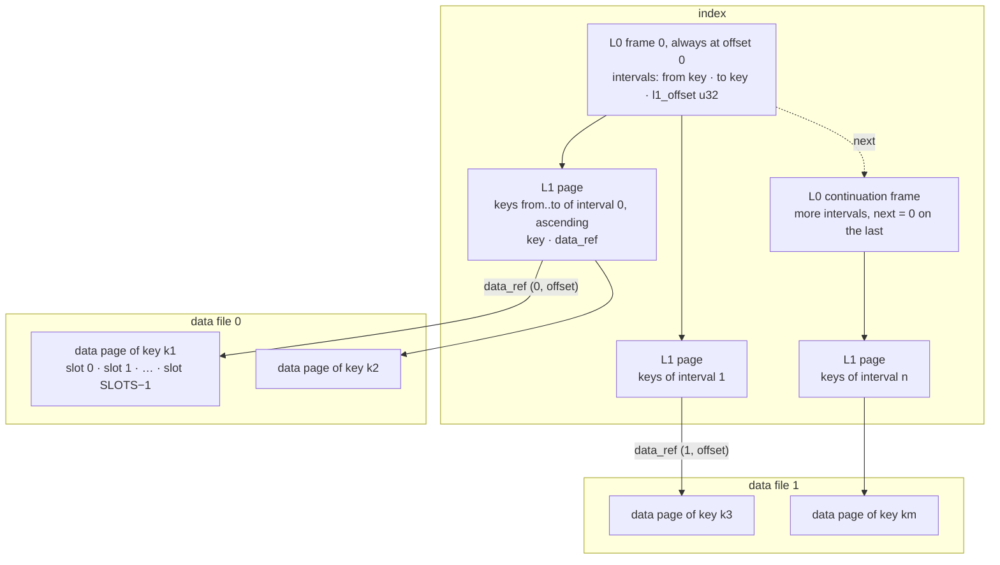

| Frame | Header | Body |
|---|---|---|
| **L0** | `size u32` · `next u32` · `count u32` · `hash u64`: 20 bytes | `count` × (`from K` · `to K` · `l1_offset u32`) = `2·LEN + 4` each, zero-padded to `size` |
| **L1** | `size u32` · `next u32` · `count u32`: 12 bytes | `count` × (`key K` · `data_ref`) = `LEN + 5` each, zero-padded to `size` |
| **data** | `size u32` · `next u32` · `item_len u16`: 10 bytes | `SLOTS` × `ITEM_LEN` |

`data_ref` = `file_no u8` · `offset u32`: which data file, and where in it.

- `size` is the whole frame including its header. `next` is the absolute offset of a continuation frame
  in the SAME file, `0` = none.
- `hash` is FNV-1a 64 over `archived-data/split/L0/v1` and the header's `size`, `next`, `count`
  little-endian, checked on every L0 frame before anything in it is used: bytes that are not a split index
  are `Corrupted` at open, never an empty archive. `open` also refuses, with no read, an L0 naming an L1
  page whose header lies past the end of the index, and, with ONE small read — the 12-byte header of the
  page at the highest `l1_offset`, and of any continuation it chains to — an index that ends inside that
  last page. An index grows only by append, so only its last page can be cut.
- **L0 is a CHAIN, and frame 0 is always at index offset 0.** A reader follows it when it opens and keeps
  every interval in memory with no lock. The intervals are ordered and disjoint across the WHOLE chain,
  and a lookup is one binary search over all of them.
- An L1 page's keys must be strictly ascending, and its first and last keys must equal its interval's
  `from` and `to` — otherwise the archive is `Corrupted`, because a binary search would answer "absent"
  for a key that is there.
- A data page's bodies must total exactly `SLOTS × ITEM_LEN`, with `item_len == ITEM_LEN` on every frame.
- **The number of keys is the sum of the `count` fields of every L1 frame header** — nothing stores it
  separately.
- Limits, all field widths: the index may not pass `u32::MAX + 1` bytes (4 GiB), a data file holds at
  most 4 GiB, and there are 256 data files. Crossing any of them is a `ContractViolation`.

## Continuation frames

Writers chain only L0. Readers follow `next` on L0, L1 and data frames alike, so an archive written by
something else — or rewritten in place one day — reads the same.

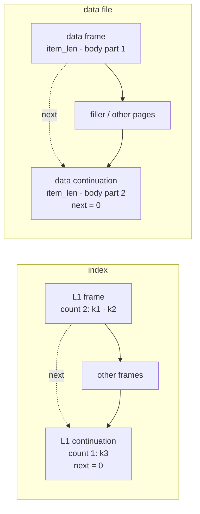

- A continuation always lies past the end of the frame pointing at it. A `next` into the frame itself,
  backwards, or past the end of its file is `Corrupted`, so every walk ends by construction.
- **Entries never straddle frames.** Every L0 and L1 frame carries its own `count`, and its entries are
  decoded against it; the logical list is the frames' entries joined. An L1 frame holds at least one
  entry, and its body is a whole number of entries with room for `count` of them.
- A data page chained over frames is their bodies joined, `item_len` stated on every frame.

## Working archive — written in any key order

`FixedKeyPreallocatedSlotsArchiveWriter` over one factory that implements both `IoWriterFactory` and
`IoReaderFactory`. `new_with_capacity(factory, capacity_l0, capacity_l1)` — defaults 1024 and 1024 —
creates the index and appends L0 frame 0, reserved for `capacity_l0` intervals, with a hash that does NOT
verify: the index is refused at open until a flush completes (see "Caches, flush, finish"). **`capacity_l0`
is the number of intervals per L0 FRAME**, not a limit on L0. Data file 0 is created with the first key,
and data file `n` with its first page.

### Every file grows only by append

An offset is handed out ahead of its bytes: a new L1 page or data page is placed at the end of what its
file has reserved, and its bytes reach the file later, when the page leaves the cache or at `flush`. So
the rule that keeps a file without holes is:

**a page past its file's append frontier is always cached.** A page leaving the cache appends every
not-yet-appended page before it first — all of them cached, by the same rule. A page already appended is
rewritten in place with `write_at`; an item for a data page that is not cached goes straight to its file.

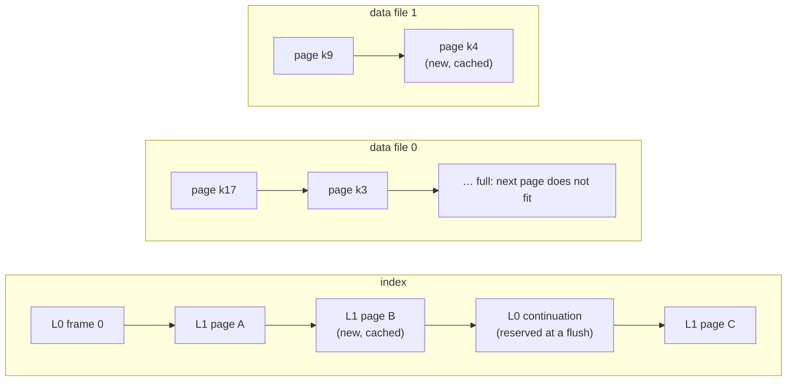

A data page goes into the current data file only if `offset + page_len <= max_data_file_bytes`;
otherwise the next data file starts and the page lands at offset 0. A page is never split across files.
`max_data_file_bytes` is 4 GiB by default and settable with `set_max_data_file_bytes` before the first
key — tests use a few pages — and panics above 4 GiB or below one page. Needing data file 256 refuses
that one key with a `ContractViolation` before anything changes, and the writer stays usable. So does a
new key needing an L1 page the index has no room left for below 4 GiB — room counted together with the
L0 continuations the next flush will need for the new interval, so a flush never runs into the limit.

Every data writer created stays open until `finish`: a known key's page may live in any earlier data
file, and its item is written there in place.

### A new key

1. finds its interval — the last one with `from <= key`;
2. gets a data page placed at the end of the current data file, filled with `Default`;
3. is inserted, sorted, into that interval's L1 page;
4. if the page is over `capacity_l1`, one of the two rules below applies.

A known key has its item written into its slot in place.

**Rule 1 — append.** The key is past the last key of the LAST L1 page and that page is full: the page is
NOT halved. A new page holds only the new key, and its interval is added after the last one. Keys written
in ascending order therefore fill every page completely; the only partial page is the last.

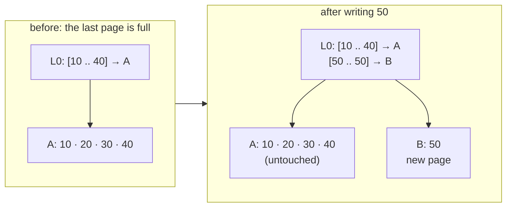

**Rule 2 — insert.** Any other overflow halves the page. The upper half is below every key of the NEXT
page, so if it fits into the room that page has left, it moves in front of that page's keys: this
interval's `to` shrinks, the next one's `from` moves down, and no page or interval is added. Only when the
next page has no room for the whole upper half — or there is no next page — is a new page allocated for
it, with a new interval.

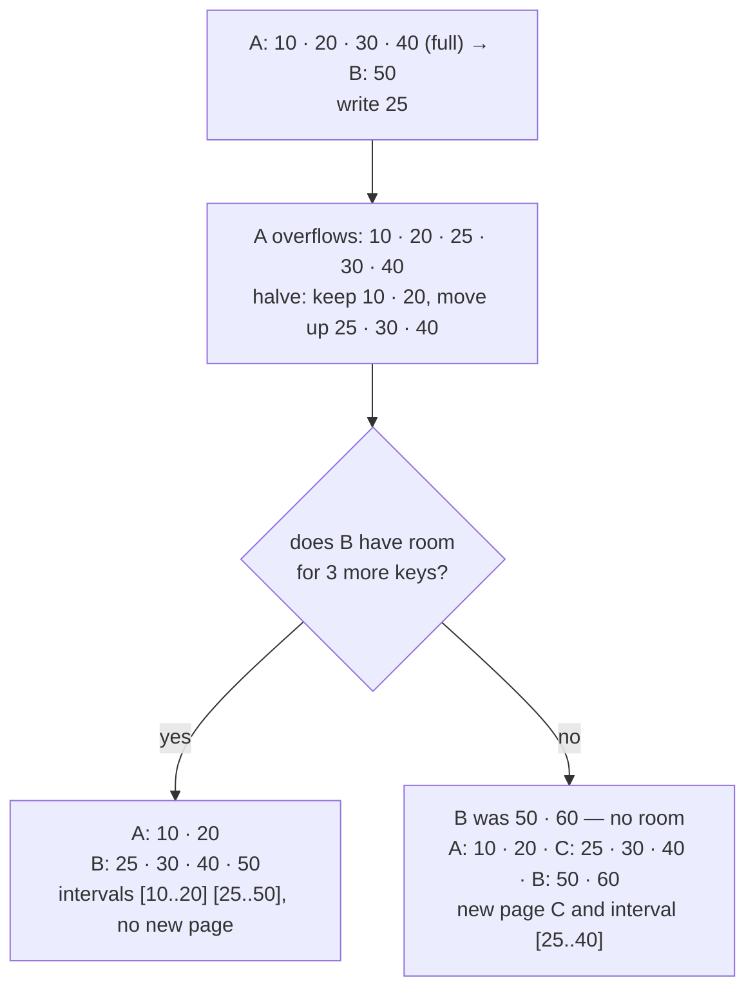

**Where a new key goes is decided before anything changes.** Its interval's page is read in and, when it
is full and not the last, the next page too; then the next page's room for the upper half, or the index's
room for a new page, is checked. Only after that is the key's data page placed and the page cut, with no
await between the first change and the last. So a write that fails or is dropped halfway never leaves an
upper half on no page: the keys written before it are all still there.

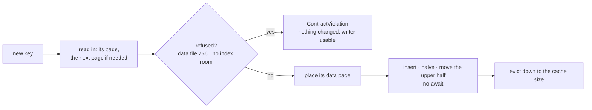

An L1 page is never cached while it holds more than `capacity_l1` keys, because any cache eviction may
encode any cached page, and the pages read in are evicted only once the key is placed.

### Caches, flush, finish

- **Two caches**: L1 pages (64 by default, at least 1: `set_l1_cache_size`) and data pages (1024 by
  default, 0 = every page appended at once and every item written straight to its file:
  `set_data_cache_size`). An L1 page that is not cached was appended already, and is read back through a
  reader of the index made by the same factory, created on first need. A write placing a new key holds up
  to three L1 pages more until it returns — its page, the next one, a new one. The writer never reads a
  data file.
- **Nothing written is readable until `flush` / `finish` returns `Ok`.** A `write` keeps what it changes
  in the caches, or sends it to a file: an L1 page or a data page leaving its cache, rewritten in place or
  appended; a new data page appended at once with no data cache; an item written straight into a data
  page that is not cached. The FIRST byte to reach the index or any data
  file after a completed flush — in a `write` or in the flush itself — is preceded by one `write_at` of 8
  bytes that spoils frame 0's hash in place, so from it the index is refused at open; later bytes find it
  spoiled and cost nothing more. `flush`, in this one order:
  1. appends or rewrites every cached L1 page in offset order;
  2. appends or rewrites every cached data page in file order;
  3. stops there, with no write at all, when no byte — in a `write`, or in steps 1 and 2 — reached a file
     since the last flush completed;
  4. lays the L0 chain out: the continuations it has rewritten in place, new ones appended at the end of
     the index — L0 never shrinks, so a continuation is never given back;
  5. writes frame 0 LAST: its entries, then its 20-byte header with the real hash.
- **So the index opens only when its last flush COMPLETED and nothing was written to its files after it;
  otherwise `open` is `Err(Corrupted)`.** A writer that never completed a flush — dropped before its
  first, say — leaves an index refused, never an archive that holds no keys. So does a writer that stopped
  after any byte reached the index or a data file since its last completed flush, and a flush that fails,
  is dropped at an await or dies once a byte of its cycle reached a file: never an index that opens and answers `None` for a
  key a flush saved, or answers what no flush saved. A `write` whose changes all stayed in the caches wrote
  nothing to the files: it is not in the archive until a flush, and does not stop it from opening. A spoil
  that fails stops its call before any byte of the call's own is written, so a flush stopped there changed
  nothing and the index opens as the last completed flush left it — nothing was written after it.
- **`finish`** flushes, then calls `finish()` on the index and on EVERY data file created, awaiting each
  even after another failed, and returns the flush's error first, else the first failed finish.
- A writer dropped without `finish` leaves each file writer's own `Drop` to finish whatever reached it.
  `finish` and `Drop` alike mean "what was written is persisted", never "the archive is complete": only
  `finish` returning `Ok` says every key written is in the working archive.
- **Refusals change nothing**, and the writer stays usable after them: a slot or item out of contract, a
  new key whose `copy_to` breaks its contract, a new key needing data file 256, a new key needing an L1
  page the index has no room for.
- **Any other `Err`** leaves the archive in an unknown state: it is a working archive, and is rebuilt.
  So does a `write` or `flush` future dropped before it returned — neither is cancel-safe. Either way the
  writer refuses every later `write`, `flush` and `finish` as a `ContractViolation`: a call is marked in
  flight on the way in and cleared only on its `Ok`, because a dropped future runs no error path. `finish`
  still finishes every file.

## Compaction in two steps — the archive that is kept

The compact archive has exact sizes, and a caller writing to S3 must know each object's size before the
upload starts. So compaction is PLANNED first, and written from the plan.

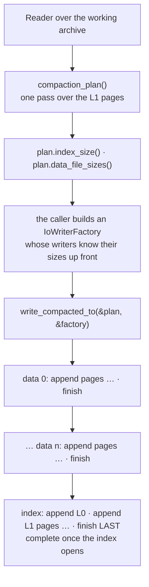

1. **`compaction_plan()`** walks the L1 pages once, not through the caches, groups the keys into compact
   pages and works out the exact size of the index and of every data file under the reader's
   `max_data_file_bytes` (`set_max_data_file_bytes` on the reader; it affects only the next plan). Keys
   that do not ascend across pages are `Corrupted`; a compact index past 4 GiB or data needing data file
   256 is a `ContractViolation`.
2. **`write_compacted_to(&plan, &factory)`** writes each data file in order, `append` only, each finished
   before the next is created; then creates the index, writes it with `append` only and finishes it
   LAST. It never calls `write_at`. Memory is one L1 page plus one data page.

The compact shape: ONE L0 frame of exact size (`next` 0), then full L1 pages of `COMPACT_L1_CAPACITY` =
1024 keys, the last zero-padded to 1024 like the SingleFile compact file, then every data page as ONE
frame in ascending key order across the data files.

```text
index      = 20 + p × (2·LEN + 4)                    L0, one frame
           + p × (12 + 1024 × (LEN + 5))             L1 pages                 where p = ceil(n / 1024)
page       = 10 + SLOTS × ITEM_LEN
per_file   = floor(max_data_file_bytes / page)
ref(i)     = (i / per_file,  (i % per_file) × page)  the data page of the key of rank i
data file  = per_file × page for every full file, the rest in the last
empty      = a 20-byte index and NO data files
```

Because every `ref(i)` is a closed form, the index needs nothing from the data pass, and it is written
last: **a compact archive is complete when its index exists AND opens** — not when the index object
exists. A compaction that fails in its data pass leaves no index, so `open` fails on the missing index.
One that fails in its index pass can leave a short index behind — a file writer dropped unfinished still
persists what reached it, and an append that failed partway may leave part of a page — and `open` refuses
it as `Corrupted`, because its L0 names an L1 page that starts past its end, or its last L1 page ends past
it. Running the compaction again replaces every file.

The result is **deterministic**: the same keys and items under the same `max_data_file_bytes` give the
same bytes, whatever order they were written in, whatever page sizes the working archive had, and however
its frames were chained — so a stored archive can be verified by compacting again and comparing, and two
runs over one archive write identical files. That rests on one condition: `max_data_file_bytes` decides
which data file every page lands in, so it must be the same for every run of one archive.

**The source is checked against the plan.** A compact L1 page whose count, first or last key differs from
the plan, more or fewer keys than planned, or a file that ends at a size other than planned, is
`Corrupted`: the source changed between the two steps.

## Reading

`FixedKeyPreallocatedSlotsArchiveReader` over an `IoReaderFactory` — local files, or S3 objects read a
range per call. It reads working and compact archives alike and is shared through an `Arc` by concurrent
callers.

```mermaid
sequenceDiagram
    participant C as caller
    participant R as Reader
    participant L1 as L1 cache (RwLock)
    participant D as data cache (RwLock)
    participant I as index reader
    participant Z as lazy data readers (OnceCell per file)
    participant F as data file n

    Note over R,I: open(): size() once, L0 frame 0 in one read clamped to 64 KiB, then each next frame, then the header of the last L1 page; L0 in memory, no lock

    C->>R: get(key, from, to)
    R->>R: binary search L0 → interval
    R->>L1: read lock: page at l1_offset?
    alt hit
        L1-->>R: page (last_access = now)
    else miss
        R->>I: read_at the L1 frame (no cache lock held), then its continuations
        I-->>R: bytes
        R->>L1: write lock: insert, evict the oldest last_access
    end
    R->>R: binary search the page → data_ref (absent → None)
    R->>D: read lock: page at data_ref?
    alt hit
        D-->>R: body
    else miss
        R->>Z: data file n (opened on first use, once, size() learned)
        Z-->>R: reader
        R->>F: read_at the data frame, then its continuations
        R->>D: write lock: insert
    end
    R-->>C: items of slots from..=to
```

- `get(key, from, to)` — the items of slots `from..=to`, inclusive, in order; `from == to` is one item.
  A slot never written is `Default`. The key not in the archive is `Ok(None)`. `from > to` is an empty
  list at once, reading nothing and opening no data file. A failed read or a corrupted page is `Err`,
  never `None`; a `data_ref` into a data file the factory cannot open is `Io`.
- **Two caches, each under its own `RwLock`**: L1 pages and data pages, 10 each by default. A hit only
  stamps the page's `last_access: AtomicDateTimeAsMicroseconds` under the READ lock. A miss reads with no
  cache lock held and takes the WRITE lock only to insert — dropping its own copy if somebody inserted the
  page meanwhile — evicting the page with the oldest `last_access`.
- **`set_l1_cache_size(n).await` / `set_data_cache_size(n).await` evict down to `n` before they return**,
  and the cache holds at most `n` pages from then on: 0 empties it and caches nothing more. An insert reads
  the size under the write lock, so one racing a shrink cannot leave the cache above it.
- **A cached L1 page is checked like a page just read**: its first and last keys must be the `from` and
  `to` of the interval asking for it, or it is `Corrupted`. In a damaged index two intervals can name one
  page; the page is then cached against one of them, and handing it to the other would answer `None` for
  a key that is there, or a range with keys repeated and missing.
- **Data files are opened lazily, once each.** No data file is opened by `open`; the first read of file
  `n` opens it through a `OnceCell`, however many callers race for it, and keeps it for the reader's life.
  A file that fails to open is not remembered, so the next read tries again.
- **Reads are exact.** `read_at` returns exactly `len` bytes or `UnexpectedEof`, so the reader learns each
  file's size once and clamps every speculative read to it: the usual L1 page and the usual data page each
  cost ONE `read_at`, and a frame whose size reaches past its file is `Corrupted` without a read past the
  end.
- **No position is shared.** `read_at` carries its offset, so misses — of one file or of many — do not
  wait on each other. Whether a dropped `read_at` is safe is the IO implementation's business.
- `keys_count()` reads only the L1 frame headers, one small read per frame, uncached.

### A range of keys

`get_range(from, to, from_slot, to_slot)` — EVERY key `k` with `from <= k <= to`, in ascending key order,
each with its items of slots `from_slot..=to_slot` as `get` gives them, all at once.

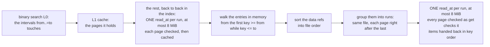

- `from > to` is an empty list at once, reading nothing. `from_slot > to_slot` is every key in the range
  with no items, reading no data page. A range between keys, or of an empty archive, is empty.
- **L1 pages** come from the L1 cache when it holds them, as `get`'s do. The ones it does not hold, and
  that lie back to back in the index, are read in RUNS: one `read_at` up to 8 MiB, each page decoded and
  checked as a read of it alone is — its span included — and inserted into the cache. A page's size is
  known only once it is read, so a page is taken to follow the one before it when it starts at most one
  default page length (`12 + 1024 × (LEN + 5)`) after it: in a compact index, exactly the pages back to
  back. A page chained to a continuation, or longer than its run's read, is loaded on its own. A wide
  range of a compact archive costs a handful of index reads, and the same range again, with a cache that
  holds its pages, none. In a working index, where pages lie in the order they were allocated, fewer
  pages share a read.
- **Data pages** are read in FILE order, never through the data page cache and never filling it: the refs
  are sorted by `(file_no, offset)`, the pages that follow one another in one data file come in one
  `read_at`, up to 8 MiB a read, and the items are handed back in key order. A contiguous range of a
  compact archive is a handful of reads, and so is a dense range of a working archive — whose pages lie in
  the order their keys first arrived — whatever that order was. A sparse range of a working archive still
  costs about a read per key: its pages have gaps between them. A page chained to a continuation is read
  on its own.
- A failed read or a damaged page anywhere in the range is `Err` — never a partial `Ok`.
- Memory: every key of the range with `(to_slot − from_slot + 1) × size_of::<TItem>()` of items, plus one
  run of at most 8 MiB at a time.

## SingleFile format (`…SingleFile` structures)

### Leaves

Three kinds of frame. Every offset is an absolute `u64` from the start of the file, little-endian
throughout.

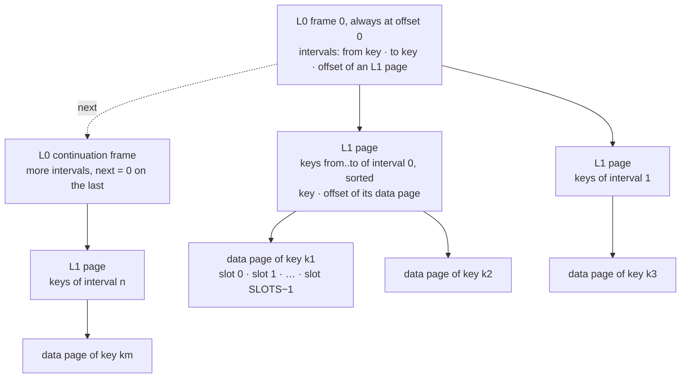

| Frame | Header | Body |
|---|---|---|
| **L0** | `size u32` · `next u64` · `count u32`: 16 bytes | `count` × (`from K` · `to K` · `offset u64`), zero-padded to `size` |
| **L1** | `size u32` · `count u32`: 8 bytes | `capacity` × (`key K` · `offset u64`), zero-padded past `count` |
| **data** | `size u32` · `next u64` (always 0) · `item_len u16`: 14 bytes | `SLOTS` × `ITEM_LEN` |

- `size` is the whole frame including its header. The capacity of an L1 page is read from its `size`.
- **L0 is a CHAIN, and frame 0 is always at offset 0.** `next` is the absolute offset of the next
  frame, `0` on the last one. A reader follows the chain when it opens and keeps every interval in
  memory with no lock. The intervals are ordered and disjoint across the WHOLE chain, and a lookup is
  one binary search over all of them.
- A continuation always lies past the end of the frame pointing at it. A `next` pointing into frame 0,
  back into an earlier frame, in a cycle, or past the end of the file means the file is `Corrupted`.
  The chain framing is shared with every module of the crate (`l0_chain.rs` at the crate root).
- An L1 page's first and last keys must equal its interval's `from` and `to`, and its keys must be
  strictly ascending — otherwise the file is refused as `Corrupted`, because a binary search would
  answer "absent" for a key that is there.
- A data page must be exactly `14 + SLOTS × ITEM_LEN` bytes with `item_len == ITEM_LEN`: a file of
  other sizes is not this file.
- **The number of keys is the sum of the `count` fields of every L1 header** — nothing stores it
  separately.

### Working file — written in any key order

`FixedKeyPreallocatedSlotsArchiveWriterSingleFile` over a local `AsyncRead + AsyncWrite + AsyncSeek`.
**`capacity_l0` is the number of intervals per L0 FRAME** (default 1024), not a limit on L0. Frame 0
is reserved at offset 0 for that many intervals. Its `size` is the reserved length and its `count` is
the real one. L1 and data pages are appended after it **in the order they were allocated**, mixed.

When L0 grows past the frames it has, a flush allocates continuation frames of the same reserved size
at the END of the file. Each flush lays L0 across the chain in order: frame 0, then the continuations
it already has, then new ones only if needed. L0 never shrinks, so a later flush reuses every
continuation an earlier one allocated.

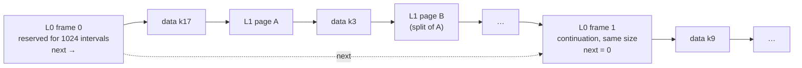

A new key:

1. finds its interval — the last one with `from <= key`;
2. gets a data page appended at the end, filled with `Default`;
3. is inserted, sorted, into that interval's L1 page;
4. if the page now holds more than `capacity_l1` keys, **it is split in half**: the upper half moves
   to a new L1 page appended at the end, and a new L0 interval is inserted right after the old one.

A known key has its item written into its slot in place.

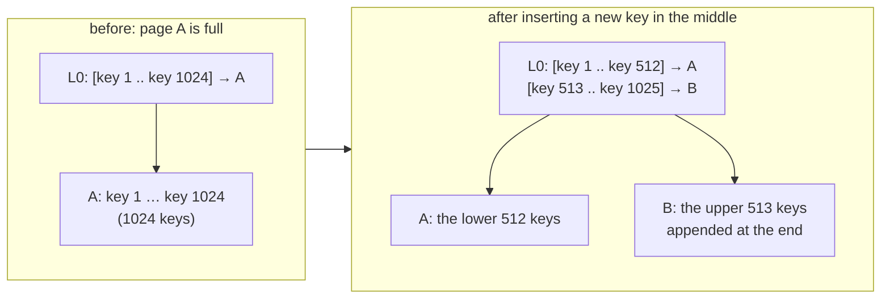

A split never fails for lack of room in L0: a new interval that does not fit the current frames
becomes one more continuation at the next flush.

Nothing written is durable until `flush` / `finish` returns `Ok`. Dirty L1 pages and data pages go to the
sink first, then every frame of the L0 chain, then the sink is flushed. A file whose writer stopped
anywhere else is in no defined state: between two flushes, the pages evicted since the last one were
already rewritten in place under an L0 that does not describe them, so such a file may open and answer
what no flush saved — the SingleFile format has no hash to refuse it with. An `Err` on the way leaves the
file unusable; it is a temporary file and is rebuilt.

### Compact file — the one that is kept

`FixedKeyPreallocatedSlotsArchiveReaderSingleFile::write_compacted_to` streams it from any readable file of this
format. It has exact capacity. L0 is **one frame** (`next = 0`) with `ceil(n / 1024)` intervals,
whatever chain the source had. Full L1 pages of 1024 keys follow, the last one zero-padded, then every
data page **in ascending key order**. The layout is the same as before L0 became a chain, byte for
byte.

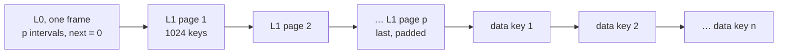

```text
compacted_len = 16 + p × (2·LEN + 8)                 L0
              + p × (8 + 1024 × (LEN + 8))           L1
              + n × (14 + SLOTS × ITEM_LEN)          data         where p = ceil(n / 1024)
```

Because the data page of the key with rank `i` sits at `data_start + i × data_page_len`, every offset
is known before the first data byte is written, and the stream needs no seek. It is **deterministic**:
the same keys and items give the same bytes whatever order they were written in — so a stored file
can be verified by compacting again and comparing.

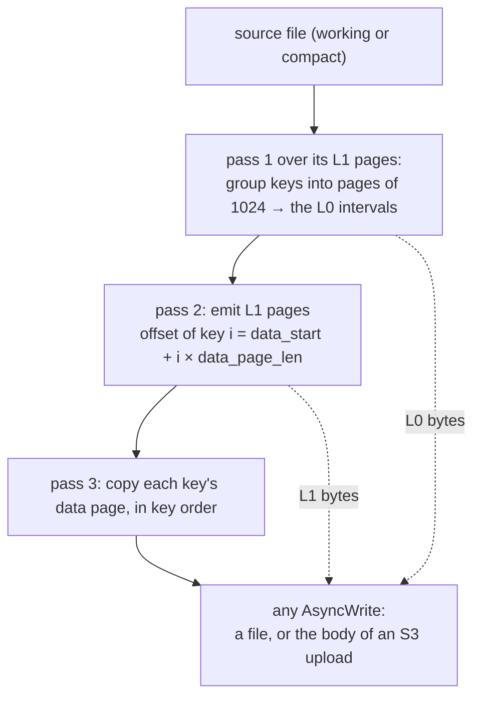

Memory is L0 plus one L1 page plus one data page, however many keys there are. `out` is neither
flushed nor shut down — the caller owns it, and can run the whole stream again for a retry.

### Reading

`FixedKeyPreallocatedSlotsArchiveReaderSingleFile` over any `AsyncRead + AsyncSeek` — `tokio::fs::File`, or an
`S3Reader` whose every read is one ranged GET. It is shared through an `Arc` by concurrent callers.

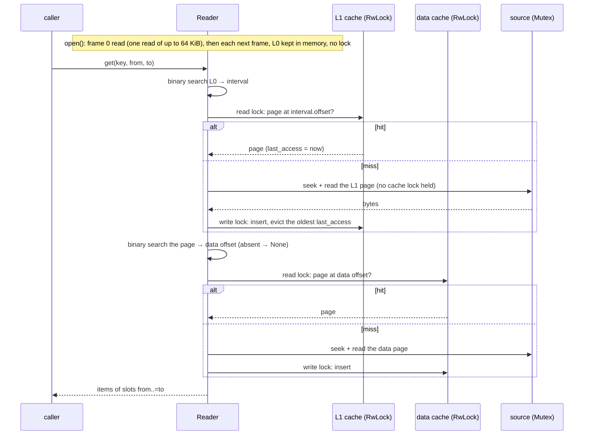

- `get(key, from, to)` — the items of slots `from..=to`, inclusive, in order; `from == to` is one
  item. A slot never written is `Default`. The key not in the file is `Ok(None)`. `from > to` is an
  empty list at once, without reading. A failed read or a corrupted page is `Err`, never `None`.
- **Two caches, each under its own `RwLock`**: L1 pages and data pages, 10 each by default
  (`set_l1_cache_size`, `set_data_cache_size`). A hit only stamps the page's
  `last_access: AtomicDateTimeAsMicroseconds` under the READ lock, so callers of cached pages never
  wait on each other. A miss reads the source with no cache lock held and takes the WRITE lock only to
  insert — dropping its own copy if somebody inserted the page meanwhile — evicting the page with the
  oldest `last_access`.
- **The source is one position**, so its seek + read is under a mutex: misses of one file go one at a
  time. Two files are two readers and do not wait on each other.
- **Not cancel-safe over a source that keeps a read in flight.** Dropping a `get` half way through an
  `S3Reader` request leaves the reader mid-request, and the next caller's seek fails. A caller that
  can be dropped — a request handler — runs the call in a task of its own. `tokio::fs::File` is not
  affected.
