# variable_key_preallocated_slots

The same archive as [`fixed_key_preallocated_slots`](../fixed_key_preallocated_slots/README.md) with one
difference: the **primary key has a variable size**, from 1 to 32 767 bytes. Each key still owns
exactly one **preallocated data page** of `SLOTS × ITEM_LEN` bytes, and a slot is still addressed by
its position.

Everything that does not depend on the key is shared with the fixed module and lives at the crate
root: the data page, the frame header and chain reading, the data files and their rollover, the page
caches, the compaction plan, the slot and item traits. This module holds only what a variable-size key
changes: the length prefix, the L0 and L1 entries, how an L1 page is sized and split, and how the
compact archive packs its L1 pages.

Two families of structures read and write it:

| Structures | Format | IO |
|---|---|---|
| `VariableKeyPreallocatedSlotsArchiveWriter` / `…ArchiveReader` | the **split archive**: an index and data files `0 ..= 255` | `ArchiveFileWriter` / `ArchiveFileReader` by role, from an `IoWriterFactory` / `IoReaderFactory` |
| `…ArchiveWriterSingleFile` / `…ArchiveReaderSingleFile` | the **SingleFile** format: one file, `u64` offsets | `AsyncRead + AsyncWrite + AsyncSeek` |

## The three traits

| Trait | Says |
|---|---|
| `PrimaryKeyVariableSize` | `from_slice`, `copy_to`, `Ord + Clone`: the key, its bytes, and how it sorts |
| `PreallocatedSlotKey` | `SLOTS`, `slot_index`: how many positions a page has and which one this is (shared) |
| `PreallocatedDataItem` | `ITEM_LEN`, `from_slice`, `copy_to`, `Default`: one slot's bytes, and what an empty slot is (shared) |

`copy_to` appends **only the key bytes**. The crate writes the length prefix, and `from_slice` gets back
exactly the bytes `copy_to` wrote. The archive sorts on `Ord`, so the byte form does not have to sort
the same way.

The crate checks every contract on its own side through internal traits no implementation can
override. A key of 0 bytes (empty) or of more than `MAX_VARIABLE_KEY_LEN` = 32 767 bytes is a
`ContractViolation`, and so are a wrong item byte count and a slot out of range.

## The length prefix

Every key in both formats is preceded by its length:

| Length | Bytes | Example |
|---|---|---|
| `0` | `0x00`: the **end marker**, not a key | `00` |
| `1 ..= 127` | one byte, the length | `127` → `7F` |
| `128 ..= 32767` | two bytes, `len \| 0x8000`, **big-endian** | `128` → `80 80`, `256` → `81 00`, `32767` → `FF FF` |

Decoding reads the first byte `b0`. If `b0 & 0x80 == 0` the length is `b0` and the prefix is one byte.
Otherwise it reads `b1`, and the length is `((b0 & 0x7F) << 8) | b1`.

- The rest of the archive is little-endian. **The prefix is big-endian on purpose**: the flag has to be
  in the FIRST byte read.
- Every length has exactly one spelling. A two-byte prefix holding a length below 128 is `Corrupted`,
  so the compact bytes of a set of keys are unique.
- A single `0x00` ends the entries of an L0 frame or an L1 frame. A reader stops there or at the frame's
  `size`, whichever comes first, and the number of entries read must equal that frame's `count`. A
  mismatch is `Corrupted`.

## The split archive — leaves

The archive is an INDEX and up to 256 DATA files. The structures never learn a file name, or whether a
file is a file: they ask the factory for the index or for data file `n`. Every offset is a `u32` inside
its own file. `P` below is a length prefix followed by the key bytes.

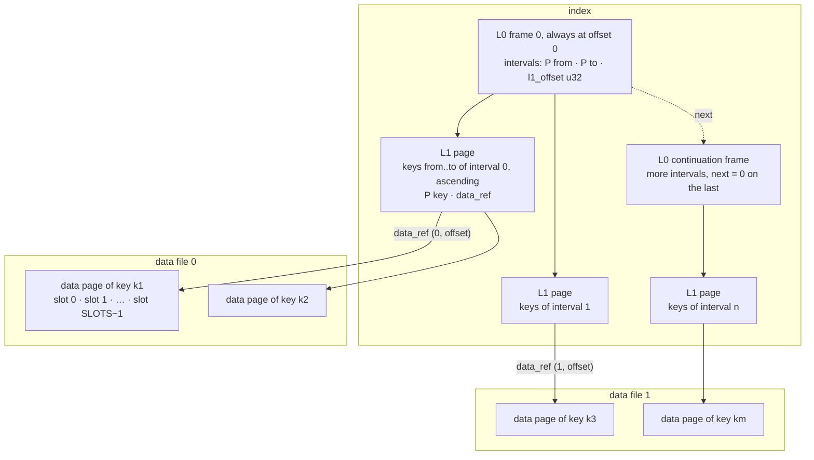

| Frame | Header | Body |
|---|---|---|
| **L0** | `size u32` · `next u32` · `count u32` · `hash u64`: 20 bytes | `count` × (`P from` · `P to` · `l1_offset u32`), then zeros up to `size` |
| **L1** | `size u32` · `next u32` · `count u32`: 12 bytes | `count` × (`P key` · `data_ref`), ascending, then zeros up to `size` (working archive only) |
| **data** | `size u32` · `next u32` · `item_len u16`: 10 bytes | `SLOTS` × `ITEM_LEN` (shared with the fixed module) |

`data_ref` = `file_no u8` · `offset u32`: which data file, and where in it. One L1 entry is
`P(key) + 5` bytes and one L0 entry `P(from) + P(to) + 4`, where `P(k) = (len(k) < 128 ? 1 : 2) + len(k)`.

- `size` is the whole frame including its header. `next` is the absolute offset of a continuation frame
  in the SAME file, `0` = none.
- `hash` is FNV-1a 64 over `archived-data/split/L0/v1` and the header's `size`, `next`, `count`
  little-endian, checked on every L0 frame before anything in it is used: bytes that are not a split index
  are `Corrupted` at open, never an empty archive. `open` also refuses, with no read, an L0 naming an L1
  page whose header lies past the end of the index, and, with ONE small read — the 12-byte header of the
  page at the highest `l1_offset`, and of any continuation it chains to — an index that ends inside that
  last page. An index grows only by append, so only its last page can be cut.
- **L0 is a CHAIN, and frame 0 is always at index offset 0.** A reader follows it when it opens and keeps
  every interval in memory with no lock. The intervals are ordered and disjoint across the WHOLE chain,
  and a lookup is one binary search over all of them.
- An L1 page's keys must be strictly ascending, and its first and last keys must equal its interval's
  `from` and `to`. Otherwise it is `Corrupted`, because a binary search would answer "absent" for a key
  that is there.
- A data page's bodies must total exactly `SLOTS × ITEM_LEN`, with `item_len == ITEM_LEN` on every frame.
- **The number of keys is the sum of the `count` fields of every L1 frame header.** Nothing stores it
  separately.
- Limits, all field widths: the index may not pass `u32::MAX + 1` bytes (4 GiB), a data file holds at
  most 4 GiB, and there are 256 data files. Crossing any of them is a `ContractViolation`.

## Continuation frames

Writers chain only L0. Readers follow `next` on L0, L1 and data frames alike, so an archive written by
something else reads the same.

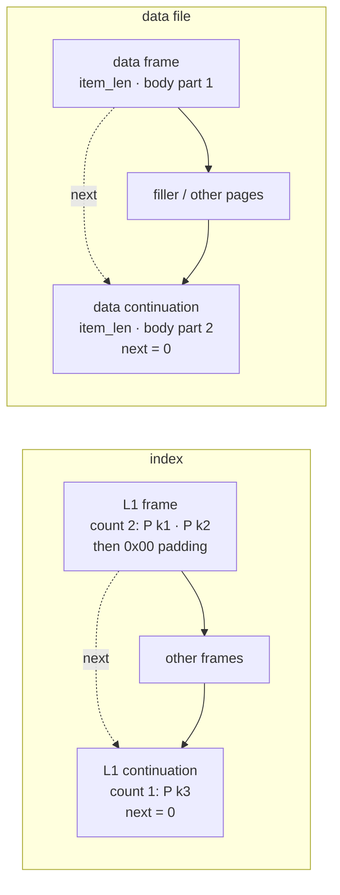

- A continuation always lies past the end of the frame pointing at it. A `next` into the frame itself,
  backwards, or past the end of its file is `Corrupted`, so every walk ends by construction.
- **Entries never straddle frames.** Every L0 and L1 frame is walked on its own, up to its end marker or
  its `size`, and the entries found must be exactly its `count`; the logical list is the frames' entries
  joined. A frame zero-padded past its entries would otherwise put an end marker in the middle of the
  list. An L1 frame holds at least one entry and room for `count` entries of a one-byte key (`7` bytes
  each). An entry cut short at the end of its frame is `Corrupted`.
- A data page chained over frames is their bodies joined, `item_len` stated on every frame.

## Working archive — written in any key order

`VariableKeyPreallocatedSlotsArchiveWriter` over one factory that implements both `IoWriterFactory` and
`IoReaderFactory`:

| Constructor | L0 frame | L1 page |
|---|---|---|
| `new(factory)` | `DEFAULT_L0_FRAME_BYTES` = 64 KiB | `DEFAULT_L1_PAGE_BYTES` = 16 KiB |
| `new_with_capacity(factory, l0_frame_bytes, l1_page_bytes)` | in **bytes**, header included | in **bytes**, header included |

Both sizes are in BYTES. `l0_frame_bytes` is the size of each L0 FRAME, not a limit on L0. The constructor
creates the index and appends L0 frame 0 with a hash that does NOT verify: the index is refused at open
until a flush completes (see "Caches, flush, finish"). Data file 0 is created with the first key, and data
file `n` with its first page.

### Every file grows only by append

An offset is handed out ahead of its bytes: a new L1 page or data page is placed at the end of what its
file has reserved, and its bytes reach the file later, when the page leaves the cache or at `flush`. So
the rule that keeps a file without holes is:

**a page past its file's append frontier is always cached.** A page leaving the cache appends every
not-yet-appended page before it first — all of them cached, by the same rule. A page already appended is
rewritten in place with `write_at`; an item for a data page that is not cached goes straight to its file.

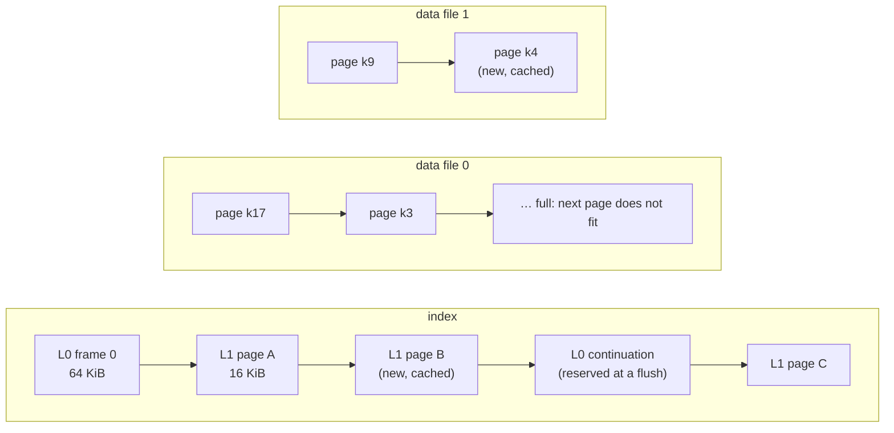

A data page goes into the current data file only if `offset + page_len <= max_data_file_bytes`;
otherwise the next data file starts and the page lands at offset 0. A page is never split across files.
`max_data_file_bytes` is 4 GiB by default and settable with `set_max_data_file_bytes` before the first
key — tests use a few pages — and panics above 4 GiB or below one page. Needing data file 256 refuses
that one key with a `ContractViolation` before anything changes, and the writer stays usable. So does a
new key needing index bytes the index has no room left for below 4 GiB: the L1 page it needs, if any,
together with the L0 continuations the next flush will need — so a flush never runs into the limit.

L0 entries vary in size, so those continuations are BOUNDED, not counted — from what L0 will be once the
key is placed. No L0 entry is longer than both bounds of the longest key written, `E = 2 × P(longest) + 4`,
and L0's bytes grow by at most `2 × E` with one key: a split changes one interval and adds or changes
another. A frame packed greedily, with `body = l0_frame_bytes − 20` bytes for entries, closes only before
an entry that does not fit, so the frames are at most the SMALLER of two bounds:

```text
by count   ceil(intervals / floor(body / E))          every closed frame holds at least floor(body / E) entries
by bytes   1 + floor(L0 bytes / (body − E + 1))       every closed frame holds more than body − E bytes
```

Either bound alone can be far too many. By count, one long key counts every interval as long as its own:
with a key near the half-page limit, the continuations reserved would match the L1 pages byte for byte, and
the index would refuse new keys at half its size. By bytes, an `E` near a whole frame leaves almost nothing
to count on. The writer keeps L0's bytes as it goes, so taking the smaller costs nothing. A key longer than
every key before it can still be refused for a continuation although it needs no page, and near the limit
the bound may refuse a key a flush would still have had room for — it never accepts one a flush has no room
for.

Every data writer created stays open until `finish`: a known key's page may live in any earlier data
file, and its item is written there in place.

### A new key

1. finds its interval, the last one with `from <= key`;
2. gets a data page placed at the end of the current data file, filled with `Default`;
3. is inserted, sorted, into that interval's L1 page;
4. if the page's entries no longer fit its `l1_page_bytes − 12` bytes of room, one of the two rules below
   applies.

A known key has its item written into its slot in place.

The pictures use 64-byte pages (52 bytes of room) and the nine-byte keys `key-00010`, `key-00020`, …,
written `10`, `20`, …: each entry is 1 + 9 + 5 = 15 bytes, so three fit a page.

**Rule 1 — append.** The key is past the last key of the LAST L1 page and its entry does not fit there:
the page is NOT split. A new page holds only the new key, and its interval is added after the last one.
Keys written in ascending order therefore fill every page as far as the next key allows; the only page
with room left is the last.

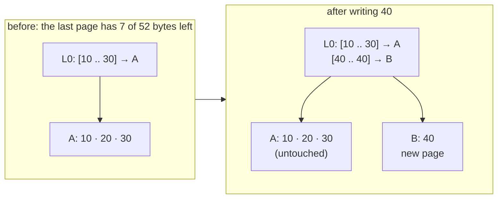

**Rule 2 — insert.** Any other overflow splits the page **by bytes**: the left page keeps entries in key
order while the next one still fits, and the rest is split off. That part is below every key of the NEXT
page, so if its entries fit into the room that page has left, it moves in front of that page's keys: this
interval's `to` shrinks, the next one's `from` moves down, and no page or interval is added. Only when the
next page has no room for the whole part — or there is no next page — is a new page allocated for it,
with a new interval.

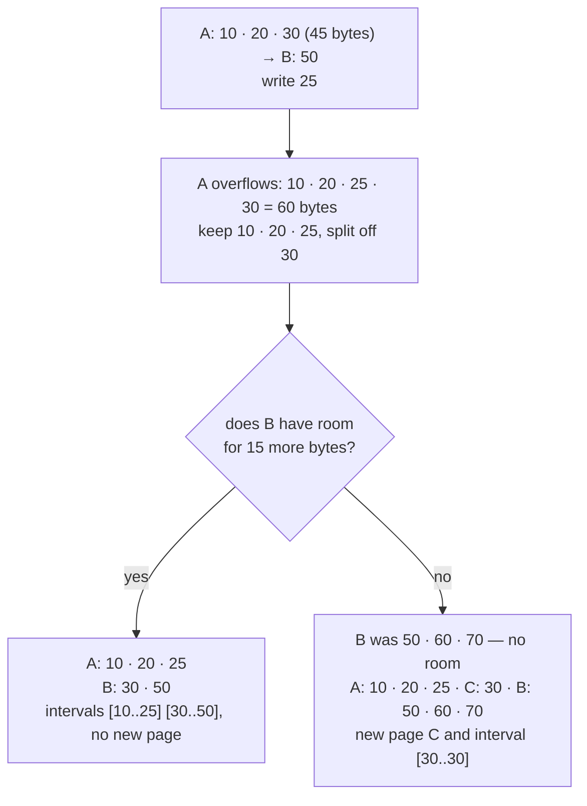

**Where a new key goes is decided before anything changes.** Its interval's page is read in and, when the
key's entry overflows it and it is not the last page, the next page too; then the next page's room for
the part split off, or the index's room for a new page, is checked. Only after that is the key's data
page placed and the page cut, with no await between the first change and the last. So a write that fails
or is dropped halfway never leaves a split-off part on no page: the keys written before it are all still
there.

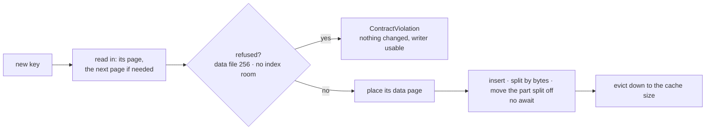

An L1 page is never cached while its entries do not fit it, because any cache eviction may encode any
cached page, and the pages read in are evicted only once the key is placed.

### The half-page rule

The writer refuses a key whose entry is more than half the room a page has for entries:

```text
entry = (key_len < 128 ? 1 : 2) + key_len + 5
accepted  ⇔  2 × entry ≤ l1_page_bytes − 12
```

A refused key is a `ContractViolation` ("key too large"), returned before anything is written or placed.
With the default 16 KiB page, an entry may be `(16384 − 12) / 2 = 8186` bytes, so the largest key is
8 179 bytes.

This rule is what makes every split produce **exactly two pages that fit**:
- Before the insert the page's entries fit in `room = l1_page_bytes − 12`, and the new entry is at most
  `room / 2`, so the total is at most `1.5 × room`.
- The left page stops only when the next entry would pass `room`. That entry is at most `room / 2`, so
  the left page holds more than `room / 2`.
- That leaves less than `room` for the part split off, which fits a page of its own — or the next page,
  when that page has the room.

**Sizes checked at construction** (a panic, like the fixed module's capacity checks):

- an L1 page must hold two entries of a one-byte key: `l1_page_bytes ≥ 12 + 2 × 7 = 26`;
- an L0 frame must hold one interval of the largest key such a page accepts:
  `l0_frame_bytes ≥ 20 + 2 × min((l1_page_bytes − 12) / 2 − 5, 2 + 32767) + 4`. With 16 KiB pages that is
  16 386 bytes;
- both sizes must fit a `u32`.

So an L0 interval always fits a frame on its own, and an interval that does not fit the current frames
becomes one more continuation at the next flush — whose room in the index was checked when the key that
needs it was written.

### Caches, flush, finish

- **Two caches**: L1 pages (`DEFAULT_WRITER_L1_CACHE_PAGES` = 64, at least 1: `set_l1_cache_size`) and
  data pages (`DEFAULT_WRITER_DATA_CACHE_PAGES` = 1024, 0 = every page appended at once and every item
  written straight to its file: `set_data_cache_size`). An L1 page that is not cached was appended
  already, and is read back through a reader of the index made by the same factory, created on first
  need. A write placing a new key holds up to three L1 pages more until it returns — its page, the next
  one, a new one. The writer never reads a data file.
- **Nothing written is readable until `flush` / `finish` returns `Ok`.** A `write` keeps what it changes
  in the caches, or sends it to a file: an L1 page or a data page leaving its cache, rewritten in place or
  appended; a new data page appended at once with no data cache; an item written straight into a data
  page that is not cached. The FIRST byte to reach the index or any data
  file after a completed flush — in a `write` or in the flush itself — is preceded by one `write_at` of 8
  bytes that spoils frame 0's hash in place, so from it the index is refused at open; later bytes find it
  spoiled and cost nothing more. `flush`, in this one order:
  1. appends or rewrites every cached L1 page in offset order;
  2. appends or rewrites every cached data page in file order;
  3. stops there, with no write at all, when no byte — in a `write`, or in steps 1 and 2 — reached a file
     since the last flush completed;
  4. lays the L0 chain out: the continuations it has rewritten in place, new ones appended at the end of
     the index — L0 never shrinks, so a continuation is never given back, and a flush may link fewer
     frames than it has reserved when the bounds of the intervals got shorter;
  5. writes frame 0 LAST: its entries, then its 20-byte header with the real hash.
- **So the index opens only when its last flush COMPLETED and nothing was written to its files after it;
  otherwise `open` is `Err(Corrupted)`.** A writer that never completed a flush — dropped before its
  first, say — leaves an index refused, never an archive that holds no keys. So does a writer that stopped
  after any byte reached the index or a data file since its last completed flush, and a flush that fails,
  is dropped at an await or dies once a byte of its cycle reached a file: never an index that opens and answers `None` for a
  key a flush saved, or answers what no flush saved. A `write` whose changes all stayed in the caches wrote
  nothing to the files: it is not in the archive until a flush, and does not stop it from opening. A spoil
  that fails stops its call before any byte of the call's own is written, so a flush stopped there changed
  nothing and the index opens as the last completed flush left it — nothing was written after it.
- **`finish`** flushes, then calls `finish()` on the index and on EVERY data file created, awaiting each
  even after another failed, and returns the flush's error first, else the first failed finish.
- A writer dropped without `finish` leaves each file writer's own `Drop` to finish whatever reached it.
  `finish` and `Drop` alike mean "what was written is persisted", never "the archive is complete": only
  `finish` returning `Ok` says every key written is in the working archive.
- **Refusals change nothing**, and the writer stays usable after them: a slot, an item or a key out of
  contract, a key too large for the half-page rule, a new key needing data file 256, a new key needing
  index bytes the index has no room for.
- **Any other `Err`** leaves the archive in an unknown state: it is a working archive, and is rebuilt.
  So does a `write` or `flush` future dropped before it returned — neither is cancel-safe. Either way the
  writer refuses every later `write`, `flush` and `finish` as a `ContractViolation`: a call is marked in
  flight on the way in and cleared only on its `Ok`, because a dropped future runs no error path. `finish`
  still finishes every file.

## Compaction in two steps — the archive that is kept

The compact archive has exact sizes, and a caller writing to S3 must know each object's size before the
upload starts. So compaction is PLANNED first, and written from the plan. Keys vary in size, so the plan
is a pass over every L1 page of the source.

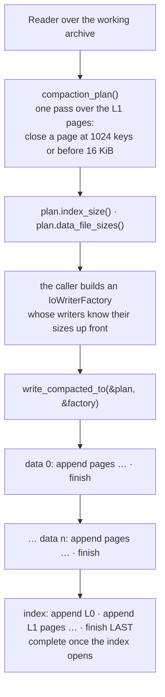

1. **`compaction_plan()`** walks the L1 pages once, not through the caches, packs the keys into compact
   pages and works out the exact size of the index and of every data file under the reader's
   `max_data_file_bytes` (`set_max_data_file_bytes` on the reader; it affects only the next plan). Keys
   that do not ascend across pages are `Corrupted`; a compact index past 4 GiB or data needing data file
   256 is a `ContractViolation`.
2. **`write_compacted_to(&plan, &factory)`** writes each data file in order, `append` only, each finished
   before the next is created; then creates the index, writes it with `append` only and finishes it
   LAST. It never calls `write_at`. Memory is one L1 page plus one data page.

The compact shape:

- **L0 is ONE frame of exact size**, `next = 0`, whatever chain the source had.
- **L1 pages have exact size**: no zero padding and no end marker, so `size = 12 + Σ entries`. A page
  closes at `COMPACT_L1_MAX_KEYS` = 1024 keys, or before the entry that would take it past
  `COMPACT_L1_PAGE_BYTES` = 16 KiB, whichever comes first.
  - This keeps a page small: one page is found through L0, fits the cache, and keeps its binary search
    short.
  - A page that is still empty takes any entry. A working archive written with larger L1 pages may hold a
    key whose entry alone passes 16 KiB (up to `12 + 2 + 32767 + 5` bytes), and that key gets a page of
    its own.
- **Data pages** follow as ONE frame each, in ascending key order across the data files.

Key bytes are copied from the source's raw bytes, never re-encoded through the trait.

```text
index      = 20 + Σ over pages (P(from) + P(to) + 4)            L0, one frame
           + Σ over pages (12 + Σ over its keys (P(key) + 5))   L1 pages
page       = 10 + SLOTS × ITEM_LEN
per_file   = floor(max_data_file_bytes / page)
ref(i)     = (i / per_file,  (i % per_file) × page)            the data page of the key of rank i
data file  = per_file × page for every full file, the rest in the last
empty      = a 20-byte index and NO data files

P(k) = (len(k) < 128 ? 1 : 2) + len(k)
```

Because every `ref(i)` is a closed form, the index needs nothing from the data pass, and it is written
last: **a compact archive is complete when its index exists AND opens** — not when the index object
exists. A compaction that fails in its data pass leaves no index, so `open` fails on the missing index.
One that fails in its index pass can leave a short index behind — a file writer dropped unfinished still
persists what reached it, and an append that failed partway may leave part of a page — and `open` refuses
it as `Corrupted`, because its L0 names an L1 page that starts past its end, or its last L1 page ends past
it. Running the compaction again replaces every file.

The result is **deterministic**: the same keys and items under the same `max_data_file_bytes` give the
same bytes, whatever order they were written in, whatever page sizes the working archive had, and however
its frames were chained — so a stored archive can be verified by compacting again and comparing, and two
runs over one archive write identical files. That rests on one condition: `max_data_file_bytes` decides
which data file every page lands in, so it must be the same for every run of one archive.

**The source is checked against the plan.** A compact L1 page whose count, size, first or last key
differs from the plan, more or fewer keys than planned, or a file that ends at a size other than planned,
is `Corrupted`: the source changed between the two steps.

## Reading

`VariableKeyPreallocatedSlotsArchiveReader` over an `IoReaderFactory` — local files, or S3 objects read a
range per call. It reads working and compact archives alike and is shared through an `Arc` by concurrent
callers.

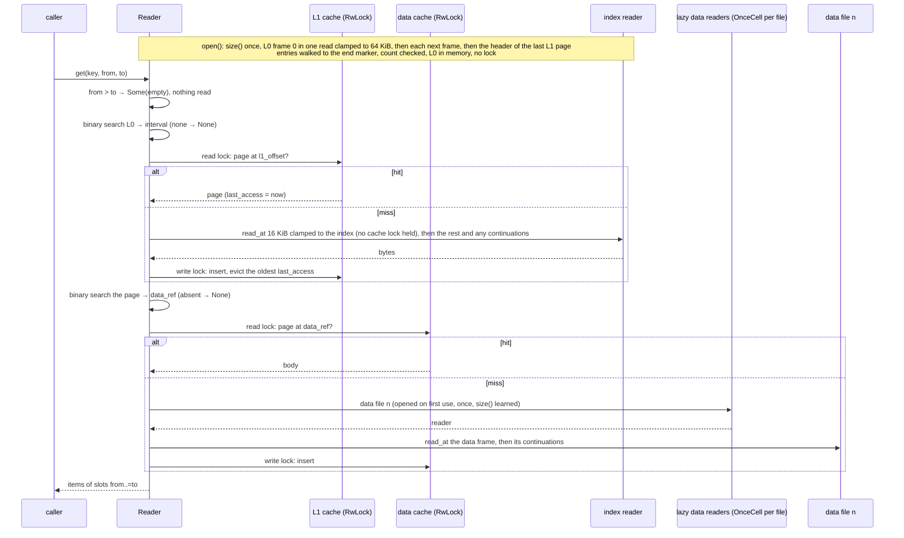

- **`get(key, from, to)`** returns the items of slots `from..=to`, inclusive, in slot order; `from == to`
  is one item.
  - A slot never written reads back as `Default`.
  - A key the archive does not hold is `Ok(None)`.
  - `from > to` is `Ok(Some(empty))` at once, reading nothing and opening no data file, so it says
    nothing about whether the key is there.
  - A failed read or a corrupted page is `Err`, never `None`; a `data_ref` into a data file the factory
    cannot open is `Io`.
- **`keys_count`** is the sum of the L1 frame header counts: one small uncached read per L1 frame.
- **Two caches, each under its own `RwLock`**: L1 pages and data pages, 10 each by default
  (`DEFAULT_READER_L1_CACHE_PAGES`, `DEFAULT_READER_DATA_CACHE_PAGES`). A hit only stamps the page's
  `last_access: AtomicDateTimeAsMicroseconds` under the READ lock. A miss reads with no cache lock held
  and takes the WRITE lock only to insert — dropping its own copy if somebody inserted the page meanwhile
  — evicting the page with the oldest `last_access`.
- **`set_l1_cache_size(n).await` / `set_data_cache_size(n).await` evict down to `n` before they return**,
  and the cache holds at most `n` pages from then on: 0 empties it and caches nothing more. An insert reads
  the size under the write lock, so one racing a shrink cannot leave the cache above it.
- **A cached L1 page is checked like a page just read**: its first and last keys must be the `from` and
  `to` of the interval asking for it, or it is `Corrupted`. In a damaged index two intervals can name one
  page; the page is then cached against one of them, and handing it to the other would answer `None` for
  a key that is there, or a range with keys repeated and missing.
- **Data files are opened lazily, once each.** No data file is opened by `open`; the first read of file
  `n` opens it through a `OnceCell`, however many callers race for it, and keeps it for the reader's life.
  A file that fails to open is not remembered, so the next read tries again.
- **Reads are exact.** `read_at` returns exactly `len` bytes or `UnexpectedEof`, so the reader learns each
  file's size once and clamps every speculative read to it: the usual L1 page — a working page of the
  default size, or a compact page, including a short last one at the very end of the index — and the
  usual data page each cost ONE `read_at`, and a frame whose size reaches past its file is `Corrupted`
  without a read past the end.
- **No position is shared.** `read_at` carries its offset, so misses — of one file or of many — do not
  wait on each other. Whether a dropped `read_at` is safe is the IO implementation's business.

### A range of keys

`get_range(from, to, from_slot, to_slot)` — EVERY key `k` with `from <= k <= to`, in ascending key order,
each with its items of slots `from_slot..=to_slot` as `get` gives them, all at once.

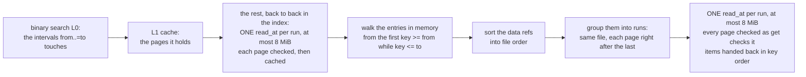

- `from > to` is an empty list at once, reading nothing. `from_slot > to_slot` is every key in the range
  with no items, reading no data page. A range between keys, or of an empty archive, is empty.
- **L1 pages** come from the L1 cache when it holds them, as `get`'s do. The ones it does not hold, and
  that lie back to back in the index, are read in RUNS: one `read_at` up to 8 MiB, each page decoded and
  checked as a read of it alone is — its span included — and inserted into the cache. A page's size is
  known only once it is read, so a page is taken to follow the one before it when it starts at most one
  default page length (`DEFAULT_L1_PAGE_BYTES` = 16 KiB) after it: in a compact index, whose pages are at
  most 16 KiB but for a key too long for one, exactly the pages back to back. A page chained to a
  continuation, or longer than its run's read, is loaded on its own. A wide range of a compact archive
  costs a handful of index reads, and the same range again, with a cache that holds its pages, none. In a
  working index, where pages lie in the order they were allocated, fewer pages share a read.
- **Data pages** are read in FILE order, never through the data page cache and never filling it: the refs
  are sorted by `(file_no, offset)`, the pages that follow one another in one data file come in one
  `read_at`, up to 8 MiB a read, and the items are handed back in key order. A contiguous range of a
  compact archive is a handful of reads, and so is a dense range of a working archive — whose pages lie in
  the order their keys first arrived — whatever that order was. A sparse range of a working archive still
  costs about a read per key: its pages have gaps between them. A page chained to a continuation is read
  on its own.
- A failed read or a damaged page anywhere in the range is `Err` — never a partial `Ok`.
- Memory: every key of the range with `(to_slot − from_slot + 1) × size_of::<TItem>()` of items, plus one
  run of at most 8 MiB at a time.

### Every key that starts with a prefix

Keys compare by `Ord`, and a range is two keys, not a prefix. For a key whose `Ord` is the order of its
bytes — `Vec<u8>`, `String`, a byte slice — `last_key_starting_with(prefix)` gives the upper bound:

```text
from = prefix
to   = prefix · 0xFF … 0xFF        MAX_VARIABLE_KEY_LEN = 32 767 bytes in all
```

`from ..= to` is then EXACTLY every key that starts with `prefix`, of any length:

- a key that starts with `prefix` has at most `32 767 − len(prefix)` bytes after it, and those sort at or
  below as many `0xFF`s;
- a key at or above `prefix` that does not start with it differs from it first at a greater byte, and so
  sorts past every key that does.

A prefix longer than 32 767 bytes is a `ContractViolation`. The bound is compared, never stored, and a
comparison stops at the first byte that differs.

A SHORTER run of `0xFF` is not that bound. `prefix ..= prefix + [0xFF; n]` holds only keys that start with
`prefix`, but it says nothing about length and it is not all of them:

| keys | `node/ ..= node/ + [0xFF; 1]` | `node/ ..= last_key_starting_with("node/")` |
|---|---|---|
| `node.`, `node0` | no | no |
| `node/`, `node/a`, `node/ab`, `node/abcdefgh` | yes — `node/ab` is 2 bytes past the prefix, `node/abcdefgh` 8 | yes |
| `node/` `FF 01` | **no** — its first byte past the prefix is `FF`, and it goes on | yes |

For a key whose `Ord` is NOT its bytes' order, the bound means nothing: build the range from what `Ord`
compares.

## SingleFile format (`…SingleFile` structures)

### The leaves

Every offset is an absolute `u64` from the start of the file. `P` below is a length prefix followed by
the key bytes.

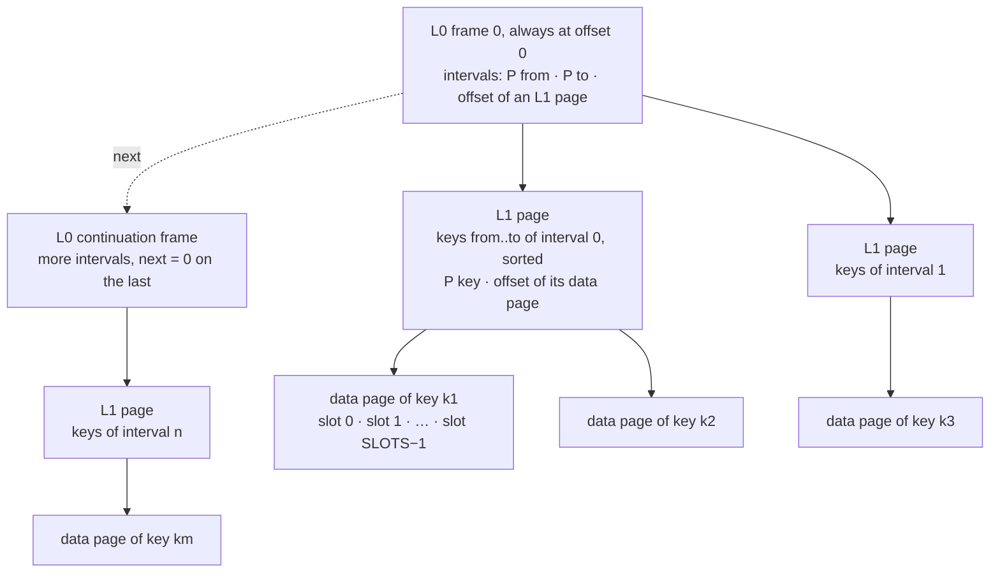

| Frame | Header | Body |
|---|---|---|
| **L0** | `size u32` · `next u64` · `count u32`: 16 bytes | `count` × (`P from` · `P to` · `offset u64`), then zeros up to `size` |
| **L1** | `size u32` · `count u32`: 8 bytes | `count` × (`P key` · `offset u64`), ascending, then zeros up to `size` (working file only) |
| **data** | `size u32` · `next u64` (always 0) · `item_len u16`: 14 bytes | `SLOTS` × `ITEM_LEN` (shared with the fixed module) |

- `size` is the whole frame or page, including its header.
- **L0 is a CHAIN** (the crate root's `l0_chain.rs`). Frame 0 is at offset 0, and `next` is the absolute
  offset of the continuation, `0` on the last frame. A continuation always lies past the end of the
  frame pointing at it. A `next` into frame 0, back into an earlier frame, in a cycle, or past the end
  of the file is `Corrupted`. So are intervals that are not ordered and disjoint across the WHOLE chain.
- An L1 page's keys must be strictly ascending, and its first and last keys must equal its interval's
  `from` and `to`. Otherwise it is `Corrupted`, because a binary search would answer "absent" for a key
  that is there.
- **The number of keys is the sum of the `count` fields of every L1 header**. Nothing stores it
  separately.

### Two shapes of one format

#### Working file: written in any key order

`VariableKeyPreallocatedSlotsArchiveWriterSingleFile` over a local `AsyncRead + AsyncWrite + AsyncSeek`.

| Constructor | L0 frame | L1 page |
|---|---|---|
| `new(sink)` | `DEFAULT_L0_FRAME_BYTES` = 64 KiB | `DEFAULT_L1_PAGE_BYTES` = 16 KiB |
| `new_with_capacity(sink, l0_frame_bytes, l1_page_bytes)` | in **bytes**, header included | in **bytes**, header included |

Both sizes are in BYTES. `l0_frame_bytes` is the size of each L0 FRAME, not a limit on L0.

Frame 0 is reserved at offset 0. L1 pages and data pages are appended after it **in the order they were
allocated**, mixed. When L0 outgrows the frames it has, a flush allocates continuation frames of the
same size at the END of the file. Each flush lays L0 across the chain in order: frame 0, then the
continuations already allocated, then new ones only if needed. A continuation is never given back.

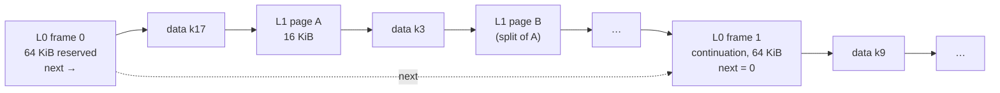

A new key:

1. finds its interval, the last one with `from <= key`;
2. gets a data page appended at the end, filled with `Default`;
3. is inserted, sorted, into that interval's L1 page;
4. if the page's entries no longer fit it, **the page is split by bytes**. The left page keeps entries
   in key order while the next one still fits. The rest moves to a new L1 page appended at the end, and
   a new L0 interval is inserted right after the old one.

A known key has its item written into its slot in place.

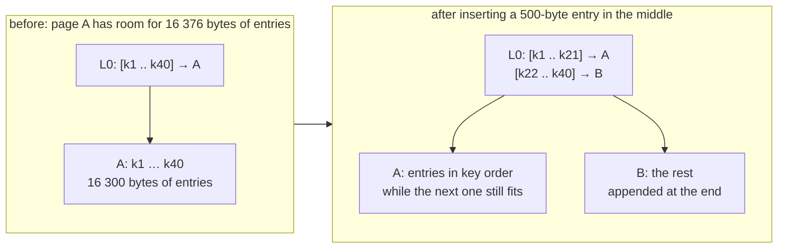

**The half-page rule.** One L1 entry is `prefix + key + 8` bytes, where the prefix is 1 byte below 128
and 2 bytes otherwise. The writer refuses a key whose entry is more than half the room a page has for
entries, header included in the accounting:

```text
entry = (key_len < 128 ? 1 : 2) + key_len + 8
accepted  ⇔  2 × entry ≤ l1_page_bytes − 8
```

A refused key is a `ContractViolation` ("key too large"), returned before anything is written. With the
default 16 KiB page, an entry may be `(16384 − 8) / 2 = 8188` bytes, so the largest key is 8 178 bytes.

This rule is what makes every split produce **exactly two pages that fit**:
- Before the insert the page's entries fit in `room = l1_page_bytes − 8`, and the new entry is at most
  `room / 2`, so the total is at most `1.5 × room`.
- The left page stops only when the next entry would pass `room`. That entry is at most `room / 2`, so
  the left page holds more than `room / 2`.
- That leaves less than `room` for the right page.

**Sizes checked at construction** (a panic, like the fixed module's capacity checks):

- an L1 page must hold two entries of a one-byte key: `l1_page_bytes ≥ 8 + 2 × 10`;
- an L0 frame must hold one interval of the largest key such a page accepts:
  `l0_frame_bytes ≥ 16 + 2 × min((l1_page_bytes − 8) / 2 − 8, 2 + 32767) + 8`. With 16 KiB pages
  that is 16 384 bytes;
- both sizes must fit a `u32`.

So an L0 interval always fits a frame on its own. L0 never refuses a split: an interval that does not
fit the current frames becomes one more continuation at the next flush.

**Caches.** L1 pages and data pages are kept in bounded LRU caches, as in the fixed writer:
- The defaults are `DEFAULT_WRITER_L1_CACHE_PAGES` = 64 and `DEFAULT_WRITER_DATA_CACHE_PAGES` = 1024;
  change them with `set_l1_cache_size` and `set_data_cache_size`.
- A page reaches the sink when it is evicted or on `flush`. An item for a data page that is not cached
  goes straight to the sink.

Nothing written is durable until `flush` / `finish` returns `Ok`. A flush writes dirty L1 pages first, then
data pages, then every frame of the L0 chain, then flushes the sink. A file whose writer stopped anywhere
else is in no defined state: between two flushes, the pages evicted since the last one were already
rewritten in place under an L0 that does not describe them, so such a file may open and answer what no
flush saved — the SingleFile format has no hash to refuse it with. An `Err` on the way (other than a
refused key or slot) leaves the file unusable; it is a temporary file and is rebuilt.

#### Compact file: the one that is kept

`VariableKeyPreallocatedSlotsArchiveReaderSingleFile::write_compacted_to` streams it from any readable file of
this format:

- **L0 is ONE frame of exact size**, `next = 0`, whatever chain the source had.
- **L1 pages have exact size**: no zero padding and no end marker, so `size = 8 + Σ entries`. A page
  closes at `COMPACT_L1_MAX_KEYS` = 1024 keys, or before the entry that would take it past
  `COMPACT_L1_PAGE_BYTES` = 16 KiB, whichever comes first.
  - This keeps a page small: one page is found through L0, fits the cache, and keeps its binary search
    short.
  - A page that is still empty takes any entry. A working file written with larger L1 pages may hold a
    key whose entry alone passes 16 KiB (up to `8 + 2 + 32767 + 8` bytes), and that key gets a page of
    its own.
- **Data pages** follow in ascending key order, copied raw.

Every offset is absolute. Key bytes are copied from the source's raw bytes, never re-encoded through
the trait.

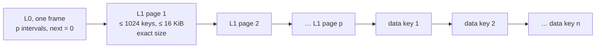

```text
compacted_len = 16 + Σ over pages (P(from) + P(to) + 8)          L0
              + Σ over pages (8 + Σ over its keys (P(key) + 8))   L1
              + n × (14 + SLOTS × ITEM_LEN)                        data

P(k) = (len(k) < 128 ? 1 : 2) + len(k)
```

Keys vary in size, so `compacted_len` is a pass over every L1 page of the source. The stream itself
takes three passes, none through the caches:

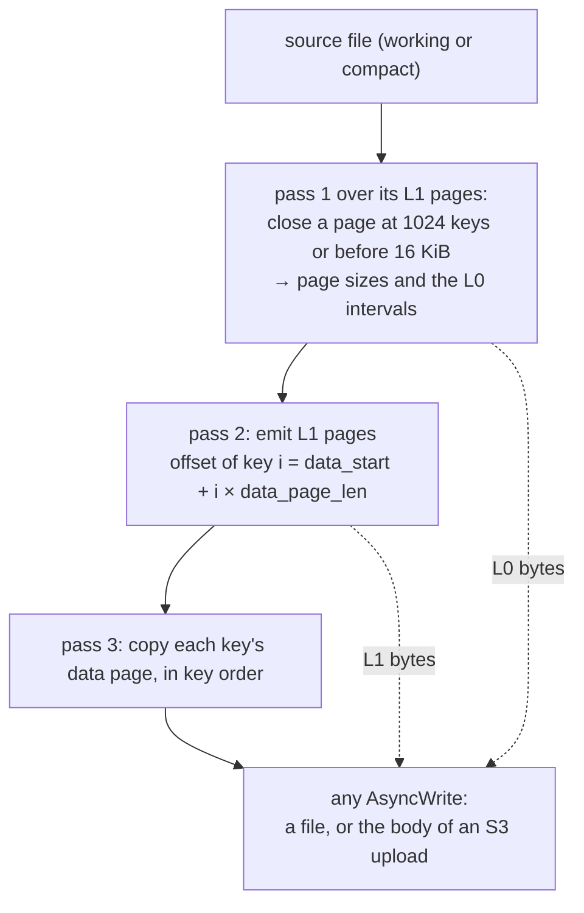

Pass 1 knows every page's size, so every offset is known before the first data byte is written, and
the stream needs no seek. If a later pass does not agree with pass 1, the source changed underneath and
the result is `Corrupted`.

The output is **deterministic**: the same keys and items give the same bytes, whatever order they were
written in and whatever page sizes the working file used. Memory is L0 plus the page plan plus one L1
page plus one data page. `out` is neither flushed nor shut down: the caller owns it, and can run the
whole stream again for a retry.

### Reading

`VariableKeyPreallocatedSlotsArchiveReaderSingleFile` reads a working file or a compact one:
- the source is any `AsyncRead + AsyncSeek`: `tokio::fs::File`, or an `S3Reader` whose every read is
  one ranged GET;
- concurrent callers share it through an `Arc`.

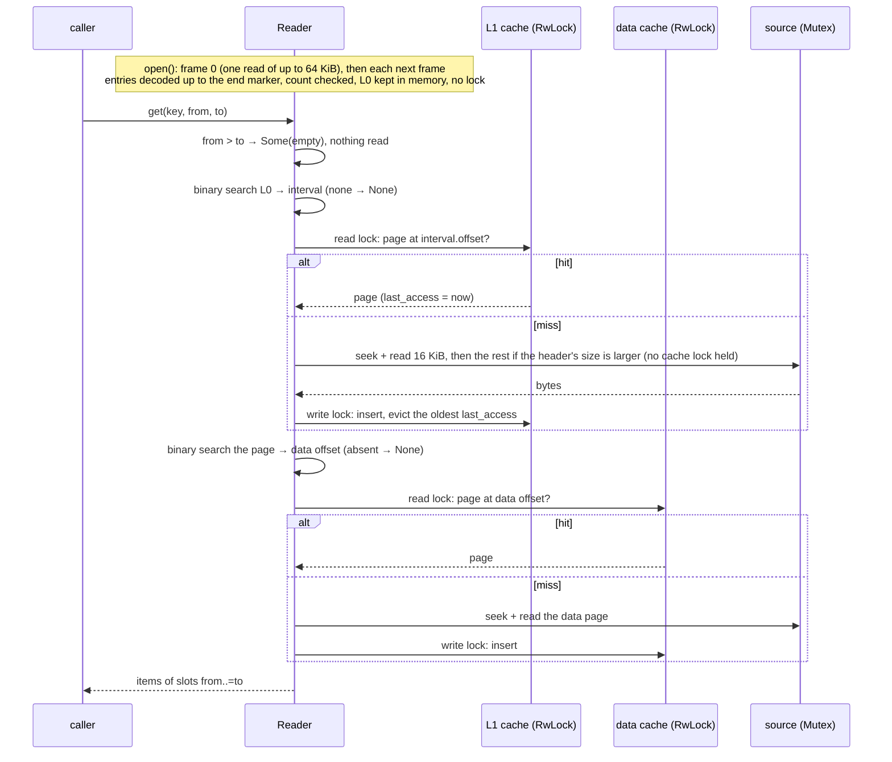

- **`get(key, from, to)`** returns the items of slots `from..=to`, inclusive, in slot order; `from == to`
  is one item.
  - A slot never written reads back as `Default`.
  - A key the file does not hold is `Ok(None)`.
  - `from > to` is `Ok(Some(empty))` at once, without reading, so it says nothing about whether the
    key is there.
  - A failed read or a corrupted page is `Err`, never `None`.
- **`keys_count`** is the sum of the L1 header counts: one small uncached read per L1 page.
- **Two caches, each under its own `RwLock`**: L1 pages and data pages, 10 each by default
  (`DEFAULT_READER_L1_CACHE_PAGES`, `DEFAULT_READER_DATA_CACHE_PAGES`; change them with
  `set_l1_cache_size` and `set_data_cache_size`).
  - A hit only stamps the page's `last_access: AtomicDateTimeAsMicroseconds` under the READ lock, so
    callers of cached pages never wait on each other.
  - A miss reads the source with no cache lock held. It takes the WRITE lock only to insert, dropping
    its own copy if somebody inserted the page meanwhile, and evicts the page with the oldest
    `last_access`.
- **The source is one position**, so its seek + read is under a mutex: misses of one file go one at a
  time. Two files are two readers and do not wait on each other.
- **Not cancel-safe over a source that keeps a read in flight.** Dropping a `get`, `keys_count` or
  `write_compacted_to` half way through an `S3Reader` request leaves the reader mid-request, and the
  next caller's seek fails. A caller that can be dropped, such as a request handler, should run the
  call in a task of its own. `tokio::fs::File` is not affected.
